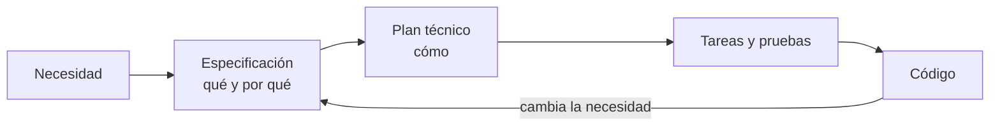

# SDD: desarrollo guiado por especificaciones

Con un asistente de IA es muy fácil generar código rápido. Lo difícil es conseguir que ese código siga haciendo, dentro de unas semanas, exactamente lo que queríamos.

Este repositorio es una introducción práctica a **SDD (*Spec-Driven Development*)**: una forma de trabajar en la que primero dejamos claro qué queremos construir y por qué, y después usamos esa especificación para guiar el plan, las tareas, las pruebas y el código.

No hace falta saber programar para empezar.



La idea no es escribir documentación por escribir. Es evitar que las decisiones importantes terminen escondidas en un chat o en una línea de código.

## ¿Qué vas a aprender?

Al recorrer el material aprenderás a:

- distinguir *vibe coding* de un desarrollo guiado por especificaciones;
- escribir una especificación que negocio y tecnología puedan entender;
- redactar requisitos claros con **EARS**;
- separar el **qué y por qué** del **cómo** técnico;
- pasar de una especificación a un plan y una lista de tareas;
- usar un asistente de IA sin delegarle las decisiones importantes;
- saber dónde corregir cuando algo falla: especificación, plan o implementación.

## Empieza por aquí

No hace falta leer el repositorio entero.

### Quiero entender SDD

1. [El problema del *vibe coding*](docs/01-el-problema-del-vibe-coding.md)
2. [Qué es SDD](docs/02-que-es-sdd.md)
3. [El flujo paso a paso](docs/03-el-flujo-paso-a-paso.md)

Con esos tres capítulos ya tienes la idea principal.

### Quiero aprender a escribir buenas especificaciones

1. [Qué es SDD](docs/02-que-es-sdd.md)
2. [Los artefactos](docs/04-los-artefactos.md)
3. [Escribir requisitos claros con EARS](docs/05-escribir-requisitos-claros-ears.md)
4. [Ejercicio 01: tu primera especificación](ejercicios/01-tu-primera-especificacion-sin-codigo.md)
5. [Ejercicio 02: practicar requisitos EARS](ejercicios/02-practicar-requisitos-ears.md)

### Quiero construir algo con Spec Kit

1. [Preparar el entorno](ejercicios/00-preparacion-del-entorno.md)
2. [El flujo paso a paso](docs/03-el-flujo-paso-a-paso.md)
3. [ReservaSalas paso a paso con Spec Kit](ejercicios/03-reserva-salas-paso-a-paso.md)
4. [Reto final: tu propio proyecto](ejercicios/06-reto-final-tu-propio-proyecto.md)

## El ejemplo que usamos: ReservaSalas

Todo el curso gira alrededor del mismo caso para no cambiar de contexto constantemente.

**ReservaSalas** es una pequeña aplicación interna para reservar las doce salas de reuniones de una empresa. Hoy las reservas se gestionan en una hoja compartida y aparecen problemas bastante normales: solapamientos, reservas fantasma, horarios mal entendidos y reglas que nadie recuerda haber decidido.

Ana, responsable de Oficina, plantea la necesidad. Luis la construye con ayuda de un asistente de IA. Marta y Jorge representan a quienes la usan y revisan.

A partir de ese ejemplo veremos cómo una petición bastante vaga:

> «Necesitamos algo para reservar salas.»

termina convertida en requisitos como:

> **SI** una franja se solapa con otra reserva de la misma sala, **ENTONCES** el sistema deberá rechazarla e indicar qué franja está ocupada.

Y después en un plan, tareas, pruebas y código.

La solución completa está en [ejercicios/soluciones/03-reserva-salas](ejercicios/soluciones/03-reserva-salas/README.md).

## El flujo que seguimos

En este curso trabajamos con siete pasos:

| Paso | Pregunta que responde |
|---|---|
| **0. Constitución** | ¿Qué reglas del proyecto no queremos romper? |
| **1. Especificar** | ¿Qué queremos construir y por qué? |
| **2. Aclarar** | ¿Qué decisiones siguen abiertas? |
| **3. Planificar** | ¿Cómo lo vamos a construir? |
| **4. Trocear** | ¿Qué trabajo concreto hay que hacer? |
| **5. Analizar** | ¿Todo encaja antes de empezar a programar? |
| **6. Implementar** | ¿El resultado cumple lo que acordamos? |

La explicación completa está en [El flujo paso a paso](docs/03-el-flujo-paso-a-paso.md).

## Tres formas de entender SDD

No todos los equipos usan la especificación con la misma intensidad.

- **Spec-first:** se escribe antes de construir.
- **Spec-anchored:** se mantiene como referencia durante la evolución del producto.
- **Spec-as-source:** se utiliza como fuente principal para regenerar otros artefactos y partes de la implementación.

Este curso se mueve sobre todo entre **spec-anchored** y **spec-as-source**.

Eso no significa que todo problema obligue a regenerar el sistema entero. Si cambia una necesidad, empezamos por la especificación. Si la especificación es correcta y el programa no la cumple, tenemos un bug y se corrige la implementación.

## Qué hay en el repositorio

```text
charla-sdd/
├── docs/          conceptos, flujo, artefactos, roles y buenas prácticas
├── diagramas/     el mismo contenido explicado de forma visual
├── ejercicios/    práctica guiada
│   ├── plantillas/
│   └── soluciones/
└── README.md
```

### Documentación

La teoría está en [docs/](docs/README.md). Los capítulos principales son:

- [01 · El problema del vibe coding](docs/01-el-problema-del-vibe-coding.md)
- [02 · Qué es SDD](docs/02-que-es-sdd.md)
- [03 · El flujo paso a paso](docs/03-el-flujo-paso-a-paso.md)
- [04 · Los artefactos](docs/04-los-artefactos.md)
- [05 · Escribir requisitos claros con EARS](docs/05-escribir-requisitos-claros-ears.md)
- [06 · Roles: quién hace qué](docs/06-roles-quien-hace-que.md)
- [07 · Herramientas](docs/07-herramientas.md)
- [08 · Buenas prácticas y errores comunes](docs/08-buenas-practicas-y-errores-comunes.md)
- [09 · Preguntas frecuentes](docs/09-preguntas-frecuentes.md)
- [10 · Glosario](docs/10-glosario.md)

### Ejercicios

Si quieres aprender de verdad el método, entra pronto en [ejercicios/](ejercicios/README.md). Hay ejercicios sin código, una dinámica para equipos y un recorrido completo con Spec Kit.

### Diagramas

En [diagramas/](diagramas/README.md) tienes el flujo, los roles, los artefactos y EARS representados visualmente. También hay versiones SVG y PNG para reutilizarlas en presentaciones.

## Herramientas

SDD no depende de una herramienta concreta.

En el curso usamos principalmente:

- **GitHub Spec Kit**, para recorrer el flujo desde el asistente de programación;
- **Kiro**, como ejemplo de editor que incorpora un enfoque parecido;
- las **plantillas del propio repositorio**, si quieres practicar sin instalar nada.

La comparación está en [Herramientas](docs/07-herramientas.md).

## Una última idea

El objetivo de SDD no es producir más documentos.

Es poder responder, meses después, a una pregunta muy sencilla:

**«¿Por qué el sistema hace esto?»**

y que la respuesta no sea:

**«Porque salió así.»**

---

Si quieres empezar ahora, ve a [El problema del *vibe coding*](docs/01-el-problema-del-vibe-coding.md).

Para proponer mejoras al material, consulta [CONTRIBUIR.md](CONTRIBUIR.md).
