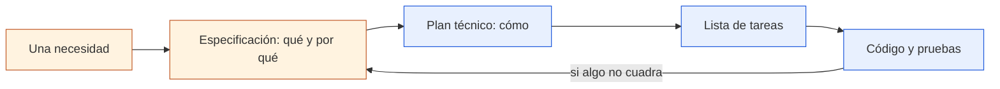

# SDD: desarrollo guiado por especificaciones

> **Para quién:** toda la empresa, sepa programar o no · **Tiempo de lectura:** ~5 min · **Nivel:** 🟢 básico

Este repositorio acompaña a una charla introductoria sobre SDD (*Spec-Driven Development*, desarrollo guiado por especificaciones). La idea de fondo es sencilla: antes de pedir código a un asistente de IA, dejamos por escrito qué queremos construir, por qué y qué condiciones debe cumplir.

No hace falta saber programar para seguir el material. Hay explicaciones cortas, diagramas y ejercicios para practicar el proceso desde una petición inicial hasta el plan, las tareas y el código.



De izquierda a derecha: una necesidad se convierte primero en una especificación que cualquiera puede leer; de ella salen el plan técnico, la lista de tareas y, al final, el código. Si el resultado no es el que se quería, no se parchea el código a ciegas: se corrige la especificación y se vuelve a generar lo que depende de ella.

**Qué vas a encontrar**

- [SDD en un minuto](#sdd-en-un-minuto)
- [Empieza por aquí](#empieza-por-aquí)
- [Rutas de lectura por perfil](#rutas-de-lectura-por-perfil)
- [Mapa del repositorio](#mapa-del-repositorio)
- [Índice completo](#índice-completo)
- [El ejemplo de todo el material: ReservaSalas](#el-ejemplo-de-todo-el-material-reservasalas)
- [Cómo ver los diagramas](#cómo-ver-los-diagramas)
- [Cómo contribuir](#cómo-contribuir)
- [Sobre este material](#sobre-este-material)

## SDD en un minuto

Con un asistente de IA podemos generar código muy deprisa. El problema aparece cuando empezamos a encadenar instrucciones sin haber dejado claro qué queríamos construir. Al principio funciona; unas cuantas iteraciones después cuesta recordar qué decisiones eran intencionadas y cuáles aparecieron por el camino.

SDD intenta evitar eso cambiando el orden. Primero escribimos la especificación: qué debe hacer el sistema, para quién y cómo sabremos que está bien. Después vienen el plan técnico, las tareas y el código. El asistente ayuda en todo el recorrido, pero las decisiones siguen siendo nuestras.

En este curso trabajamos con la especificación como referencia principal del comportamiento esperado. Si cambia una necesidad, el cambio empieza ahí y después se actualiza lo que dependa de ella. [Qué es SDD](docs/02-que-es-sdd.md) desarrolla esta idea con un ejemplo completo.

## Empieza por aquí

| Si quieres… | Empieza por | Y sigue con |
|---|---|---|
| 🧭 Entender SDD y decidir si tu equipo lo prueba | [El problema del *vibe coding*](docs/01-el-problema-del-vibe-coding.md) | [Roles: quién hace qué](docs/06-roles-quien-hace-que.md) y la [dinámica de equipo](ejercicios/04-dinamica-de-equipo-20-minutos.md) |
| ✍️ Escribir y revisar lo que pides | [El problema del *vibe coding*](docs/01-el-problema-del-vibe-coding.md) | [Escribir requisitos claros (EARS)](docs/05-escribir-requisitos-claros-ears.md) y el [ejercicio 01](ejercicios/01-tu-primera-especificacion-sin-codigo.md) |
| 🛠️ Construir con SDD desde cero | [Qué es SDD](docs/02-que-es-sdd.md) | El [ejercicio 00](ejercicios/00-preparacion-del-entorno.md) para preparar el entorno y el [ejercicio 03](ejercicios/03-reserva-salas-paso-a-paso.md) para construir ReservaSalas |

Si solo tienes cinco minutos, lee [SDD en un minuto](#sdd-en-un-minuto) y mira [*Vibe coding* frente a SDD](diagramas/01-vibe-coding-vs-sdd.md).

## Rutas de lectura por perfil

No hace falta leerlo todo. Elige tu camino según lo que quieras hacer:

| Ruta | Qué leer y hacer, en este orden | Tiempo |
|---|---|---|
| Entender SDD y decidir si tu equipo lo prueba | Docs [01](docs/01-el-problema-del-vibe-coding.md) y [02](docs/02-que-es-sdd.md) → diagramas [01](diagramas/01-vibe-coding-vs-sdd.md) y [02](diagramas/02-flujo-completo-sdd.md) → doc [06](docs/06-roles-quien-hace-que.md) → docs [08](docs/08-buenas-practicas-y-errores-comunes.md) y [09](docs/09-preguntas-frecuentes.md) → [ejercicio 01](ejercicios/01-tu-primera-especificacion-sin-codigo.md) → [dinámica de 20 minutos](ejercicios/04-dinamica-de-equipo-20-minutos.md) con tu equipo | Unas 3 h, en dos o tres ratos |
| Escribir y revisar lo que pides | Docs [01](docs/01-el-problema-del-vibe-coding.md) y [02](docs/02-que-es-sdd.md) → [diagrama 01](diagramas/01-vibe-coding-vs-sdd.md) → docs [05](docs/05-escribir-requisitos-claros-ears.md) y [06](docs/06-roles-quien-hace-que.md) → ejercicios [01](ejercicios/01-tu-primera-especificacion-sin-codigo.md) y [02](ejercicios/02-practicar-requisitos-ears.md), con el [glosario](docs/10-glosario.md) a mano | Unas 3 h, en dos o tres ratos |
| Construir con SDD desde cero | Docs [01 a 10](docs/README.md) → diagramas [01 a 06](diagramas/README.md) → ejercicios [00](ejercicios/00-preparacion-del-entorno.md), [02](ejercicios/02-practicar-requisitos-ears.md), [03](ejercicios/03-reserva-salas-paso-a-paso.md), [05](ejercicios/05-arreglar-una-especificacion-mala.md) y [06](ejercicios/06-reto-final-tu-propio-proyecto.md) | 10-12 h, en varios días |
| Ir al grano si ya trabajas con un asistente de IA | Doc [02](docs/02-que-es-sdd.md) → docs [03](docs/03-el-flujo-paso-a-paso.md) y [04](docs/04-los-artefactos.md) → diagramas [02](diagramas/02-flujo-completo-sdd.md) y [03](diagramas/03-artefactos-y-relaciones.md) → docs [07](docs/07-herramientas.md) y [08](docs/08-buenas-practicas-y-errores-comunes.md) → ejercicios [03](ejercicios/03-reserva-salas-paso-a-paso.md) y [06](ejercicios/06-reto-final-tu-propio-proyecto.md) | 6-8 h |

Las mismas rutas, dibujadas paso a paso, están en el [mapa del repositorio](diagramas/06-mapa-del-repositorio.md#itinerarios-por-perfil).

## Mapa del repositorio

```text
charla-sdd/
├── README.md               ← estás aquí
├── CONTRIBUIR.md           cómo proponer mejoras al material
├── docs/                   la teoría: diez documentos en lenguaje llano
├── diagramas/              lo mismo, con dibujos
│   ├── svg/                cada diagrama en SVG, para presentaciones y documentos
│   └── png/                cada diagrama en PNG, para Google Slides o el correo
└── ejercicios/             la práctica: siete ejercicios guiados
    ├── plantillas/         los documentos de SDD en blanco, listos para copiar
    └── soluciones/         respuestas de los ejercicios
        └── 03-reserva-salas/   el ejemplo completo de ReservaSalas
```

El [mapa del repositorio](diagramas/06-mapa-del-repositorio.md) dibuja todas las carpetas con sus ficheros.

## Índice completo

### Documentación ([docs/](docs/README.md))

1. [El problema del *vibe coding*](docs/01-el-problema-del-vibe-coding.md): qué pasa cuando se programa con un asistente de IA sin un texto que diga qué hay que hacer.
2. [Qué es SDD](docs/02-que-es-sdd.md): la idea, qué es y qué no es, con un ejemplo corto de especificación.
3. [El flujo paso a paso](docs/03-el-flujo-paso-a-paso.md): los siete pasos, quién participa y qué deja escrito cada uno.
4. [Los artefactos](docs/04-los-artefactos.md): los documentos que produce SDD y para qué sirve cada uno.
5. [Escribir requisitos claros (EARS)](docs/05-escribir-requisitos-claros-ears.md): cinco plantillas de frase para que un requisito no se pueda malinterpretar.
6. [Roles: quién hace qué](docs/06-roles-quien-hace-que.md): qué hace cada rol en cada paso.
7. [Herramientas](docs/07-herramientas.md): Spec Kit, Kiro o sin herramientas.
8. [Buenas prácticas y errores comunes](docs/08-buenas-practicas-y-errores-comunes.md): lo que funciona y lo que suele salir mal.
9. [Preguntas frecuentes](docs/09-preguntas-frecuentes.md): 27 preguntas agrupadas por tema.
10. [Glosario](docs/10-glosario.md): 62 términos en lenguaje llano.

### Diagramas ([diagramas/](diagramas/README.md))

1. [*Vibe coding* frente a SDD](diagramas/01-vibe-coding-vs-sdd.md): los dos caminos, uno al lado del otro.
2. [Flujo completo de SDD](diagramas/02-flujo-completo-sdd.md): los siete pasos, sus ficheros, quién participa y los bucles de vuelta.
3. [Artefactos y relaciones](diagramas/03-artefactos-y-relaciones.md): cómo se alimentan los documentos entre sí y dónde vive cada uno.
4. [Roles y participación](diagramas/04-roles-y-participacion.md): quién lidera y quién revisa en cada paso.
5. [Anatomía de un requisito EARS](diagramas/05-anatomia-de-un-requisito-ears.md): las piezas de un buen requisito y cómo elegir la plantilla.
6. [Mapa del repositorio](diagramas/06-mapa-del-repositorio.md): todo el contenido y los itinerarios de lectura.

Todos están también como imagen en [svg/](diagramas/svg/README.md) y [png/](diagramas/png/README.md).

### Ejercicios ([ejercicios/](ejercicios/README.md))

0. [Preparación del entorno](ejercicios/00-preparacion-del-entorno.md): lo que necesitas, con o sin instalar nada.
1. [Tu primera especificación sin código](ejercicios/01-tu-primera-especificacion-sin-codigo.md): la solicitud de vacaciones, con una plantilla (60-90 min).
2. [Practicar requisitos EARS](ejercicios/02-practicar-requisitos-ears.md): de frases vagas a requisitos claros (30 min).
3. [ReservaSalas paso a paso con Spec Kit](ejercicios/03-reserva-salas-paso-a-paso.md): el flujo completo con una herramienta real (90-120 min).
4. [Dinámica de equipo de 20 minutos](ejercicios/04-dinamica-de-equipo-20-minutos.md): en grupo y sin ordenador.
5. [Arreglar una especificación mala](ejercicios/05-arreglar-una-especificacion-mala.md): encontrar los problemas y reescribirla (30-40 min).
6. [Reto final: tu propio proyecto](ejercicios/06-reto-final-tu-propio-proyecto.md): un problema real tuyo, de principio a fin (3-4 h).

Además: las [plantillas](ejercicios/plantillas/README.md) de los seis documentos de SDD y las [soluciones](ejercicios/soluciones/README.md), con el [ejemplo completo de ReservaSalas](ejercicios/soluciones/03-reserva-salas/README.md).

## El ejemplo de todo el material: ReservaSalas

Todos los documentos usan el mismo caso, para que lo reconozcas de uno a otro. La empresa tiene doce salas de reuniones repartidas en tres plantas, con nombres de mares (Mediterráneo, Cantábrico, Atlántico…). Hoy se reservan en una hoja de cálculo compartida y hay choques, salas que se quedan vacías y reservas que nadie sabe de quién son. Ana, responsable de Oficina, encarga una pequeña aplicación interna; Luis, programador junior, la construye con un asistente de IA siguiendo SDD; Marta, manager, y Jorge, de RRHH, son quienes la usan y la revisan.

Hay además un segundo ejemplo sin código: la solicitud de vacaciones (una persona pide días, su manager aprueba o rechaza y RRHH lo registra). Todos los personajes y datos son ficticios.

## Cómo ver los diagramas

Los diagramas están escritos en Mermaid y GitHub los dibuja solo: abre cualquier fichero en GitHub y los verás como imágenes, sin instalar nada. Para una presentación, usa las imágenes de [diagramas/svg/](diagramas/svg/README.md) (PowerPoint, Keynote, documentos) o de [diagramas/png/](diagramas/png/README.md) (Google Slides, correo, chats).

## Cómo contribuir

Si algo no se entiende, falta un ejemplo o un comando ha cambiado, cuéntalo. Puedes abrir una incidencia, editar desde la web de GitHub o proponer un cambio. Todo está explicado, con la guía de estilo resumida, en [CONTRIBUIR.md](CONTRIBUIR.md).

## Sobre este material

Es material interno de formación. Lo mantiene [equipo o persona responsable del material]; para dudas y propuestas, escribe a [buzón o canal de contacto]. Si no tienes cuenta en GitHub, pide a IT acceso de lectura al repositorio o pide al contacto las imágenes de los diagramas.

Los ejemplos y sus personajes son ficticios: no metas nunca datos reales de clientes ni de personas de la plantilla en un asistente de IA que la empresa no haya autorizado.

Las herramientas citadas pertenecen a sus autores y cambian a menudo, así que consulta siempre su documentación oficial: [GitHub Spec Kit](https://github.com/github/spec-kit) (con su [documentación](https://github.github.io/spec-kit/)) y [Kiro](https://kiro.dev). El formato de requisitos EARS (*Easy Approach to Requirements Syntax*) lo propusieron Alistair Mavin y otros autores en 2009.
