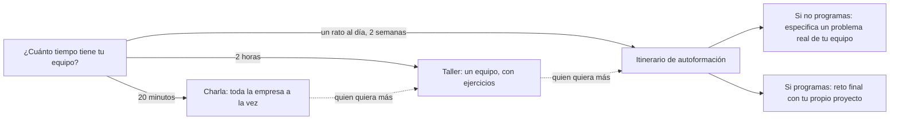

# Guía del facilitador

> **Para quién:** quien va a formar a un equipo con este repositorio: managers, RRHH, responsables de formación o cualquier persona que facilite (no hace falta programar) · **Tiempo de lectura:** ~15 min · **Nivel:** 🟢 básico

Esta guía explica cómo usar el repositorio para enseñar a un equipo SDD (*Spec-Driven Development*, desarrollo guiado por especificaciones): escribir primero qué se quiere y por qué, en vez de recurrir al *vibe coding* (programar a golpe de instrucciones sueltas, improvisando con el asistente de IA). Hay tres formatos (una charla de 20 minutos, un taller de 2 horas y un itinerario de autoformación de 2 semanas) y, para cada uno, tienes la agenda y los ficheros de cada tramo.

**Qué vas a encontrar**

- [Cómo usar este repositorio para formar a un equipo](#cómo-usar-este-repositorio-para-formar-a-un-equipo)
- [Tres formatos](#tres-formatos)
- [Formato 1: charla de 20 minutos](#formato-1-charla-de-20-minutos)
- [Formato 2: taller de 2 horas](#formato-2-taller-de-2-horas)
- [Formato 3: itinerario de autoformación de 2 semanas](#formato-3-itinerario-de-autoformación-de-2-semanas)
- [Preparar la sala o la sesión en línea](#preparar-la-sala-o-la-sesión-en-línea)
- [Adaptar al público](#adaptar-al-público)
- [Medir si ha funcionado](#medir-si-ha-funcionado)
- [Errores de facilitación habituales](#errores-de-facilitación-habituales)
- [Recoger mejoras al material](#recoger-mejoras-al-material)

## Cómo usar este repositorio para formar a un equipo

El repositorio se puede leer a solas, pero se aprende más en grupo y practicando. Tu papel no es saberlo todo, sino conducir: elegir el formato, preparar el material y conseguir que la gente practique más de lo que escucha.

| Carpeta | Qué contiene | Para qué la usas al formar |
|---|---|---|
| `docs/` | Diez documentos, del problema que resuelve SDD al glosario | Lectura previa y respuesta a las dudas, sobre todo las [preguntas frecuentes](../docs/09-preguntas-frecuentes.md) |
| `diagramas/` | Seis diagramas, del flujo completo a los roles | Proyectarlos y explicarlos en voz alta |
| `ejercicios/` | Siete ejercicios (del 00 al 06), plantillas y soluciones | La parte práctica: casi todo el tiempo de un taller |
| `charla/` | El [guion de 20 minutos](guion-20-minutos.md) y esta guía | Tu guion y tus agendas |

Tres reglas que valen para cualquier formato:

- **Practicar antes que explicar.** En el taller, más de dos tercios del tiempo son ejercicios. Si dudas entre explicar algo o dejar que lo descubran haciendo, elige lo segundo.
- **Un solo ejemplo.** Todo el material usa ReservaSalas, la aplicación interna para reservar salas de reuniones, y la Solicitud de vacaciones para lo que no lleva código. No cambies de ejemplo a mitad: la gente aprende el método porque ya conoce el caso.
- **Datos ficticios siempre.** Ni nombres de clientes ni datos de empleados en los ejercicios. Si usas un problema real del equipo, quítale antes los nombres y los datos.

Los artefactos que enseñarás están resueltos en la [solución del ejercicio 03](../ejercicios/soluciones/03-reserva-salas/README.md): la constitución (`constitution.md`), la especificación (`spec.md`), el plan técnico (`plan.md`) y la lista de tareas (`tasks.md`) de ReservaSalas.

Antes de facilitar por primera vez, recorre el [itinerario de quien facilita](../diagramas/06-mapa-del-repositorio.md#facilitador-de-la-charla-o-del-taller): esta carpeta, la [dinámica de equipo de 20 minutos](../ejercicios/04-dinamica-de-equipo-20-minutos.md) y los seis diagramas. Y haz tú los ejercicios que vayas a dirigir: es la única forma de saber dónde se atasca la gente.

## Tres formatos

| | Charla | Taller | Itinerario |
|---|---|---|---|
| **Duración** | 20 minutos | 2 horas | 2 semanas, de 30 a 60 minutos al día |
| **Para quién** | Toda la empresa a la vez | Un equipo de 6 a 24 personas | Quien quiera profundizar, a su ritmo |
| **Objetivo** | Entender qué es SDD y por qué importa | Practicar especificar, aclarar y revisar | Recorrer todo el material y aplicarlo a algo propio |
| **Ordenador** | Solo quien presenta | No hace falta (salvo en la variante técnica) | Sí; quien programa, con herramientas instaladas |
| **Material principal** | [Guion de 20 minutos](guion-20-minutos.md) | Ejercicios 04, 02 y 05 | Todo el repositorio |

Los formatos se encadenan. Este diagrama muestra cómo elegir el primero y cómo pasar de uno a otro.



De izquierda a derecha: el tiempo disponible decide el formato. La charla despierta el interés de toda la empresa; quien quiere más pasa al taller, y del taller, al itinerario. El itinerario termina con algo propio: la especificación de un problema real del equipo si no programas, o el reto final del [ejercicio 06](../ejercicios/06-reto-final-tu-propio-proyecto.md) si programas.

### Formato 1: charla de 20 minutos

Es la puerta de entrada: la charla «Pizza Day», abierta a toda la empresa. Todo lo que tienes que decir y enseñar está en el [guion](guion-20-minutos.md), bloque a bloque; esta es la agenda con los ficheros de cada tramo.

| Minuto | Tramo | Ficheros |
|---|---|---|
| 0-2 | Gancho: la reforma sin plano o la demo que se rompe | [Docs 01](../docs/01-el-problema-del-vibe-coding.md#la-reforma-sin-plano), solo para prepararlo |
| 2-5 | El problema del *vibe coding* | [Diagrama 01](../diagramas/01-vibe-coding-vs-sdd.md#los-dos-caminos-cara-a-cara) |
| 5-9 | Qué es SDD y los siete pasos | [Diagrama 02](../diagramas/02-flujo-completo-sdd.md#los-siete-pasos-y-sus-artefactos) |
| 9-12 | Los artefactos de ReservaSalas | [`spec.md`](../ejercicios/soluciones/03-reserva-salas/spec.md) y [`tasks.md`](../ejercicios/soluciones/03-reserva-salas/tasks.md) de la solución del ejercicio 03 |
| 12-16 | Mini-ejercicio: tres frases vagas convertidas en requisitos | [Ejercicio 04, versión de 4 minutos](../ejercicios/04-dinamica-de-equipo-20-minutos.md#variantes) y [tabla de patrones](../docs/05-escribir-requisitos-claros-ears.md#los-cinco-patrones-y-el-sexto) |
| 16-18 | Qué cambia para cada rol | [Diagrama 04](../diagramas/04-roles-y-participacion.md#matriz-de-roles-y-pasos) |
| 18-20 | Cierre, llamada a la acción y preguntas | [Itinerarios por perfil](../diagramas/06-mapa-del-repositorio.md#itinerarios-por-perfil) y [preguntas frecuentes](../docs/09-preguntas-frecuentes.md) |

Lleva preparadas las fechas del próximo taller para la diapositiva de cierre: son el puente al formato 2.

### Formato 2: taller de 2 horas

**Objetivo.** Al terminar, cada participante habrá escrito requisitos con EARS (*Easy Approach to Requirements Syntax*, una forma sencilla y estructurada de redactar requisitos), habrá formulado preguntas de aclaración y habrá revisado una especificación con ojo crítico. Es la parte de SDD que no necesita herramientas y en la que participa todo el equipo.

**Público.** De 6 a 24 personas, en grupos de 3 o 4 para la dinámica y en parejas para los ejercicios, mezclando perfiles.

**Preparación (la víspera):**

- Imprime una tarjeta y una plantilla por grupo de los [materiales de la dinámica](../ejercicios/04-dinamica-de-equipo-20-minutos.md#materiales-imprimibles).
- Copia, una por pareja, la especificación mala del paso 1 del [ejercicio 05](../ejercicios/05-arreglar-una-especificacion-mala.md) y la [constitución de ReservaSalas](../ejercicios/soluciones/03-reserva-salas/constitution.md), en papel o en un documento compartido.
- Ten lista para proyectar la [tabla de patrones EARS](../docs/05-escribir-requisitos-claros-ears.md#los-cinco-patrones-y-el-sexto).

| Hora | Tramo | Qué pasa | Ficheros |
|---|---|---|---|
| 0:00-0:12 | Apertura | Objetivo del taller y bloques 0-9 del guion, resumidos: gancho, *vibe coding*, SDD y sus siete pasos | [Guion](guion-20-minutos.md), [diagrama 01](../diagramas/01-vibe-coding-vs-sdd.md), [diagrama 02](../diagramas/02-flujo-completo-sdd.md) |
| 0:12-0:32 | Especificar en grupo | Dinámica completa: historias, requisitos, preguntas de aclaración y caza de vaguedades | [Ejercicio 04](../ejercicios/04-dinamica-de-equipo-20-minutos.md) |
| 0:32-1:02 | Requisitos claros | Ejercicio 02 por parejas, en papel (20 minutos), y comparación en común con la solución (10) | [Ejercicio 02](../ejercicios/02-practicar-requisitos-ears.md), [diagrama 05](../diagramas/05-anatomia-de-un-requisito-ears.md) |
| 1:02-1:12 | Pausa | — | — |
| 1:12-1:47 | Revisar una especificación | Ejercicio 05 por parejas mixtas, en papel y con la constitución al lado | [Ejercicio 05](../ejercicios/05-arreglar-una-especificacion-mala.md) |
| 1:47-1:55 | Los artefactos de verdad | De la petición de Ana a la tarea T013: especificación, lista de tareas y matriz de roles | [Solución del ejercicio 03](../ejercicios/soluciones/03-reserva-salas/README.md), [diagrama 04](../diagramas/04-roles-y-participacion.md#matriz-de-roles-y-pasos) |
| 1:55-2:00 | Cierre | Un compromiso por persona, rutas de lectura y encuesta | [Encuesta](#encuesta-de-cierre-5-preguntas) |

> [!WARNING]
> No enseñes la especificación de la solución antes de los ejercicios 02 y 05: contiene sus respuestas. Por eso, a diferencia de la charla, el recorrido por los artefactos de verdad va al final.

**Variantes:**

- **Grupo que empieza de cero:** cambia el ejercicio 05 por el [ejercicio 01](../ejercicios/01-tu-primera-especificacion-sin-codigo.md) (Solicitud de vacaciones; en el taller, los pasos 1 a 5, y el resto en casa): escribir una especificación propia, completa y sin código prepara mejor que revisar una ajena cuando todavía no se ha escrito ninguna.
- **Grupo técnico con el entorno instalado de antemano** (la vía B del [ejercicio 00](../ejercicios/00-preparacion-del-entorno.md), con GitHub Spec Kit, la herramienta de GitHub para seguir SDD con un asistente de IA): sustituye los ejercicios 02 y 05 por la primera sesión del [ejercicio 03](../ejercicios/03-reserva-salas-paso-a-paso.md), los pasos 0 a 7, hasta analizar. La implementación queda para una segunda sesión, como propone el propio ejercicio.
- **En línea:** usa la variante en línea de la [dinámica](../ejercicios/04-dinamica-de-equipo-20-minutos.md#variantes), con salas pequeñas y un documento compartido por grupo, y cuenta 25 minutos para ella en vez de 20: los cinco que faltan, quítalos de la apertura.

### Formato 3: itinerario de autoformación de 2 semanas

Diez días laborables, de 30 a 60 minutos al día, cada persona a su ritmo. Funciona mejor con dos encuentros cortos del grupo (días 5 y 10) y un canal de chat del equipo para las dudas. La columna «Leer» es para todos; la tarea práctica cambia según programes o no.

| Día | Tema | Leer | Si no programas | Si programas | Tiempo (aprox.) |
|---|---|---|---|---|---|
| 1 | El problema | [Docs 01](../docs/01-el-problema-del-vibe-coding.md), [diagrama 01](../diagramas/01-vibe-coding-vs-sdd.md) | Aplica las [tres preguntas](../docs/01-el-problema-del-vibe-coding.md#tres-preguntas-antes-de-aceptar-una-demo) a una herramienta que uses | Lo mismo | 25 min |
| 2 | Qué es SDD | [Docs 02](../docs/02-que-es-sdd.md), [diagrama 06](../diagramas/06-mapa-del-repositorio.md) | [Ejercicio 00](../ejercicios/00-preparacion-del-entorno.md), vía A | Ejercicio 00, vía B | 30-60 min |
| 3 | Primera especificación | — | [Ejercicio 01](../ejercicios/01-tu-primera-especificacion-sin-codigo.md) | Ejercicio 01 | 30 min |
| 4 | El flujo | [Docs 03](../docs/03-el-flujo-paso-a-paso.md), [diagrama 02](../diagramas/02-flujo-completo-sdd.md) | Sigue la [historia de ReservaSalas](../diagramas/02-flujo-completo-sdd.md#una-historia-de-reservasalas-paso-a-paso) y apunta quién hace qué | Lo mismo | 30-40 min |
| 5 | Requisitos claros | [Docs 05](../docs/05-escribir-requisitos-claros-ears.md), [diagrama 05](../diagramas/05-anatomia-de-un-requisito-ears.md) | [Ejercicio 02](../ejercicios/02-practicar-requisitos-ears.md) | Ejercicio 02 | 45 min y encuentro |
| 6 | Los artefactos | [Docs 04](../docs/04-los-artefactos.md), [diagrama 03](../diagramas/03-artefactos-y-relaciones.md) | [Ejercicio 05](../ejercicios/05-arreglar-una-especificacion-mala.md), vía A | Ejercicio 05, vía B | 50-60 min |
| 7 | Roles | [Docs 06](../docs/06-roles-quien-hace-que.md), [diagrama 04](../diagramas/04-roles-y-participacion.md) | Lee la [solución de ReservaSalas](../ejercicios/soluciones/03-reserva-salas/README.md) como lo haría Ana: constitución, especificación y aclaraciones | [Ejercicio 03](../ejercicios/03-reserva-salas-paso-a-paso.md), primera sesión (pasos 0 a 7) | 40-75 min |
| 8 | Herramientas | [Docs 07](../docs/07-herramientas.md) | La [variante con asistente de IA](../ejercicios/01-tu-primera-especificacion-sin-codigo.md#variante-con-asistente-de-ia-opcional-entre-los-pasos-7-y-8) del ejercicio 01, si la empresa tiene un chat de IA autorizado | Ejercicio 03, segunda sesión (pasos 8 a 10) | 30-75 min |
| 9 | Buenas prácticas | [Docs 08](../docs/08-buenas-practicas-y-errores-comunes.md) | Elige un problema real y pequeño de tu equipo y escribe su historia P1 con la [plantilla de especificación](../ejercicios/plantillas/especificacion.md) | Empieza el [ejercicio 06](../ejercicios/06-reto-final-tu-propio-proyecto.md) | 45 min |
| 10 | Cierre | [Docs 09](../docs/09-preguntas-frecuentes.md), [docs 10](../docs/10-glosario.md) | Encuentro final y encuesta | Lo mismo | 45 min |

- **Encuentro del día 5 (30 minutos):** cada persona lee en voz alta un requisito suyo del ejercicio 02 y el resto le caza una vaguedad, como en la dinámica. Después, dudas abiertas.
- **Encuentro del día 10 (45 minutos):** cada persona enseña en dos minutos su historia P1 o el avance de su reto final; después, la encuesta de cierre y qué hace el equipo a partir de ahora.

El orden difiere un poco de la ruta del programador junior de los [itinerarios por perfil](../diagramas/06-mapa-del-repositorio.md#itinerarios-por-perfil): aquí el ejercicio 05 va antes que el 03, para que todo el equipo lo haga la misma semana y antes de leer entera la especificación de la solución, que contiene sus respuestas.

> [!IMPORTANT]
> Antes del día 2, quien programe tiene que confirmar con IT que puede instalar Spec Kit y qué asistente de IA está autorizado ([preguntas frecuentes](../docs/09-preguntas-frecuentes.md#puedo-instalar-spec-kit-en-el-ordenador-del-trabajo)). Si no se puede, sigue la vía A y hace los días 7 y 8 como quien no programa.

## Preparar la sala o la sesión en línea

### En una sala

- [ ] El proyector, probado con tu portátil; el navegador al 125-150 % de zoom y las pestañas abiertas en el orden del guion.
- [ ] Un plan B sin conexión: capturas de los diagramas y de los fragmentos que vas a enseñar. Para las diapositivas tienes todos los diagramas exportados en [`diagramas/svg/`](../diagramas/svg/README.md) (PowerPoint, Keynote) y [`diagramas/png/`](../diagramas/png/README.md) (Google Slides).
- [ ] Mesas separadas para grupos de 3 o 4 personas, con los perfiles ya mezclados, si vas a hacer la dinámica.
- [ ] El material impreso: tarjetas y plantillas de la dinámica (con letra de ancho fijo), la especificación del ejercicio 05 si toca, y bolígrafos.
- [ ] Una pizarra o un rotafolio para la caza de vaguedades, y un cronómetro visible.
- [ ] Llegas 15 minutos antes. Si alguien se conecta en remoto, pruebas el micrófono con esa persona.
- [ ] Accesibilidad: letra grande, micrófono aunque la sala sea pequeña y cada diagrama leído en voz alta (el texto que acompaña a cada diagrama del repositorio sirve de guion).

### En línea

- [ ] Una herramienta de reuniones con salas pequeñas, una por grupo, con su duración fijada en la propia herramienta.
- [ ] Un documento compartido por grupo, con su tarjeta pegada arriba y la hoja de trabajo debajo.
- [ ] Una segunda persona como copiloto: lleva el tiempo, lee el chat, manda los avisos a las salas y pasa por ellas.
- [ ] Compartes una sola ventana del navegador, no el escritorio entero, con el zoom alto.
- [ ] Levantar la mano es escribir en el chat: en el mini-ejercicio, pide que escriban ahí el requisito.
- [ ] El enlace al repositorio va en la convocatoria y lo repites en el chat al cerrar.
- [ ] Si vas a grabar la sesión, lo avisas al empezar y sigues las normas de la empresa.

**Sesión híbrida.** Nombra a alguien de la sala portavoz de quienes están conectados, y usa el chat como canal común: también quien está en la sala puede escribir allí su requisito.

## Adaptar al público

El material es el mismo para todos; lo que cambia es dónde pones el énfasis y qué ejercicio eliges.

| | Managers | RRHH y negocio | Quien programa |
|---|---|---|---|
| **Qué les preocupa** | Plazos, riesgo, dependencia de una sola persona, retrabajo | Si hace falta saber programar, qué les tocará hacer y cuánto tiempo, qué pasa con los datos de las personas | Si van a dejar de programar, si es más lento, qué herramientas, qué pasa con lo que ya existe |
| **Qué enfatizar** | La velocidad a los tres meses frente a la del primer día; las tres preguntas antes de aceptar una demo; su papel al aclarar y al validar los criterios de éxito | Que la especificación se escribe en castellano y sin tecnología; EARS como plantillas de frase; la Solicitud de vacaciones; el principio de datos mínimos | El plan y las tareas; las pruebas antes que el código; corregir la especificación, no el código; los comandos de Spec Kit |
| **Qué evitar** | Comandos y detalles de instalación | El plan técnico y la lista de tareas en detalle | Presentarlo como burocracia o como sustituto de su criterio |
| **Ficheros estrella** | [Docs 01](../docs/01-el-problema-del-vibe-coding.md#tres-preguntas-antes-de-aceptar-una-demo), [diagrama 01](../diagramas/01-vibe-coding-vs-sdd.md), [diagrama 04](../diagramas/04-roles-y-participacion.md) | [Docs 05](../docs/05-escribir-requisitos-claros-ears.md), ejercicios [01](../ejercicios/01-tu-primera-especificacion-sin-codigo.md) y [02](../ejercicios/02-practicar-requisitos-ears.md) | [Docs 03](../docs/03-el-flujo-paso-a-paso.md), [docs 07](../docs/07-herramientas.md), [ejercicio 03](../ejercicios/03-reserva-salas-paso-a-paso.md) |
| **Sus preguntas frecuentes** | [Para managers](../docs/09-preguntas-frecuentes.md#para-managers) | [Para negocio y RRHH](../docs/09-preguntas-frecuentes.md#para-negocio-y-rrhh) | [Para quien programa](../docs/09-preguntas-frecuentes.md#para-quien-programa) |

Con un grupo mixto, que es lo más habitual:

- Mezcla perfiles en cada grupo: al menos una persona de negocio y una técnica.
- Que escriba la hoja y haga de portavoz alguien de negocio; quien programa vigila que no se cuele tecnología y propone casos límite («¿y si dos personas reservan a la vez?»).
- Pon los ejemplos en el rol mayoritario de la sala: con muchos managers, habla de Marta; con mucha gente de RRHH, de Jorge.

## Medir si ha funcionado

Mide dos cosas: lo que la gente se lleva al salir, con la encuesta, y lo que hace en las semanas siguientes, con señales de uso.

### Encuesta de cierre (5 preguntas)

Dos minutos al final de la sesión, anónima. Cópiala en la herramienta de formularios de la empresa o imprímela. Los datos de la cabecera no puntúan: sirven para leer los resultados por formato y por perfil.

```text
ENCUESTA DE CIERRE · Formación en SDD                      (anónima, 2 minutos)
Formato: [charla / taller / itinerario]   Fecha: [fecha]
Perfil:  [manager / RRHH o negocio / programo / otro]

Escala: 1 = nada de acuerdo · 2 = poco · 3 = a medias · 4 = bastante ·
        5 = totalmente de acuerdo

1. Sabría explicar a un compañero, en una frase, qué es SDD.          1 2 3 4 5
2. Entiendo por qué la especificación se escribe antes que el código. 1 2 3 4 5
3. Sabría convertir una petición vaga en un requisito EARS.           1 2 3 4 5
4. Sé qué me toca hacer a mí, en mi rol, en un proyecto con SDD.      1 2 3 4 5
5. Voy a probar algo de lo visto en las próximas dos semanas.         1 2 3 4 5

Opcional: ¿qué cambiarías de la sesión o del material?
____________________________________________________________________________
```

### Cómo leer los resultados

Calcula la media de cada pregunta. Como referencia orientativa, una media por debajo de 3 señala el tramo que conviene cambiar la próxima vez:

| Si sale baja la pregunta… | Lo más probable | Qué cambiar la próxima vez |
|---|---|---|
| 1. Explicar SDD en una frase | El bloque de los siete pasos se hizo largo o técnico | Di la [frase de SDD](../docs/02-que-es-sdd.md#sdd-en-una-frase) al principio y al final, con las mismas palabras |
| 2. La especificación, antes que el código | El gancho no conectó con el público | Prueba la otra versión del gancho: la reforma o la demo que se rompe |
| 3. Requisito EARS | El ejercicio fue corto o participó poca gente | Protege sus minutos; en el taller, no recortes el ejercicio 02 |
| 4. Mi papel | El bloque de roles fue genérico | Pon ejemplos del rol mayoritario y enseña la [matriz de roles](../diagramas/04-roles-y-participacion.md#matriz-de-roles-y-pasos) |
| 5. Voy a probar algo | La llamada a la acción no fue concreta | Da un primer paso por perfil, con su enlace y su tiempo («30 minutos, sin instalar nada») |

### Dos a cuatro semanas después

La encuesta mide intenciones; lo que cuenta es lo que pasa después. No hace falta una auditoría, basta con preguntar:

- Repite la pregunta 5 en pasado, por el canal del equipo: «He probado algo de lo visto».
- ¿Algún equipo ha usado la dinámica de 20 minutos en una reunión?
- ¿Hay alguna especificación nueva en un repositorio del equipo, revisada por alguien de negocio?
- ¿El último cambio de comportamiento de alguna aplicación empezó por un cambio en su especificación?

Para los equipos que ya trabajan con SDD, la lista de [señales de que lo estás haciendo bien](../docs/08-buenas-practicas-y-errores-comunes.md#señales-de-que-lo-estás-haciendo-bien) es el siguiente nivel.

## Errores de facilitación habituales

| Síntoma | Qué hacer |
|---|---|
| Llegas al minuto 12 de la charla sin haber empezado el mini-ejercicio. | Recorta con la tabla [Qué recortar si vas tarde](guion-20-minutos.md#qué-recortar-si-vas-tarde). El ejercicio no se toca. |
| La sesión se convierte en una demo de comandos y de instalación. | Las herramientas se nombran; los comandos son para el ejercicio 03 o para un taller técnico. Al público general le basta el qué y el porqué. |
| Quien programa acapara su grupo y escribe la hoja. | Pide que escriba y haga de portavoz alguien de negocio; dale a quien programa el papel de cazar tecnología y casos límite. |
| Nadie levanta la mano en el mini-ejercicio. | Espera cinco segundos; luego dicta tú la respuesta típica del guion y pide a la sala que la cace. En línea, pide el requisito por el chat. |
| Alguien dice «esto es la cascada de siempre» o «más burocracia». | No discutas. Cuenta que la especificación de ReservaSalas se lee en diez minutos y que cada funcionalidad recorre el flujo en horas o en un par de días ([respuesta larga](../docs/09-preguntas-frecuentes.md#no-es-volver-a-escribir-documentos-que-nadie-lee)). |
| Te hacen una pregunta que no sabes responder. | «No lo sé; lo consulto y os respondo por escrito». Búscala en las preguntas frecuentes y, si no está, propón añadirla (ver la sección siguiente). |
| Se te escapa una promesa («con esto no habrá errores»). | Corrígete en el momento: SDD reduce riesgos; no los elimina. Habla de lo que has visto («es habitual que…»), sin cifras inventadas. |
| Un grupo trabaja con un caso real, con nombres de clientes o datos de empleados. | Para el ejercicio y pide que quiten nombres y datos, o dales una tarjeta ficticia. Nada de datos reales en el material ni en el asistente de IA. |
| La sala se enzarza con un requisito concreto («¿por qué un máximo de 4 horas?»). | «Lo decidió Ana, que es quien lo encarga; en vuestro proyecto lo decidiréis vosotros. Eso es aclarar». Y sigue. |
| En línea, los grupos se pierden en las salas pequeñas. | Avisos de tiempo por mensaje a todas las salas, la tarjeta pegada arriba del documento compartido y el copiloto pasando por las salas. |
| Falla el entorno técnico en directo (variante técnica del taller). | Pide que la vía B del ejercicio 00 venga hecha de casa. Si aun así falla, seguid con la [solución del ejercicio 03](../ejercicios/soluciones/03-reserva-salas/README.md) abierta: revisad los artefactos en vez de generarlos. |

## Recoger mejoras al material

El material mejora con cada sesión. Lo que te pregunten y no esté respondido, lo que no se entienda y lo que falle es justo lo que hay que cambiar.

- **Durante la sesión,** apunta las preguntas sin respuesta, los ejemplos que no se entendieron, las erratas y los enlaces rotos.
- **Al terminar,** junta esas notas con los comentarios de la encuesta, agregados y sin nombres.
- **Para proponer el cambio,** sigue [CONTRIBUIR.md](../CONTRIBUIR.md): puedes abrir una incidencia (*issue*, una petición o aviso que queda registrado en el repositorio), editar el fichero y proponerlo con una *pull request* (una propuesta de cambio que otra persona revisa antes de incorporarla) o, si no tienes cuenta de GitHub, escribir a quien mantiene el material.

Cada propuesta se entiende mejor con estos cuatro datos:

```text
Fichero y sección: charla/guion-20-minutos.md, «Minutos 12-16»
Formato y fecha:   [charla / taller / itinerario], [fecha]
Qué pasó:          [lo que observaste en la sesión, sin nombres de personas]
Propuesta:         [texto nuevo o cambio concreto]
```

> [!NOTE]
> No incluyas en tus propuestas datos reales, nombres de participantes ni referencias externas que no estén autorizadas.

## En tres frases

1. El repositorio se usa en tres formatos que se encadenan: una charla de 20 minutos para toda la empresa, un taller de 2 horas para un equipo y un itinerario de 2 semanas para quien quiera profundizar.
2. En todos, la gente practica más de lo que escucha, con un solo ejemplo (ReservaSalas) y datos ficticios, y el énfasis se adapta a managers, a RRHH y negocio o a quien programa.
3. La encuesta de cinco preguntas y las señales de uso de las semanas siguientes dicen qué ha funcionado, y lo que falla se convierte en una mejora del material.

## Siguiente paso

Continúa con la [dinámica de equipo de 20 minutos](../ejercicios/04-dinamica-de-equipo-20-minutos.md): hazla tú con un grupo pequeño antes de dirigirla, y ensaya el [guion de 20 minutos](guion-20-minutos.md) con cronómetro. El [índice de la charla](README.md) reúne todo lo demás.

---

⬅️ [Anterior: Guion de 20 minutos](guion-20-minutos.md) · 🏠 [Índice de la charla](README.md)
