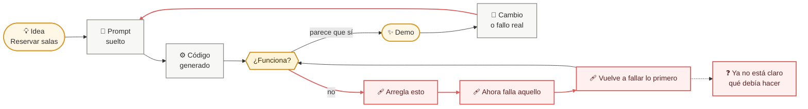
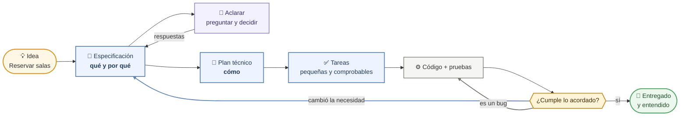

# *Vibe coding* frente a SDD

> **Para quién:** cualquier persona, sepa programar o no · **Tiempo de lectura:** ~6 min · **Nivel:** 🟢 básico

Esta página pone uno al lado del otro los dos caminos para construir software con un asistente de IA. El primero es el *vibe coding* (programar a golpe de instrucciones sueltas, improvisando con el asistente de IA). El segundo es SDD (*Spec-Driven Development*, desarrollo guiado por especificaciones): escribir primero qué queremos y por qué, y dejar que el código sea la consecuencia.

Los dos diagramas parten de la misma idea, «hazme una app para reservar salas», que es como empieza ReservaSalas. Lo que cambia es lo que pasa después.

## Camino 1: *vibe coding*

Este diagrama muestra el bucle en el que se entra cuando se pide el código directamente, sin haber escrito antes qué tiene que hacer el sistema. Cada vuelta empieza con un *prompt* (la instrucción que le escribes al asistente).

De izquierda a derecha: la idea se convierte directamente en un *prompt* y el asistente devuelve código que nadie lee entero. Si parece funcionar, se enseña la demo; en cuanto alguien pide un cambio o aparece un fallo real, se escribe otro *prompt* y empieza otra vuelta. Si no funciona, se encadenan parches: cada uno arregla una cosa y rompe otra, hasta que nadie sabe ya qué debía hacer el sistema.

Fíjate en que el bucle no tiene salida: no hay ningún punto donde esté escrito qué significa «funciona». Por eso cada parche se juzga a ojo. La historia completa de cómo le pasó esto a Luis y a Ana con la primera versión de ReservaSalas está en [El problema del vibe coding](../docs/01-el-problema-del-vibe-coding.md).

## Camino 2: SDD

Este diagrama muestra el mismo punto de partida siguiendo SDD: la idea pasa primero por una especificación (`spec.md`) y el código llega al final, con una referencia contra la que revisarlo.

De izquierda a derecha: la idea se escribe como una especificación (`spec.md`), en lenguaje natural y sin decidir tecnología. El asistente de IA detecta huecos y pregunta; negocio (quien pide el software y quien lo va a usar) responde, y las respuestas se incorporan a la especificación. Solo entonces se decide el cómo en el plan técnico (`plan.md`), que se trocea en una lista de tareas (`tasks.md`), y el asistente escribe el código tarea a tarea.

Al final se revisa el código contra la especificación: si cumple, está entregado; si no, se corrige la especificación y se vuelve a pedir al asistente que genere la parte afectada (se «regenera»), en vez de parchear el código a ciegas.

Aquí también hay un bucle, pero con dos diferencias: tiene una salida clara («cumple») y la corrección se hace siempre en el mismo sitio, la especificación. La constitución (`constitution.md`), el documento con los principios del proyecto (en el flujo completo es el paso 0), no aparece en este diagrama por sencillez; lo verás en el [flujo completo](02-flujo-completo-sdd.md).

## Los dos caminos, cara a cara

| | *Vibe coding* | SDD |
|---|---|---|
| **Velocidad el primer día** | Muy alta: hay una demo en una tarde. | Más lenta: la tarde se va en escribir y aclarar la especificación. |
| **Velocidad a los 3 meses** | Cae: cada cambio obliga a releer código que nadie entiende y a probar a mano. | Se mantiene mejor: un cambio empieza por editar la especificación y regenerar lo afectado (plan, tareas y la parte del código que cambia), con una referencia escrita contra la que comprobarlo. |
| **Quién lo entiende** | Solo quien escribió los *prompts*, y cada vez menos. | Cualquiera que lea la especificación, incluida la persona que lo pidió. |
| **Quién puede participar** | Quien sepa hablar con el asistente y leer código. | Negocio escribe y revisa la especificación; quien programa decide el plan. |
| **Cómo se corrige un fallo** | Con otro parche, a ojo, sin saber si rompe algo más. | Comparando con la especificación: se corrige el texto y se regenera la parte afectada. |
| **Qué queda escrito** | Un historial de conversaciones y código suelto. | Constitución, especificación, plan y tareas, guardados en el repositorio (la carpeta compartida, con historial de cambios, donde vive el proyecto). |
| **Riesgo para la empresa** | Alto: dependencia de una persona, retrabajo, datos tratados sin reglas. | Menor: hay un contrato escrito que cualquiera puede revisar. SDD reduce el riesgo; no lo elimina. |

> [!NOTE]
> El *vibe coding* no es malo para una prueba de una tarde que se va a tirar. El problema empieza cuando esa prueba se convierte en «la aplicación que usa todo el mundo» sin que nadie haya escrito nunca qué tenía que hacer.

## En tres frases

1. El *vibe coding* va rápido el primer día porque se salta la pregunta «¿qué tiene que hacer esto?», y por eso después no hay nada escrito contra lo que comprobar si un parche arregla o rompe.
2. SDD invierte el orden: primero la especificación, después el plan y las tareas, y el código al final, revisado contra lo que se pidió.
3. La diferencia de fondo no es la herramienta ni el asistente de IA: es tener o no tener un contrato escrito que todo el mundo pueda leer.

## Siguiente paso

Si vienes de los documentos 01 y 02, sigue con el [Flujo completo de SDD](02-flujo-completo-sdd.md) (ruta «Entender SDD y decidir si tu equipo lo prueba») o con [Escribir requisitos claros (EARS)](../docs/05-escribir-requisitos-claros-ears.md) (ruta «Escribir y revisar lo que pides»). Si empiezas aquí, lee antes [El problema del vibe coding](../docs/01-el-problema-del-vibe-coding.md).

---

🏠 [Índice de diagramas](README.md) · ➡️ [Siguiente: Flujo completo de SDD](02-flujo-completo-sdd.md)
