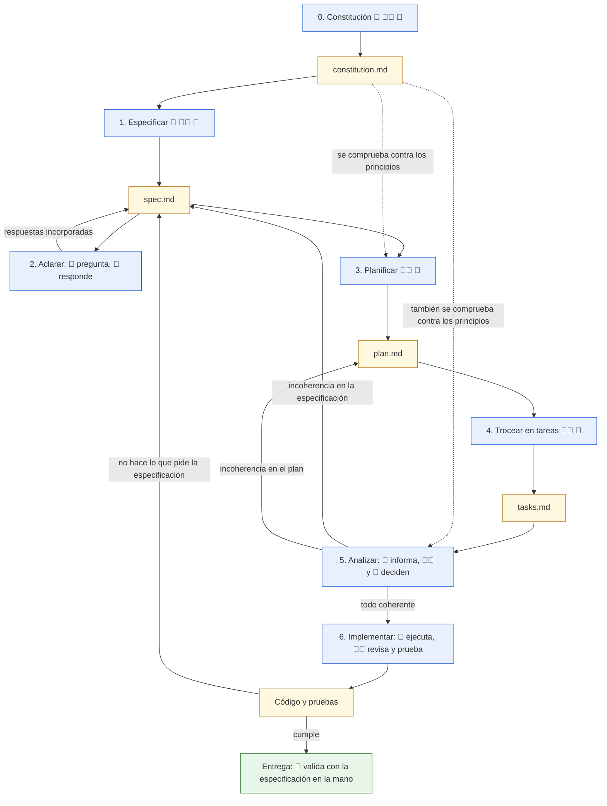
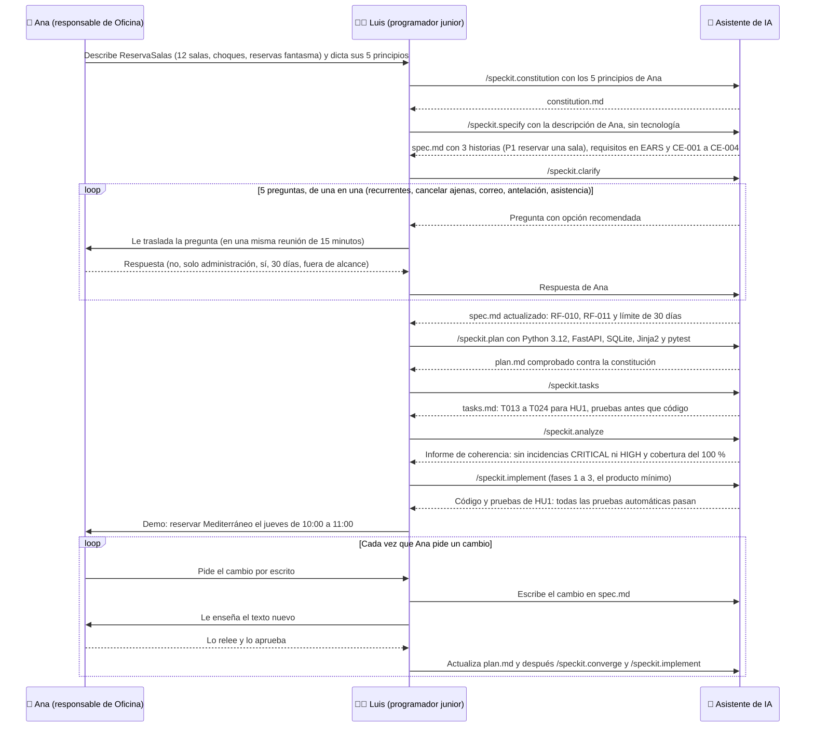

# Flujo completo de SDD

> **Para quién:** cualquier persona que quiera ver el proceso entero de un vistazo · **Tiempo de lectura:** ~10 min · **Nivel:** 🟡 intermedio

Este es el diagrama principal del repositorio: el flujo de SDD (*Spec-Driven Development*, desarrollo guiado por especificaciones) con sus siete pasos, numerados del 0 al 6, los ficheros que van saliendo por el camino y quién participa. Frente al *vibe coding* (programar a golpe de instrucciones sueltas, improvisando con el asistente de IA), aquí el código es lo último que aparece.

**Qué vas a encontrar**

- [Los siete pasos y sus artefactos](#los-siete-pasos-y-sus-artefactos)
- [Los tres bucles de vuelta](#los-tres-bucles-de-vuelta)
- [Una historia de ReservaSalas, paso a paso](#una-historia-de-reservasalas-paso-a-paso)

Los iconos de los nodos indican quién participa en cada paso:

| Icono | Quién | En ReservaSalas |
|---|---|---|
| 👤 | Negocio: quien pide el software y quien lo va a usar | Ana (responsable de Oficina), Marta (manager), Jorge (RRHH) |
| 👩‍💻 | Quien programa | Luis (programador junior) |
| 🤖 | El asistente de programación con IA | El asistente que Luis usa con Spec Kit (la herramienta de GitHub para seguir SDD con un asistente de IA; añade al asistente los comandos `/speckit.*` que ves más abajo; ver [Herramientas](../docs/07-herramientas.md)) |

## Los siete pasos y sus artefactos

El diagrama muestra, de arriba abajo, los siete pasos del flujo, el fichero que sale de cada uno (cuando lo hay; nodos de color amarillo) y las flechas de vuelta que hacen que la especificación (`spec.md`) sea siempre la fuente de verdad.

De arriba abajo: la constitución (`constitution.md`) fija los principios del proyecto y alimenta todo lo demás. Especificar produce la especificación (`spec.md`); el paso de aclarar la completa con las respuestas de negocio. Planificar produce el plan técnico (`plan.md`), comprobado contra la constitución, y trocear produce la lista de tareas (`tasks.md`).

Analizar no añade ningún fichero a la cadena principal: el informe de coherencia entre especificación, plan, tareas y constitución se lee en el chat; si además se piden listas de verificación, se guardan aparte en `checklists/`. Si el informe detecta una incoherencia, se vuelve atrás a corregirla. Implementar genera el código y las pruebas; si el resultado no hace lo que pide la especificación, se corrige la especificación, no el código.

Los pasos 0 a 2 producen texto que cualquier persona puede leer. El plan, las tareas y el análisis (pasos 3 a 5) también son texto, pero técnico: de ellos, negocio lee el resumen del plan y su comprobación contra la constitución. El código solo aparece en el paso 6, y llega con cuatro documentos que explican qué debe hacer y por qué.

> [!NOTE]
> Cada herramienta nombra los pasos a su manera. En Spec Kit, por ejemplo, el paso 5 se reparte en dos comandos: la lista de verificación va justo después del plan y el análisis de coherencia después de las tareas. La equivalencia completa entre nuestros nombres y los comandos está en [El flujo paso a paso](../docs/03-el-flujo-paso-a-paso.md) y en [Herramientas](../docs/07-herramientas.md).

## Los tres bucles de vuelta

Las flechas que vuelven hacia arriba son la parte más importante del diagrama. No son fallos del proceso: son el proceso.

| Bucle | Cuándo se activa | Qué se corrige | Ejemplo en ReservaSalas |
|---|---|---|---|
| Aclarar → Especificar | Siempre: cada respuesta de negocio se incorpora a la especificación antes de planificar | `spec.md` | «¿Quién puede cancelar una reserva ajena?» → «Solo administración» → aparece el requisito RF-010 |
| Analizar → Plan o Especificación | Cuando el informe de coherencia detecta un requisito sin tarea, una tarea sin requisito o una decisión que choca con la constitución | `plan.md` o `spec.md`, y después se regeneran las tareas | Si el plan propusiera guardar el teléfono de cada persona, el informe señalaría que choca con el principio 4 de la constitución (datos mínimos): se corregiría `plan.md` y se regenerarían las tareas |
| Implementar → Especificar | Cuando el código no hace lo que se pidió, o cuando alguien pide un cambio | `spec.md` (lo escribe quien construye y lo aprueba quien encarga); después se actualiza el plan, se añaden las tareas que faltan y se regenera la parte afectada del código | Ana decide que la antelación máxima pasa de 30 a 60 días y lo pide; Luis cambia RF-006 en `spec.md` y Ana aprueba el texto nuevo. Luis actualiza el plan, `/speckit.converge` añade a `tasks.md` las tareas que faltan y `/speckit.implement` las ejecuta (no se relanza `/speckit.tasks`, que rehace la lista entera); nadie toca el código a mano |

> [!IMPORTANT]
> Si algo está mal, se corrige la especificación y se regenera. Parchear el código a mano «para salir del paso» rompe el contrato: a partir de ese momento la especificación ya no describe lo que hace el sistema.

## Una historia de ReservaSalas, paso a paso

Este diagrama de secuencia muestra cómo Ana, Luis y el asistente de IA recorren el flujo completo para la historia de usuario P1 de ReservaSalas (reservar una sala), con los comandos de Spec Kit que usa Luis. Los mensajes van en el orden en que ocurren, de arriba abajo.

En los mensajes verás códigos de la especificación: RF-nnn son los requisitos funcionales, redactados en EARS (*Easy Approach to Requirements Syntax*, una forma sencilla y estructurada de redactar requisitos); CE-nnn son los criterios de éxito; HU1 es la historia de usuario 1; y T0nn son las tareas de `tasks.md`.

De arriba abajo: Ana describe el problema y dicta los principios; Luis los convierte en constitución y especificación con el asistente de IA, sin decir ni una palabra de tecnología. El asistente hace cinco preguntas, de una en una, que Luis va trasladando a Ana en una reunión corta; con las respuestas, la especificación gana dos requisitos y un límite.

Solo entonces Luis decide la tecnología en el plan (los nombres de herramientas que ves en ese mensaje son esa decisión técnica; no hace falta conocerlos para seguir el flujo), trocea en tareas, pide el informe de coherencia y lanza la implementación de la primera historia. La demo final se compara con la especificación, y cualquier cambio posterior entra por ella: Ana lo pide, Luis lo escribe en `spec.md` y Ana aprueba el texto nuevo antes de que Luis actualice el plan y deje que `/speckit.converge` añada las tareas que faltan.

Fíjate en dónde está cada persona: Ana solo habla en lenguaje natural (describir, responder, pedir cambios) y aun así decide lo importante. Luis apenas escribe código: escribe la descripción, elige la tecnología, revisa y prueba; solo toca el código a mano para detalles. El asistente hace el trabajo mecánico y pregunta cuando le falta información. Los documentos completos de esta sesión (constitución, especificación con aclaraciones, lista de verificación, plan y tareas; el código no se incluye) están en la [solución del ejercicio 03](../ejercicios/soluciones/03-reserva-salas/README.md).

> [!TIP]
> Cada asistente de IA redacta distinto y los comandos pueden escribirse con punto (`/speckit.specify`) o con guion (`/speckit-specify`) según la herramienta. Lo que no cambia es el orden: no se planifica sin especificar, y no se implementa sin tareas.

## En tres frases

1. SDD tiene siete pasos, del 0 al 6: constitución, especificar, aclarar, planificar, trocear en tareas, analizar e implementar; los tres primeros producen texto que cualquiera puede leer, los tres siguientes texto técnico (plan, tareas y análisis) y solo el último produce código.
2. Las flechas de vuelta son el corazón del flujo: aclarar completa la especificación, analizar corrige el plan o la especificación, e implementar devuelve a la especificación cualquier cosa que no cuadre.
3. En ReservaSalas, Ana decide hablando en lenguaje natural, Luis especifica, elige la tecnología y revisa, y el asistente de IA genera y pregunta: nadie parchea el código a mano.

## Siguiente paso

Si sigues la ruta «Entender SDD y decidir si tu equipo lo prueba», continúa con [Roles: quién hace qué](../docs/06-roles-quien-hace-que.md). Si vas a construir con SDD, sigue con el diagrama siguiente, [Artefactos y relaciones](03-artefactos-y-relaciones.md). Y si quieres cada paso en detalle, con lo que entra, lo que sale y lo que puede salir mal, lee [El flujo paso a paso](../docs/03-el-flujo-paso-a-paso.md).

---

⬅️ [Anterior: Vibe coding frente a SDD](01-vibe-coding-vs-sdd.md) · 🏠 [Índice de diagramas](README.md) · ➡️ [Siguiente: Artefactos y relaciones](03-artefactos-y-relaciones.md)
