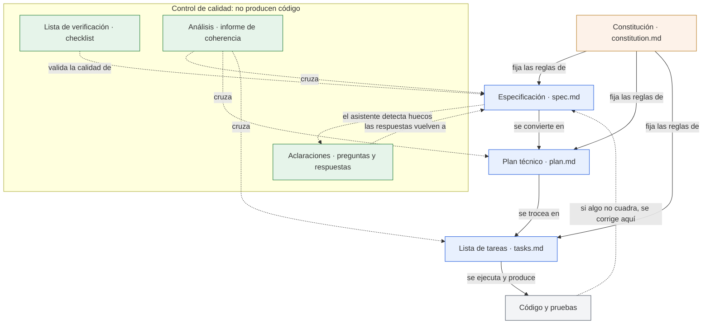
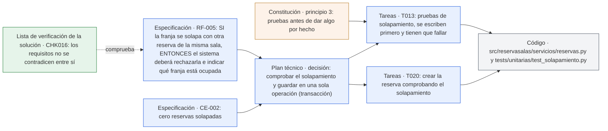

# Artefactos y relaciones

> **Para quién:** programadores junior y perfiles técnicos; también para quien quiera saber «qué fichero es cada cosa» · **Tiempo de lectura:** ~8 min · **Nivel:** 🟡 intermedio

El SDD (*Spec-Driven Development*, desarrollo guiado por especificaciones) produce un puñado de documentos, los **artefactos**, y cada uno se alimenta de los anteriores. Este diagrama muestra el mapa: qué artefactos hay, en qué fichero vive cada uno y qué flecha une a cada uno con los demás. Lo que contiene cada artefacto por dentro lo cuenta [Los artefactos](../docs/04-los-artefactos.md); los pasos del flujo, [el diagrama anterior](02-flujo-completo-sdd.md).

**Qué vas a encontrar**

- [Cómo se alimentan los artefactos](#cómo-se-alimentan-los-artefactos)
- [Un requisito, de principio a fin](#un-requisito-de-principio-a-fin)
- [Dónde vive cada fichero](#dónde-vive-cada-fichero)
- [Quién escribe y quién aprueba cada artefacto](#quién-escribe-y-quién-aprueba-cada-artefacto)

## Cómo se alimentan los artefactos

El diagrama muestra los cinco artefactos de SDD (constitución, especificación, lista de verificación, plan técnico y lista de tareas) más el registro de aclaraciones, el informe de análisis (que no deja fichero) y el código que sale de todo ello, con las relaciones entre ellos: las flechas continuas significan «fija las reglas de», «se convierte en» o «produce»; las discontinuas, «comprueba» o «corrige».



De arriba abajo: la constitución (`constitution.md`) está en lo más alto y marca los límites de todo lo demás; cada comando del asistente de IA la lee antes de trabajar. La especificación (`spec.md`) es el centro: de ella sale el plan técnico (`plan.md`), del plan la lista de tareas (`tasks.md`) y de las tareas el código con sus pruebas.

Dentro del recuadro «Control de calidad» están las tres piezas que no producen código: las aclaraciones corrigen la especificación con las respuestas de quien encarga el proyecto; la lista de verificación (*checklist*) valida la calidad de la especificación; y el análisis cruza especificación, plan y tareas para avisar de incoherencias antes de escribir código.

La última flecha, de abajo arriba, es la regla de oro: si el código no hace lo que querías, se corrige la especificación y se regenera lo que cuelga de ella.

## Un requisito, de principio a fin

Las flechas del mapa anterior se entienden mejor siguiendo un requisito concreto de ReservaSalas: RF-005, el que impide que dos equipos reserven la misma sala a la vez. El diagrama muestra su rastro por cada artefacto, de izquierda a derecha.



De izquierda a derecha: el requisito RF-005 y el criterio de éxito CE-002 («cero reservas solapadas») viven en la especificación, y la lista de verificación comprueba que no se contradicen con el resto (CHK016 es el número de esa comprobación en la lista de la solución; la [plantilla](../ejercicios/plantillas/lista-de-verificacion.md) numera sus preguntas de otra forma). El plan técnico los convierte en una decisión concreta: comprobar y guardar en una sola operación, para que dos personas no puedan colarse a la vez.

De esa decisión salen dos tareas: T013, las pruebas, que por el principio 3 de la constitución se escriben antes; y T020, la implementación. Las dos acaban en ficheros de código concretos. Si mañana Ana cambiara la regla, el cambio empezaría en RF-005 y bajaría por las mismas flechas.

## Dónde vive cada fichero

El árbol muestra la carpeta de un proyecto creado con GitHub Spec Kit (<https://github.com/github/spec-kit>) después de recorrer todo el flujo con ReservaSalas. Entre paréntesis, el comando del asistente que crea cada fichero; el número es el paso del flujo.

```text
reserva-salas/
├── .specify/                           carpeta de Spec Kit (la crea specify init)
│   ├── memory/constitution.md          0 · Constitución (/speckit.constitution)
│   ├── feature.json                    qué funcionalidad está activa (aparece con el primer /speckit.specify)
│   ├── templates/                      plantillas que usa el asistente: no hace falta tocarlas (para personalizarlas, Spec Kit usa templates/overrides/)
│   ├── scripts/                        scripts auxiliares: no hace falta tocarlos
│   └── ...                             otros ficheros de configuración de Spec Kit
├── .claude/skills/speckit-*/           los comandos del asistente (/speckit-* o /speckit.* según el asistente; la carpeta también cambia)
├── specs/
│   └── 001-reserva-salas/              una carpeta por funcionalidad, numerada
│       ├── spec.md                     1 · Especificar (/speckit.specify); 2 · Aclarar (/speckit.clarify añade la sección «Aclaraciones»)
│       ├── checklists/
│       │   ├── requirements.md         lista de verificación automática (la crea specify, la reevalúa clarify)
│       │   └── ux.md                   5 · Analizar: listas por tema, solo si ejecutas /speckit.checklist (en la solución de ReservaSalas no se hizo)
│       ├── plan.md                     3 · Planificar (/speckit.plan)
│       ├── research.md                 apoyo del plan: decisiones y alternativas
│       ├── data-model.md               apoyo del plan: modelo de datos
│       ├── contracts/                  apoyo del plan: contratos (qué entra y qué sale en cada operación)
│       ├── quickstart.md               apoyo del plan: cómo arrancar
│       └── tasks.md                    4 · Trocear en tareas (/speckit.tasks); implement marca cada tarea hecha con [X]
├── src/reservasalas/                   6 · Implementar: el código (/speckit.implement)
└── tests/                              6 · Implementar: las pruebas
```

Tres detalles que suelen sorprender. El comando de análisis, `/speckit.analyze`, no crea ningún fichero: deja su informe en el chat del asistente y eres tú quien decide qué corregir. Las aclaraciones tampoco tienen fichero propio: van dentro de `spec.md` (en este repositorio las mostramos aparte, en `aclaraciones.md`, para que se vea el proceso). Y el plan técnico se reparte en cuatro ficheros y una carpeta (`contracts/`, solo si hay interfaces con el exterior); en la [solución de ReservaSalas](../ejercicios/soluciones/03-reserva-salas/plan.md) lo resumimos todo en un solo fichero.

## Quién escribe y quién aprueba cada artefacto

La tabla resume, para cada artefacto, el fichero real, quién lo escribe y quién da el visto bueno, con los nombres de ReservaSalas. Salvo la constitución y el código, todas las rutas están dentro de `specs/001-reserva-salas/`. Quién hace qué en cada paso, con más detalle, está en [el diagrama siguiente](04-roles-y-participacion.md).

| Artefacto | Fichero | Quién lo escribe | Quién lo aprueba |
|---|---|---|---|
| Constitución | `.specify/memory/constitution.md` | Quien encarga y quien construye, juntos (Ana y Luis); el asistente de IA redacta | Ana; revisa alguien con experiencia técnica |
| Especificación | `spec.md` | Ana describe qué quiere y por qué; el asistente de IA la redacta con historias, requisitos y criterios de éxito | Ana; Luis y QA (control de calidad: quien prueba que la aplicación hace lo que debe) revisan que no haya tecnología ni vaguedades |
| Aclaraciones | Sección «Aclaraciones» dentro de `spec.md` | El asistente de IA pregunta; Ana responde; Luis ejecuta el comando | Ana: sus respuestas son la decisión |
| Lista de verificación | `checklists/requirements.md` (automática) y `checklists/[tema].md` (por tema) | La automática la evalúa el asistente de IA; las de tema las marca quien revisa | Alguien que no escribió la especificación (QA u otra persona del equipo) |
| Plan técnico | `plan.md` (+ `research.md`, `data-model.md`, `contracts/`, `quickstart.md`) | Luis, con el asistente de IA, a partir de la especificación y la constitución | Programador senior, punto por punto contra la constitución |
| Lista de tareas | `tasks.md` | El asistente de IA la genera; Luis la lee entera | Luis, senior y QA: tareas pequeñas, en orden y con las pruebas antes que el código |
| Análisis | Ningún fichero: informe en el chat | El asistente de IA | Luis decide qué remedios aplicar; el senior revisa los que tocan el plan y Ana los que tocan la especificación |
| Código y pruebas | `src/` y `tests/` | El asistente de IA ejecuta las tareas una a una | Luis revisa cada tarea; senior y QA revisan código y pruebas; Marta y Jorge prueban la aplicación y Ana da el visto bueno |

> [!IMPORTANT]
> El asistente de IA escribe mucho, pero no aprueba nada. Cada fila tiene una persona responsable, y la especificación la aprueba siempre quien encarga el proyecto, no quien lo programa.

## En tres frases

1. La constitución va arriba y marca los límites; la especificación es el centro: de ella sale el plan, del plan las tareas y de las tareas el código.
2. Aclaraciones, lista de verificación y análisis no producen código: existen para que especificación, plan y tareas sean coherentes antes de implementar.
3. Cada artefacto tiene un fichero concreto y una persona responsable (el análisis solo deja un informe en el chat); si el código no cuadra, se corrige la especificación y se regenera lo que cuelga de ella.

## Siguiente paso

Continúa con [Los artefactos](../docs/04-los-artefactos.md), que explica qué secciones tiene cada uno y qué errores evitar. Si prefieres verlos rellenos, abre [la solución de ReservaSalas](../ejercicios/soluciones/03-reserva-salas/README.md).

---

⬅️ [Anterior: Flujo completo de SDD](02-flujo-completo-sdd.md) · 🏠 [Índice de diagramas](README.md) · ➡️ [Siguiente: Roles y participación](04-roles-y-participacion.md)
