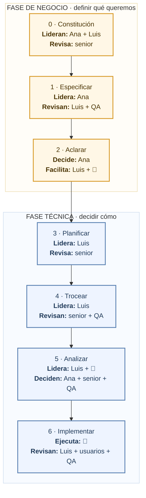
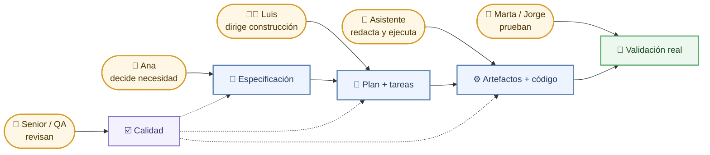
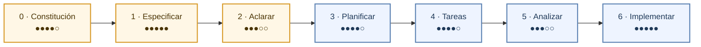

# Roles y participación

> **Para quién:** cualquier persona que participe en un proyecto con SDD, sepa programar o no · **Tiempo de lectura:** ~7 min · **Nivel:** 🟢 básico

Cuando alguien oye hablar por primera vez de SDD (*Spec-Driven Development*, desarrollo guiado por especificaciones) suele preguntar lo mismo: «¿y yo qué pinto ahí?». Este diagrama lo responde con ReservaSalas: Ana (responsable de Oficina) encarga la aplicación, Luis (programador junior) la construye con un asistente de IA, y Marta (manager de un equipo) y Jorge (RRHH) la van a usar. Lo que hace cada rol, explicado con calma, está en [Roles: quién hace qué](../docs/06-roles-quien-hace-que.md); los pasos del flujo, en [el diagrama 02](02-flujo-completo-sdd.md).

Iconos que usamos: 👤 negocio (quien encarga o usa la aplicación), 👩‍💻 quien programa, 🤖 asistente de IA. Cuando decimos QA nos referimos al control de calidad: la persona o el equipo que prueba que la aplicación hace lo que debe.

**Qué vas a encontrar**

- [Pasos 0 a 2: pensar, lidera quien encarga](#pasos-0-a-2-pensar-lidera-quien-encarga)
- [Pasos 3 a 6: construir, lidera quien construye](#pasos-3-a-6-construir-lidera-quien-construye)
- [Cómo vive cada paso cada persona](#cómo-vive-cada-paso-cada-persona)
- [Matriz de roles y pasos](#matriz-de-roles-y-pasos)

## Pasos 0 a 2: pensar, lidera quien encarga

El diagrama muestra, para cada uno de los tres primeros pasos del flujo, quién lidera y quién revisa: cada casilla lo dice con su primera palabra, y el color es naranja cuando lidera o revisa negocio (aunque le acompañe alguien técnico) y azul cuando lo hace solo quien programa.

De arriba abajo: la constitución (`constitution.md`) la fijan juntos quien encarga y quien construye, y la revisa alguien con experiencia técnica. La especificación (`spec.md`) la lidera Ana: ella dice qué quiere y por qué, el asistente de IA lo redacta con historias y requisitos, y Luis y QA revisan que no se haya colado tecnología ni frases vagas; a Marta y Jorge se les pregunta cómo usan hoy las salas.

En aclarar, el asistente hace las preguntas, Ana responde y Luis se ocupa de que las respuestas acaben dentro de la especificación; a Marta, Jorge y QA se les consulta si alguna respuesta les afecta. En estos tres pasos nadie programa nada.

## Pasos 3 a 6: construir, lidera quien construye

El diagrama sigue con los cuatro pasos restantes, con el mismo esquema: una casilla «Lidera» y otra «Revisa» por paso, naranja cuando lidera o revisa negocio (aunque le acompañe alguien técnico) y azul cuando lo hace solo quien programa.

De arriba abajo: a partir del plan técnico (`plan.md`) lidera Luis. El asistente de IA hace el trabajo pesado: redacta el plan, genera la lista de tareas (`tasks.md`), informa de incoherencias y, al final, ejecuta las tareas. La revisión técnica (plan, tareas, informe y código) la hace alguien con experiencia, y QA vigila las pruebas; en planificar se consulta a Ana y a QA si una decisión les afecta.

Negocio vuelve a aparecer en los dos últimos pasos: en analizar, Ana comprueba que los criterios de éxito siguen siendo los suyos; en implementar, Marta y Jorge prueban la aplicación y cuentan qué han visto, y Ana da el visto bueno final. Fíjate en que el asistente aparece en todos los pasos, pero nunca en una casilla «Revisa»: redacta y ejecuta, no aprueba.

## Cómo vive cada paso cada persona

Una lectura más ligera del mismo recorrido. El diagrama muestra lo cómodo que suele resultar cada paso para quien participa en él: cara contenta, paso cómodo y vistoso; cara seria, paso tedioso o de espera. Es una estimación hecha desde nuestra experiencia, no una medición.

De izquierda a derecha: los pasos más agradecidos son especificar (Ana por fin dice lo que necesita, sin traducirlo a jerga) e implementar (la aplicación aparece y se puede tocar). Las caras más serias están en aclarar y analizar: son pasos de preguntas y comprobaciones en los que no se ve avanzar nada, y por eso son los que más tentación dan de saltarse. Precisamente ahí se evitan muchos de los disgustos de después.

## Matriz de roles y pasos

La tabla resume la participación de cada rol en cada paso. **L** = lidera (es responsable de que el paso salga bien) · **R** = revisa (aprueba o pide cambios) · **C** = consulta (se le pregunta o aporta información) · **—** = no participa. La fila del asistente de IA va en palabras, porque no lidera ni revisa: produce borradores y ejecuta lo que las personas aprueban.

| Rol (en ReservaSalas) | 0 Constitución | 1 Especificar | 2 Aclarar | 3 Planificar | 4 Tareas | 5 Analizar | 6 Implementar |
|---|---|---|---|---|---|---|---|
| Quien encarga el proyecto (Ana, responsable de Oficina) | L | L | L | C | — | R | R |
| Manager de un equipo que la usará (Marta): prioridades y uso real | — | C | C | — | — | — | C |
| RRHH y otros perfiles de negocio (Jorge): datos de las personas y uso real | — | C | C | — | — | — | C |
| Programador junior (Luis) | L | R | R | L | L | L | L |
| Programador senior | R | C | — | R | R | R | R |
| QA (calidad y pruebas) | — | R | C | C | R | R | R |
| 🤖 Asistente de IA | redacta | redacta | pregunta | diseña | trocea | informa | ejecuta |

Dos formas de leer la tabla. Por filas: quien encarga el software o lo va a usar está en la primera mitad (pensar), liderando o aportando información, y vuelve al final para revisar el análisis y probar la aplicación, siempre sin tocar código; Marta y Jorge prueban y cuentan qué han visto (por eso llevan una C), y el visto bueno es de Ana. Quien construye participa en los siete pasos y lidera los cuatro últimos. Por columnas: ningún paso tiene como único participante al asistente de IA, y ningún paso lo lidera él.

> [!TIP]
> Si en tu equipo no hay QA ni programador senior, sus casillas las cubre otra persona del equipo que **no** haya escrito el artefacto que revisa. Lo importante es que haya cuatro ojos, no el cargo.

## En tres frases

1. Negocio lidera la primera mitad del flujo (constitución, especificar, aclarar) y vuelve al final para comprobar criterios y probar; quien programa lidera la segunda mitad.
2. El asistente de IA participa en todos los pasos, pero siempre redactando, generando o ejecutando: nunca lidera y nunca aprueba.
3. Cada paso tiene una persona que lidera y otra distinta que revisa; los pasos menos vistosos (aclarar y analizar) suelen ser los que más disgustos evitan.

## Siguiente paso

Continúa con [Roles: quién hace qué](../docs/06-roles-quien-hace-que.md), que desarrolla esta matriz rol a rol y explica qué cambia en el trabajo de cada persona. Para practicarlo en equipo, está [la dinámica de 20 minutos](../ejercicios/04-dinamica-de-equipo-20-minutos.md).

---

⬅️ [Anterior: Artefactos y relaciones](03-artefactos-y-relaciones.md) · 🏠 [Índice de diagramas](README.md) · ➡️ [Siguiente: Anatomía de un requisito EARS](05-anatomia-de-un-requisito-ears.md)
