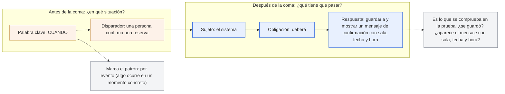
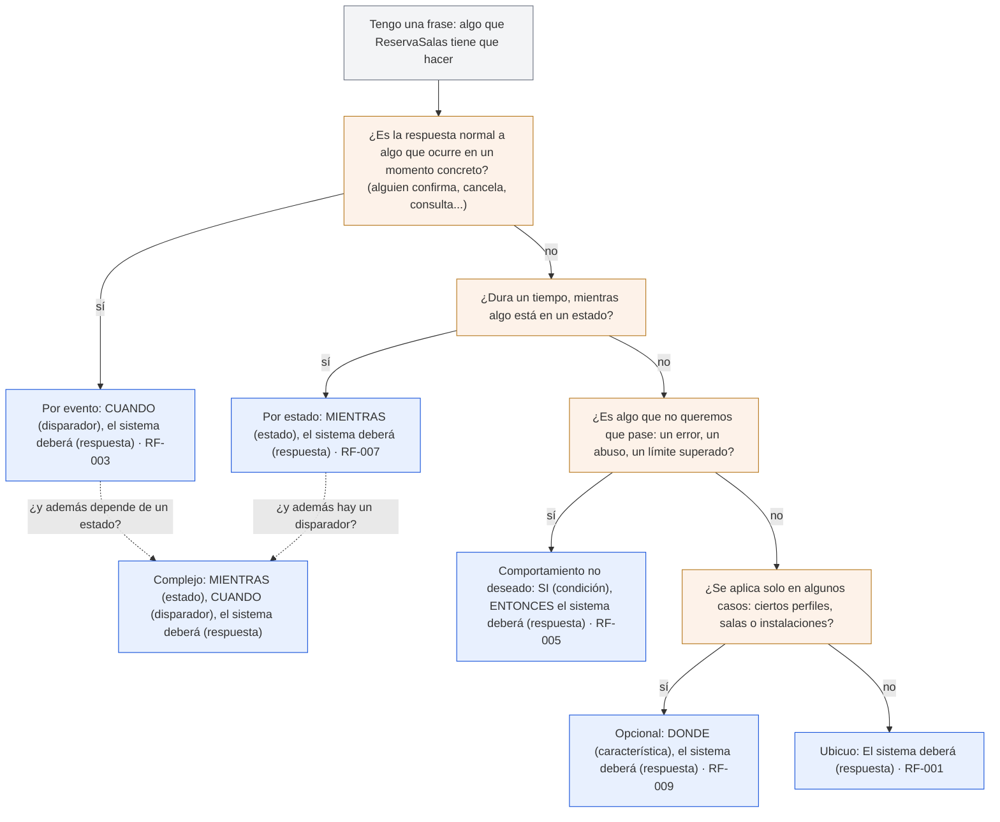

# Anatomía de un requisito EARS

> **Para quién:** managers, RRHH, perfiles de negocio y programadores junior · **Tiempo de lectura:** ~6 min · **Nivel:** 🟢 básico

En SDD (*Spec-Driven Development*, desarrollo guiado por especificaciones) los requisitos de la especificación (`spec.md`) se escriben en EARS (*Easy Approach to Requirements Syntax*), una forma sencilla y estructurada de redactar requisitos propuesta por Alistair Mavin y otros en 2009. La idea es que cada requisito sea una sola frase, con las mismas piezas siempre en el mismo orden, para que cualquiera pueda leerla y comprobar si se cumple.

Esta página desmonta un requisito real de ReservaSalas pieza a pieza y te da un árbol de decisión para elegir el patrón. La explicación completa, con reglas y ejemplos «antes → después», está en [Escribir requisitos claros con EARS](../docs/05-escribir-requisitos-claros-ears.md).

## Las piezas de un requisito

Tomamos el requisito RF-003 de la especificación canónica de ReservaSalas (en [`spec.md`](../ejercicios/soluciones/03-reserva-salas/spec.md)):

> **RF-003**: CUANDO una persona confirma una reserva, el sistema deberá guardarla y mostrar un mensaje de confirmación con sala, fecha y hora.

El diagrama muestra las cinco piezas de ese requisito, agrupadas en lo que va antes de la coma (la situación) y lo que va después (la respuesta obligatoria), y para qué sirve cada mitad.



De izquierda a derecha: la palabra clave CUANDO avisa de que el requisito solo se aplica en una situación concreta, y el disparador dice cuál (alguien confirma una reserva). Después de la coma siempre aparece el mismo sujeto, «el sistema», seguido de «deberá» (es una obligación, no una sugerencia) y de la respuesta: qué hace exactamente. La palabra clave es la que decide el patrón EARS; la respuesta es la parte que luego se convierte en prueba. Fíjate en que esa respuesta es, casi palabra por palabra, el «entonces» del criterio de aceptación 2 de la historia de usuario 1 de ReservaSalas.

Lo mismo, subrayado sobre la frase:

```text
CUANDO una persona confirma una reserva, el sistema deberá guardarla y mostrar un mensaje de confirmación con sala, fecha y hora.
└────┘ └──────────────────────────────┘  └────────┘ └────┘ └───────────────────────────────────────────────────────────────────┘
clave             disparador               sujeto   obligación                           respuesta
```

La tabla resume qué pregunta responde cada pieza y qué suele salir mal en ella.

| Pieza | Pregunta que responde | En RF-003 | Error típico |
|---|---|---|---|
| Palabra clave | ¿De qué tipo de situación hablamos? | CUANDO | Omitirla cuando sí hay una condición: «el sistema deberá rechazar reservas solapadas» esconde un SI. |
| Disparador o condición | ¿En qué momento o circunstancia? | una persona confirma una reserva | Vaguedad: «cuando haga falta», «si procede», «en los casos habituales». |
| Sujeto | ¿Quién responde? | el sistema | Nombrar tecnología o pantallas: «la base de datos», «el botón verde». |
| Obligación | ¿Es obligatorio? | deberá | «debería», «podría», «sería bueno que»: nadie sabe si hay que cumplirlo. |
| Respuesta | ¿Qué hace exactamente? | guardarla y mostrar un mensaje con sala, fecha y hora | Adjetivos que no se pueden medir: «rápido», «bien», «de forma intuitiva». |

> [!TIP]
> Si no sabes cómo comprobarías la respuesta, el requisito aún no está terminado. «Mostrar un mensaje con sala, fecha y hora» se comprueba mirando la pantalla; «mostrar un mensaje claro» no.

## ¿Qué patrón EARS uso?

El diagrama es un árbol de decisión: partes de una frase sobre lo que debe hacer ReservaSalas, respondes cuatro preguntas y llegas al patrón que te toca, con un requisito real de la especificación canónica como ejemplo.



De arriba abajo: si la frase describe la respuesta normal a algo que pasa en un momento concreto, es un requisito por evento (CUANDO). Si describe algo que se mantiene mientras dura un estado, es por estado (MIENTRAS). Si describe una situación que queremos evitar o rechazar, es un comportamiento no deseado (SI…, ENTONCES…). Si solo se aplica a algunos perfiles, salas o instalaciones, es opcional (DONDE). Y si no depende de nada, es ubicuo: «El sistema deberá…» a secas. Las dos flechas punteadas recuerdan que, cuando hacen falta dos condiciones a la vez, se combinan en un requisito complejo.

Si una frase encaja en dos ramas, la duda más habitual es entre CUANDO y SI/ENTONCES. La regla práctica: si la situación es deseada y el sistema simplemente responde, CUANDO; si es un error, un abuso o un límite que hay que rechazar, SI/ENTONCES. Así quien lee la especificación distingue de un vistazo el camino feliz de los casos límite.

## Los cinco patrones y el complejo, con ReservaSalas

La tabla recoge la plantilla de cada patrón, un requisito real de la especificación canónica y cómo se comprobaría. Las palabras clave van siempre en mayúsculas y el verbo es siempre «deberá».

| Patrón | Plantilla | Ejemplo en ReservaSalas | Cómo se comprueba |
|---|---|---|---|
| Ubicuo | `El sistema deberá <respuesta>.` | RF-001: El sistema deberá mostrar la lista de salas con su planta y aforo. | En cualquier momento: abres la lista y cada sala muestra planta y aforo. |
| Por evento | `CUANDO <disparador>, el sistema deberá <respuesta>.` | RF-003: CUANDO una persona confirma una reserva, el sistema deberá guardarla y mostrar un mensaje de confirmación con sala, fecha y hora. | Provocas el disparador (confirmas una reserva) y miras la respuesta. |
| Por estado | `MIENTRAS <estado>, el sistema deberá <respuesta>.` | RF-007: MIENTRAS una sala esté marcada en mantenimiento, el sistema deberá impedir nuevas reservas en ella. | Pones la sala en mantenimiento e intentas reservarla varias veces durante ese tiempo. |
| Comportamiento no deseado | `SI <condición>, ENTONCES el sistema deberá <respuesta>.` | RF-005: SI la franja solicitada se solapa con otra reserva de la misma sala, ENTONCES el sistema deberá rechazar la reserva e indicar qué franja está ocupada. | Fuerzas la situación mala (pides una franja ocupada) y compruebas el rechazo y el aviso. |
| Opcional | `DONDE <característica>, el sistema deberá <respuesta>.` | RF-009: DONDE la persona tenga permisos de administración, el sistema deberá permitir marcar una sala en mantenimiento. | Con un perfil que tiene la característica y con otro que no: solo el primero ve la opción. |
| Complejo | `MIENTRAS <estado>, CUANDO <disparador>, el sistema deberá <respuesta>.` | Ejemplo construido a partir del criterio de aceptación 5 de la historia 1 (la especificación canónica no usa este patrón): MIENTRAS una sala esté marcada en mantenimiento, CUANDO una persona consulta la disponibilidad, el sistema deberá mostrarla como «en mantenimiento» y no permitir elegirla. | Combinas las dos comprobaciones: con la sala en mantenimiento, consultas la disponibilidad. |

Un detalle que verás en la especificación canónica: los doce requisitos (RF-001 a RF-012) se reparten entre los cinco patrones básicos, y en la propia `spec.md` hay una tabla que dice cuál usa cada uno. Si alguna vez dudas de un patrón, ese fichero es un buen sitio para comparar.

> [!NOTE]
> EARS no es un corsé: hay frases que admiten dos patrones correctos. Lo importante es que la condición quede explícita, que haya un solo «deberá» y que la respuesta se pueda comprobar. El patrón elegido es la forma de conseguirlo, no el objetivo.

## En tres frases

1. Un requisito EARS es una sola frase con piezas fijas: una palabra clave con su situación (si la hay), «el sistema deberá» y una respuesta concreta que se puede comprobar.
2. La palabra clave dice de qué tipo de situación hablamos: CUANDO (algo ocurre), MIENTRAS (algo dura), SI/ENTONCES (algo que no queremos), DONDE (solo en algunos casos); sin palabra clave, el requisito se cumple siempre.
3. Lo que va después de «deberá» es lo que luego se prueba: si no sabrías cómo comprobarlo, el requisito todavía no está terminado.

## Siguiente paso

Continúa con [Escribir requisitos claros con EARS](../docs/05-escribir-requisitos-claros-ears.md), que desarrolla las reglas de oro y cómo pasar de una frase vaga a un requisito. Para practicar, tienes [el ejercicio 02: practicar requisitos EARS](../ejercicios/02-practicar-requisitos-ears.md).

---

⬅️ [Anterior: Roles y participación](04-roles-y-participacion.md) · 🏠 [Índice de diagramas](README.md) · ➡️ [Siguiente: Mapa del repositorio](06-mapa-del-repositorio.md)
