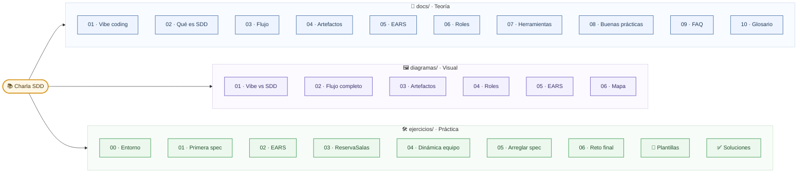
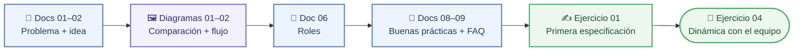
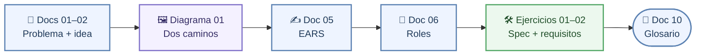
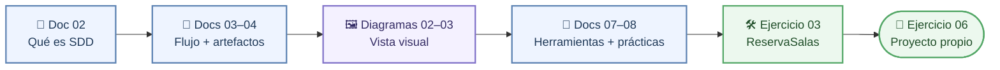

# Mapa del repositorio

> **Para quién:** toda la empresa, sepa programar o no · **Tiempo de lectura:** ~8 min · **Nivel:** 🟢 básico

Este repositorio es el material de formación interno sobre SDD (*Spec-Driven Development*, desarrollo guiado por especificaciones). Tiene cuatro partes y unos sesenta ficheros, pero nadie tiene que leerlos todos: según lo que quieras hacer, hay un camino distinto. Esta página es el plano del edificio: primero un mapa con todo lo que hay, después los cuatro itinerarios de lectura y, al final, una tabla con cada fichero, de qué va, para quién es y cuánto se tarda. Si acabas de llegar, lo más cómodo es empezar por la [portada](../README.md), que tiene estos mismos itinerarios en forma de enlaces.

**Qué vas a encontrar**

- [El repositorio de un vistazo](#el-repositorio-de-un-vistazo)
- [Itinerarios por perfil](#itinerarios-por-perfil)
- [Todos los ficheros, uno por línea](#todos-los-ficheros-uno-por-línea)

## El repositorio de un vistazo

El mapa mental muestra el repositorio entero: en el centro, su nombre; alrededor, cuatro partes (la raíz y las tres carpetas de contenido: `docs/`, `diagramas/` y `ejercicios/`), y dentro de cada parte sus ficheros con el nombre abreviado.

El mapa agrupa el repositorio en tres zonas: teoría (`docs/`), apoyo visual (`diagramas/`) y práctica (`ejercicios/`). La portada (`README.md`) y la guía para contribuir (`CONTRIBUIR.md`) quedan en la raíz. `docs/` es la teoría, en diez documentos numerados que se leen en orden (aunque, según tu itinerario, puedes saltarte algunos): van desde el problema del *vibe coding* (programar a golpe de instrucciones sueltas, improvisando con el asistente de IA) hasta el glosario. `diagramas/` cuenta lo mismo en dibujos; esta página es el último. `ejercicios/` es la práctica: siete ejercicios, las plantillas de los artefactos listas para copiar y las soluciones, entre ellas el ejemplo completo de ReservaSalas (los seis ficheros que produce el flujo y un README que explica cómo se generaron) y un ejemplo completo del reto final.

Para no recargar el mapa no aparecen los índices: cada carpeta (también `plantillas/`, `soluciones/`, `soluciones/03-reserva-salas/`, `soluciones/06-reto-final/` y `soluciones/06-reto-final/prestamo-de-portatiles/`) tiene su propio `README.md`, y los encontrarás todos en la tabla del final. `diagramas/svg/` y `diagramas/png/` guardan una exportación automática de cada diagrama (SVG para PowerPoint y documentos; PNG para Google Slides o el correo), útil para pegarlo en una presentación; no se editan a mano.

## Itinerarios por perfil

Hay cuatro, según lo que quieras hacer. Cada diagrama es un camino de lectura: empiezas por la izquierda y sigues las flechas. Cada recuadro dice de qué carpeta es (doc, diagrama o ejercicio) y debajo tienes los enlaces en el mismo orden. Los tiempos son aproximados; los exactos están en la cabecera de cada fichero.

### Entender SDD y decidir si tu equipo lo prueba

En unas 3 horas, este camino te da lo justo para decidir si tu equipo prueba SDD y saber qué te va a pedir: el problema, la idea, tu papel y lo que suele salir mal.

De izquierda a derecha: empiezas por [El problema del vibe coding](../docs/01-el-problema-del-vibe-coding.md) y [Qué es SDD](../docs/02-que-es-sdd.md); los ves dibujados en [Vibe coding frente a SDD](01-vibe-coding-vs-sdd.md) y [Flujo completo de SDD](02-flujo-completo-sdd.md); en [Roles: quién hace qué](../docs/06-roles-quien-hace-que.md) encuentras tu papel, y [Buenas prácticas y errores comunes](../docs/08-buenas-practicas-y-errores-comunes.md) y [Preguntas frecuentes](../docs/09-preguntas-frecuentes.md) te preparan para las dudas del equipo. Escribes una especificación sin código en el [ejercicio 01](../ejercicios/01-tu-primera-especificacion-sin-codigo.md), y terminas probándolo con tu equipo en la [dinámica de 20 minutos](../ejercicios/04-dinamica-de-equipo-20-minutos.md).

### Escribir y revisar lo que pides

Si pides software o lo usas, este camino de unas 3 horas te enseña a escribir lo que necesitas de forma que no se pueda malinterpretar.

De izquierda a derecha: [El problema del vibe coding](../docs/01-el-problema-del-vibe-coding.md) y [Qué es SDD](../docs/02-que-es-sdd.md) explican de qué va esto, y [Vibe coding frente a SDD](01-vibe-coding-vs-sdd.md) lo resume en dos dibujos. [Escribir requisitos claros (EARS)](../docs/05-escribir-requisitos-claros-ears.md) es la pieza clave para ti: cómo pedir las cosas de forma comprobable; [Roles: quién hace qué](../docs/06-roles-quien-hace-que.md) te dice en qué pasos participas. Lo practicas con el [ejercicio 01](../ejercicios/01-tu-primera-especificacion-sin-codigo.md) y el [ejercicio 02](../ejercicios/02-practicar-requisitos-ears.md), y el [glosario](../docs/10-glosario.md) queda a mano para cualquier término que se te resista.

### Construir con SDD desde cero

Es el itinerario completo (10-12 horas, en varios días): toda la teoría, todos los diagramas y los ejercicios con herramientas, hasta construir ReservaSalas y un proyecto propio.

```mermaid
flowchart LR
  a["📘 Docs 01–10<br/>Teoría completa"] --> b["🖼️ Diagramas 01–06<br/>Repaso visual"]
  b --> c["⚙️ Ejercicio 00<br/>Preparar entorno"]
  c --> d["✍️ Ejercicio 02<br/>Practicar EARS"]
  d --> e["🛠️ Ejercicio 03<br/>Construir ReservaSalas"]
  e --> f["🔎 Ejercicio 05<br/>Revisar una mala spec"]
  f --> g(["🚀 Ejercicio 06<br/>Proyecto propio"])

  classDef read fill:#EEF4FF,stroke:#5D83B3,stroke-width:2px,color:#203A59;
  classDef visual fill:#F4F1FF,stroke:#8172C9,stroke-width:2px,color:#352D65;
  classDef practice fill:#ECF8EE,stroke:#55A868,stroke-width:2px,color:#214F2A;
  class a read;
  class b visual;
  class c,d,e,f,g practice;
```

De izquierda a derecha: lees los diez documentos de [`docs/`](../docs/README.md) en orden, desde [El problema del vibe coding](../docs/01-el-problema-del-vibe-coding.md) hasta el [glosario](../docs/10-glosario.md), y después los seis [diagramas](README.md). Luego la práctica: instalas lo necesario en el [ejercicio 00](../ejercicios/00-preparacion-del-entorno.md) (vía B), afinas los requisitos en el [ejercicio 02](../ejercicios/02-practicar-requisitos-ears.md), construyes ReservaSalas con Spec Kit en el [ejercicio 03](../ejercicios/03-reserva-salas-paso-a-paso.md), entrenas el ojo crítico en el [ejercicio 05](../ejercicios/05-arreglar-una-especificacion-mala.md) y cierras con un proyecto tuyo en el [ejercicio 06](../ejercicios/06-reto-final-tu-propio-proyecto.md).

### Ir al grano si ya trabajas con un asistente de IA

Si ya trabajas con un asistente de IA, este camino de 6-8 horas te permite saltarte la motivación e ir directamente al flujo, los artefactos y las herramientas.

De izquierda a derecha: [Qué es SDD](../docs/02-que-es-sdd.md) fija el vocabulario; [El flujo paso a paso](../docs/03-el-flujo-paso-a-paso.md) y [Los artefactos](../docs/04-los-artefactos.md) son el núcleo, y [Flujo completo de SDD](02-flujo-completo-sdd.md) y [Artefactos y relaciones](03-artefactos-y-relaciones.md) los resumen en dos diagramas; [Herramientas](../docs/07-herramientas.md) y [Buenas prácticas y errores comunes](../docs/08-buenas-practicas-y-errores-comunes.md) te dicen qué instalar y qué evitar. Después construyes ReservaSalas en el [ejercicio 03](../ejercicios/03-reserva-salas-paso-a-paso.md), comparas con la [solución canónica](../ejercicios/soluciones/03-reserva-salas/README.md) y aplicas el flujo a un problema real en el [ejercicio 06](../ejercicios/06-reto-final-tu-propio-proyecto.md).

## Todos los ficheros, uno por línea

La tabla recorre el repositorio en el mismo orden que el mapa. Para cada fichero: de qué va en una línea, a quién le interesa y el tiempo con su nivel (🟢 básico, 🟡 intermedio, 🔴 avanzado), tal como figuran en su cabecera; en los ejercicios, el tiempo es el de hacerlos. «Consulta» quiere decir que es material de referencia: se abre cuando hace falta, no se lee de principio a fin.

| Fichero | De qué va | Para quién | Tiempo y nivel |
|---|---|---|---|
| [README.md](../README.md) | Portada: qué es el repositorio, para quién es y por dónde empezar según lo que quieras hacer | Todos | ~5 min · 🟢 |
| [CONTRIBUIR.md](../CONTRIBUIR.md) | Cómo proponer mejoras al material, la guía de estilo resumida y qué no incluir | Todos | ~7 min · 🟢 |
| [docs/README.md](../docs/README.md) | Índice detallado de la documentación con las rutas de lectura | Todos | ~3 min · 🟢 |
| [docs/01-el-problema-del-vibe-coding.md](../docs/01-el-problema-del-vibe-coding.md) | Qué es el *vibe coding*, por qué engancha y lo que le cuesta a la empresa después | Todos | ~8 min · 🟢 |
| [docs/02-que-es-sdd.md](../docs/02-que-es-sdd.md) | Qué es SDD en una frase, qué cambia respecto a antes y qué no es | Todos | ~10 min · 🟢 |
| [docs/03-el-flujo-paso-a-paso.md](../docs/03-el-flujo-paso-a-paso.md) | Los siete pasos del flujo: qué entra, qué sale y qué puede salir mal en cada uno | Quien vaya a construir con SDD y quien quiera el detalle de cada paso | ~15 min · 🟡 |
| [docs/04-los-artefactos.md](../docs/04-los-artefactos.md) | Los cinco artefactos (constitución, especificación, plan técnico, tareas y lista de verificación) con extractos de ReservaSalas | Quien vaya a escribir o revisar una especificación, o a construir con SDD | ~15 min · 🟡 |
| [docs/05-escribir-requisitos-claros-ears.md](../docs/05-escribir-requisitos-claros-ears.md) | Cómo escribir requisitos claros con EARS: patrones, reglas de oro y ejemplos antes y después | Todos | ~12 min · 🟢 |
| [docs/06-roles-quien-hace-que.md](../docs/06-roles-quien-hace-que.md) | Quién lidera, revisa o consulta en cada paso, incluidas las personas que no programan | Todos | ~10 min · 🟢 |
| [docs/07-herramientas.md](../docs/07-herramientas.md) | Spec Kit, Kiro y la vía sin herramientas: qué hace falta instalar (o no) según lo que vayas a hacer | Quien vaya a usar Spec Kit y quien decida qué instalar | ~12 min · 🟡 |
| [docs/08-buenas-practicas-y-errores-comunes.md](../docs/08-buenas-practicas-y-errores-comunes.md) | Buenas prácticas, errores comunes con su remedio y señales de que vas bien | Todos, sobre todo quien encarga, lidera o revisa | ~12 min · 🟡 |
| [docs/09-preguntas-frecuentes.md](../docs/09-preguntas-frecuentes.md) | Preguntas frecuentes agrupadas por necesidad, con enlace al documento que amplía cada respuesta | Todos | ~10 min · 🟢 |
| [docs/10-glosario.md](../docs/10-glosario.md) | Glosario: los términos del material explicados en lenguaje llano, con enlaces | Todos | ~15 min o consulta · 🟢 |
| [diagramas/README.md](README.md) | Índice de los diagramas, cómo verlos en GitHub, cómo editarlos y dónde están los SVG | Todos | ~3 min · 🟢 |
| [diagramas/01-vibe-coding-vs-sdd.md](01-vibe-coding-vs-sdd.md) | Los dos caminos, uno al lado del otro: el bucle de parches frente al flujo con especificación | Todos | ~6 min · 🟢 |
| [diagramas/02-flujo-completo-sdd.md](02-flujo-completo-sdd.md) | El diagrama principal: los siete pasos, sus ficheros, quién participa y los bucles de vuelta | Quien quiera ver el proceso entero | ~10 min · 🟡 |
| [diagramas/03-artefactos-y-relaciones.md](03-artefactos-y-relaciones.md) | Cómo se alimentan los artefactos entre sí y qué fichero es cada cosa | Quien vaya a construir con SDD o a usar Spec Kit | ~8 min · 🟡 |
| [diagramas/04-roles-y-participacion.md](04-roles-y-participacion.md) | Quién lidera y quién revisa en cada paso, con la matriz rol × paso | Todos | ~7 min · 🟢 |
| [diagramas/05-anatomia-de-un-requisito-ears.md](05-anatomia-de-un-requisito-ears.md) | Un requisito EARS pieza a pieza y el árbol de decisión para elegir patrón | Quien vaya a escribir o revisar una especificación | ~6 min · 🟢 |
| [diagramas/06-mapa-del-repositorio.md](06-mapa-del-repositorio.md) | Esta página: el mapa del repositorio, los itinerarios de lectura y esta tabla | Todos | ~8 min · 🟢 |
| [diagramas/svg/](svg/) | Exportación automática de cada diagrama en SVG (PowerPoint, documentos), lista para pegar en una presentación; no se edita a mano | Quien vaya a preparar una presentación o un documento | ~1 min · 🟢 |
| [diagramas/png/](png/) | La misma exportación en PNG (Google Slides, correo, chats); no se edita a mano | Quien vaya a preparar una presentación o un documento | ~1 min · 🟢 |
| [ejercicios/README.md](../ejercicios/README.md) | Índice de ejercicios, niveles, por cuáles empezar y cómo usarlos | Todos | ~4 min · 🟢 |
| [ejercicios/00-preparacion-del-entorno.md](../ejercicios/00-preparacion-del-entorno.md) | Preparar el entorno: vía A sin instalar nada y vía B con Git, un asistente de IA y Spec Kit | Todos (vía A) y quien vaya a usar Spec Kit (vía B) | 10-45 min · 🟡 |
| [ejercicios/01-tu-primera-especificacion-sin-codigo.md](../ejercicios/01-tu-primera-especificacion-sin-codigo.md) | Escribir la especificación de «Solicitud de vacaciones» con la plantilla, sin código | Quien vaya a escribir o revisar una especificación | 60-90 min · 🟢 |
| [ejercicios/02-practicar-requisitos-ears.md](../ejercicios/02-practicar-requisitos-ears.md) | Reescribir doce frases vagas en EARS, clasificar patrones y cazar errores | Quien vaya a escribir o revisar requisitos | 30 min · 🟢 |
| [ejercicios/03-reserva-salas-paso-a-paso.md](../ejercicios/03-reserva-salas-paso-a-paso.md) | Construir ReservaSalas de principio a fin con Spec Kit y un asistente de IA; el ejercicio central | Quien vaya a construir con SDD | 90-120 min · 🟡 |
| [ejercicios/04-dinamica-de-equipo-20-minutos.md](../ejercicios/04-dinamica-de-equipo-20-minutos.md) | Dinámica en grupo sin ordenador: de una petición vaga a historias, requisitos y preguntas | Quien dirija una reunión de equipo; todos como participantes | 20 min · 🟢 |
| [ejercicios/05-arreglar-una-especificacion-mala.md](../ejercicios/05-arreglar-una-especificacion-mala.md) | Detectar diez problemas en una especificación mala de ReservaSalas y reescribirla | Quien haya hecho el 02 | 30-40 min · 🟡 |
| [ejercicios/06-reto-final-tu-propio-proyecto.md](../ejercicios/06-reto-final-tu-propio-proyecto.md) | Recorrer el flujo completo con un problema real tuyo, con rúbrica de autoevaluación | Quien ha terminado el 03 | 3-4 h · 🔴 |
| [ejercicios/plantillas/README.md](../ejercicios/plantillas/README.md) | Qué plantillas hay y cómo usarlas con y sin Spec Kit | Todos | ~6 min · 🟢 |
| [ejercicios/plantillas/constitucion.md](../ejercicios/plantillas/constitucion.md) | Plantilla de constitución: principios numerados con su porqué, restricciones y proceso de cambio | Quien encarga y quien construye, juntos | Consulta |
| [ejercicios/plantillas/especificacion.md](../ejercicios/plantillas/especificacion.md) | Plantilla de especificación: historias priorizadas, casos límite, requisitos EARS y criterios de éxito | Quien pide el software, con ayuda de quien construye | Consulta |
| [ejercicios/plantillas/lista-de-aclaraciones.md](../ejercicios/plantillas/lista-de-aclaraciones.md) | Plantilla de registro de preguntas y respuestas, con su impacto en la especificación | Quien construye pregunta, quien encarga responde | Consulta |
| [ejercicios/plantillas/plan-tecnico.md](../ejercicios/plantillas/plan-tecnico.md) | Plantilla de plan técnico: decisiones, estructura, modelo de datos, contratos y comprobación contra la constitución | Quien construye | Consulta |
| [ejercicios/plantillas/tareas.md](../ejercicios/plantillas/tareas.md) | Plantilla de lista de tareas por fases, con las marcas `[P]` y `[HUn]` | Quien construye | Consulta |
| [ejercicios/plantillas/lista-de-verificacion.md](../ejercicios/plantillas/lista-de-verificacion.md) | Plantilla de preguntas sí/no para revisar la calidad de una especificación | Quien no escribió la especificación | Consulta |
| [ejercicios/soluciones/README.md](../ejercicios/soluciones/README.md) | Índice de soluciones y recordatorio de que son ejemplos, no la única respuesta correcta | Todos | ~2 min · 🟢 |
| [ejercicios/soluciones/00-preparacion-del-entorno-resuelta.md](../ejercicios/soluciones/00-preparacion-del-entorno-resuelta.md) | Cómo debería quedar el entorno: lo que ves en cada comprobación, el árbol de carpetas del proyecto de prueba y los nueve comandos en cada escritura | Quien haya hecho el 00 | ~7 min · 🟡 |
| [ejercicios/soluciones/01-solicitud-de-vacaciones/especificacion.md](../ejercicios/soluciones/01-solicitud-de-vacaciones/especificacion.md) | Especificación completa y ejemplar de «Solicitud de vacaciones», la del ejercicio 01 | Quien haya hecho el 01 | ~12 min · 🟢 |
| [ejercicios/soluciones/02-requisitos-ears-resueltos.md](../ejercicios/soluciones/02-requisitos-ears-resueltos.md) | Las doce reescrituras, la clasificación por patrón y el «caza el error», comentados | Quien haya hecho el 02 | ~10 min · 🟢 |
| [ejercicios/soluciones/03-reserva-salas/README.md](../ejercicios/soluciones/03-reserva-salas/README.md) | Qué contiene el ejemplo canónico de ReservaSalas, en qué orden leerlo y cómo se generó | Quien vaya a construir con SDD y quien quiera un ejemplo completo | ~25 min · 🟡 |
| [ejercicios/soluciones/03-reserva-salas/constitution.md](../ejercicios/soluciones/03-reserva-salas/constitution.md) | La constitución de ReservaSalas: sus cinco principios | Todos | Consulta |
| [ejercicios/soluciones/03-reserva-salas/spec.md](../ejercicios/soluciones/03-reserva-salas/spec.md) | La especificación de referencia: historias P1-P3, requisitos RF-001 a RF-012 en EARS y criterios de éxito | Todos | Consulta |
| [ejercicios/soluciones/03-reserva-salas/aclaraciones.md](../ejercicios/soluciones/03-reserva-salas/aclaraciones.md) | Las cinco preguntas del asistente de IA y las respuestas de Ana | Todos | Consulta |
| [ejercicios/soluciones/03-reserva-salas/plan.md](../ejercicios/soluciones/03-reserva-salas/plan.md) | El plan técnico: tecnología elegida, estructura, modelo de datos, contratos y decisiones justificadas | Quien construye | Consulta |
| [ejercicios/soluciones/03-reserva-salas/tasks.md](../ejercicios/soluciones/03-reserva-salas/tasks.md) | La lista de tareas por fases e historias de usuario, con las marcas `[P]` y `[HUn]` | Quien construye | Consulta |
| [ejercicios/soluciones/03-reserva-salas/checklist.md](../ejercicios/soluciones/03-reserva-salas/checklist.md) | La lista de verificación de calidad de la especificación, ya pasada y marcada | Todos | Consulta |
| [ejercicios/soluciones/03-reserva-salas-pasos-7-a-10.md](../ejercicios/soluciones/03-reserva-salas-pasos-7-a-10.md) | El informe de `/speckit.analyze`, el cambio de 30 a 60 días con `/speckit.converge` y la reflexión del ejercicio 03, contados por dentro | Quien haya hecho el 03 | ~15 min · 🟡 |
| [ejercicios/soluciones/04-dinamica-de-equipo-resuelta.md](../ejercicios/soluciones/04-dinamica-de-equipo-resuelta.md) | Las seis tarjetas de la dinámica resueltas, con las vaguedades más habituales de cada una | Quien haya hecho el 04 | ~15 min · 🟢 |
| [ejercicios/soluciones/05-especificacion-arreglada.md](../ejercicios/soluciones/05-especificacion-arreglada.md) | Lista numerada de problemas con su explicación y la especificación corregida | Quien haya hecho el 05 | ~15 min · 🟡 |
| [ejercicios/soluciones/06-reto-final/README.md](../ejercicios/soluciones/06-reto-final/README.md) | Qué materiales hay para el reto final, por qué no tiene una solución única y cómo usarlos sin estropear el ejercicio | Quien haya empezado el 06 | ~5 min · 🟡 |
| [ejercicios/soluciones/06-reto-final/otras-ideas.md](../ejercicios/soluciones/06-reto-final/otras-ideas.md) | Un esqueleto resuelto (petición, recorte, historias, un principio, cinco requisitos, tres aclaraciones y lo que queda fuera) para cada una de las otras seis ideas | Quien haya empezado el 06 | ~20 min · 🟡 |
| [ejercicios/soluciones/06-reto-final/prestamo-de-portatiles/README.md](../ejercicios/soluciones/06-reto-final/prestamo-de-portatiles/README.md) | El ejemplo completo de la idea 1: qué contiene, el recorrido de Luis, el análisis y el cambio de Ana | Quien haya empezado el 06 | ~12 min · 🟡 |
| [ejercicios/soluciones/06-reto-final/prestamo-de-portatiles/peticion.md](../ejercicios/soluciones/06-reto-final/prestamo-de-portatiles/peticion.md) | La petición de Ana escrita por Luis, con las dos frases que ella cambió | Todos | Consulta |
| [ejercicios/soluciones/06-reto-final/prestamo-de-portatiles/constitution.md](../ejercicios/soluciones/06-reto-final/prestamo-de-portatiles/constitution.md) | La constitución del préstamo de portátiles: sus cuatro principios | Todos | Consulta |
| [ejercicios/soluciones/06-reto-final/prestamo-de-portatiles/spec.md](../ejercicios/soluciones/06-reto-final/prestamo-de-portatiles/spec.md) | La especificación: tres historias, nueve requisitos en EARS, seis casos límite y cuatro criterios de éxito | Todos | Consulta |
| [ejercicios/soluciones/06-reto-final/prestamo-de-portatiles/plan.md](../ejercicios/soluciones/06-reto-final/prestamo-de-portatiles/plan.md) | El plan técnico: decisiones, modelo de datos, páginas, estructura y registro de complejidad | Quien construye | Consulta |
| [ejercicios/soluciones/06-reto-final/prestamo-de-portatiles/tasks.md](../ejercicios/soluciones/06-reto-final/prestamo-de-portatiles/tasks.md) | Las 31 tareas por fases e historias, con las pruebas antes que el código | Quien construye | Consulta |
| [ejercicios/soluciones/06-reto-final/prestamo-de-portatiles/autoevaluacion.md](../ejercicios/soluciones/06-reto-final/prestamo-de-portatiles/autoevaluacion.md) | La rúbrica puntuada (17 de 20), tres cosas que haría distinto y la lista de entrega | Todos | Consulta |

## En tres frases

1. El repositorio tiene cuatro partes: la portada y la guía de contribución en la raíz, la teoría en `docs/`, los dibujos en `diagramas/` y la práctica en `ejercicios/`.
2. No hace falta leerlo todo: hay cuatro itinerarios según lo que quieras hacer, desde unas tres horas para entender SDD o escribir lo que pides hasta varios días de práctica para construir con SDD desde cero, y los diagramas de esta página los recorren paso a paso con sus enlaces.
3. Cuando dudes de qué fichero abrir, la tabla final te dice de qué va cada uno, para quién es y cuánto se tarda.

## Siguiente paso

Vuelve a la [portada del repositorio](../README.md) y elige tu itinerario. Si quieres repasar la teoría desde el principio, empieza por [El problema del vibe coding](../docs/01-el-problema-del-vibe-coding.md).

---

⬅️ [Anterior: Anatomía de un requisito EARS](05-anatomia-de-un-requisito-ears.md) · 🏠 [Índice de diagramas](README.md)
