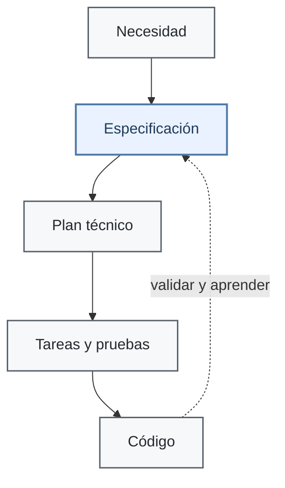

# Qué es SDD

> **Para quién:** toda la empresa, sepa programar o no · **Tiempo de lectura:** ~8 min · **Nivel:** 🟢 básico

En el capítulo anterior vimos el problema: si construimos a base de instrucciones sueltas, las decisiones terminan repartidas entre conversaciones, código y memoria.

SDD propone algo bastante sencillo: **escribir primero lo que queremos conseguir y usar ese texto para guiar la construcción**.

## SDD en una frase

SDD (*Spec-Driven Development*, desarrollo guiado por especificaciones) consiste en poner la especificación antes que el código.

Primero dejamos claro qué queremos, por qué y cómo sabremos que está bien. Después usamos esa información para preparar el plan técnico, dividir el trabajo y construir.

La especificación está pensada para que la puedan discutir personas. Puede tener estructura y reglas de redacción, pero sigue siendo lenguaje normal. El asistente acelera el proceso; las decisiones y la revisión siguen siendo humanas.

## La idea: primero el qué y el por qué

Con ReservaSalas, Ana no empieza diciendo «hazme una aplicación web». Empieza explicando el problema:

- hay doce salas;
- hoy se reservan en una hoja compartida;
- se producen solapamientos;
- cualquier empleado debe poder consultar disponibilidad, reservar y cancelar;
- el horario es de 08:00 a 20:00;
- una reserva no puede superar cuatro horas.

Con ayuda del asistente, eso se convierte en una **especificación** (`spec.md`).

Después llegan las preguntas que todavía faltan: ¿se permiten reservas recurrentes?, ¿quién puede cancelar una reserva ajena?, ¿con cuánta antelación se puede reservar? Las respuestas también quedan escritas.

Solo entonces Luis decide cómo construirlo y prepara el **plan técnico**. De ahí salen las tareas, las pruebas y el código.

En este curso usamos además una **constitución** del proyecto: unas pocas reglas estables —por ejemplo, datos mínimos o pruebas obligatorias— que sirven para tomar decisiones cuando hay varias opciones razonables.

El flujo completo está en [El flujo paso a paso](03-el-flujo-paso-a-paso.md). Aquí basta con una idea: **primero acordamos el comportamiento; después decidimos la tecnología**.

## Especificación y plan: qué, por qué, cómo

Esta separación es una de las partes más útiles de SDD.

- La **especificación** responde a **qué** tiene que hacer el sistema y **por qué**.
- El **plan técnico** responde a **cómo** lo vamos a construir.

Con ReservaSalas:

| Pregunta | Ejemplo |
|---|---|
| **¿Qué?** | Si una franja se solapa con otra reserva de la misma sala, el sistema debe rechazarla |
| **¿Por qué?** | La hoja compartida actual provoca choques y reservas fantasma |
| **¿Cómo?** | Python, FastAPI, SQLite, plantillas HTML y pruebas con pytest |

La tercera fila puede cambiar sin que cambie el problema. Podríamos elegir otra base de datos o incluso otro lenguaje y seguir construyendo el mismo producto.

Una regla práctica: si una frase menciona una tecnología concreta, normalmente pertenece al plan. «Guardar las reservas en SQLite» es una decisión técnica; «las reservas deben conservarse después de cerrar el navegador» describe comportamiento.

Los documentos completos del ejemplo están en la [especificación](../ejercicios/soluciones/03-reserva-salas/spec.md) y el [plan técnico](../ejercicios/soluciones/03-reserva-salas/plan.md).

## Antes y después



La diferencia importante no es que SDD añada documentos entre la idea y el código. Es que **las decisiones dejan rastro**.

Cuando aparece un cambio, podemos volver a la especificación y ver qué comportamiento se esperaba. Cuando aparece un bug, podemos comprobar si el código contradice algo que ya estaba escrito. Y cuando una decisión técnica cambia, sabemos que pertenece al plan y no al requisito de negocio.

## Qué cambia: la especificación deja de ser documentación decorativa

En muchos proyectos los requisitos se escriben al principio y poco después quedan desactualizados. A partir de ahí manda el código y el documento sirve, como mucho, para recordar cómo empezó todo.

En el enfoque que practicamos aquí, la especificación sigue viva. Es la referencia del comportamiento esperado.

Eso implica una distinción importante:

- **Si cambia lo que queremos que haga el sistema**, cambiamos primero la especificación y después actualizamos lo que dependa de ella.
- **Si la especificación sigue siendo correcta y el programa no la cumple**, tenemos un bug de implementación: se corrige el código y se añade una prueba.

Por ejemplo, si Ana decide pasar de 30 a 60 días de antelación máxima, eso es un cambio funcional. El requisito cambia primero y después se ajustan tareas, pruebas y código.

Si, en cambio, el requisito ya dice que no se permiten reservas fuera de 08:00–20:00 y la aplicación acepta una hasta las 20:30, no hay nada que renegociar: el código está mal.

Esta diferencia evita dos extremos: tratar el código como la única verdad o tratar la especificación como un texto intocable.

### Tres formas de usar una especificación

No todos los equipos llevan SDD hasta el mismo punto. Una forma útil de entenderlo es distinguir tres niveles:

- **Spec-first:** la especificación se escribe antes de construir y sirve para arrancar el trabajo.
- **Spec-anchored:** además de empezar por ella, se mantiene como referencia durante la evolución del producto.
- **Spec-as-source:** la especificación se trata como la fuente principal de la que se regeneran de forma sistemática otros artefactos y partes de la implementación.

Este curso se mueve sobre todo entre **spec-anchored** y **spec-as-source**, porque queremos practicar qué ocurre cuando un cambio funcional vuelve a la especificación y se propaga hacia abajo.

## Qué no es SDD

**No es documentación por documentación.** Si una sección no ayuda a decidir, construir o comprobar algo, sobra.

**No es cascada.** No se trata de cerrar durante meses un documento enorme. Se trabaja con funcionalidades pequeñas y se revisa la especificación cuando aprendemos algo nuevo.

**No significa que la especificación sea perfecta.** También puede contener errores, ambigüedades o decisiones equivocadas. Por eso se revisa.

**No significa que el asistente decida.** Puede proponer, redactar, comparar y generar código. La responsabilidad sigue estando en las personas.

**Y no depende de Spec Kit.** Una herramienta puede facilitar el proceso, pero el método también se puede practicar con plantillas y un asistente autorizado.

## Para quién es

Si **pides software**, puedes participar en el documento que realmente describe el comportamiento, sin tener que leer código. Puedes corregir requisitos, responder dudas y validar criterios de éxito.

Si **construyes software**, parte del trabajo se desplaza de teclear a dirigir y revisar: decidir tecnología, comprobar lo generado, diseñar pruebas y detectar contradicciones antes de que se conviertan en código.

SDD no elimina la conversación entre ambos grupos; intenta que las decisiones importantes que salen de esa conversación no desaparezcan después.

## Un ejemplo sin código: solicitud de vacaciones

Una especificación también puede describir un proceso que todavía no sabemos cómo se va a implementar.

Por ejemplo:

```markdown
# Especificación: Solicitud de vacaciones

**Problema:** hoy las vacaciones se piden por correo y el estado de cada solicitud no siempre está claro.

- **P1:** como empleado, quiero pedir días indicando las fechas.
- **P2:** como manager, quiero aprobar o rechazar la solicitud y dejar un motivo.
- **P3:** como empleado, quiero ver mi saldo y el estado de mis solicitudes.

- **RF-001:** El sistema deberá mostrar el saldo disponible.
- **RF-002:** CUANDO una persona envía una solicitud, el sistema deberá dejarla en estado pendiente y avisar a su manager.
- **RF-003:** SI una persona solicita más días de los disponibles, ENTONCES el sistema deberá rechazar la solicitud e indicar el saldo restante.

- **CE-001:** enviar una solicitud lleva menos de dos minutos.
```

No hay tecnología. Podría terminar siendo una aplicación, un formulario o una solución más sencilla. Lo importante es que ya podemos discutir el comportamiento.

En el [ejercicio 01](../ejercicios/01-tu-primera-especificacion-sin-codigo.md) se construye este ejemplo completo.

## De dónde viene

Escribir requisitos antes de programar no es nuevo. Lo que cambia con los asistentes de IA es la velocidad con la que ese texto puede convertirse en diseño, tareas, pruebas y código.

Herramientas como [GitHub Spec Kit](https://github.com/github/spec-kit) o [Kiro](https://kiro.dev) han popularizado flujos donde la especificación ocupa un papel mucho más activo. Para redactar requisitos, este curso utiliza además EARS (*Easy Approach to Requirements Syntax*), una técnica de ingeniería de requisitos anterior a la IA.

Las herramientas cambiarán. La idea importante es más estable: **hacer explícitas las decisiones antes de pedir que una máquina las convierta en software**.

## En tres frases

1. SDD pone la especificación antes que el código y separa el **qué y por qué** del **cómo**.
2. Cuando cambia una necesidad, el cambio empieza en la especificación; cuando el código contradice una especificación válida, tenemos un bug.
3. La especificación puede ser solo el punto de partida, mantenerse como ancla del proyecto o convertirse en la fuente desde la que se regeneran otros artefactos.

## Siguiente paso

Continúa con [El flujo paso a paso](03-el-flujo-paso-a-paso.md).

---

⬅️ [Anterior: El problema del vibe coding](01-el-problema-del-vibe-coding.md) · 🏠 [Índice de documentación](README.md) · ➡️ [Siguiente: El flujo paso a paso](03-el-flujo-paso-a-paso.md)
