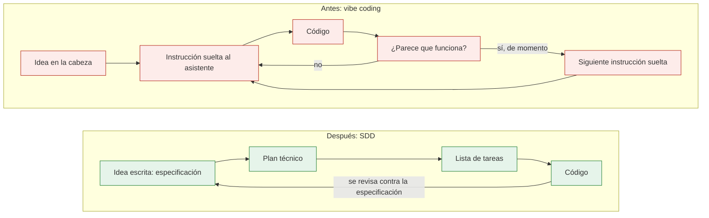

# Qué es SDD

> **Para quién:** todos los perfiles (managers, RRHH, negocio y quien programa) · **Tiempo de lectura:** ~10 min · **Nivel:** 🟢 básico

El [documento anterior](01-el-problema-del-vibe-coding.md) terminaba con un diagnóstico: cuando el software se hace a golpe de instrucciones sueltas, lo que falta es un contrato claro. Este documento explica qué es ese contrato, cómo se llama el método que lo pone en el centro y qué cambia cuando se trabaja así. Como en el anterior, no hace falta saber programar para seguirlo.

**Qué vas a encontrar**

- [SDD en una frase](#sdd-en-una-frase)
- [La idea: primero el qué y el por qué](#la-idea-primero-el-qué-y-el-por-qué)
- [Especificación y plan: qué, por qué, cómo](#especificación-y-plan-qué-por-qué-cómo)
- [Antes y después](#antes-y-después)
- [Qué cambia: la especificación es el programa fuente](#qué-cambia-la-especificación-es-el-programa-fuente)
- [Qué no es SDD](#qué-no-es-sdd)
- [Para quién es](#para-quién-es)
- [Un ejemplo sin código: solicitud de vacaciones](#un-ejemplo-sin-código-solicitud-de-vacaciones)
- [De dónde viene](#de-dónde-viene)

## SDD en una frase

SDD (*Spec-Driven Development*, desarrollo guiado por especificaciones) es una forma de construir software en la que primero se escribe, en lenguaje natural, qué queremos y por qué, y a partir de ese texto el asistente de IA genera el plan técnico, la lista de tareas y el código, con una persona revisando cada paso.

«Lenguaje natural» quiere decir castellano corriente, el de un correo o una conversación: sin código y sin palabras técnicas.

Eso es todo. El resto del repositorio son los detalles: cómo se escribe ese texto, qué pasos hay, quién hace qué y con qué herramientas. Pero si solo te quedas con una frase, que sea esa.

## La idea: primero el qué y el por qué

En el *vibe coding* (programar a golpe de instrucciones sueltas, improvisando con el asistente de IA) el orden es: pedir código, mirar, volver a pedir. En SDD el orden se invierte: primero se piensa y se escribe; después se genera.

Volvamos a ReservaSalas, la aplicación para reservar las 12 salas de reuniones de la empresa. Con SDD, la historia empieza de otra manera. Los seis puntos de abajo son los pasos del método, con el nombre que les da el resto del repositorio:

1. **Ana escribe lo que necesita**, en castellano y sin tecnología: cualquier empleado tiene que poder ver qué salas están libres en una franja, reservar una, cancelar o cambiar su reserva; horario de 08:00 a 20:00; nada de más de 4 horas; toda reserva con un responsable visible.

   Con ayuda del asistente, ese texto se convierte en una **especificación** (`spec.md`): historias de usuario (lo que cada tipo de persona quiere conseguir) ordenadas por prioridad, requisitos, criterios de éxito (cómo sabremos que ha funcionado, con cifras) y casos límite (las situaciones raras: ¿y si dos personas reservan a la vez?). Es el paso de especificar.

2. **El asistente pregunta lo que no está claro** («¿se pueden hacer reservas recurrentes?», «¿quién puede cancelar una reserva ajena?») y Ana responde. Las respuestas se incorporan a la especificación. Es el paso de aclarar.

3. **Luis, el programador, decide con el asistente cómo construirlo**: tecnología, estructura y cómo se guardan los datos. Eso es el **plan técnico** (`plan.md`). Es el paso de planificar.

4. **El plan se trocea en una lista de tareas** (`tasks.md`): pequeñas, comprobables y agrupadas por historia de usuario. Es el paso de trocear en tareas.

5. **Se comprueba que todo cuadra**: el asistente compara especificación, plan y tareas y avisa de huecos y contradicciones (un requisito sin tarea, una tarea que nadie pidió). Es el paso de analizar.

6. **El asistente ejecuta las tareas** una a una y escribe el código. Luis revisa, prueba y, si algo no cuadra, corrige la especificación y vuelve a generar. Es el paso de implementar.

Antes de todo eso hay un paso cero: la **constitución** (`constitution.md`), los principios innegociables del proyecto (sencillez, pruebas, datos mínimos...) que todo lo demás tiene que respetar.

Los siete pasos completos, con lo que entra y lo que sale en cada uno, están en [El flujo paso a paso](03-el-flujo-paso-a-paso.md); los documentos que se producen, uno a uno, en [Los artefactos](04-los-artefactos.md). Aquí basta con la idea: **el texto va antes que el código, y el código sale del texto**.

## Especificación y plan: qué, por qué, cómo

Hay dos documentos que conviene no confundir, porque responden a preguntas distintas y los escriben personas distintas.

- La **especificación** responde a **qué** queremos y **por qué**. La escribe (o la dicta) quien pide el software, con ayuda del asistente, y la puede leer cualquiera. No menciona tecnología.
- El **plan técnico** responde a **cómo** lo vamos a construir. Lo escribe quien programa, con el asistente, y lo revisa alguien con experiencia técnica. Aquí sí hay tecnología.

Con la analogía de [la reforma sin plano](01-el-problema-del-vibe-coding.md#la-reforma-sin-plano) del documento anterior: la especificación es el plano; el plan técnico, el presupuesto y las decisiones de obra.

Las tres preguntas, con ReservaSalas:

| Pregunta | Dónde se responde | Ejemplo en ReservaSalas |
|---|---|---|
| **¿Qué?** | Especificación (`spec.md`): historias de usuario y requisitos | «CUANDO una persona confirma una reserva, el sistema deberá guardarla y mostrar un mensaje de confirmación con sala, fecha y hora» (RF-003). «SI la franja solicitada se solapa con otra reserva de la misma sala, ENTONCES el sistema deberá rechazar la reserva e indicar qué franja está ocupada» (RF-005) |
| **¿Por qué?** | Especificación (`spec.md`): problema de partida y criterios de éxito | Hoy se reserva en una hoja de cálculo compartida y hay choques, salas vacías y reservas fantasma. Éxito: reservar una sala lleva menos de 1 minuto (CE-001) y cero reservas solapadas (CE-002) |
| **¿Cómo?** | Plan técnico (`plan.md`) | Aplicación web sencilla con Python 3.12 y FastAPI, datos en SQLite, páginas HTML con plantillas Jinja2 y pruebas con pytest |

Si no entiendes la última fila, no pasa nada: son nombres de tecnologías, y precisamente por eso van en el plan y no en la especificación.

Esos requisitos están redactados en EARS (*Easy Approach to Requirements Syntax*), una forma sencilla y estructurada de redactar requisitos: una frase, una sola cosa comprobable y el verbo «deberá». Se explica en [Escribir requisitos claros (EARS)](05-escribir-requisitos-claros-ears.md).

Una prueba rápida para saber si una frase está en el documento correcto: si menciona una tecnología (una base de datos, un lenguaje de programación, un producto concreto), es del plan, no de la especificación. «Las reservas se guardan en SQLite» es *cómo*; «ninguna reserva se pierde al cerrar el navegador» es *qué*.

Los dos documentos completos de ReservaSalas están en el ejemplo resuelto: [especificación](../ejercicios/soluciones/03-reserva-salas/spec.md) y [plan técnico](../ejercicios/soluciones/03-reserva-salas/plan.md).

## Antes y después

El diagrama muestra, en dos bloques, el camino que recorre una idea hasta convertirse en código: el bloque de arriba, «Antes: *vibe coding*», y el de abajo, «Después: SDD».



En el bloque de arriba, «Antes: *vibe coding*», la idea se queda en la cabeza y se lanza una instrucción suelta al asistente; aparece código y se mira si parece que funciona. Si no, otra instrucción; si sí, la siguiente instrucción suelta, y vuelta a empezar: un bucle sin un final definido.

En el bloque de abajo, «Después: SDD», la idea se escribe primero, en la especificación; de ahí salen, en orden, el plan técnico, la lista de tareas y el código. La única flecha de vuelta va del código a la especificación: el código se revisa contra lo que está escrito y, si algo no cuadra, se corrige el texto.

Fíjate en la diferencia entre las dos flechas de vuelta. En el primer bloque se vuelve a improvisar; en el segundo se vuelve a un documento que todo el mundo puede leer. Una versión más completa de esta comparación, con tabla incluida, está en el [diagrama 01](../diagramas/01-vibe-coding-vs-sdd.md).

## Qué cambia: la especificación es el programa fuente

En muchos proyectos ya existía un documento de requisitos. Se escribía al principio, se guardaba en una carpeta compartida y a las dos semanas estaba desactualizado. La frase habitual era: «no mires el documento, mira el código». El código era la verdad; el documento, un recuerdo.

SDD le da la vuelta a eso. En programación, el *código fuente* es el texto a partir del cual se construye el programa; en SDD, la especificación pasa a jugar ese papel: es el «programa fuente», el texto del que todo lo demás se deriva. El asistente la lee y genera el plan, las tareas y el código. Si la especificación cambia, el código cambia. Si el código no hace lo que dice la especificación, el que está mal es el código.

Un ejemplo. Ana decide ampliar la antelación máxima de 30 a 60 días: a partir de ahora se podrá reservar una sala hasta dos meses antes.

- **En ReservaSalas v0** (la versión sin SDD del documento anterior), Luis le pediría al asistente «cambia la antelación», el asistente buscaría dónde está escondido el «30» en el código, lo cambiaría y, con suerte, no rompería nada más. Nadie sabría después por qué la antelación es la que es.
- **Con SDD**, Ana cambia la especificación: el requisito RF-006, que rechaza las reservas que empiezan «más de 30 días después de hoy», pasa a decir «más de 60 días», y con él el caso límite que lo acompaña. Luis vuelve a generar el plan y las tareas afectadas, el asistente actualiza el código y las pruebas, y la nueva antelación queda escrita donde cualquiera puede verla.

No es casualidad: la [constitución de ReservaSalas](../ejercicios/soluciones/03-reserva-salas/constitution.md) lo deja fijado como regla. Los límites de uso se fijan en la especificación, no en el código; cambiarlos es cambiar la especificación y regenerar.

Es el mensaje central de todo el repositorio: **la especificación es la fuente de verdad; el código es su consecuencia.** Si algo está mal, se corrige la especificación y se regenera; no se parchea el código a ciegas.

Para quien no programa, esto tiene una consecuencia práctica: lo que revisas y apruebas es un texto, no código. Y cuando algo falla, la primera pregunta deja de ser «¿quién tocó el código?» y pasa a ser «¿qué dice la especificación?». Quien programe lo vivirá en primera persona en el [ejercicio 03](../ejercicios/03-reserva-salas-paso-a-paso.md): su momento clave es pedir un cambio tocando la especificación y no el código.

> [!IMPORTANT]
> SDD no es magia. El asistente puede entender mal una frase, y una especificación puede ser ambigua o estar equivocada. Por eso el método incluye pasos para aclarar dudas, analizar la coherencia entre documentos y comprobar con pruebas automáticas, y por eso una persona revisa cada resultado. SDD reduce los riesgos del *vibe coding*; no los elimina.

## Qué no es SDD

Como cualquier idea nueva, SDD se confunde fácilmente con cosas que ya conocíamos. Cuatro aclaraciones.

- **No es volver a la documentación pesada.** Una especificación describe una funcionalidad, no un sistema entero, y ocupa unas pocas páginas. La de ReservaSalas se lee en unos diez minutos. Y es un documento vivo: cambia cada vez que cambia lo que queremos.
- **No es «cascada».** En el desarrollo en cascada se planificaba todo al principio, durante meses, y después no se tocaba. En SDD se trabaja funcionalidad a funcionalidad, en ciclos cortos, y la especificación se corrige en cuanto se aprende algo nuevo. SDD también avanza en ciclos cortos, como el *vibe coding*; la diferencia es que cada cosa que se aprende queda escrita y no se pierde.
- **No es escribir más por escribir.** Cada sección de la especificación existe porque el asistente la usa para generar algo: las historias priorizadas ordenan el trabajo, los requisitos se convierten en pruebas automáticas, los criterios de éxito dicen cuándo parar. Si una sección no cambia lo que se construye, sobra.
- **No sustituye a las personas.** Alguien decide qué se construye y por qué, alguien responde a las preguntas del asistente, alguien revisa el plan, prueba el resultado y responde de él. El asistente propone; las personas deciden.

Tampoco es una herramienta concreta. Hay herramientas que lo facilitan mucho, pero el método se puede seguir con unas plantillas y cualquier asistente de IA autorizado por la empresa. Lo cuenta [Herramientas](07-herramientas.md).

## Para quién es

SDD interesa a dos grupos de personas que hasta ahora hablaban poco entre sí.

- **Si pides software** (negocio, managers, RRHH, responsables de un proceso): la especificación se escribe en tu idioma. Puedes redactarla, revisarla, responder a las preguntas de aclaración y comprobar los criterios de éxito sin leer una línea de código. Una especificación bien escrita sustituye a muchos correos y reuniones de «yo pensaba que...».
- **Si lo construyes** (programadores junior y con experiencia): tecleas menos y piensas más. Tu trabajo pasa a ser dirigir al asistente, revisar lo que genera, decidir la tecnología y vigilar que el resultado cumple lo escrito. Para alguien que empieza, el método da una estructura que antes solo daba la experiencia.

Quién hace qué en cada paso, con una tabla por rol, está en [Roles: quién hace qué](06-roles-quien-hace-que.md).

> [!TIP]
> Escribir una especificación también sirve para procesos que no son software, o que todavía no sabes si lo serán. Poner por escrito qué quieres, por qué y cómo sabrás que está bien es útil aunque al final lo resuelva una hoja de cálculo o un procedimiento en papel. El ejemplo siguiente es de ese tipo.

## Un ejemplo sin código: solicitud de vacaciones

Para ver que una especificación no necesita tecnología ni programadores, aquí tienes una de apenas una docena de líneas para un proceso que todo el mundo conoce: pedir días de vacaciones. Una persona pide días; su manager aprueba o rechaza con un motivo; RRHH lo registra y el saldo de días se actualiza.

```markdown
# Especificación: Solicitud de vacaciones

**Problema**: hoy los días libres se piden por correo; se pierden peticiones y nadie sabe cuántos días le quedan a cada persona.

- **Historia 1 - Pedir días de vacaciones (P1)**: como empleado, quiero pedir días libres indicando las fechas, para que mi manager los apruebe.
- **Historia 2 - Aprobar o rechazar una solicitud (P2)**: como manager, quiero aprobar o rechazar una solicitud y, si la rechazo, indicar el motivo.
- **Historia 3 - Ver el saldo y las solicitudes (P3)**: como empleado, quiero ver cuántos días me quedan y en qué estado están mis solicitudes.
- **RF-001**: El sistema deberá mostrar a cada persona su saldo de días de vacaciones del año en curso: días totales, consumidos, pendientes de decidir y disponibles.
- **RF-003**: CUANDO una persona envía una solicitud, el sistema deberá registrarla en estado «pendiente» y avisar a su manager con las fechas y los días laborables que consume.
- **RF-004**: SI una persona pide más días de los que tiene disponibles, ENTONCES el sistema deberá rechazar la solicitud e indicar cuántos días le quedan.
- **RF-009**: CUANDO la manager aprueba o rechaza una solicitud, el sistema deberá registrar la decisión, con quién la tomó y cuándo, y comunicársela a la persona solicitante junto con el motivo si es un rechazo.
- **RF-011**: CUANDO una solicitud queda aprobada, el sistema deberá descontar cada día del saldo del año al que pertenece y dejar la solicitud registrada para RRHH.
- **CE-001**: Pedir vacaciones, desde que se abre la solicitud hasta que se envía, lleva menos de 2 minutos.
- **CE-002**: El 100 % de las solicitudes aprobadas quedan registradas para RRHH sin que nadie las copie a mano.
```

Fíjate en tres cosas. No hay ni una palabra de tecnología: podría acabar siendo una aplicación, un formulario o un procedimiento en papel. Las historias llevan prioridad (P1 es lo imprescindible; si solo se hiciera eso, ya serviría). Y cada requisito es una frase con una sola cosa comprobable: cualquiera puede leer RF-004 y decir si el sistema lo cumple o no.

Esta especificación la podría escribir Jorge, de RRHH, sin ayuda de nadie técnico. Es exactamente lo que se hace en el [ejercicio 01](../ejercicios/01-tu-primera-especificacion-sin-codigo.md), con la [plantilla de especificación](../ejercicios/plantillas/especificacion.md); la versión completa, con los catorce requisitos de los que salen estos cinco (por eso la numeración salta), está en [la solución del ejercicio](../ejercicios/soluciones/01-solicitud-de-vacaciones/especificacion.md).

## De dónde viene

Escribir requisitos antes de programar no es nuevo. Lo nuevo es que ahora hay quien los lee y los convierte en código en muy poco tiempo: el asistente de IA. Eso ha convertido la especificación, que muchas veces era un trámite, en la pieza central del proyecto, y ha dado nombre al método.

Dos organizaciones lo han impulsado con herramientas propias.

**GitHub, con Spec Kit** (<https://github.com/github/spec-kit>; documentación en <https://github.github.io/spec-kit/>). Es un conjunto de herramientas de código abierto (gratuito y con el código a la vista de cualquiera). Se instala con una herramienta de línea de comandos llamada `specify`: un programa que se maneja escribiendo órdenes en la terminal, la ventana de texto del ordenador.

`specify` prepara el proyecto y añade al asistente de IA una serie de comandos `/speckit.*`: por ejemplo, `/speckit.specify` crea la especificación y `/speckit.plan`, el plan técnico. Funciona con muchos asistentes de programación; Claude Code, GitHub Copilot, Cursor o Gemini CLI son ejemplos de asistentes compatibles. Es la herramienta que se instala en el [ejercicio 00](../ejercicios/00-preparacion-del-entorno.md) y se usa en los ejercicios [03](../ejercicios/03-reserva-salas-paso-a-paso.md) y [06](../ejercicios/06-reto-final-tu-propio-proyecto.md); para los demás ejercicios no hace falta instalar nada.

**AWS, con Kiro** (<https://kiro.dev>). Es un editor de código (el programa con el que se escribe y organiza el código) que lleva integrado un flujo del mismo tipo: especificación, diseño y tareas. No necesita Spec Kit; trae su propio proceso.

Y una fuente más antigua: EARS (*Easy Approach to Requirements Syntax*), la forma de redactar requisitos que usamos en todas las especificaciones. Viene de la ingeniería de requisitos: la propusieron Alistair Mavin y otros en 2009, mucho antes de los asistentes de IA. SDD no la inventa; la aprovecha.

Las herramientas cambian deprisa (los comandos de hoy pueden no ser los de dentro de seis meses, y hasta su forma de escribirlos varía según el asistente: `/speckit.specify` en unos, `/speckit-specify` en otros). El método, no. Por eso este repositorio explica primero el método y deja las herramientas para [su propio documento](07-herramientas.md).

## En tres frases

1. SDD (desarrollo guiado por especificaciones) consiste en escribir primero, en lenguaje natural, qué queremos y por qué; a partir de ese texto el asistente de IA genera el plan técnico, las tareas y el código, y una persona revisa cada paso.
2. La especificación responde al qué y al por qué, sin tecnología; el plan técnico responde al cómo. La especificación es la fuente de verdad: si algo está mal, se corrige el texto y se regenera, no se parchea el código.
3. No es documentación pesada ni «cascada», y no sustituye a nadie: sirve tanto a quien pide software como a quien lo construye, y una especificación de una docena de líneas la puede escribir cualquiera.

## Siguiente paso

Continúa con [El flujo paso a paso](03-el-flujo-paso-a-paso.md), donde se recorren los siete pasos de SDD con ReservaSalas: qué entra, qué sale y quién participa en cada uno.

---

⬅️ [Anterior: El problema del vibe coding](01-el-problema-del-vibe-coding.md) · 🏠 [Índice de documentación](README.md) · ➡️ [Siguiente: El flujo paso a paso](03-el-flujo-paso-a-paso.md)
