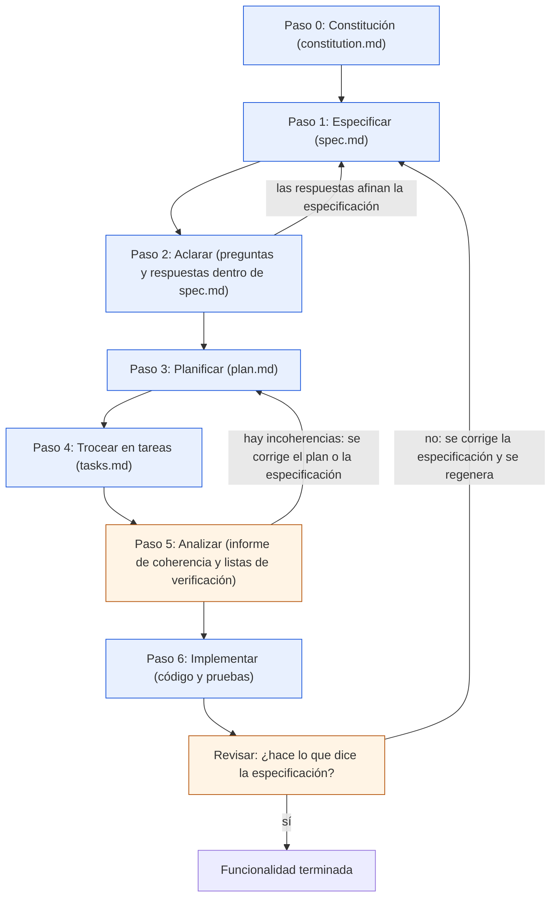

# El flujo paso a paso

> **Para quién:** programadores junior y cualquier persona que quiera saber qué pasa en cada paso · **Tiempo de lectura:** ~15 min · **Nivel:** 🟡 intermedio

SDD (*Spec-Driven Development*, desarrollo guiado por especificaciones) es un flujo de siete pasos, numerados del 0 al 6. Cada paso deja algo escrito (un documento casi siempre; un informe, en el paso de analizar) que el siguiente necesita como entrada. Aquí recorremos los siete con el mismo ejemplo de siempre, ReservaSalas: qué es cada paso, quién participa, qué entra y qué sale, cuánto suele durar y qué puede salir mal.

Si todavía no sabes qué es SDD, empieza por [Qué es SDD](02-que-es-sdd.md). Si lo que quieres es ver cada documento por dentro, eso está en [Los artefactos](04-los-artefactos.md). Cuando leas «en Spec Kit», hablamos de GitHub Spec Kit, la herramienta gratuita que añade este flujo a tu asistente de IA en forma de comandos (`/speckit.constitution`, `/speckit.specify`…); la vemos al final del documento y, con más detalle, en [Herramientas](07-herramientas.md).

**Qué vas a encontrar**

- [El flujo de un vistazo](#el-flujo-de-un-vistazo)
- [Paso 0: Constitución](#paso-0-constitución)
- [Paso 1: Especificar](#paso-1-especificar)
- [Paso 2: Aclarar](#paso-2-aclarar)
- [Paso 3: Planificar](#paso-3-planificar)
- [Paso 4: Trocear en tareas](#paso-4-trocear-en-tareas)
- [Paso 5: Analizar](#paso-5-analizar)
- [Paso 6: Implementar](#paso-6-implementar)
- [Resumen: paso, artefacto y responsable](#resumen-paso-artefacto-y-responsable)
- [Cada herramienta lo llama a su manera](#cada-herramienta-lo-llama-a-su-manera)
- [Por qué el orden importa](#por-qué-el-orden-importa)

## El flujo de un vistazo

Los tiempos que verás en cada paso son orientativos: en nuestra experiencia, una funcionalidad pequeña como ReservaSalas recorre los siete pasos en uno o dos días de trabajo, y la mayor parte se va en el último. Lo importante no es cuánto dura cada paso, sino que no se salte ninguno por prisa.

El diagrama muestra los siete pasos en orden, el fichero que produce cada uno y los tres bucles de vuelta: aclarar cambia la especificación, analizar puede devolverte al plan, e implementar termina siempre con una pregunta: ¿hace lo que dice la especificación?

De arriba abajo: primero la constitución, después la especificación, que se afina con las aclaraciones; de ahí salen el plan y las tareas, que se analizan antes de implementar. Al final se revisa el resultado contra la especificación: si cuadra, la funcionalidad está terminada; si no, se corrige la especificación y se regenera lo que haga falta. Nunca se parchea el código a ciegas.

Una versión más detallada de este diagrama, con quién participa en cada paso, está en [el diagrama del flujo completo](../diagramas/02-flujo-completo-sdd.md).

## Paso 0: Constitución

**Qué es.** Los principios innegociables del proyecto: las reglas que la especificación, el plan, las tareas y el código tienen que respetar. Se escribe una vez por proyecto, no una vez por funcionalidad. Es el paso 0 porque va antes de pedir nada concreto.

**Quién participa.** Quien encarga el proyecto y quien lo construye, juntos. El asistente de IA redacta a partir de lo que le dictan; aprueba quien encarga.

**Qué entra y qué sale.** Entran entre tres y siete principios en lenguaje natural. Sale la constitución (`constitution.md`); en Spec Kit, `.specify/memory/constitution.md`.

**Cuánto suele durar.** Una conversación de media hora o una hora. Después casi no se toca.

**ReservaSalas.** Ana dicta cinco principios: sencillez primero, accesible y en castellano, pruebas antes de dar algo por hecho, datos mínimos y transparencia (toda reserva tiene un responsable visible). Luis se los pasa al asistente con `/speckit.constitution` y aparece la constitución en su versión 1.0.0, con una sección de restricciones (solo red interna, sin integración con el calendario corporativo) y otra que dice cómo se cambia.

**Qué puede salir mal.** Una constitución genérica copiada de otro sitio («código limpio», «buenas prácticas») que no prohíbe nada y por tanto no sirve para decidir nada. O saltarse el paso «porque el proyecto es pequeño»: entonces las decisiones de fondo las toma el asistente sobre la marcha, sin que nadie las haya escrito.

## Paso 1: Especificar

**Qué es.** Escribir qué queremos y por qué, en lenguaje natural y sin decidir tecnología. La especificación recoge historias de usuario (lo que cada tipo de persona quiere conseguir, contado en unas líneas) ordenadas por prioridad (P1 es lo imprescindible), criterios de aceptación (situaciones concretas que se comprueban con un sí o un no, en formato Dado/Cuando/Entonces), requisitos funcionales redactados en EARS (*Easy Approach to Requirements Syntax*, una forma sencilla y estructurada de redactar requisitos), casos límite (las situaciones raras o incómodas), criterios de éxito medibles y supuestos. Es el paso imprescindible: sin especificación no hay nada que planificar ni construir.

**Quién participa.** Lidera quien pide el software (negocio), con ayuda de quien lo construye. El asistente de IA convierte la descripción en una especificación completa. La revisan quien la va a construir y QA; las personas que la usarán (como Marta o Jorge) la consultan y aportan.

**Qué entra y qué sale.** Entra la petición en lenguaje natural. Sale la especificación (`spec.md`); en Spec Kit, `specs/001-reserva-salas/spec.md`, junto con una lista de verificación automática (`checklists/requirements.md`). Si al asistente le falta información, deja marcadores `[NECESITA ACLARACIÓN: …]` (tres como máximo) para el paso siguiente.

**Cuánto suele durar.** Una o dos horas: describir, generar y, sobre todo, leer con calma lo generado.

**ReservaSalas.** Ana escribe su petición: 12 salas en 3 plantas, hoy se reservan en una hoja de cálculo, hay choques y reservas fantasma; cualquier empleado tiene que ver qué salas están libres, reservar, cancelar y ver sus reservas; horario de 08:00 a 20:00 y máximo 4 horas. Luis ejecuta `/speckit.specify` con ese texto. La especificación resultante tiene tres historias (P1 reservar una sala, P2 cancelar o modificar, P3 ver mis reservas y las de hoy), requisitos como RF-005 («SI la franja solicitada se solapa con otra reserva de la misma sala, ENTONCES el sistema deberá rechazar la reserva e indicar qué franja está ocupada») y criterios de éxito como CE-001 (reservar lleva menos de 1 minuto).

**Qué puede salir mal.** Que se cuele tecnología («una base de datos», «una API», es decir, una conexión para que otros programas la usen): eso va al plan. Requisitos vagos («que sea rápido»). Historias sin prioridad, o una P1 que no sirve de nada por sí sola. Y el más frecuente: aceptar la especificación generada sin leerla.

## Paso 2: Aclarar

**Qué es.** El asistente de IA relee la especificación buscando huecos (alcance, roles, datos, casos límite, avisos) y hace preguntas, de una en una, con una respuesta recomendada. Las respuestas se incorporan a la especificación: cambian requisitos, añaden casos límite o acotan el alcance.

**Quién participa.** Pregunta el asistente (o quien construye); responde quien encarga el proyecto. Si responde quien no decide, el paso no vale.

**Qué entra y qué sale.** Entra la especificación recién generada. Sale la misma especificación, actualizada: en Spec Kit, `/speckit.clarify` hace hasta cinco preguntas por sesión y añade a `spec.md` la sección `## Clarifications` con una línea por pregunta (`- Q: … → A: …`), además de retocar las secciones afectadas y reevaluar la lista de verificación automática.

**Cuánto suele durar.** Una reunión de 15 a 30 minutos con la persona que decide.

**ReservaSalas.** El asistente hace cinco preguntas y Ana responde: ¿reservas recurrentes? No en la primera versión. ¿Quién puede cancelar una reserva ajena? Solo administración. ¿Hay que avisar por correo? Sí, un correo de confirmación. ¿Antelación máxima? 30 días. ¿Qué pasa si nadie aparece? Fuera de alcance. Resultado: dos requisitos nuevos (RF-010 permisos y RF-011 correo), el límite de 30 días en RF-006 y dos puntos más en «Fuera de alcance». Está contado paso a paso en [aclaraciones.md](../ejercicios/soluciones/03-reserva-salas/aclaraciones.md).

**Qué puede salir mal.** Responder por correo o de palabra y no reflejarlo en la especificación: para el asistente, lo que no está en `spec.md` no existe. Saltarse el paso por prisa y descubrir la duda cuando el código ya está hecho. Y dejar que se cuelen preguntas de tecnología, que pertenecen al plan.

> [!TIP]
> Si no programas, hasta aquí el flujo es exactamente el mismo para un proceso sin código, como la «Solicitud de vacaciones» del [ejercicio 01](../ejercicios/01-tu-primera-especificacion-sin-codigo.md): describir, especificar y aclarar. Los pasos 3 a 6 son los que necesitan a alguien que construya.

## Paso 3: Planificar

**Qué es.** Decidir cómo lo haremos: tecnología, arquitectura, modelo de datos (qué información guarda el sistema), contratos (qué entra y qué sale en cada operación) y estructura de carpetas. Cada decisión se justifica contra la constitución; si algo se desvía, se escribe por qué.

**Quién participa.** Lidera quien construye, con el asistente de IA; revisa alguien con experiencia técnica. Quien encarga el proyecto solo necesita leer el resumen y la tabla de comprobación contra la constitución.

**Qué entra y qué sale.** Entran la especificación, la constitución y las indicaciones de tecnología. Sale el plan técnico (`plan.md`). En Spec Kit, `/speckit.plan` genera además ficheros de apoyo: `research.md` (decisiones y alternativas), `data-model.md`, `contracts/` y `quickstart.md`. No genera la lista de tareas: eso es el paso siguiente.

**Cuánto suele durar.** Alrededor de una hora entre generar y revisar.

**ReservaSalas.** Luis indica al asistente la tecnología: Python 3.12 con FastAPI, SQLite y páginas HTML con Jinja2, pruebas con pytest y sin una interfaz compleja (son nombres de herramientas de programación; no hace falta conocerlos para seguir el flujo). El plan describe un único servicio web, tres tablas de datos (sala, persona, reserva), seis operaciones (las «rutas») y una tabla de comprobación contra la constitución con una sola desviación justificada: una pequeña API, la conexión para otros programas que ha salido en el paso 1, que aquí sirve para que las pruebas automáticas no dependan de las pantallas. Puedes leerlo en [plan.md](../ejercicios/soluciones/03-reserva-salas/plan.md).

**Qué puede salir mal.** Un plan de cuarenta páginas que nadie lee. Una tecnología que choca con la constitución (un servicio en la nube cuando el principio es «datos mínimos»). Planificar con aclaraciones pendientes. Y dejar que el asistente decida todo sin comprobar la tabla de la constitución.

## Paso 4: Trocear en tareas

**Qué es.** Convertir el plan en una lista ordenada de tareas pequeñas y comprobables, agrupadas por fases: preparación, base compartida, una fase por historia de usuario (primero sus pruebas, luego su implementación) y remate. Cada tarea nombra el fichero que toca; `[P]` marca las que se pueden hacer en paralelo y `[HU1]`, `[HU2]`, `[HU3]` la historia a la que pertenecen.

**Quién participa.** Quien construye, con el asistente de IA; revisan el programador senior y QA. Quien encarga no interviene en este paso, pero las tareas fijan los puntos de control en los que verá avances durante la implementación.

**Qué entra y qué sale.** Entran el plan y la especificación (y los ficheros de apoyo del plan, si existen). Sale la lista de tareas (`tasks.md`); en Spec Kit, `/speckit.tasks`.

**Cuánto suele durar.** Generarla lleva minutos; revisarla, de 20 a 30 minutos bien empleados.

**ReservaSalas.** La lista tiene 47 tareas en seis fases, 20 de ellas paralelizables. La fase de la historia 1 empieza con cinco pruebas (T013 a T017) que tienen que fallar antes de implementar nada (si fallan es que de verdad comprueban algo que todavía no existe), y termina con un punto de control: «la historia 1 funciona de principio a fin y se puede enseñar a Ana». Es el producto mínimo viable: lo más pequeño que ya resuelve el problema y se puede enseñar. Está completa en [tasks.md](../ejercicios/soluciones/03-reserva-salas/tasks.md).

**Qué puede salir mal.** Tareas gigantes («hacer toda la parte del servidor») que no se pueden dar por terminadas con un sí o un no. Tareas sin fichero. Fases de historia sin pruebas. Y no comprobar que cada requisito de la especificación aparece en alguna tarea: si falta uno, no se implementará.

## Paso 5: Analizar

**Qué es.** La última comprobación antes de escribir código: ¿cada requisito tiene una tarea? ¿El plan respeta la constitución? ¿Hay contradicciones entre especificación, plan y tareas? A esto se suman las listas de verificación (*checklists*), que hacen preguntas de sí o no sobre la calidad de la propia especificación.

**Quién participa.** El asistente de IA produce el informe; quien construye y quien encarga deciden qué corregir. Las listas de verificación las pasa alguien que no escribió la especificación (la automática la evalúa el propio asistente).

**Qué entra y qué sale.** Entran la especificación, el plan, las tareas y la constitución. En Spec Kit, `/speckit.analyze` devuelve un informe en el chat y no modifica ningún fichero: propone remedios para que los apruebes. `/speckit.checklist` genera listas por tema en `checklists/<dominio>.md` (por ejemplo, `ux.md`) y nunca marca casillas: eso lo hace quien revisa.

**Cuánto suele durar.** De 15 a 30 minutos.

**ReservaSalas.** La lista de verificación de la especificación pasa de 20 a 23 comprobaciones superadas después de aclarar (el alcance, la antelación máxima y los permisos eran los tres huecos). El informe de `/speckit.analyze` no encuentra incidencias críticas: cada RF aparece en alguna tarea y las pruebas van antes que el código, como exige el principio 3. Está en [checklist.md](../ejercicios/soluciones/03-reserva-salas/checklist.md).

**Qué puede salir mal.** Saltárselo porque «ya está todo claro». Aceptar los remedios del informe sin leerlos. Marcar casillas sin comprobar nada. Y confundir la lista de verificación con pruebas del código: comprueba el texto, no el programa.

> [!NOTE]
> En Spec Kit estas dos comprobaciones no van juntas: `checklist` se sitúa justo después de `plan` (necesita `plan.md`) y `analyze` después de `tasks`. Nosotros las agrupamos en un solo paso porque cumplen la misma función: parar y mirar antes de construir.

## Paso 6: Implementar

**Qué es.** El asistente de IA ejecuta las tareas una a una, fase a fase, y va marcando las hechas. La persona supervisa: lee el código, ejecuta las pruebas, arranca la aplicación y la prueba. Si el resultado no es lo que se quería, se corrige la especificación y se regenera la parte afectada; el código a mano se toca solo para detalles.

**Quién participa.** Ejecuta el asistente; supervisa quien construye; quien encarga prueba la aplicación en cada punto de control.

**Qué entra y qué sale.** Entran la lista de tareas y el plan. Sale el código del proyecto, con sus pruebas, y `tasks.md` con cada tarea terminada marcada como `[X]`. En Spec Kit, `/speckit.implement` comprueba antes las listas de verificación (si hay ítems sin marcar, pregunta si seguir) y respeta las marcas `[P]`. Después, `/speckit.converge` compara el código con la especificación, el plan y las tareas: si falta algo, añade tareas nuevas; si no, responde que ha convergido.

**Cuánto suele durar.** Es el paso más largo: varias horas, repartidas por fases, con paradas para probar.

**ReservaSalas.** Tras las fases de preparación y base compartida, el asistente escribe las pruebas de la historia 1 (fallan), implementa los servicios de disponibilidad y reserva, las rutas y la página principal, y las pruebas pasan. Luis arranca la aplicación, abre `http://localhost:8000` (la dirección de la aplicación en su propio ordenador) y reserva la sala Mediterráneo; se la enseña a Ana antes de seguir con las historias 2 y 3. Semanas después Ana quiere ampliar la antelación máxima de 30 a 60 días: Luis no busca el número en el código, cambia RF-006 en la especificación, regenera el plan y las tareas afectadas y vuelve a implementar esa parte.

**Qué puede salir mal.** Aceptar código sin leerlo. Corregir el código a mano en vez de la especificación, con lo que el documento deja de ser la fuente de verdad. Tener una demo bonita sin pruebas que la respalden. Y dar por terminada una fase con tareas sin marcar.

> [!IMPORTANT]
> El asistente de IA no acierta siempre. SDD no elimina los errores; los hace visibles antes, porque cada paso deja un documento que se puede leer, discutir y corregir. Las pruebas automáticas y la revisión humana siguen siendo imprescindibles.

## Resumen: paso, artefacto y responsable

| Paso | Qué entra | Qué sale (fichero) | Quién lidera | Quién revisa |
|---|---|---|---|---|
| 0. Constitución | Principios en lenguaje natural | Constitución (`constitution.md`) | Quien encarga y quien construye | Quien encarga aprueba |
| 1. Especificar | Petición en lenguaje natural | Especificación (`spec.md`) y lista de verificación automática | Negocio, con quien construye | Todo el equipo |
| 2. Aclarar | La especificación | La especificación actualizada (sección de aclaraciones) | El asistente de IA pregunta | Quien encarga responde |
| 3. Planificar | Especificación, constitución y tecnología elegida | Plan técnico (`plan.md`) y ficheros de apoyo | Quien construye | Alguien con experiencia técnica; negocio lee el resumen |
| 4. Trocear en tareas | Plan y especificación | Lista de tareas (`tasks.md`) | Quien construye | Programador senior y QA |
| 5. Analizar | Especificación, plan, tareas y constitución | Informe de coherencia y listas de verificación | El asistente de IA | Quien construye y quien encarga deciden |
| 6. Implementar | Tareas y plan | Código con pruebas; tareas marcadas | El asistente de IA ejecuta | Quien construye revisa; quien encarga prueba |

Quién hace qué en cada rol, con más detalle, está en [Roles: quién hace qué](06-roles-quien-hace-que.md).

## Cada herramienta lo llama a su manera

Los siete pasos son el método. Las herramientas que lo automatizan les ponen sus propios nombres. En GitHub Spec Kit (<https://github.com/github/spec-kit>) cada paso es un comando que se escribe en el chat del asistente de IA, no en la terminal (la ventana donde se escriben órdenes al ordenador); antes hay que crear el proyecto una sola vez desde la terminal con `specify init`.

| Nuestro nombre | Comando en Spec Kit | Fichero que crea o modifica | ¿Obligatorio? |
|---|---|---|---|
| 0. Constitución | `/speckit.constitution` | `.specify/memory/constitution.md` | Recomendado, una vez por proyecto |
| 1. Especificar | `/speckit.specify` | `specs/NNN-nombre/spec.md` y `checklists/requirements.md` | Sí |
| 2. Aclarar | `/speckit.clarify` | `spec.md` (añade la sección de aclaraciones) | Opcional, muy recomendado |
| 3. Planificar | `/speckit.plan` | `plan.md`, `research.md`, `data-model.md`, `contracts/`, `quickstart.md` | Sí |
| 4. Trocear en tareas | `/speckit.tasks` | `tasks.md` | Sí |
| 5. Analizar | `/speckit.checklist` y `/speckit.analyze` | `checklists/<dominio>.md`; el análisis no crea ficheros | Opcional, muy recomendado |
| 6. Implementar | `/speckit.implement` y después `/speckit.converge` | Código del proyecto; `tasks.md` con marcas `[X]` y, si hace falta, tareas nuevas | Sí (`converge` es recomendado) |

El orden oficial completo de Spec Kit es `constitution → specify → clarify → plan → checklist → tasks → analyze → implement → converge`; para funcionalidades muy pequeñas admite el camino corto `specify → plan → tasks → implement → converge`. La ortografía de los comandos cambia según el asistente (`/speckit.specify` en unos, `/speckit-specify` en otros), pero hacen lo mismo.

Kiro, de AWS (<https://kiro.dev>), integra un flujo parecido dentro de su editor con sus propios nombres. Y el método se puede seguir sin ninguna herramienta, con las [plantillas](../ejercicios/plantillas/README.md) de este repositorio y cualquier chat de IA autorizado. Las tres opciones están comparadas en [Herramientas](07-herramientas.md).

## Por qué el orden importa

Cada paso existe porque el siguiente lo necesita como entrada. No se puede planificar lo que no está especificado: el plan decidiría tecnología para un problema que nadie ha descrito. No se puede trocear en tareas lo que no está planificado: las tareas dirían «hacer la aplicación». Y no se implementa sin tareas: el asistente escribiría código de un tirón, sin pruebas y sin puntos de control, que es justo el *vibe coding* (programar a golpe de instrucciones sueltas, improvisando con el asistente de IA) del que queríamos salir.

El orden tampoco es una «cascada» (el modelo antiguo: meses de documentos antes de ver nada funcionando). Se recorre entero para cada funcionalidad pequeña, en horas o en un par de días, y los bucles de vuelta son cortos: una aclaración cambia una línea de la especificación, un análisis devuelve una incoherencia al plan, una prueba fallida devuelve una duda a la especificación.

Lo que no cambia es la dirección: la especificación es la fuente de verdad y el código es su consecuencia. Si al final algo está mal, se corrige el documento y se regenera; no se parchea el programa a ciegas.

## En tres frases

1. SDD son siete pasos, del 0 al 6: constitución, especificar, aclarar, planificar, trocear en tareas, analizar e implementar; cada uno deja algo escrito que el siguiente necesita.
2. Quien encarga lidera los pasos 0 a 2 (qué y por qué) con ayuda técnica; quien construye lidera los pasos 3 a 6 (cómo), con el asistente de IA generando y la persona revisando.
3. El orden importa porque cada paso es la entrada del siguiente; cuando algo falla, se vuelve a la especificación y se regenera, nunca se parchea el código a ciegas.

## Siguiente paso

Continúa con [Los artefactos](04-los-artefactos.md), donde abrimos uno por uno los documentos que produce el flujo.

---

⬅️ [Anterior: Qué es SDD](02-que-es-sdd.md) · 🏠 [Índice de documentación](README.md) · ➡️ [Siguiente: Los artefactos](04-los-artefactos.md)
