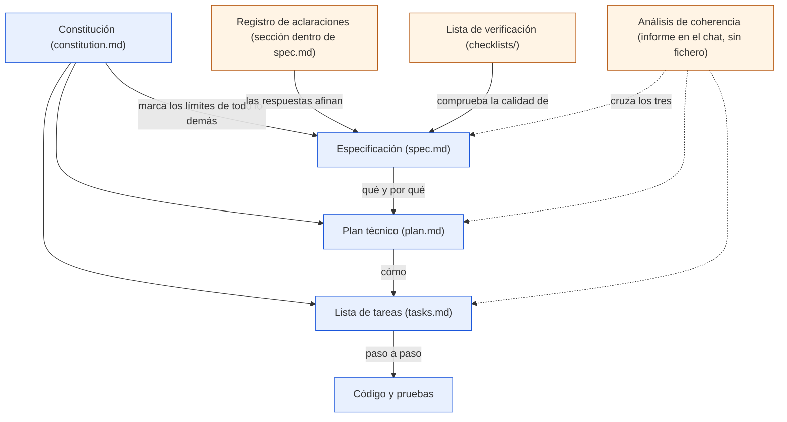

# Los artefactos

> **Para quién:** quien vaya a construir con SDD y cualquier persona que vaya a escribir o revisar una especificación · **Tiempo de lectura:** ~15 min · **Nivel:** 🟡 intermedio

Durante el flujo van apareciendo varios documentos. Llamarlos «artefactos» suena más solemne de lo que son: simplemente son las piezas escritas que nos permiten pasar una decisión de una fase a la siguiente sin depender de lo que alguien recuerde del chat.

En este curso trabajamos con la constitución (`constitution.md`), la especificación (`spec.md`), el plan técnico (`plan.md`), la lista de tareas (`tasks.md`) y las listas de verificación. Las aclaraciones se incorporan a la propia especificación en Spec Kit. Vamos a abrirlos uno por uno para ver qué aporta cada cual y, sobre todo, qué no debería contener.

**Qué vas a encontrar**

- [Cómo se relacionan](#cómo-se-relacionan)
- [Dónde viven en un proyecto](#dónde-viven-en-un-proyecto)
- [La constitución](#la-constitución)
- [La especificación](#la-especificación)
- [El registro de aclaraciones](#el-registro-de-aclaraciones)
- [El plan técnico](#el-plan-técnico)
- [La lista de tareas](#la-lista-de-tareas)
- [La lista de verificación](#la-lista-de-verificación)
- [Plantillas y ejemplo completo](#plantillas-y-ejemplo-completo)

## Cómo se relacionan

Los artefactos no son documentos sueltos: cada uno sale del anterior, y el asistente de IA lee los anteriores antes de dar cada paso. El diagrama muestra quién alimenta a quién.



De arriba abajo: la constitución marca los límites de la especificación, del plan y de las tareas. La especificación (el qué y el por qué) alimenta al plan (el cómo), el plan a la lista de tareas y las tareas al código. Además, el registro de aclaraciones afina la especificación y la lista de verificación comprueba su calidad; el análisis de coherencia, con líneas discontinuas, cruza especificación, plan y tareas sin modificar ninguno.

Una versión ampliada, con quién escribe y quién aprueba cada artefacto, está en [el diagrama de artefactos y relaciones](../diagramas/03-artefactos-y-relaciones.md).

## Dónde viven en un proyecto

Con GitHub Spec Kit (<https://github.com/github/spec-kit>), los ficheros aparecen en sitios fijos. La constitución es una por proyecto y vive en `.specify/memory/`; el resto van juntos en una carpeta por funcionalidad, numerada desde `001`. El árbol está simplificado: omite los ficheros internos de Spec Kit que no hace falta tocar.

```text
reserva-salas/
├── .specify/
│   ├── memory/
│   │   └── constitution.md         # constitución, una por proyecto (/speckit.constitution)
│   ├── templates/                  # plantillas que usa el asistente para cada artefacto
│   ├── scripts/                    # scripts auxiliares de Spec Kit
│   └── feature.json                # qué funcionalidad está activa (aparece con el primer /speckit.specify)
├── .claude/skills/                 # los comandos del asistente (la carpeta cambia según el asistente)
├── specs/
│   └── 001-reserva-salas/          # una carpeta por funcionalidad
│       ├── spec.md                 # especificación (/speckit.specify); /speckit.clarify añade las aclaraciones
│       ├── checklists/
│       │   ├── requirements.md     # lista de verificación automática (la mantienen specify y clarify)
│       │   └── ux.md               # listas por tema (/speckit.checklist), una por dominio
│       ├── plan.md                 # plan técnico (/speckit.plan)
│       ├── research.md             # apoyo del plan: decisiones y alternativas
│       ├── data-model.md           # apoyo del plan: modelo de datos
│       ├── contracts/              # apoyo del plan: contratos (solo si hay interfaces externas)
│       ├── quickstart.md           # apoyo del plan: cómo arrancar
│       └── tasks.md                # lista de tareas (/speckit.tasks); implement marca [X], converge añade fases
├── src/                            # el código (/speckit.implement)
└── tests/                          # y sus pruebas
```

Sin herramientas, basta con una carpeta con los mismos nombres de fichero. Lo que importa es que estén juntos y en el repositorio, no sueltos en correos.

> [!NOTE]
> Spec Kit escribe los ficheros en inglés. En este repositorio traducimos los títulos de sección y algunas marcas: `FR-001` pasa a `RF-001`, `SC-001` a `CE-001`, `US1` a `HU1` y `[NEEDS CLARIFICATION: …]` a `[NECESITA ACLARACIÓN: …]`. Los identificadores `T001`, `CHK001`, `P1` y `[P]` se mantienen.

## La constitución

**Para qué sirve.** Es el conjunto de principios innegociables del proyecto. Cada vez que el asistente de IA planifica, trocea o implementa, la lee primero; cada vez que una decisión técnica choca con ella, se cambia la decisión. Es el único artefacto que no pertenece a una funcionalidad, sino al proyecto entero.

**Quién la escribe y quién la revisa.** La redactan juntos quien encarga el proyecto y quien lo construye; el asistente de IA la pone por escrito a partir de lo que le dictan. La aprueba quien encarga. Se cambia poco y siempre por escrito.

**Qué secciones tiene** (nombre original de Spec Kit entre paréntesis):

- Principios fundamentales (*Core Principles*): entre tres y siete (la plantilla de Spec Kit trae hueco para cinco), cada uno con nombre, regla y «por qué».
- Restricciones adicionales (*Additional Constraints*): límites que no son principios pero tampoco se negocian.
- Flujo de trabajo y puertas de calidad (*Development Workflow, Quality Gates*): quién revisa, quién aprueba, qué tiene que pasar antes de dar algo por hecho.
- Gobernanza (*Governance*): qué manda en caso de conflicto, cómo se cambia y la versión (`1.0.0`, con fecha de ratificación y de última modificación).

**Extracto de ReservaSalas** ([constitution.md](../ejercicios/soluciones/03-reserva-salas/constitution.md)):

```markdown
### Principio 3: Pruebas antes de dar algo por hecho

Ninguna funcionalidad se considera terminada sin al menos una prueba automática que la demuestre.

- Cada historia de usuario tiene pruebas que se escriben **antes** que la implementación y que fallan hasta que la funcionalidad existe.
- Las reglas de negocio críticas (solapamientos, horario, duración máxima, permisos) tienen pruebas automáticas propias, pequeñas y específicas (*pruebas unitarias*).
- La batería completa de pruebas se ejecuta antes de cada entrega y tiene que pasar al 100 %.

**Por qué:** el asistente de IA genera código rápido, pero «parece que funciona» no es lo mismo que «funciona». Las pruebas son la forma de comprobarlo sin fiarse de la demo.
```

**Errores típicos.** Principios que no prohíben nada («calidad», «buenas prácticas»): si no sabes decir qué impide un principio, no sirve para decidir. Una constitución copiada de otro proyecto sin adaptarla. Y olvidarla después de escribirla: el plan tiene una tabla de comprobación contra ella precisamente para que no pase.

## La especificación

**Para qué sirve.** Es el contrato entre quien pide el software y quien lo construye, y la fuente de verdad de todo lo demás: si el código no hace lo que dice aquí, se corrige el código o se corrige esto y se regenera. Habla de qué queremos y por qué, en lenguaje natural, y nunca de tecnología.

**Quién la escribe y quién la revisa.** La escribe quien pide, con ayuda de quien construye; el asistente de IA la redacta a partir de la petición. La lee todo el equipo, incluido el asistente en cada paso posterior. Es el artefacto donde una persona no técnica aporta más.

**Qué secciones tiene:**

- Cabecera: carpeta o rama, fecha de creación, estado y petición original (*Feature Branch, Created, Status, Input*).
- Historias de usuario y escenarios (*User Scenarios & Testing*, obligatorio): cada historia (lo que un tipo de persona quiere conseguir, contado en unas líneas) con prioridad P1, P2 o P3, «por qué esta prioridad», «prueba independiente» y criterios de aceptación (situaciones concretas que se comprueban con un sí o un no) en formato Dado/Cuando/Entonces (*Given/When/Then*).
- Casos límite (*Edge Cases*): las situaciones raras o incómodas.
- Aclaraciones (*Clarifications*): la añade el paso de aclarar; la vemos en la sección siguiente.
- Requisitos (*Requirements*, obligatorio): requisitos funcionales numerados RF-001, RF-002… y entidades clave (las «cosas» de las que el sistema guarda información).
- Criterios de éxito (*Success Criteria*, obligatorio): resultados medibles CE-001, CE-002…, con cifra y sin tecnología.
- Supuestos (*Assumptions*) y, en nuestras plantillas, un Resumen al principio y un Fuera de alcance al final.

**Extracto de ReservaSalas** (fragmentos; la numeración salta donde hemos cortado) ([spec.md](../ejercicios/soluciones/03-reserva-salas/spec.md)):

```markdown
### Historia de usuario 1 — Reservar una sala (Prioridad: P1)

**Por qué esta prioridad:** es el motivo de la aplicación. Sin esto no hay producto; con solo esto ya se evitan los choques de la hoja de cálculo.

**Criterios de aceptación:**

1. **Dado** que la sala Mediterráneo está libre el jueves de 10:00 a 11:00, **cuando** Marta indica esa fecha y esa franja, **entonces** Mediterráneo aparece en la lista de salas libres con su planta (1.ª) y su aforo (8 personas).
3. **Dado** que Mediterráneo ya está reservada el jueves de 10:30 a 11:30, **cuando** Marta intenta reservarla de 10:00 a 11:00, **entonces** el sistema rechaza la reserva e indica que la sala está ocupada de 10:30 a 11:30.

### Requisitos funcionales (Functional Requirements)

- **RF-001**: El sistema deberá mostrar la lista de salas con su planta y aforo.
- **RF-003**: CUANDO una persona confirma una reserva, el sistema deberá guardarla y mostrar un mensaje de confirmación con sala, fecha y hora.
- **RF-005**: SI la franja solicitada se solapa con otra reserva de la misma sala, ENTONCES el sistema deberá rechazar la reserva e indicar qué franja está ocupada.
- **RF-007**: MIENTRAS una sala esté marcada en mantenimiento, el sistema deberá impedir nuevas reservas en ella.

## Criterios de éxito (Success Criteria)

### Resultados medibles (Measurable Outcomes)

- **CE-001**: Reservar una sala, desde que se abre la aplicación hasta que aparece la confirmación, lleva menos de 1 minuto.
```

Los requisitos siguen EARS (*Easy Approach to Requirements Syntax*), una forma sencilla y estructurada de redactar requisitos: una frase, un verbo «deberá» y, cuando toca, una palabra clave en mayúsculas (CUANDO, MIENTRAS, SI/ENTONCES, DONDE). Cómo escribirlos está en [Escribir requisitos claros (EARS)](05-escribir-requisitos-claros-ears.md).

**Errores típicos.** Colar tecnología («se guardará en una base de datos», «tendrá una API», es decir, una conexión para que otros programas la usen). Adjetivos sin cifra («rápido», «intuitivo»). Una P1 que no resuelve nada por sí sola. Requisitos que dicen dos cosas en una frase. Y confundir criterio de aceptación (una situación concreta que se comprueba con un sí o un no) con criterio de éxito (un resultado medible meses después).

## El registro de aclaraciones

**Para qué sirve.** Recoge las preguntas que surgen al leer la especificación y las decisiones que las resuelven. Es la memoria de los «¿por qué se decidió esto?» que, sin él, se pierden en correos y reuniones.

**Quién lo escribe y quién lo revisa.** Pregunta el asistente de IA (o quien construye); responde quien encarga el proyecto. Cada respuesta tiene que acabar reflejada en la sección afectada de la especificación; una aclaración que no cambia nada no era una aclaración.

**Qué secciones tiene.** En Spec Kit no es un fichero aparte: `/speckit.clarify` añade a `spec.md` la sección `## Clarifications` con una subsección por sesión (`### Session AAAA-MM-DD`) y una línea por pregunta (`- Q: … → A: …`), y retoca los requisitos afectados. En nuestras plantillas, además, hay una tabla con quién respondió, cuándo y qué cambió en la especificación, y una lista de dudas abiertas que en el texto aparecen como `[NECESITA ACLARACIÓN: …]`.

**Extracto de ReservaSalas** ([aclaraciones.md](../ejercicios/soluciones/03-reserva-salas/aclaraciones.md)):

```markdown
## Aclaraciones (Clarifications)

### Sesión 2026-10-07

- P: ¿Se pueden hacer reservas recurrentes (por ejemplo, todos los lunes)? → R: No en la primera versión.
- P: ¿Quién puede cancelar una reserva ajena? → R: Solo administración.
- P: ¿Hay que avisar por correo? → R: Sí: un correo al confirmar, al modificar y al cancelar, para que sirva de comprobante.
- P: ¿Con cuánta antelación máxima se puede reservar? → R: 30 días.
- P: ¿Qué pasa si nadie aparece a la reserva? → R: Fuera de alcance: no se controla la asistencia.
```

La segunda respuesta dio lugar al requisito RF-010 (quién puede cancelar una reserva ajena); la tercera, a RF-011 (el correo al confirmar, al modificar y al cancelar); la cuarta añadió el límite de 30 días a RF-006. Eso es lo que significa «las respuestas se incorporan a la especificación».

**Errores típicos.** Responder de palabra y no escribirlo. Dejar que responda quien no decide. Pasar al plan con dudas abiertas. Y meter preguntas de tecnología («¿qué base de datos?»), que pertenecen al plan.

## El plan técnico

**Para qué sirve.** Describe cómo vamos a construir lo que pide la especificación: tecnología, modelo de datos (qué información guarda el sistema), contratos (qué entra y qué sale en cada operación), estructura de carpetas y riesgos. Es el primer artefacto donde aparece tecnología, y cada decisión tiene que responder a algo que piden la especificación o la constitución.

**Quién lo escribe y quién lo revisa.** Lo genera el asistente de IA a partir de la especificación, la constitución y las indicaciones de quien construye. Lo revisa alguien con experiencia técnica. Quien encarga solo necesita leer el resumen y la tabla de comprobación contra la constitución.

**Qué secciones tiene:**

- Resumen (*Summary*) y Contexto técnico (*Technical Context*): lenguaje y versión, dependencias (los programas de terceros de los que depende), almacenamiento, pruebas, plataforma, tipo de proyecto, rendimiento, restricciones, escala.
- Comprobación contra la constitución (*Constitution Check*): principio a principio, si el plan lo cumple y cómo. Es una puerta de calidad.
- Estructura del proyecto (*Project Structure*): documentación de la funcionalidad y código fuente, con la decisión de estructura.
- Registro de complejidad (*Complexity Tracking*): cada desviación de la constitución, por qué es necesaria y qué alternativa más simple se descartó.
- Ficheros de apoyo que Spec Kit genera aparte: `research.md` (decisión, justificación, alternativas consideradas), `data-model.md`, `contracts/` y `quickstart.md`. En nuestra solución y en nuestra plantilla van resumidos dentro del propio plan.

**Extracto de ReservaSalas** ([plan.md](../ejercicios/soluciones/03-reserva-salas/plan.md)):

```markdown
## Comprobación contra la constitución (Constitution Check)

| Principio | Cómo lo cumple este plan | Estado |
|---|---|---|
| 1. Sencillez primero | Un solo proceso, una sola base de datos en fichero, sin frontend separado ni cola de mensajes. Cuatro páginas y seis rutas de API; la API es la única pieza que no pide la especificación y se justifica en el «Registro de complejidad». | Cumple (con una desviación justificada) |
| 4. Datos mínimos | La tabla `persona` tiene solo nombre, correo y rol. No hay registro de actividad por persona ni campos «por si acaso». | Cumple |

## Registro de complejidad (Complexity Tracking)

| Desviación | Por qué es necesaria | Alternativa más simple descartada porque |
|---|---|---|
| API JSON bajo `/api/` además de las páginas HTML (la especificación solo pide pantallas) | Las pruebas de contrato necesitan respuestas estructuradas para comprobar códigos y mensajes de rechazo (RF-005, RF-006, RF-010) sin depender del HTML. Páginas y API comparten los servicios: no duplican reglas de negocio, solo la capa de entrada. | Probar las páginas HTML directamente: las pruebas se vuelven frágiles (cualquier cambio de maquetación las rompe) y cuesta más saber qué regla ha fallado. |
```

No hace falta entender la jerga técnica del extracto; fíjate en la estructura: cada fila dice qué principio se mira, cómo lo cumple el plan y en qué estado queda, y cada desviación lleva su motivo y la alternativa más simple que se descartó.

**Errores típicos.** Un plan de cuarenta páginas que nadie lee entero. Decisiones sin alternativa descartada («usamos X» y punto). Saltarse la tabla de la constitución o rellenarla con «cumple» sin explicar cómo. Y un plan que inventa funcionalidades que la especificación no pide.

## La lista de tareas

**Para qué sirve.** Es el plan troceado en trabajo pequeño, ordenado y comprobable. El asistente de IA la ejecuta tarea a tarea y va marcando; quien encarga puede seguir el avance por los puntos de control. Una buena tarea cabe en una línea, toca un fichero concreto y se da por terminada con un sí o un no.

**Quién la escribe y quién la revisa.** La genera el asistente a partir del plan y la especificación; la revisa quien construye. Una comprobación útil: coger cada RF de la especificación y buscar en qué tarea aparece.

**Qué secciones tiene:**

- Cabecera (*Input, Prerequisites, Tests, Organization*), leyenda del formato (`- [ ] T001 [P] [HU1] Descripción con ruta de fichero`, donde `[P]` marca lo paralelizable y `[HU1]` la historia; al terminar, `[ ]` pasa a `[X]`) y convenciones de rutas (*Path Conventions*: dónde vive el código).
- Fase 1: Preparación (*Setup*) y Fase 2: Base compartida (*Foundational*): lo que todas las historias necesitan antes de empezar.
- Una fase por historia de usuario, en orden de prioridad, con objetivo, prueba independiente, primero las pruebas de la historia y después su implementación, y un punto de control (*Checkpoint*). En Spec Kit las pruebas son opcionales (solo si se piden); en ReservaSalas las exige el principio 3 de la constitución, y por eso van primero y tienen que fallar (si fallan es que comprueban algo que todavía no existe). La primera historia lleva la marca 🎯 MVP (producto mínimo viable: lo más pequeño que ya resuelve el problema y se puede enseñar).
- Fase final: Remate y aspectos transversales (*Polish & Cross-Cutting Concerns*); si se usa `/speckit.converge`, puede añadir una fase de Convergencia.
- Dependencias y orden de ejecución, ejemplo en paralelo y estrategia de implementación (primero el MVP, entrega incremental).

**Extracto de ReservaSalas** ([tasks.md](../ejercicios/soluciones/03-reserva-salas/tasks.md)):

```markdown
## Fase 3: Historia de usuario 1 — Reservar una sala (Prioridad: P1) 🎯 MVP

### Pruebas de la historia 1 (se escriben primero y tienen que fallar)

- [ ] T013 [P] [HU1] Pruebas unitarias de solapamiento en `tests/unitarias/test_solapamiento.py`: solapamiento parcial, total, franjas consecutivas que no chocan y sala distinta que no choca (RF-005, CE-002)
- [ ] T014 [P] [HU1] Pruebas unitarias de límites en `tests/unitarias/test_limites.py`: antes de 08:00, después de 20:00, más de 4 horas, fin anterior al inicio, fin en el pasado y más de 30 días de antelación (RF-006)

### Implementación de la historia 1

- [ ] T018 [HU1] Implementar `src/reservasalas/servicios/disponibilidad.py`: salas libres en una franja, marcando las ocupadas (con la franja y el responsable) y las que están en mantenimiento (RF-001, RF-002, RF-007)
- [ ] T024 [HU1] Ejecutar `pytest` y comprobar que las pruebas T013-T017 pasan; revisar que todos los mensajes salen de `src/reservasalas/textos.py`

**Punto de control:** la historia 1 funciona de principio a fin y se puede enseñar a Ana. Es el producto mínimo viable.
```

Sin entrar en el código, lo que importa de este extracto es la forma: cada tarea cabe en una línea, dice qué fichero toca y a qué requisito responde (RF-005, CE-002…), y las pruebas van antes que el código.

**Errores típicos.** Tareas gigantes («hacer toda la parte del servidor»). Tareas sin fichero. Fases de historia sin pruebas, o con las pruebas después del código. Dos tareas marcadas `[P]` que tocan el mismo fichero. Y un requisito de la especificación que no aparece en ninguna tarea.

## La lista de verificación

**Para qué sirve.** Es un control de calidad del texto de la especificación, no del código: preguntas de sí o no sobre si lo escrito es claro, completo, medible y coherente. En Spec Kit la llaman «las pruebas unitarias de la especificación» (las pruebas unitarias son las que comprueban cada pieza pequeña del código por separado; aquí, cada frase de lo escrito). Cada «no» es algo que hay que arreglar antes de planificar.

**Quién la escribe y quién la revisa.** Con Spec Kit, `/speckit.specify` crea y evalúa una lista automática (`checklists/requirements.md`) y `/speckit.clarify` la reevalúa. `/speckit.checklist` genera listas por tema (experiencia de uso, seguridad, API…) y en ellas el asistente nunca marca casillas: las marca quien revisa, que idealmente no es quien escribió la especificación. `/speckit.implement` las lee antes de empezar y, si hay ítems sin marcar, pregunta si seguir.

**Qué secciones tiene:**

- Cabecera: propósito, fecha, funcionalidad, responsable de la revisión y significado de las marcas (*Purpose, Created, Feature, Review Ownership, Marker Semantics*).
- La lista automática tiene tres categorías: Calidad del contenido (*Content Quality*), Completitud de los requisitos (*Requirement Completeness*) y Preparación de la funcionalidad (*Feature Readiness*). Las listas por tema tienen las categorías que pida el tema. Nuestra solución amplía la automática a cinco categorías: añade Claridad y medibilidad, y Coherencia.
- En las listas por tema, cada ítem lleva un identificador `CHK001…`, la pregunta y, entre corchetes, qué aspecto revisa (Completitud, Claridad, Coherencia, Medibilidad, Cobertura), el tipo de fallo que busca (Laguna, Ambigüedad, Conflicto, Supuesto) y dónde mirar (`Spec §RF-005`). La lista automática solo lleva la frase, sin corchetes ni números; nuestra solución le añade una numeración propia (CHK001 a CHK023), que no coincide con la de la [plantilla](../ejercicios/plantillas/lista-de-verificacion.md): si comparas las dos, compara las preguntas, no los números.
- Notas: hallazgos, resultado de cada pasada y qué cambió a raíz de la revisión.

**Extracto de ReservaSalas** ([checklist.md](../ejercicios/soluciones/03-reserva-salas/checklist.md)):

```markdown
## Calidad del contenido (Content Quality)

- [x] CHK001 La especificación no contiene detalles de implementación (lenguajes, bases de datos, herramientas). — Las entidades se describen por lo que son, no por cómo se guardan.

## Completitud de los requisitos (Requirement Completeness)

- [x] CHK006 Cada requisito es comprobable y no admite dos lecturas. — Los doce siguen el formato EARS (*Easy Approach to Requirements Syntax*, una forma sencilla y estructurada de redactar requisitos): sistema y respuesta y, cuando toca, disparador o condición.
- [x] CHK009 El alcance está delimitado. — Sección «Fuera de alcance» con cinco exclusiones explícitas, dos de ellas fruto de aclarar.

## Notas

- Resultado tras `/speckit.specify` (2026-10-06): 20 de 23 criterios superados. Pendientes: CHK009 (el alcance no decía nada de las reservas recurrentes ni de la asistencia), CHK014 (faltaba el límite de antelación) y CHK015 (no estaba dicho quién puede cancelar una reserva ajena).
- Resultado tras `/speckit.clarify` (2026-10-07): 23 de 23. Las respuestas sobre alcance (recurrentes, asistencia), antelación (30 días) y permisos (solo administración) cerraron los tres pendientes.
```

**Errores típicos.** Marcar casillas sin comprobar nada en el texto. Escribir ítems del tipo «verificar que la aplicación funciona»: eso son pruebas del código y viven en `tests/`. Que la pase la misma persona que escribió la especificación. Y pasarla una sola vez: cada aclaración obliga a repasarla.

> [!TIP]
> Si solo tienes diez minutos para revisar un proyecto ajeno, lee la lista de verificación y la tabla de comprobación contra la constitución del plan. Si las dos están bien hechas, lo demás suele estarlo.

## Plantillas y ejemplo completo

Para escribir estos artefactos sin herramientas, o para revisar los que genere tu asistente, tienes una plantilla en castellano por artefacto en [ejercicios/plantillas](../ejercicios/plantillas/README.md): `constitucion.md`, `especificacion.md`, `lista-de-aclaraciones.md`, `plan-tecnico.md`, `tareas.md` y `lista-de-verificacion.md`, con una ayuda visible en cursiva bajo cada título (qué se escribe, para quién y un consejo) y un ejemplo a medio rellenar.

Los seis ficheros de ReservaSalas (los cinco artefactos más el registro de aclaraciones), completos y coherentes entre sí, están en [la solución del ejercicio 03](../ejercicios/soluciones/03-reserva-salas/README.md). Es un ejemplo, no la única respuesta correcta: cada asistente redacta distinto y cada equipo decide distinto. La lista completa de buenas prácticas y errores está en [Buenas prácticas y errores comunes](08-buenas-practicas-y-errores-comunes.md).

> [!IMPORTANT]
> Los artefactos no son documentación que se escribe al final: son la entrada del paso siguiente. Si cambias el código a mano y no la especificación, el documento deja de ser la fuente de verdad y vuelves al punto de partida.

## En tres frases

1. SDD produce cinco artefactos (constitución, especificación, plan técnico, lista de tareas y lista de verificación) más el registro de aclaraciones, y cada uno alimenta al siguiente o comprueba al anterior.
2. La constitución y la especificación hablan de qué y por qué, y las escribe quien encarga, con ayuda técnica; el plan y las tareas hablan de cómo, y los genera el asistente de IA bajo la revisión de quien construye.
3. Con Spec Kit viven en sitios fijos (`.specify/memory/constitution.md` y `specs/001-nombre/`); sin herramientas, basta con una carpeta en el repositorio con los mismos nombres y las plantillas de este material.

## Siguiente paso

Continúa con [Escribir requisitos claros (EARS)](05-escribir-requisitos-claros-ears.md), que enseña a redactar la parte más delicada de la especificación: los requisitos.

---

⬅️ [Anterior: El flujo paso a paso](03-el-flujo-paso-a-paso.md) · 🏠 [Índice de documentación](README.md) · ➡️ [Siguiente: Escribir requisitos claros (EARS)](05-escribir-requisitos-claros-ears.md)
