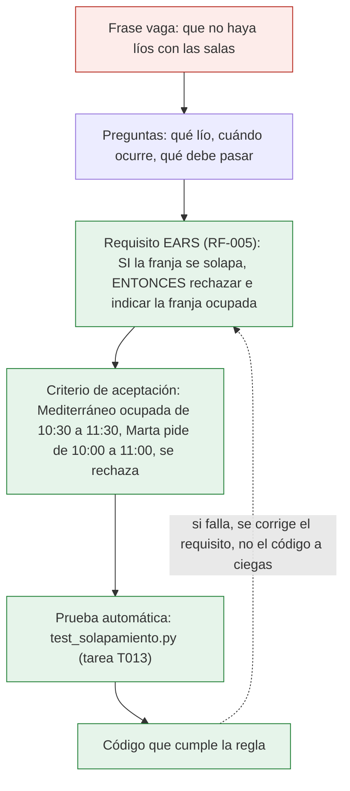

# Escribir requisitos claros (EARS)

> **Para quién:** managers, RRHH, perfiles de negocio y quien programa · **Tiempo de lectura:** ~12 min · **Nivel:** 🟢 básico

En SDD (*Spec-Driven Development*, desarrollo guiado por especificaciones) la especificación es la fuente de verdad: el asistente de IA la lee y de ella salen el plan técnico, la lista de tareas y el código. Dentro de la especificación, la parte de la que más depende todo son los requisitos. Un requisito ambiguo se convierte en código ambiguo en cuestión de minutos.

Este documento enseña a escribir requisitos que no admiten dos lecturas con EARS (*Easy Approach to Requirements Syntax*), una forma sencilla y estructurada de redactar requisitos. No hace falta saber programar; de hecho, quien mejor escribe un requisito es quien conoce el problema. Qué es una especificación y en qué sección van los requisitos está en [Los artefactos](04-los-artefactos.md).

**Qué vas a encontrar:**

- [Por qué los requisitos vagos cuestan dinero](#por-qué-los-requisitos-vagos-cuestan-dinero)
- [Qué es EARS](#qué-es-ears)
- [Los cinco patrones (y el sexto)](#los-cinco-patrones-y-el-sexto)
- [¿Qué patrón elijo?](#qué-patrón-elijo)
- [Reglas de oro](#reglas-de-oro)
- [De una frase vaga a un requisito EARS](#de-una-frase-vaga-a-un-requisito-ears)
- [De requisito a criterio de aceptación](#de-requisito-a-criterio-de-aceptación)
- [Ejercicio rápido](#ejercicio-rápido)
- [Para seguir practicando](#para-seguir-practicando)

## Por qué los requisitos vagos cuestan dinero

Imagina la petición de ReservaSalas tal como Ana la habría escrito en un correo, antes de conocer SDD:

> Quiero una aplicación para reservar salas. Que sea rápida, que funcione bien y que no haya líos con las salas.

Tres lectores, tres lecturas:

- Luis (programador junior) entiende que «rápida» es que la pantalla cargue deprisa.
- Marta (manager) entiende que «rápida» es reservar en dos clics, sin rellenar formularios.
- El asistente de IA no entiende nada en concreto: elige una interpretación, o la inventa, y escribe código con ella. Sin avisar.

«Que no haya líos» es peor. ¿Lío es que dos equipos coincidan en una sala? ¿Que una sala reservada se quede vacía? ¿Que nadie sepa de quién es una reserva? Son tres problemas distintos con tres soluciones distintas, y la frase no dice cuál resolver.

El coste de un requisito vago no se ve el primer día; se ve después:

| Frase vaga | Qué pasa después | Qué cuesta |
|---|---|---|
| «Que sea rápida» | Cada persona lo mide a su manera y nadie puede decir si se cumple | Una demo en la que alguien dice «a mí no me parece rápida» y vuelta a empezar |
| «Que funcione bien» | No se puede escribir una prueba de «funcionar bien» | Errores que aparecen cuando ya se usa |
| «Que no haya líos con las salas» | El asistente de IA resuelve el lío que él entiende, no el de Ana | Retrabajo: se construye, se enseña, se rehace |
| «Que avise cuando haga falta» | ¿A quién, por qué medio, cuándo? Se decide sobre la marcha y nadie lo apunta | Dentro de seis meses nadie sabe por qué se avisa como se avisa |

Con un asistente de IA el problema se multiplica. Antes, un programador con dudas preguntaba; el asistente, muchas veces, rellena el hueco con una suposición razonable y sigue adelante. La velocidad que da el asistente se vuelve en contra cuando lo que recibe es vago: es el mecanismo que describe [El problema del vibe coding](01-el-problema-del-vibe-coding.md).

La buena noticia es que escribir requisitos claros no exige un talento especial. Exige una plantilla.

## Qué es EARS

EARS es un conjunto de cinco plantillas de frase, cada una con una palabra clave, que obligan a decir cuándo ocurre algo, quién responde y qué hace exactamente. Lo propusieron Alistair Mavin y otros en 2009, en el campo de la ingeniería de requisitos y mucho antes de los asistentes de IA, para que personas sin formación técnica escribieran requisitos que un equipo pudiera comprobar.

Todo requisito EARS tiene las mismas piezas, en el mismo orden: una palabra clave (que no existe en el patrón más simple), un disparador o condición, el sujeto «el sistema deberá» y una respuesta. Así se descompone el requisito RF-003 de ReservaSalas:

```text
CUANDO   una persona confirma una reserva,   el sistema deberá   guardarla y mostrar un mensaje de
                                                                  confirmación con sala, fecha y hora.
palabra  disparador                           sujeto y verbo      respuesta
clave
```

No dice cómo se guarda ni dónde aparece el mensaje: dice qué tiene que pasar y cuándo. Cualquiera puede leerlo, hacer una reserva y comprobar si se cumple.

Para qué sirve tanta disciplina lo muestra el diagrama: es el recorrido de una frase vaga de Ana hasta el código, con el requisito en el centro.



De arriba abajo: la frase vaga («que no haya líos») provoca preguntas; las respuestas se escriben como un requisito EARS (RF-005); del requisito sale un criterio de aceptación con datos concretos (una sala, dos franjas, un rechazo); del criterio, una prueba automática; y de la prueba, el código que la hace pasar. La flecha discontinua de vuelta es la regla de SDD: si el código no hace lo que debe, se revisa el requisito y se regenera, no se parchea a ciegas. Todo lo que hay por debajo del requisito depende de que el requisito esté bien escrito.

> [!NOTE]
> Con GitHub Spec Kit (<https://github.com/github/spec-kit>) la plantilla de especificación escribe los requisitos como `**FR-001**: System MUST …`. En este repositorio los numeramos `RF-001` y usamos «deberá»; los patrones EARS encajan en ese formato sin cambiar nada más. La anatomía de un requisito, dibujada pieza a pieza, está en el [diagrama 05](../diagramas/05-anatomia-de-un-requisito-ears.md).

## Los cinco patrones (y el sexto)

Cada patrón responde a una pregunta distinta: ¿esto pasa siempre, cuando ocurre algo, mientras dura un estado, cuando algo va mal o solo para algunas personas? Las palabras clave van en mayúsculas para que se vean de un vistazo, y el verbo es siempre «deberá».

| Patrón | Plantilla en castellano | Cuándo se usa |
|---|---|---|
| Ubicuo | «El sistema deberá <respuesta>.» | Siempre se cumple, no depende de nada |
| Por evento | «CUANDO <disparador>, el sistema deberá <respuesta>.» | Algo ocurre en un momento concreto |
| Por estado | «MIENTRAS <estado>, el sistema deberá <respuesta>.» | Algo dura un tiempo |
| Comportamiento no deseado | «SI <condición>, ENTONCES el sistema deberá <respuesta>.» | Errores y situaciones que queremos evitar |
| Opcional | «DONDE <característica o perfil>, el sistema deberá <respuesta>.» | Solo en algunas instalaciones o para algunos perfiles |
| Complejo | «MIENTRAS <estado>, CUANDO <disparador>, el sistema deberá <respuesta>.» | Varias condiciones a la vez |

Dos ejemplos de cada patrón: uno de ReservaSalas (son, literalmente, requisitos de [la especificación canónica](../ejercicios/soluciones/03-reserva-salas/spec.md)) y otro de Solicitud de vacaciones, el caso sin código del [ejercicio 01](../ejercicios/01-tu-primera-especificacion-sin-codigo.md), en el que Luis pide días, Marta aprueba o rechaza y Jorge, de RRHH, lo registra.

| Patrón | ReservaSalas | Solicitud de vacaciones |
|---|---|---|
| Ubicuo | RF-001: El sistema deberá mostrar la lista de salas con su planta y aforo. | El sistema deberá mostrar a cada persona su saldo de días de vacaciones del año en curso. |
| Por evento | RF-003: CUANDO una persona confirma una reserva, el sistema deberá guardarla y mostrar un mensaje de confirmación con sala, fecha y hora. | CUANDO una persona envía una solicitud, el sistema deberá avisar a su manager. |
| Por estado | RF-007: MIENTRAS una sala esté marcada en mantenimiento, el sistema deberá impedir nuevas reservas en ella. | MIENTRAS una solicitud esté pendiente de respuesta, el sistema deberá mostrarla en la lista de pendientes de su manager. |
| Comportamiento no deseado | RF-005: SI la franja solicitada se solapa con otra reserva de la misma sala, ENTONCES el sistema deberá rechazar la reserva e indicar qué franja está ocupada. | SI una persona pide más días de los que tiene disponibles, ENTONCES el sistema deberá rechazar la solicitud e indicar cuántos días le quedan. |
| Opcional | RF-009: DONDE la persona tenga permisos de administración, el sistema deberá permitir marcar una sala en mantenimiento. | DONDE la persona tenga rol de RRHH, el sistema deberá permitir ver las solicitudes aprobadas de toda la empresa. |
| Complejo | MIENTRAS una sala esté en mantenimiento, CUANDO administración la desmarca, el sistema deberá volver a mostrarla como disponible. (No está en la especificación canónica; es solo para ver cómo suena.) | MIENTRAS la manager esté de vacaciones, CUANDO llegue una solicitud de su equipo, el sistema deberá enviarla a la persona que la sustituye. |

Tres observaciones sobre la tabla:

- Los doce requisitos de ReservaSalas usan los cinco patrones básicos y ninguno complejo. Es lo normal: el patrón complejo se reserva para cuando hacen falta dos condiciones a la vez; si necesitas tres, casi seguro que son dos requisitos.
- Los de Solicitud de vacaciones no tienen ni una palabra de tecnología. Podrían acabar siendo una aplicación, un formulario o un procedimiento en papel.
- Un mismo problema necesita varios patrones: reservar es un CUANDO, los límites son SI…ENTONCES, el mantenimiento es un MIENTRAS y lo que solo puede hacer administración es un DONDE.

## ¿Qué patrón elijo?

Hazte estas preguntas en orden; la primera que respondas con un «sí» te da el patrón.

1. ¿Es algo que no queremos que pase (un error, un intento no permitido, un límite que se incumple)? → **SI…, ENTONCES**. La respuesta suele ser rechazar, impedir o avisar.
2. ¿Ocurre en un momento concreto, porque alguien hace algo o llega una fecha? → **CUANDO**.
3. ¿Depende de un estado que dura un tiempo (en mantenimiento, pendiente, fuera del horario)? → **MIENTRAS**.
4. ¿Solo se aplica a algunos perfiles, sedes o configuraciones? → **DONDE**.
5. Si no es ninguna de las anteriores, es un requisito ubicuo: **El sistema deberá…**

La duda más frecuente es entre CUANDO y SI. Las dos describen algo que ocurre; la diferencia es la intención. CUANDO es el camino normal (una persona confirma, la manager aprueba); SI es el camino que queremos cortar (se solapa, no quedan días, no tiene permisos). Si la respuesta del sistema es «rechazar» o «impedir», casi siempre es un SI. El [diagrama 05](../diagramas/05-anatomia-de-un-requisito-ears.md) tiene este mismo recorrido dibujado como árbol de decisión.

## Reglas de oro

Las plantillas evitan la mitad de los problemas. La otra mitad la evitan estas reglas.

1. **Un requisito, una frase, una cosa comprobable.** Si no puedes decir con un sí o un no si se cumple, no es un requisito. Y si la frase lleva «y además…», probablemente son dos. Matiz: una respuesta con dos partes que siempre van juntas (RF-003: «guardarla y mostrar un mensaje de confirmación») sigue siendo una cosa; dos respuestas que pueden fallar por separado, o con disparadores distintos, son dos requisitos.
2. **El sujeto es «el sistema» y el verbo es «deberá».** Ni «debería», ni «podría», ni «intentará», ni «sería deseable». Tampoco «la persona deberá…»: eso es una norma para personas, no un requisito del sistema. Si quieres obligar a algo a la persona, escríbelo como lo que el sistema impide o exige.
3. **Sin tecnología.** Nada de bases de datos, lenguajes, servidores ni productos concretos. «El sistema deberá guardar la reserva» es un requisito; «el sistema guardará la reserva en SQLite» es una decisión del plan técnico. La prueba del algodón: si solo lo entiende quien programa, sobra.
4. **Sin adjetivos vagos.** Rápido, fácil, intuitivo, robusto, moderno, flexible. Si necesitas uno, conviértelo en un criterio de éxito con cifra (CE-004: «el listado de disponibilidad se muestra en menos de 2 segundos») o quítalo.
5. **Numerados y estables.** RF-001, RF-002… Un número no se reutiliza nunca: si un requisito desaparece, se marca como retirado. Los criterios de aceptación, el plan y las tareas citan esos números (la tarea T013 de ReservaSalas dice «RF-005, CE-002»); si los cambias, rompes el hilo.
6. **Palabras clave en mayúsculas.** CUANDO, MIENTRAS, SI/ENTONCES, DONDE. No es capricho: permite ver de un vistazo el patrón de cada requisito y detectar los que no tienen ninguno.
7. **Escribe lo que ve la persona, no lo que pasa por dentro.** «Mostrar un mensaje con sala, fecha y hora» se puede comprobar mirando la pantalla; «actualizar el registro» no lo puede comprobar nadie que no programe.

> [!TIP]
> Antes de dar por bueno un requisito, léelo en voz alta y pregúntate: «¿cómo demostraría que se cumple?». Si la respuesta empieza por «pues haría una reserva y miraría si…», está bien escrito. Si empieza por «depende», no.

## De una frase vaga a un requisito EARS

El método es siempre el mismo: coger la frase, hacerle las preguntas que no responde (¿cuándo? ¿quién? ¿qué debe pasar exactamente? ¿y si no?) y escribir las respuestas con la plantilla que toque. Tres ejemplos de ReservaSalas.

### 1. La frase que no dice cuándo

**Antes:** «Que no se pueda reservar una sala ocupada.»

**Preguntas:** ¿Ocupada por otra reserva o en mantenimiento? ¿Qué es «ocupada» si las franjas solo coinciden media hora? ¿Qué ve la persona cuando se le rechaza?

**Después** (dos requisitos, porque eran dos cosas):

```markdown
- **RF-005**: SI la franja solicitada se solapa con otra reserva de la misma sala, ENTONCES el sistema deberá rechazar la reserva e indicar qué franja está ocupada.
- **RF-007**: MIENTRAS una sala esté marcada en mantenimiento, el sistema deberá impedir nuevas reservas en ella.
```

La pregunta sobre la media hora no cabe en el requisito: va a «Casos límite» («una franja de 10:00 a 11:00 choca con otra de 10:30 a 11:30; dos reservas consecutivas no chocan»).

### 2. La frase que mezcla tecnología

**Antes:** «Al reservar se guarda en la base de datos y se manda un correo por el servidor de correo de la empresa.»

**Preguntas:** Quitando la tecnología, ¿qué queda? Dos cosas: la reserva no se pierde y la persona recibe un aviso. ¿Qué lleva el aviso? ¿Solo al reservar, o también al cambiar y al cancelar?

**Después:**

```markdown
- **RF-003**: CUANDO una persona confirma una reserva, el sistema deberá guardarla y mostrar un mensaje de confirmación con sala, fecha y hora.
- **RF-011**: CUANDO una reserva se confirma, se modifica o se cancela, el sistema deberá enviar un correo a la persona responsable con la sala, la fecha, la franja y el tipo de cambio.
```

«Base de datos» y «servidor de correo» no han desaparecido: han ido al sitio que les corresponde, el [plan técnico](../ejercicios/soluciones/03-reserva-salas/plan.md). Y la última pregunta (¿hay que avisar por correo?) fue una de las [aclaraciones](../ejercicios/soluciones/03-reserva-salas/aclaraciones.md) que Ana respondió.

### 3. La frase que no es un requisito

**Antes:** «Que sea rápida.»

**Preguntas:** ¿Rápida haciendo qué? ¿Cuánto es rápido? ¿Cómo lo mediremos?

**Después:** no es un requisito funcional, es un criterio de éxito, y va en su sección con una cifra:

```markdown
- **CE-001**: Reservar una sala, desde que se abre la aplicación hasta que aparece la confirmación, lleva menos de 1 minuto.
- **CE-004**: El listado de disponibilidad se muestra en menos de 2 segundos.
```

Un criterio de éxito dice cómo sabremos, meses después, que el cambio ha merecido la pena; un requisito dice qué hace el sistema en una situación concreta. Muchos adjetivos vagos son criterios de éxito disfrazados.

## De requisito a criterio de aceptación

Un requisito es una regla general. Un criterio de aceptación es un ejemplo concreto de esa regla, con nombres, salas y horas, escrito en tres partes: **Dado** una situación de partida, **cuando** ocurre algo, **entonces** el sistema responde de una forma concreta. Los criterios de aceptación viven dentro de cada historia de usuario de la especificación; es lo que la plantilla de Spec Kit llama *Given / When / Then*.

La correspondencia es casi directa:

| Pieza del requisito EARS | Pieza del criterio de aceptación |
|---|---|
| Condición o estado (SI…, MIENTRAS…) | **Dado** que… (la situación de partida, con datos) |
| Disparador (CUANDO…) | **cuando** … (la acción concreta de una persona concreta) |
| Respuesta (el sistema deberá…) | **entonces** … (lo que se ve, palabra por palabra si hace falta) |

Con RF-005:

```markdown
RF-005: SI la franja solicitada se solapa con otra reserva de la misma sala, ENTONCES el sistema deberá rechazar la reserva e indicar qué franja está ocupada.

Criterio 3 de la historia 1: **Dado** que Mediterráneo ya está reservada el jueves de 10:30 a 11:30, **cuando** Marta intenta reservarla de 10:00 a 11:00, **entonces** el sistema rechaza la reserva e indica que la sala está ocupada de 10:30 a 11:30.
```

Un requisito suele dar lugar a más de un criterio: el caso que sale bien y el que sale mal, y a veces uno por cada límite (RF-006 agrupa cuatro límites, y la historia 1 tiene un criterio para el horario y otro para las 4 horas). Y cada criterio se convierte después, casi palabra por palabra, en una prueba automática: la tarea T013 de ReservaSalas escribe las pruebas de solapamiento a partir de RF-005 y de sus criterios. Por eso un requisito bien escrito ahorra trabajo tres veces: al aclarar, al probar y al corregir.

## Ejercicio rápido

Convierte estas tres frases en requisitos EARS. Escribe tu versión antes de abrir las respuestas; no hay una única redacción correcta, pero sí patrones que encajan mejor que otros.

1. ReservaSalas: «Que la gente no reserve salas para todo el día.»
2. Solicitud de vacaciones: «Si Marta rechaza, que diga por qué.»
3. ReservaSalas: «Solo administración puede cancelar reservas de otros.»

<details><summary>Ver respuestas</summary>

1. Es un límite que queremos impedir, así que **SI…, ENTONCES**: «SI la franja solicitada dura más de 4 horas, ENTONCES el sistema deberá rechazar la reserva e indicar que el máximo son 4 horas.» Fíjate en que «todo el día» se ha convertido en una cifra; esa cifra la tiene que dar Ana, no el asistente. En la especificación canónica este límite está agrupado con otros tres en RF-006, porque la respuesta es la misma para todos.
2. Ocurre en un momento concreto (el rechazo), así que **CUANDO**: «CUANDO la manager rechaza una solicitud, el sistema deberá pedirle un motivo y mostrárselo a la persona solicitante junto con la decisión.» Si quieres impedir el rechazo sin motivo, añade un SI: «SI la manager intenta rechazar una solicitud sin indicar un motivo, ENTONCES el sistema deberá impedirlo y pedir el motivo.»
3. Son dos requisitos escondidos en una frase: uno **DONDE** (quién puede) y uno **SI…, ENTONCES** (qué pasa si lo intenta quien no puede). «DONDE la persona tenga permisos de administración, el sistema deberá permitir cancelar reservas de otras personas.» Y el RF-010 de ReservaSalas: «SI una persona sin permisos de administración intenta cancelar o modificar una reserva de la que no es responsable, ENTONCES el sistema deberá rechazar la operación e indicar quién puede hacerlo.»

</details>

## Para seguir practicando

- [Ejercicio 02: practicar requisitos EARS](../ejercicios/02-practicar-requisitos-ears.md): doce frases vagas para reescribir, cuatro requisitos para clasificar y cuatro mal escritos para cazar el error. Veinte minutos, sin ordenador.
- [Diagrama 05: anatomía de un requisito EARS](../diagramas/05-anatomia-de-un-requisito-ears.md): las piezas de un requisito y el árbol de decisión «¿qué patrón uso?».
- [Ejercicio 01: tu primera especificación sin código](../ejercicios/01-tu-primera-especificacion-sin-codigo.md): escribe los requisitos de Solicitud de vacaciones dentro de una especificación completa.
- [Ejercicio 05: arreglar una especificación mala](../ejercicios/05-arreglar-una-especificacion-mala.md): una especificación de ReservaSalas escrita con prisa, para detectar requisitos vagos, con tecnología o con dos cosas.
- Los doce requisitos de ReservaSalas, con la tabla de qué patrón usa cada uno, están en [spec.md](../ejercicios/soluciones/03-reserva-salas/spec.md).

> [!IMPORTANT]
> EARS no sustituye a pensar: te obliga a hacerte las preguntas, pero las respuestas las tiene que dar quien conoce el problema. Un requisito con la plantilla perfecta y un límite inventado («máximo 4 horas» cuando Ana nunca lo dijo) es peor que una frase vaga, porque parece cerrado. Si no sabes el dato, deja el marcador `[NECESITA ACLARACIÓN: …]` y pregunta.

## En tres frases

1. Un requisito vago («que sea rápida», «que funcione bien») lo interpreta cada persona a su manera, y el asistente de IA lo convierte en código con la interpretación que le parece, sin avisar; el coste aparece después, en retrabajo y discusiones.
2. EARS da cinco plantillas de frase (ubicuo, CUANDO, MIENTRAS, SI/ENTONCES, DONDE), siempre con «el sistema deberá», que obligan a decir cuándo pasa algo y qué hace exactamente el sistema; cualquiera puede usarlas sin saber programar.
3. Un requisito, una frase, una cosa comprobable, sin tecnología ni adjetivos vagos y con número: así se convierte en criterios de aceptación, en pruebas automáticas y en código que hace lo que se pidió.

## Siguiente paso

Continúa con [Roles: quién hace qué](06-roles-quien-hace-que.md), que explica quién escribe estos requisitos, quién los revisa y qué hace cada persona en cada paso del flujo. Si prefieres practicar antes, el [ejercicio 02](../ejercicios/02-practicar-requisitos-ears.md) te lleva veinte minutos.

---

⬅️ [Anterior: Los artefactos](04-los-artefactos.md) · 🏠 [Índice de documentación](README.md) · ➡️ [Siguiente: Roles: quién hace qué](06-roles-quien-hace-que.md)
