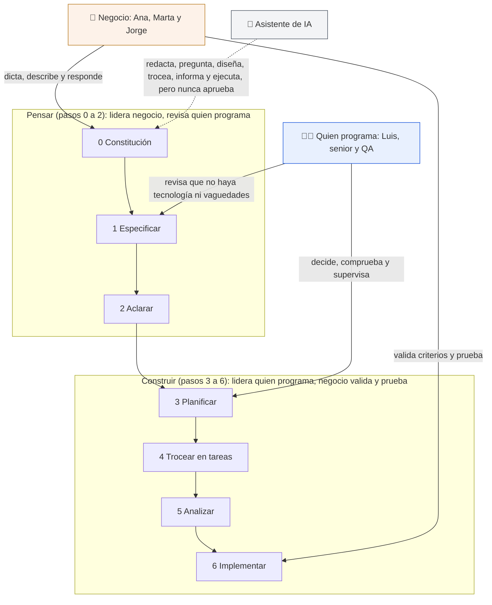

# Roles: quién hace qué

> **Para quién:** managers, RRHH, perfiles de negocio y quien programa · **Tiempo de lectura:** ~10 min · **Nivel:** 🟢 básico

Cuando alguien oye hablar de SDD (*Spec-Driven Development*, desarrollo guiado por especificaciones) por primera vez, la pregunta que llega antes que ninguna es «¿y yo qué pinto ahí?». La respuesta corta: más de lo que pintabas antes. Como la especificación se escribe en lenguaje natural, negocio entra en la conversación desde el principio, y no al final, cuando ya solo queda decir «esto no es lo que pedí».

Este documento recorre el flujo rol a rol con ReservaSalas: Ana (responsable de Oficina) encarga la aplicación, Luis (programador junior) la construye con un asistente de IA, Marta (manager) y Jorge (RRHH) la usarán, y un programador senior y QA (la persona o el equipo de calidad y pruebas) revisan. Los siete pasos del flujo están explicados en [El flujo paso a paso](03-el-flujo-paso-a-paso.md); aquí solo importa quién hace qué en cada uno.

**Qué vas a encontrar**

- [Negocio entra desde el principio](#negocio-entra-desde-el-principio)
- [Quién hace qué en cada paso](#quién-hace-qué-en-cada-paso)
- [Rol a rol](#rol-a-rol)
- [Si no eres técnico: lo que puedes hacer desde mañana](#si-no-eres-técnico-lo-que-puedes-hacer-desde-mañana)
- [Qué cambia en el trabajo de quien programa](#qué-cambia-en-el-trabajo-de-quien-programa)
- [Cómo encaja con las reuniones y los procesos de hoy](#cómo-encaja-con-las-reuniones-y-los-procesos-de-hoy)
- [Dos riesgos que conviene conocer](#dos-riesgos-que-conviene-conocer)

## Negocio entra desde el principio

En la forma habitual de pedir software, negocio participa dos veces: al principio, en una reunión en la que cuenta lo que quiere, y al final, en una demo. Entre medias, el equipo técnico traduce, interpreta y decide; y cuando algo se entendió mal, se descubre en la demo, que es el peor momento posible.

Con SDD la traducción desaparece, o casi. La especificación (`spec.md`) está escrita en castellano, con historias de usuario, requisitos y criterios de éxito que cualquiera puede leer. Eso cambia tres cosas:

- **Lo que negocio aprueba es lo que el asistente de IA usa para construir, y contra lo que se comprueba el resultado.** No hay un documento técnico intermedio que negocio no entiende. Ana lee la especificación de ReservaSalas entera; el asistente lee exactamente la misma.
- **Las dudas se resuelven antes de construir, por escrito.** El paso de aclarar hace preguntas concretas («¿quién puede cancelar una reserva ajena?») y la respuesta queda en la especificación, no en un correo.
- **Cuesta desaparecer sin que se note.** Cada paso tiene una persona que lidera y otra que revisa, y los artefactos dejan rastro de quién decidió qué.

A cambio, pide algo: que negocio esté disponible en los momentos en que se le necesita. No son muchos, pero son concretos. Los vemos a continuación.

## Quién hace qué en cada paso

El diagrama resume la participación de los tres grandes grupos (negocio, quien programa y el asistente de IA) en los siete pasos, agrupados en dos mitades: pensar (pasos 0 a 2) y construir (pasos 3 a 6).

De arriba abajo: negocio (Ana, Marta y Jorge) entra en la mitad de pensar dictando la constitución (Ana, junto con Luis), describiendo lo que quiere y respondiendo a las aclaraciones, y vuelve al final de la mitad de construir para validar los criterios de éxito y probar. Quien programa (Luis, el senior y QA) revisa la primera mitad, vigilando que no se cuele tecnología ni frases vagas, y lidera la segunda: decide, comprueba y supervisa. El asistente de IA, con la flecha discontinua, participa en todos los pasos redactando, preguntando, diseñando, troceando, informando y ejecutando; nunca aprueba.

La versión completa, con una casilla «lidera» y otra «revisa» por cada paso, está en [el diagrama 04](../diagramas/04-roles-y-participacion.md). La tabla siguiente lo resume rol a rol. **L** = lidera (responde de que el paso salga bien) · **R** = revisa (aprueba o pide cambios) · **C** = consulta (se le pregunta o aporta información) · **—** = no participa.

| Rol (en ReservaSalas) | 0 Constitución | 1 Especificar | 2 Aclarar | 3 Planificar | 4 Tareas | 5 Analizar | 6 Implementar |
|---|---|---|---|---|---|---|---|
| Quien encarga el proyecto (Ana, responsable de Oficina) | L | L | L | C | — | R | R |
| Manager de un equipo que la usará (Marta) | — | C | C | — | — | — | C |
| RRHH y otros perfiles de negocio (Jorge) | — | C | C | — | — | — | C |
| Programador junior (Luis) | L | R | R | L | L | L | L |
| Programador senior | R | C | — | R | R | R | R |
| QA (calidad y pruebas) | — | R | C | C | R | R | R |
| 🤖 Asistente de IA | redacta | redacta | pregunta | diseña | trocea | informa | ejecuta |

Dos cosas saltan a la vista. Ningún paso lo lidera el asistente de IA, y en ningún paso es el único participante: redacta, pregunta, diseña, trocea, informa y ejecuta, pero siempre hay una persona que lidera y otra que revisa. Y la frontera entre las dos mitades no es una pared: Ana sigue apareciendo en los pasos 3, 5 y 6, y Luis ya está revisando en los pasos 1 y 2.

## Rol a rol

### Quien encarga el proyecto (Ana)

Es la persona que tiene el problema y decide qué se construye. En ReservaSalas, Ana sabe que hay choques, salas vacías y reservas fantasma, y sabe qué límites quiere (horario de 08:00 a 20:00, máximo 4 horas).

- **Lidera** la constitución (`constitution.md`: dicta los cinco principios), la especificación (describe qué quiere y por qué, en castellano y sin tecnología) y las aclaraciones (responde a las preguntas del asistente; en ReservaSalas fue una reunión de 15 minutos).
- **Consulta** en el plan técnico (`plan.md`): no tiene que leerlo entero; le basta el resumen y la tabla «Comprobación contra la constitución».
- **Revisa** en analizar (¿los criterios de éxito siguen siendo los míos?) y en implementar (prueba la aplicación en cada punto de control: primero la historia 1, luego la 2, luego la 3).
- **Cómo pide un cambio sin saber editar ficheros:** lo decide y lo pide por escrito a quien construye. Luis lo escribe en la especificación y Ana relee el texto nuevo y lo aprueba, en la vista de GitHub o en el documento que le pase Luis. Después Luis actualiza el plan y deja que el asistente añada las tareas que faltan y las ejecute (con Spec Kit, `/speckit.converge` y `/speckit.implement`).
- **Lo que no tiene que hacer:** leer código, entender el plan técnico entero, instalar nada ni editar ficheros.

### Managers de equipos que la usarán (Marta)

Marta no encarga la aplicación, pero la va a usar todos los días con su equipo. Su aportación es el uso real.

- **Consulta** al especificar: cómo reserva hoy, qué le molesta de la hoja de cálculo, qué es «rápido» para ella (dos clics, no diez). De ahí salen prioridades y criterios de éxito como CE-001 (reservar en menos de 1 minuto).
- **Consulta** al aclarar, si una pregunta afecta a su equipo (¿reservas recurrentes? Marta tendría opinión).
- **Prueba** al implementar: participa en la sesión de prueba con la que se comprueban CE-001 y CE-003 (que el 90 % de las personas reserve sin ayuda la primera vez).
- **Si además dirige un equipo técnico**, tiene otro papel: proteger el tiempo de los pasos poco vistosos (aclarar, analizar) y no premiar que alguien se los salte por ir más rápido.

### RRHH y otros perfiles de negocio (Jorge)

Jorge aporta lo que nadie más sabe: los datos de las personas y las normas de la empresa.

- **Consulta** al especificar y al aclarar: qué datos de cada persona existen ya (nombre y correo corporativo), cuáles no se pueden guardar (principio 4 de la constitución: datos mínimos), quién tiene qué rol.
- **Prueba** al implementar como un usuario más: en la historia 3 es Jorge quien abre «Mis reservas».
- **Y puede ir más allá:** escribir él mismo la especificación de un proceso de su área. Solicitud de vacaciones (una persona pide días, su manager aprueba o rechaza con motivo, RRHH lo registra) es exactamente eso, y es lo que se hace en el [ejercicio 01](../ejercicios/01-tu-primera-especificacion-sin-codigo.md).

### Programador junior (Luis)

Luis construye la aplicación, pero no la teclea: dirige al asistente de IA y revisa lo que produce. Para alguien que empieza, el flujo le da una estructura que antes solo daba la experiencia.

- **Lidera** la constitución junto a Ana: le pasa los principios al asistente y comprueba el resultado.
- **Lidera** los cuatro pasos de construir: planificar (elige la tecnología con el asistente y justifica cada decisión contra la constitución), trocear en tareas (comprueba que cada requisito RF aparece en alguna tarea y que las pruebas van antes que el código), analizar (ejecuta el análisis de coherencia y decide con Ana qué corregir) e implementar (lanza las tareas, sigue el progreso, ejecuta las pruebas).
- **Revisa** la especificación y las aclaraciones: vigila que no se cuele tecnología ni frases vagas, y que cada respuesta de Ana acabe dentro de la especificación.
- **Su regla de oro:** si el código no hace lo que debe, corrige la especificación y regenera; no parchea a mano. Lo vive en el [ejercicio 03](../ejercicios/03-reserva-salas-paso-a-paso.md).

### Programador senior

Es la red de seguridad técnica. No lidera ningún paso en ReservaSalas; revisa los que más daño hacen si salen mal.

- **Revisa** la constitución (¿los principios prohíben algo de verdad?), el plan (¿la tecnología es proporcionada? ¿cada desviación está justificada en el registro de complejidad, la tabla del plan donde se apunta, con su porqué, todo lo que se sale de la regla de sencillez?), las tareas (¿son pequeñas? ¿dos tareas marcadas `[P]`, las que pueden hacerse en paralelo, tocan el mismo fichero?), el análisis y el código final.
- **Consulta** al especificar: puede avisar de que algo es inviable o desproporcionado, sin decidir tecnología todavía.
- **Lo que cambia para esta persona:** menos tiempo escribiendo código y más tiempo revisando planes y enseñando a leerlos. Las revisiones del plan técnico son la mejor clase que puede dar a un junior.

### QA (calidad y pruebas)

QA entra mucho antes de lo habitual: en la especificación, no en la demo.

- **Revisa** la especificación con la lista de verificación (¿cada requisito es comprobable? ¿hay casos límite? ¿los criterios de éxito tienen cifra?). Idealmente, quien pasa la lista no es quien escribió la especificación.
- **Consulta** al aclarar y al planificar: propone preguntas sobre casos límite y revisa que el plan prevé pruebas.
- **Revisa** las tareas (las pruebas de cada historia se escriben primero y tienen que fallar antes de implementar), las listas de verificación por tema del paso de analizar y las pruebas que acompañan al código.

### El asistente de IA

Participa en los siete pasos y no lidera ninguno. Redacta la constitución y la especificación a partir de lo que le dictan; hace las preguntas de aclarar (con GitHub Spec Kit, la herramienta que describe [Herramientas](07-herramientas.md), el comando `/speckit.clarify` hace hasta 5, de una en una, con una opción recomendada); diseña el plan; trocea las tareas; informa de incoherencias (el comando `/speckit.analyze` es solo lectura: no modifica nada y ofrece remedios para que los apruebes); y ejecuta las tareas.

Lo que nunca hace es aprobar. No marca las casillas de las listas de verificación por tema (eso lo hace quien revisa), no decide límites de negocio (si le falta un dato, deja un marcador `[NECESITA ACLARACIÓN: …]` o pregunta) y no da por buena su propia obra. Si en tu equipo el asistente es a la vez quien escribe y quien aprueba, no estás haciendo SDD; estás haciendo *vibe coding* (programar a golpe de instrucciones sueltas, improvisando con el asistente de IA) con más documentos.

## Si no eres técnico: lo que puedes hacer desde mañana

Cuatro cosas, y ninguna exige instalar nada ni ver una línea de código.

1. **Escribir o revisar una especificación.** Con la [plantilla](../ejercicios/plantillas/especificacion.md) y los requisitos en EARS (*Easy Approach to Requirements Syntax*, una forma sencilla y estructurada de redactar requisitos) del [documento anterior](05-escribir-requisitos-claros-ears.md). Si no la escribes tú, revísala con tres preguntas: ¿se entiende sin ayuda? ¿hay alguna palabra de tecnología? ¿cada requisito se puede comprobar con un sí o un no?
2. **Responder a las aclaraciones.** Son pocas (Spec Kit hace como máximo 5 por sesión), concretas y con opciones. En ReservaSalas, Ana respondió a cinco en un cuarto de hora: reservas recurrentes (no en la primera versión), quién cancela reservas ajenas (solo administración), avisos por correo (sí: un correo al confirmar, al modificar y al cancelar, para que sirva de comprobante), antelación máxima (30 días) y qué pasa si nadie aparece (fuera de alcance). Cada respuesta cambió algo en la especificación; una respuesta que no cambia nada no era una duda.
3. **Validar los criterios de éxito.** Son tuyos, no del equipo técnico: «reservar en menos de 1 minuto», «cero reservas solapadas», «el 90 % reserva sin ayuda la primera vez», «el listado se muestra en menos de 2 segundos». Tu trabajo es decir si siguen siendo los correctos al analizar y comprobarlos al final (la tarea T044 de ReservaSalas es una sesión de prueba con 10 personas de distintos equipos).
4. **Participar en la revisión final.** Probar la aplicación en cada punto de control, con tus propios casos («¿y si reservo Mediterráneo de 10:00 a 11:00 cuando ya está cogida de 10:30?»), y comparar lo que ves con lo que dice la especificación. Si no coinciden, el que está mal es el código o la especificación, nunca tú.

> [!TIP]
> Para probarlo en grupo sin ordenador, la [dinámica de equipo de 20 minutos](../ejercicios/04-dinamica-de-equipo-20-minutos.md) hace exactamente esto: escribir historias y requisitos a partir de una petición vaga, y que el resto detecte las vaguedades.

## Qué cambia en el trabajo de quien programa

Menos teclear, más pensar y revisar. En ReservaSalas, Luis no escribe a mano las 47 tareas de `tasks.md` ni el código que sale de ellas: lo hace el asistente. Lo que Luis sí hace, y nadie puede hacer por él:

- **Decidir y justificar.** Elige Python, FastAPI y SQLite (el lenguaje de programación, la pieza que sirve las páginas web y la base de datos) porque la constitución pide sencillez y un único servidor modesto, y lo deja escrito en el plan con las alternativas descartadas.
- **Comprobar coherencia.** Coge cada RF de la especificación y busca en qué tarea aparece; comprueba que las pruebas de cada historia van antes que su implementación; lee el informe de `/speckit.analyze` y decide qué corregir.
- **Leer lo que genera el asistente antes de aceptarlo.** Un plan de cuarenta páginas o una tarea del tipo «hacer toda la parte del servidor» son señales de que algo va mal, y solo las ve quien lee.
- **Volver a la especificación cuando algo falla.** Es el cambio de hábito más difícil: la tentación de «lo arreglo en el código en dos minutos» es enorme, y es la puerta de vuelta al *vibe coding*.

Para un junior, el método sustituye a la experiencia que todavía no tiene: le dice qué viene después y qué comprobar en cada paso. Para alguien con experiencia, el centro de gravedad se mueve de escribir a revisar; sus revisiones del plan y de las tareas son donde más valor aporta.

## Cómo encaja con las reuniones y los procesos de hoy

SDD no tiene por qué añadir una capa de reuniones encima de las que ya tienes: sustituye algunas y da contenido a otras.

| Lo que haces hoy | Con SDD |
|---|---|
| Cadena de correos de «¿y si…?» entre negocio y desarrollo | Una sesión de aclarar de 15 minutos; las respuestas quedan en la especificación, no en la bandeja de entrada |
| Reunión de arranque en la que negocio cuenta lo que quiere | Sigue existiendo, pero sale con un documento: la constitución y el borrador de la especificación |
| Historias de usuario en el tablero del equipo | Son las mismas: las historias P1, P2 y P3 de la especificación van al tablero, y las tareas de cada historia (T013 a T024 para la historia 1 de ReservaSalas) son sus subtareas |
| Estimaciones a ojo | La lista de tareas dice cuántas son, cuáles van en paralelo y dónde están los puntos de control |
| Una demo al final | Un punto de control por historia: la historia 1 de ReservaSalas se enseña a Ana antes de empezar la 2 |
| «¿Por qué se decidió esto?» preguntado en un pasillo | El registro de aclaraciones y las decisiones del plan, con fecha y quién respondió |
| Revisión de código | Sigue existiendo, y se le suma una revisión que negocio sí puede hacer: la de la especificación |

Una especificación bien escrita sustituye a muchos correos. Y cuando alguien nuevo entra en el proyecto, ponerle al día cuesta mucho menos: lee la constitución, la especificación y el plan, en ese orden, y ya sabe qué se construyó y por qué.

## Dos riesgos que conviene conocer

### «Negocio escribe la especificación y desaparece»

Ana dicta la especificación, la aprueba y pasa a otra cosa. Las preguntas de aclarar las responde Luis como puede, los criterios de éxito no los valida nadie y la demo final es la primera vez que Ana ve la aplicación. Vuelve el peor momento posible para descubrir malentendidos.

Cómo evitarlo:

- Acordar al principio cuándo hace falta negocio: una sesión de aclarar, leer el resumen del plan, probar en cada punto de control. Son horas, no semanas.
- Que la persona que decide esté identificada con nombre en la constitución. La de ReservaSalas dice que «toda funcionalidad empieza por una especificación en lenguaje natural que Ana (responsable de Oficina) revisa y aprueba».
- No aceptar respuestas de pasillo a las aclaraciones: si no está escrito en la especificación, no está decidido.

### «Quien programa se salta la especificación porque tiene prisa»

Luis ve un fallo, lo arregla en el código en dos minutos y no toca la especificación. Dos semanas después nadie sabe por qué el horario termina a las 21:00 si la especificación dice 20:00, las pruebas no coinciden con el código y la especificación ha dejado de ser la fuente de verdad. Es el camino de vuelta al *vibe coding*, solo que con más documentos.

Cómo evitarlo:

- Ponerlo en la constitución, como en ReservaSalas: «si el resultado no es el esperado, se corrige la especificación y se regenera; no se parchea el código a mano “para salir del paso”».
- Que la revisión de código pregunte siempre «¿qué requisito cubre este cambio?». Si no hay RF, el cambio empieza por la especificación.
- Usar las comprobaciones de la herramienta, si trabajas con Spec Kit: `/speckit.analyze` detecta incoherencias entre especificación, plan y tareas, y `/speckit.converge` compara el código con los tres y añade las tareas que falten.
- Y la parte del manager: no premiar la prisa. Si quien se salta la especificación es quien entrega «más rápido», el equipo entero aprende a saltársela.

> [!IMPORTANT]
> Los dos riesgos tienen la misma raíz: tratar la especificación como un trámite que se hace una vez. Es un documento vivo, y cada rol tiene una razón para volver a él: negocio, para comprobar que sigue siendo lo que quiere; quien programa, para corregirlo antes que al código; QA, para pasar la lista de verificación otra vez.

## En tres frases

1. Como la especificación se escribe en lenguaje natural, negocio lidera la primera mitad del flujo (constitución, especificar, aclarar) y vuelve al final para validar criterios de éxito y probar; quien programa lidera la segunda mitad (planificar, tareas, analizar, implementar).
2. El asistente de IA participa en los siete pasos redactando, preguntando, diseñando, troceando, informando y ejecutando, pero nunca lidera ni aprueba: en cada paso hay una persona que lidera y otra distinta que revisa.
3. Una persona no técnica puede escribir o revisar especificaciones, responder aclaraciones, validar criterios de éxito y probar; quien programa teclea menos y piensa, decide y revisa más. Los dos riesgos a vigilar son que negocio desaparezca tras escribir y que desarrollo se salte la especificación por prisa.

## Siguiente paso

Depende de tu ruta de lectura:

- **Si sigues la ruta de manager**, continúa con [Buenas prácticas y errores comunes](08-buenas-practicas-y-errores-comunes.md).
- **Si eres de RRHH o negocio**, continúa con el [ejercicio 01](../ejercicios/01-tu-primera-especificacion-sin-codigo.md) y escribe tu primera especificación.
- **Si lees los documentos en orden o programas**, continúa con [Herramientas](07-herramientas.md), que explica qué necesita cada perfil para trabajar así (quien no programa, nada; quien programa, un asistente de IA y GitHub Spec Kit o unas plantillas).

Para ver los roles dibujados paso a paso, está el [diagrama 04](../diagramas/04-roles-y-participacion.md).

---

⬅️ [Anterior: Escribir requisitos claros (EARS)](05-escribir-requisitos-claros-ears.md) · 🏠 [Índice de documentación](README.md) · ➡️ [Siguiente: Herramientas](07-herramientas.md)
