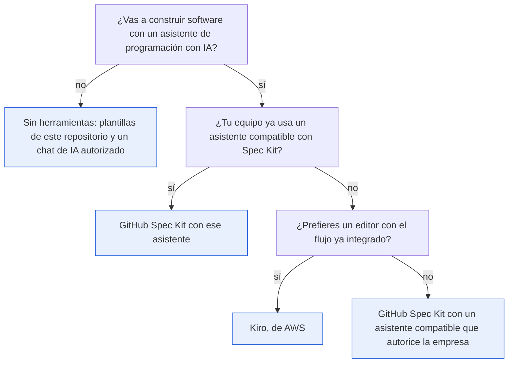

# Herramientas

> **Para quién:** quien vaya a usar Spec Kit y cualquier persona que quiera saber qué hace falta instalar (o no) para hacer SDD · **Tiempo de lectura:** ~12 min · **Nivel:** 🟡 intermedio

No necesitas una herramienta concreta para trabajar con SDD. Puedes hacerlo con Spec Kit, con un editor que lleve el flujo integrado o simplemente con las plantillas del repositorio y un asistente autorizado.

Esta página sirve para elegir y para consultar comandos. Si ya has decidido usar Spec Kit y solo quieres instalarlo, ve directamente al [ejercicio 00](../ejercicios/00-preparacion-del-entorno.md).

**Qué vas a encontrar**

- [Tres formas de hacer SDD](#tres-formas-de-hacer-sdd)
- [GitHub Spec Kit](#github-spec-kit)
- [Kiro, de AWS](#kiro-de-aws)
- [Sin herramientas: plantillas y un chat de IA](#sin-herramientas-plantillas-y-un-chat-de-ia)
- [Comparativa](#comparativa)
- [Qué necesitas según tu perfil](#qué-necesitas-según-tu-perfil)
- [Las herramientas cambian; el método no](#las-herramientas-cambian-el-método-no)

## Tres formas de hacer SDD

- **GitHub Spec Kit.** Una herramienta de línea de comandos (se maneja escribiendo órdenes en la terminal, la ventana de texto del ordenador, en vez de con botones), gratuita y de código abierto (cualquiera puede ver y usar su código). Prepara el proyecto y añade al asistente de programación con IA que ya uses una serie de comandos que recorren el flujo paso a paso. Es la que usamos en los ejercicios 03 y 06.
- **Kiro, de AWS.** Un editor de código con el flujo de especificación, diseño y tareas integrado. No necesita Spec Kit: trae el suyo.
- **Sin herramientas.** Las plantillas de este repositorio, un documento compartido y, si quieres, un chat de IA autorizado por la empresa. Es la vía de los ejercicios 01, 02, 04 y 05 y la única que necesitas si no vas a construir software.

El diagrama resume cómo elegir. Depende de dos cosas: si vas a construir software y qué asistente de IA tiene autorizado tu empresa.



De arriba abajo: si no vas a construir software con un asistente, trabaja sin herramientas. Si sí, y tu equipo ya usa un asistente compatible, añádele Spec Kit. Si no usa ninguno, elige entre un editor con el flujo integrado (Kiro) o Spec Kit con el asistente que autorice la empresa. En los tres casos el método es el mismo.

## GitHub Spec Kit

Spec Kit (<https://github.com/github/spec-kit>; documentación en <https://github.github.io/spec-kit/>) es un conjunto de herramientas de código abierto publicado por GitHub, con licencia MIT (una licencia que permite usarlo gratis, también en empresas). No es un asistente de IA: es lo que le da al asistente que ya tienes un proceso, unas plantillas y unos ficheros de salida fijos. Se instala como una herramienta de terminal llamada `specify`, y a partir de ahí todo el trabajo se hace en el chat del asistente con los comandos `/speckit.*`.

Al revisar este material, en octubre de 2026, la versión más reciente es la 1.2.2. Spec Kit ya incluye extensiones, *presets* y flujos automatizados, pero para este curso nos quedamos con el núcleo: `specify init` y los comandos del flujo SDD.

### Qué necesitas

| Requisito | Detalle |
|---|---|
| Sistema operativo | Linux, macOS o Windows. En Windows usa sus propios *scripts* (pequeños programas de apoyo) en PowerShell, sin instalar nada más |
| Python | 3.11 o superior |
| Gestor de paquetes | `uv` (recomendado) o `pipx`; también vale `pip` |
| Git (el programa que guarda el historial de versiones del código) | Opcional. Spec Kit no crea repositorios ni ramas por defecto; solo lo pide si instalas su extensión `git` |
| Asistente de IA | Uno de los compatibles (ver [más abajo](#asistentes-compatibles)). Si es de línea de comandos, su ejecutable (el programa instalado en el ordenador) tiene que estar presente, salvo que uses `--ignore-agent-tools` |

### Qué instala

Instalación persistente, la que recomienda el propio Spec Kit:

```bash
uv tool install specify-cli
specify version          # versión de Spec Kit, de Python y plataforma
specify check            # qué asistentes de IA hay instalados en tu ordenador (sin usar la red)
```

Con `pipx` o `pip` es `pipx install specify-cli` o `pip install specify-cli`. Si prefieres no instalar nada y solo crear un proyecto, `uvx` descarga una copia temporal para ese comando:

```bash
uvx --from git+https://github.com/github/spec-kit.git specify init <NOMBRE_PROYECTO>
```

Los comandos de terminal que vas a usar son pocos. Todos empiezan por `specify`:

| Comando de terminal | Para qué |
|---|---|
| `specify init` | Crea un proyecto (o prepara la carpeta actual). Es el único paso del flujo que se hace en la terminal; el resto va en el chat del asistente |
| `specify check` | Comprueba qué asistentes de IA están instalados en tu ordenador |
| `specify version` | Muestra la versión de Spec Kit, de Python y la plataforma |
| `specify self check` | Consulta si hay una versión más nueva, sin tocar nada |
| `specify self upgrade` | Actualiza Spec Kit en el sitio (detecta si lo instalaste con `uv tool` o con `pipx`) |
| `specify integration upgrade [clave]` y `specify extension update` | Refrescan los ficheros de Spec Kit en un proyecto ya creado sin tocar `specs/` ni la constitución |

Si instalaste desde PyPI (el almacén público de paquetes de Python), repetir `uv tool install specify-cli` **no** actualiza: usa `uv tool install --force specify-cli`, `pipx install --force specify-cli` o `pip install --upgrade specify-cli`. En redes corporativas con índice privado de paquetes, añade `--default-index https://tu-indice/simple/` al comando de `uv` (vale en cualquier terminal, PowerShell incluida; en Linux y macOS también puedes anteponer `UV_DEFAULT_INDEX=https://tu-indice/simple/`). No pongas credenciales en la dirección; te la da IT.

### Cómo se inicia un proyecto

Un solo comando, una sola vez por proyecto. Para ReservaSalas, Luis ejecutó:

```bash
specify init reserva-salas --integration claude
cd reserva-salas
```

`claude` es la clave de su asistente; la lista de claves está en [Asistentes compatibles](#asistentes-compatibles). Si no pasas `--integration`, Spec Kit te lo pregunta con un selector («Choose your coding agent integration:», por defecto `copilot`). Después pregunta el tipo de scripts auxiliares («Choose script type»): `sh` en Linux y macOS, `ps` en Windows; pulsa Intro para aceptar el valor por defecto.

Las banderas que de verdad se usan:

| Bandera | Qué hace |
|---|---|
| `--integration [clave]` | Qué asistente de IA configurar. Sustituye a la antigua `--ai`, que ya no existe |
| `--here` | Inicializa en la carpeta actual (igual que `specify init .`) |
| `--script sh\|ps\|py` | Tipo de scripts auxiliares: Bash, PowerShell o Python |
| `--ignore-agent-tools` | No comprueba si el ejecutable del asistente está instalado (útil si todavía no lo tienes en ese ordenador; a los asistentes que son editores no los comprueba de todos modos) |
| `--force` | En una carpeta con contenido, mezcla sin pedir confirmación. Nunca borra `specs/` |
| `--non-interactive` | No pregunta nada; usa los valores por defecto. Para *scripts* y procesos automáticos |

Al terminar, `specify init` imprime un panel «Next Steps» con el orden `constitution → specify → plan → tasks → implement → converge` y otro con los opcionales `clarify`, `analyze` y `checklist`. Y deja esto en la carpeta:

| Qué aparece | Qué es | ¿Lo tocas? |
|---|---|---|
| `.specify/memory/constitution.md` | La constitución, todavía como plantilla sin rellenar | Sí, a través de `/speckit.constitution` |
| `.specify/templates/` | Plantillas de especificación, plan, tareas y lista de verificación que usa el asistente | No, salvo que quieras personalizarlas |
| `.specify/scripts/` | Scripts auxiliares (`bash/`, `powershell/` o `python/` según `--script`) | No |
| `.specify/workflows/` | Un flujo automatizado para `specify workflow run`; no hace falta para usar los comandos a mano | No |
| `.claude/skills/` (con Claude Code; cada asistente tiene su carpeta) | Una carpeta con un fichero de instrucciones por cada comando `/speckit.*` | No |

`specify init` **no** crea un repositorio Git: si quieres uno, ejecuta `git init` tú (o instala la extensión `git` con `--extension git`, que añade ramas y *commits* automáticos opcionales). La carpeta `specs/` no existe todavía: aparece con el primer `/speckit.specify`, junto con `.specify/feature.json`, que indica qué funcionalidad está activa. Dónde queda cada artefacto dentro de `specs/` está en [Los artefactos](04-los-artefactos.md#dónde-viven-en-un-proyecto).

### Los comandos del asistente

Se escriben en el chat del asistente de IA, no en la terminal. Cada uno lee la constitución si existe. Son nueve, en este orden oficial: `constitution → specify → clarify → plan → checklist → tasks → analyze → implement → converge`. Para funcionalidades muy pequeñas Spec Kit admite el camino corto `specify → plan → tasks → implement → converge`.

| Comando | Qué hace | Qué le escribes | Ficheros que crea o modifica | ¿Obligatorio? |
|---|---|---|---|---|
| `/speckit.constitution` | Crea o actualiza los principios del proyecto | Tus principios, en lenguaje natural | `.specify/memory/constitution.md` | Recomendado, una vez por proyecto |
| `/speckit.specify` | Convierte una descripción en una especificación con historias priorizadas, requisitos, criterios de éxito y supuestos. Deja como máximo 3 marcadores de aclaración; si quedan, te pregunta con opciones | Qué quieres y por qué, sin tecnología | `specs/NNN-nombre/spec.md`, `specs/NNN-nombre/checklists/requirements.md`, `.specify/feature.json` | Sí |
| `/speckit.clarify` | Hace hasta 5 preguntas, de una en una, con una opción recomendada, e integra las respuestas en la especificación | Nada, o un área en la que centrarse | `spec.md` (sección de aclaraciones y secciones afectadas); reevalúa `checklists/requirements.md` | Opcional, muy recomendado |
| `/speckit.plan` | Genera el diseño técnico a partir de la especificación y la constitución | Tecnología, arquitectura y restricciones | `plan.md`, `research.md`, `data-model.md`, `contracts/`, `quickstart.md`. No crea `tasks.md` | Sí |
| `/speckit.checklist` | Genera una lista de verificación de calidad de los requisitos centrada en un tema. Antes pregunta hasta 3 cosas. Nunca marca casillas: eso lo hace quien revisa | Nada, o el tema (experiencia de uso, seguridad, la API o conexión para otros programas…) | `specs/NNN-nombre/checklists/[dominio].md` con ítems `CHK001…`. Requiere `plan.md` | Opcional |
| `/speckit.tasks` | Crea la lista de tareas ordenada por dependencias y agrupada por historia de usuario | Nada, o restricciones | `tasks.md`. Requiere `plan.md` y `spec.md` | Sí |
| `/speckit.analyze` | Informe de coherencia entre `spec.md`, `plan.md`, `tasks.md` y la constitución. Solo lectura: propone remedios para que los apruebes | Nada, o áreas de interés | Ninguno (el informe sale en el chat). Requiere los tres ficheros | Opcional, muy recomendado |
| `/speckit.implement` | Ejecuta las tareas fase a fase respetando las marcas `[P]` (tareas que pueden hacerse en paralelo). Antes comprueba las listas de verificación: si hay ítems sin marcar, pregunta si seguir | Nada, o un alcance («solo la fase de preparación») | Código del proyecto; marca cada tarea hecha como `[X]` en `tasks.md`. Requiere `plan.md` y `tasks.md` | Sí |
| `/speckit.converge` | Compara el código con la especificación, el plan y las tareas. Solo puede añadir tareas; nunca edita código ni los otros ficheros | Nada | `tasks.md`: añade una fase de convergencia con tareas nuevas, o responde «✅ Converged». Se repite con `implement` hasta converger | Recomendado tras `implement` |

Existe un décimo comando, `/speckit.taskstoissues`, que convierte las tareas en *issues* de GitHub (las tarjetas de trabajo de GitHub); está declarado obsoleto y se retirará, así que no lo usamos. En nuestro flujo de siete pasos, `checklist` y `analyze` forman juntos el paso 5 «Analizar»; la correspondencia completa está en [El flujo paso a paso](03-el-flujo-paso-a-paso.md#cada-herramienta-lo-llama-a-su-manera).

Así quedó la sesión de ReservaSalas, resumida (los textos exactos que escribió Luis están en el [ejercicio 03](../ejercicios/03-reserva-salas-paso-a-paso.md) y el resultado completo en [la solución](../ejercicios/soluciones/03-reserva-salas/README.md)):

| Paso | Comando | Lo que escribió Luis | Lo que apareció |
|---|---|---|---|
| 0 | `/speckit.constitution` | Los cinco principios que dictó Ana: sencillez primero, accesible y en castellano, pruebas antes de dar algo por hecho, datos mínimos, transparencia | `.specify/memory/constitution.md` en su versión 1.0.0 |
| 1 | `/speckit.specify` | La petición de Ana: 12 salas en 3 plantas, hoy en una hoja de cálculo con choques y reservas fantasma, horario de 08:00 a 20:00, máximo 4 horas. Ni una palabra de tecnología | `specs/001-reserva-salas/spec.md` con tres historias (P1, P2, P3), los requisitos funcionales en EARS y los criterios de éxito CE-001 a CE-004, más `checklists/requirements.md` |
| 2 | `/speckit.clarify` | Nada. Ana respondió a las cinco preguntas en una reunión de 15 minutos | La sección de aclaraciones en `spec.md`; de ahí salieron dos requisitos nuevos, RF-010 (permisos) y RF-011 (correo), y el límite de 30 días en RF-006. Con ellos la especificación queda en RF-001 a RF-012 |
| 3 | `/speckit.plan` | «Aplicación web sencilla con Python 3.12 y FastAPI, base de datos SQLite y páginas HTML con plantillas Jinja2. Pruebas con pytest. Sin frontend complejo […]» (el *frontend* es la parte de la aplicación que se ve en el navegador) | `plan.md` con la tabla de comprobación contra la constitución, más `research.md`, `data-model.md`, `contracts/` y `quickstart.md` |
| 4 | `/speckit.tasks` | Nada | `tasks.md`: 47 tareas en seis fases, 20 de ellas marcadas `[P]` |
| 5 | `/speckit.analyze` | Nada | Un informe en el chat sin incidencias CRITICAL ni HIGH y con cobertura del 100 % (cada requisito tiene al menos una tarea); no se creó ningún fichero |
| 6 | `/speckit.implement` y después `/speckit.converge` | Nada | El código con sus pruebas, las tareas marcadas `[X]` y la confirmación de que el código cubre la especificación |

### Cómo se escriben según el asistente

La documentación de Spec Kit escribe los comandos como `/speckit.[nombre]`, pero cada asistente los muestra a su manera. Es la misma orden en todos los casos.

| Cómo se escribe | Asistentes |
|---|---|
| `/speckit-specify` | Claude Code, GitHub Copilot, Cursor y los demás basados en *skills* (carpetas de instrucciones que el asistente carga al arrancar) |
| `/speckit.specify` | Gemini CLI, Qwen Code, opencode, Kiro CLI y los que usan ficheros de comando |
| `$speckit-specify` | Codex CLI, Command Code y ZCode |
| `/skill:speckit-specify` | Kimi Code |

Después de `specify init`, reinicia el asistente o el editor para que detecte los comandos.

### Asistentes compatibles

En la fecha de este material, Spec Kit reconoce 41 asistentes más una integración genérica. Estos son algunos ejemplos; Spec Kit solo comprueba el ejecutable de los que son de línea de comandos, no de los que son editores.

| Asistente | Clave para `--integration` | Dónde deja los comandos | ¿Necesita el ejecutable? |
|---|---|---|---|
| Claude Code | `claude` | `.claude/skills/speckit-[comando]/SKILL.md` | Sí |
| GitHub Copilot | `copilot` | `.github/skills/speckit-[comando]/SKILL.md` | No |
| Cursor | `cursor-agent` | `.cursor/skills/speckit-[comando]/SKILL.md` | No (es un editor) |
| Gemini CLI | `gemini` | `.gemini/commands/speckit.[comando].toml` | Sí |
| Codex CLI | `codex` | `.agents/skills/speckit-[comando]/SKILL.md` | Sí |
| Qwen Code | `qwen` | `.qwen/commands/speckit.[comando].md` | Sí |
| opencode | `opencode` | `.opencode/commands/speckit.[comando].md` | Sí |
| Kiro CLI | `kiro-cli` | `.kiro/prompts/speckit.[comando].md` | Sí |
| Cualquier otro | `generic` | La carpeta que indiques con `--integration-options="--commands-dir [ruta]"` | No |

Lista completa de claves, por si el tuyo no está arriba: `alquimia` (Alquimia AI), `amp` (Amp), `agy` (Antigravity), `auggie` (Auggie CLI), `claude` (Claude Code), `cline` (Cline), `codebuddy` (CodeBuddy CLI), `codex` (Codex CLI), `command-code` (Command Code), `cursor-agent` (Cursor), `dsh` (DeepSeek Harness), `devin` (Devin for Terminal), `docker-agent` (Docker Agent), `droid` (Factory Droid), `firebender` (Firebender), `forge` (Forge), `gemini` (Gemini CLI), `copilot` (GitHub Copilot), `goose` (Goose), `grok` (Grok Build), `hermes` (Hermes), `bob` (IBM Bob), `junie` (Junie), `kilocode` (Kilo Code), `kimi` (Kimi Code), `kiro-cli` (Kiro CLI), `lingma` (Lingma), `mcode` (MiniMax Code), `vibe` (Mistral Vibe), `muse` (Muse Code), `omp` (Oh My Pi), `opencode` (opencode), `pi` (Pi Coding Agent), `qodercli` (Qoder CLI), `qwen` (Qwen Code), `rovodev` (RovoDev), `shai` (SHAI), `tabnine` (Tabnine CLI), `trae` (Trae), `zcode` (ZCode), `zed` (Zed) y `generic`.

> [!NOTE]
> Kiro figura solo como `kiro-cli` (su herramienta de terminal, no el editor). `specify init --integration kiro` falla con «Unknown integration». Y si tu asistente no está en la lista, no significa que no sirva: con `generic` le indicas en qué carpeta dejar los comandos.

Todos estos nombres son ejemplos de asistentes compatibles, no recomendaciones. Cuál usar lo decide la empresa: pregunta cuál está autorizado antes de instalar ninguno.

## Kiro, de AWS

Kiro (<https://kiro.dev>) es un editor de código de AWS con un flujo del mismo tipo integrado: especificación, diseño y tareas a partir de una descripción en lenguaje natural. No necesita Spec Kit; trae su propio proceso, con sus propios nombres de fase y de fichero.

Lo que aprendes en este repositorio sirve igual: historias de usuario priorizadas, requisitos redactados en EARS (*Easy Approach to Requirements Syntax*, una forma sencilla y estructurada de redactar requisitos), aclaraciones por escrito, un plan que se revisa contra unos principios y tareas pequeñas. Cambian los nombres de los botones, no el método.

Lo que no te contamos aquí, porque cambia con cada versión y no lo hemos verificado para este material: qué se instala exactamente, qué cuesta y qué condiciones de uso tiene. Consúltalo en su documentación oficial y, como siempre, pregunta en la empresa si está autorizado. Existe además Kiro CLI, su herramienta de terminal, que Spec Kit admite como asistente con la clave `kiro-cli`.

## Sin herramientas: plantillas y un chat de IA

No hace falta instalar nada para hacer SDD. Hace falta escribir una especificación, aclararla, planificar y trocear; y eso se puede hacer con las [plantillas en castellano](../ejercicios/plantillas/README.md) de este repositorio, un documento compartido y, si lo quieres, un chat de IA genérico que la empresa haya autorizado.

| Paso | Sin herramientas |
|---|---|
| 0. Constitución | Rellenas `constitucion.md` con tu equipo en una reunión de media hora |
| 1. Especificar | Rellenas `especificacion.md`. Si tienes un chat de IA, le pides que redacte historias y requisitos EARS a partir de tu descripción, y los revisas |
| 2. Aclarar | Le pides al chat que te haga preguntas de aclaración, de una en una, y apuntas las respuestas en `lista-de-aclaraciones.md` y en la especificación |
| 3. Planificar y 4. Trocear | Si hay software que construir, quien construye rellena `plan-tecnico.md` y `tareas.md` (con o sin chat). Si no lo hay, el «plan» es el procedimiento y las «tareas», quién hace qué |
| 5. Analizar | Pasas `lista-de-verificacion.md`; alguien que no escribió la especificación la lee en voz alta |
| 6. Implementar | Si es software, quien construye lo hace con su asistente habitual, tarea a tarea, y revisa contra la especificación. Si es un proceso, se pone en marcha y se mide contra los criterios de éxito |

Es la vía natural para quien solo va a escribir o revisar la especificación, y para lo que no es software. La «Solicitud de vacaciones» del [ejercicio 01](../ejercicios/01-tu-primera-especificacion-sin-codigo.md) se escribe así: Jorge, de RRHH, rellena la plantilla, usa el chat para que le haga preguntas de aclaración (los *prompts*, las instrucciones exactas que se le escriben al chat, están en el ejercicio) y pasa la lista de verificación. Nunca abre una terminal.

También es una buena vía para equipos de programación que todavía no tienen un asistente compatible autorizado: la especificación, la constitución y el plan se escriben igual, y cuando llegue la herramienta, los ficheros ya están.

## Comparativa

| | GitHub Spec Kit | Kiro, de AWS | Sin herramientas |
|---|---|---|---|
| **Qué es** | Herramienta de terminal que añade el flujo SDD a tu asistente de IA | Editor de código con el flujo integrado | Plantillas, un documento y un chat de IA opcional |
| **Coste** | Gratuito y de código abierto (licencia MIT). El asistente de IA tiene su propio coste, el que ya pague la empresa | Según las condiciones de AWS; consúltalas antes de instalarlo | Ninguno. El chat de IA, si se usa, el que la empresa tenga contratado |
| **Requisitos** | Python 3.11 o superior, `uv` (o `pipx`/`pip`), un asistente compatible y saber usar una terminal | Instalar el editor; el resto, en su documentación | Saber escribir un documento |
| **Asistente de IA** | El que ya uses, si es compatible (más de cuarenta) | El del propio editor | Cualquier chat genérico autorizado, o ninguno |
| **Qué automatiza** | Generar y mantener los artefactos (constitución, especificación con sus aclaraciones, plan técnico, lista de tareas y listas de verificación) en ficheros fijos, con puertas de calidad (aclarar, listas de verificación, análisis) y la implementación tarea a tarea | Un flujo del mismo tipo dentro del editor, con sus propios nombres (no lo hemos verificado para este material) | Nada: tú escribes, el chat ayuda a redactar y a preguntar |
| **Para quién** | Quien construye software y ya trabaja con un asistente de IA | Quien construye software y prefiere un entorno cerrado con todo dentro | Quien vaya a escribir o revisar una especificación, procesos que no son software, y equipos que todavía no tienen herramienta |
| **Qué hay que pedir antes** | Autorización del asistente de IA que vayas a usar y permisos para instalar Python, `uv` y Spec Kit (o ayuda de IT) | Autorización e instalación del editor, según las condiciones de AWS | Nada; si quieres usar un chat de IA, que esté autorizado por la empresa |
| **Dónde se usa aquí** | Ejercicios 03 y 06 | No se usa; se cita como alternativa | Ejercicios 01, 02, 04 y 05 |

Las tres producen lo mismo: una especificación que es la fuente de verdad y un plan y unas tareas que salen de ella. Si tu equipo cambia de herramienta dentro de un año, los documentos siguen valiendo.

## Qué necesitas según tu perfil

| Si quieres… | Qué necesitas | Qué no necesitas | Por dónde empezar |
|---|---|---|---|
| Entender SDD y decidir si tu equipo lo prueba | Nada que instalar. Leer especificaciones y planes, y responder aclaraciones | Terminal, Spec Kit, un asistente de programación | [Ejercicio 01](../ejercicios/01-tu-primera-especificacion-sin-codigo.md) con las plantillas; [ejercicio 04](../ejercicios/04-dinamica-de-equipo-20-minutos.md) con tu equipo |
| Escribir y revisar lo que pides | Nada que instalar. Un documento compartido, las plantillas y, si quieres, el chat de IA autorizado | Lo mismo | [Ejercicio 01](../ejercicios/01-tu-primera-especificacion-sin-codigo.md) y [ejercicio 02](../ejercicios/02-practicar-requisitos-ears.md) |
| Construir con SDD desde cero | Un asistente de programación con IA compatible y autorizado, Python 3.11 o superior, `uv` y Spec Kit | Git es opcional para Spec Kit, aunque conviene tenerlo | [Ejercicio 00](../ejercicios/00-preparacion-del-entorno.md), vía B (la instalación completa), y después el [ejercicio 03](../ejercicios/03-reserva-salas-paso-a-paso.md) |
| Ir al grano si ya trabajas con un asistente de IA | Lo mismo que en la fila anterior. Además, leer las plantillas de `.specify/templates/` para saber qué le pide Spec Kit al asistente | Ni extensiones, ni *presets* ni flujos automatizados: el núcleo basta | [Ejercicio 03](../ejercicios/03-reserva-salas-paso-a-paso.md) y después el [ejercicio 06](../ejercicios/06-reto-final-tu-propio-proyecto.md) con un problema real |

> [!WARNING]
> Elijas la herramienta que elijas: nunca metas datos reales de clientes ni de empleados en un asistente de IA que la empresa no haya autorizado expresamente. Todos los ejemplos de este repositorio usan datos ficticios por esa razón.

## Las herramientas cambian; el método no

Spec Kit ha cambiado mucho en pocos meses. Solo entre abril y octubre de 2026, según su propio registro de cambios: la bandera `--ai` quedó obsoleta y después se eliminó (hoy es `--integration`); Git pasó de obligatorio a extensión opcional; apareció `/speckit.converge`; GitHub Copilot pasó a recibir los comandos en otro formato y otra carpeta; salió la versión 1.0.0; y `/speckit.taskstoissues` quedó obsoleto. Es probable que dentro de seis meses alguna tabla de este documento haya cambiado.

Tres consecuencias prácticas:

- **Ante la duda, la documentación oficial manda.** Si un comando de aquí no coincide con lo que ves en tu terminal, consulta <https://github.github.io/spec-kit/>, comprueba tu versión con `specify version` y avisa para que corrijamos el material (ver [cómo contribuir](../CONTRIBUIR.md)).
- **Actualiza antes de culpar al proyecto.** Un error como «No such option: --integration» significa que tu Spec Kit es muy antiguo. Reinstala la versión actual con `uv tool install --force specify-cli` (o `pipx install --force specify-cli`) y vuelve a probar. En una versión tan antigua `specify self upgrade` todavía no existe; úsalo a partir de ahora para las siguientes actualizaciones. Si trabajas en equipo, fijad una versión concreta (`specify self upgrade --tag vX.Y.Z`) para que todos tengáis la misma.
- **Lo que no caduca es lo que enseña este repositorio.** Escribir qué y por qué antes de cómo, en lenguaje natural; aclarar por escrito; planificar contra unos principios; trocear en tareas pequeñas con pruebas; y corregir la especificación, no el código, cuando algo falla. Eso vale con Spec Kit, con Kiro, con la herramienta que salga el año que viene y con papel y bolígrafo.

> [!IMPORTANT]
> Si en tu equipo no se puede instalar nada, no esperes a la herramienta para empezar. Una especificación bien escrita con las plantillas de este repositorio vale lo mismo que la que genera Spec Kit, y es el paso que más cuesta aprender.

## En tres frases

1. SDD se puede hacer con GitHub Spec Kit (una herramienta de terminal gratuita que añade los comandos `/speckit.*` a tu asistente de IA), con Kiro (un editor de AWS con el flujo integrado) o sin herramientas, con las plantillas de este repositorio y un chat de IA autorizado.
2. Con Spec Kit todo empieza con `specify init` en la terminal y sigue en el chat del asistente con nueve comandos, del `constitution` al `converge`, que crean los artefactos en sitios fijos; es compatible con más de cuarenta asistentes, y la empresa decide cuál.
3. Para escribir y revisar especificaciones no hace falta instalar nada; para construir con Spec Kit hace falta un asistente compatible, Python, `uv` y Spec Kit; y todos deben recordar que las herramientas cambian cada pocos meses y el método no.

## Siguiente paso

Continúa con [Buenas prácticas y errores comunes](08-buenas-practicas-y-errores-comunes.md), que recoge lo que suele salir bien y mal al empezar con SDD, sea cual sea la herramienta. Si quieres instalar Spec Kit ahora, el [ejercicio 00](../ejercicios/00-preparacion-del-entorno.md) te lleva paso a paso.

---

⬅️ [Anterior: Roles: quién hace qué](06-roles-quien-hace-que.md) · 🏠 [Índice de documentación](README.md) · ➡️ [Siguiente: Buenas prácticas y errores comunes](08-buenas-practicas-y-errores-comunes.md)
