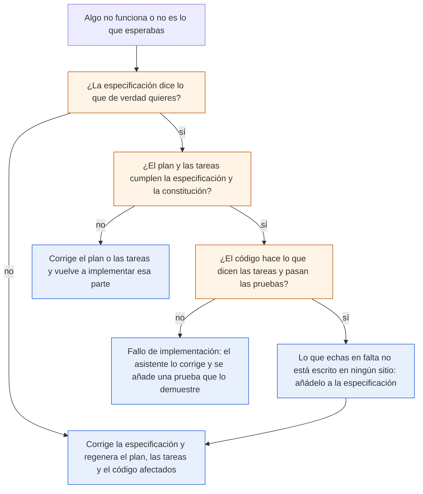

# Buenas prácticas y errores comunes

> **Para quién:** todos los perfiles; en especial quien vaya a encargar, liderar o revisar un proyecto con SDD · **Tiempo de lectura:** ~12 min · **Nivel:** 🟡 intermedio

Este documento recoge lo que, en nuestra experiencia, hace que SDD (*Spec-Driven Development*, desarrollo guiado por especificaciones) funcione y lo que suele estropearlo. No añade pasos nuevos: son los mismos siete de [El flujo paso a paso](03-el-flujo-paso-a-paso.md), vistos desde los tropiezos. Los ejemplos son de ReservaSalas y, para quien no programa, de la «Solicitud de vacaciones».

Léelo entero la primera vez. Después sirve como lista de repaso: antes de empezar un proyecto, las buenas prácticas; cuando algo chirría, la tabla de errores.

**Qué vas a encontrar**

- [Doce buenas prácticas](#doce-buenas-prácticas)
- [Doce errores comunes](#doce-errores-comunes)
- [Cuando algo falla: qué se corrige](#cuando-algo-falla-qué-se-corrige)
- [Señales de que lo estás haciendo bien](#señales-de-que-lo-estás-haciendo-bien)

## Doce buenas prácticas

Están agrupadas por el momento del flujo en que más importan. Las seis primeras, las del momento de especificar, son las que una persona no técnica puede aplicar sin ayuda.

### Al especificar (pasos 0 a 2)

**1. Empieza pequeño.** La primera funcionalidad debería caber en uno o dos días de trabajo, incluidas las pruebas. Si la petición es grande, trocéala en varias funcionalidades y especifica solo la primera. Es más fácil aprender el método con algo que termina que con algo que se eterniza.

*En ReservaSalas:* Ana no pidió «la gestión integral de espacios de la empresa». Pidió reservar las 12 salas sin choques. Las reservas recurrentes, el calendario corporativo y las pantallas de las salas quedaron fuera de alcance de la primera versión.

**2. Una especificación por funcionalidad.** Cada funcionalidad tiene su carpeta, su especificación, su plan y sus tareas. Mezclar dos en un documento hace que ninguna de las dos se pueda dar por terminada ni probar por separado.

*En ReservaSalas:* todo vive en `specs/001-reserva-salas/`. Si Ana pide más adelante reservas recurrentes, será otra funcionalidad, con su propia especificación, que parte de la primera en vez de reescribirla.

**3. Prioriza las historias, y que la P1 valga por sí sola.** Cada historia de usuario lleva P1, P2 o P3. La P1 tiene que resolver el problema principal aunque las demás no se hagan nunca: así tienes un producto mínimo viable (la versión más pequeña que ya resuelve el problema) que enseñar pronto y un orden claro cuando falte tiempo.

*En ReservaSalas:* P1 es reservar una sala. Solo con eso ya desaparecen los choques de la hoja de cálculo. *En la solicitud de vacaciones:* P1 es pedir días; aprobar o rechazar (P2) y ver el saldo (P3) vienen después.

**4. Criterios de éxito con cifra y sin tecnología.** «Que sea rápido» no se puede comprobar; «menos de 2 segundos» sí. Y el criterio describe lo que ve la persona, no cómo se consigue. Si no sabes cómo lo medirías, no es un criterio de éxito.

*En ReservaSalas:* CE-001, reservar una sala lleva menos de 1 minuto; CE-002, cero reservas solapadas; CE-003, el 90 % de las personas completan una reserva sin ayuda la primera vez. *En la solicitud de vacaciones:* «que RRHH no pierda tiempo» se convierte en «el 100 % de las solicitudes aprobadas quedan registradas para RRHH sin que nadie las copie a mano» (CE-002).

**5. Un requisito, una frase, una cosa comprobable.** Redacta los requisitos en EARS (*Easy Approach to Requirements Syntax*, una forma sencilla y estructurada de redactar requisitos): el verbo «deberá», una palabra clave en mayúsculas cuando toca (CUANDO, MIENTRAS, SI/ENTONCES, DONDE) y nada de adjetivos vagos. Cómo hacerlo está en [Escribir requisitos claros (EARS)](05-escribir-requisitos-claros-ears.md).

*En ReservaSalas:* RF-007, «MIENTRAS una sala esté marcada en mantenimiento, el sistema deberá impedir nuevas reservas en ella». Cualquiera puede leerlo y decir si se cumple.

**6. Responde a todas las aclaraciones antes de planificar, por escrito y quien decide.** Las preguntas del paso de aclarar existen para que las dudas se resuelvan cuando cuestan una frase, no cuando cuestan una semana de código. Responde quien tiene poder de decisión, y la respuesta acaba en la especificación, no en un correo.

*En ReservaSalas:* Ana respondió a las cinco preguntas en una reunión de 15 minutos. De ahí salieron dos requisitos nuevos (RF-010 y RF-011) y el límite de 30 días de antelación. Si hubiera respondido Luis por su cuenta, habría decidido él quién puede cancelar una reserva ajena.

### Al planificar y trocear (pasos 3 a 5)

**7. Revisa el plan contra la constitución, principio a principio.** El plan técnico tiene una tabla para eso. No la rellenes con «cumple» en todas las filas: explica cómo. Cada desviación va al registro de complejidad con su justificación y la alternativa más simple que se descartó.

*En ReservaSalas:* el plan cumple los cinco principios y declara una sola desviación de «sencillez primero»: una pequeña API (una conexión para que otros programas usen la aplicación), que la especificación no pide, para que las pruebas automáticas (las «pruebas de contrato» del plan) no dependan de las pantallas HTML. Está escrita, justificada y acotada.

**8. Tareas pequeñas, con fichero y con un sí o un no al final.** Una tarea cabe en una línea, nombra el fichero que toca y se da por terminada sin discusión. Si una tarea dice «hacer la parte del servidor», no es una tarea; es un plan disfrazado. Comprueba además que cada requisito de la especificación aparece en alguna tarea.

*En ReservaSalas:* 47 tareas, cada una con su ruta (`src/reservasalas/servicios/reservas.py`, `tests/unitarias/test_limites.py`…) y una tabla en la especificación que dice qué requisitos necesita cada historia, para cruzarla con la lista.

**9. Pruebas primero.** En cada historia, las tareas de pruebas van antes que las de implementación, y las pruebas tienen que fallar hasta que la funcionalidad existe. Es la forma más fiable de distinguir «funciona» de «parece que funciona» cuando el código lo ha escrito un asistente de IA.

*En ReservaSalas:* la historia 1 empieza con cinco tareas de pruebas (T013 a T017) y la constitución lo exige en su principio 3. El asistente escribe las pruebas, las ve fallar, implementa y las ve pasar.

### Al implementar y después (paso 6 y siguientes)

**10. Si el código no hace lo que querías, corrige la especificación y regenera.** Es la regla central del método. Si tocas el código a mano para salir del paso, la especificación deja de contar la verdad y la próxima regeneración puede borrar tu parche. Reserva la edición a mano para detalles que no cambian el comportamiento.

*En ReservaSalas:* cuando Ana quiso ampliar la antelación máxima de 30 a 60 días, Luis no buscó el número en el código: cambió RF-006 en la especificación, regeneró el plan y las tareas afectadas y volvió a implementar esa parte.

**11. Guarda todo en el repositorio, junto al código.** Constitución, especificación, aclaraciones, plan, tareas y listas de verificación viven en el repositorio (la carpeta compartida donde se guarda el código con su historial de versiones), junto al programa, y se versionan con él. Un cambio en la especificación es un cambio en el repositorio, revisable como cualquier otro. Haz *commit* (guarda una versión) antes de regenerar nada, para poder comparar.

*En ReservaSalas:* `.specify/memory/constitution.md` y `specs/001-reserva-salas/` van en el mismo repositorio que `src/` y `tests/`. Dentro de un año, quien pregunte «¿por qué 4 horas como máximo?» encontrará la respuesta al lado del código.

**12. Revisa en pareja: negocio y desarrollo.** La especificación la lee quien la pidió y quien la va a construir, juntos, antes de planificar. La lista de verificación la pasa alguien que no la escribió. El producto mínimo se enseña a quien encarga antes de seguir con la siguiente historia.

*En ReservaSalas:* Ana aprueba la especificación, Luis revisa el plan con alguien con experiencia técnica y, en cuanto la historia 1 funciona, se la enseña a Ana antes de empezar la 2.

> [!TIP]
> Si solo puedes aplicar tres: la 3 (la P1 vale sola), la 6 (aclaraciones respondidas por quien decide, antes de planificar) y la 10 (se corrige la especificación, no el código). Con esas tres ya no es *vibe coding* (programar a golpe de instrucciones sueltas, improvisando con el asistente de IA).

## Doce errores comunes

Cada fila dice cómo reconocer el error, por qué pasa y qué hacer. Varios tienen su espejo en las buenas prácticas de arriba; los demás son tropiezos propios de la primera vez.

| # | Error | Cómo se reconoce | Remedio |
|---|---|---|---|
| 1 | **Especificación con tecnología** | En la especificación aparecen palabras como «base de datos», «API» (una conexión para que otros programas la usen), el nombre de un lenguaje o de un servicio en la nube | Bórralas y describe el comportamiento que ve la persona. La tecnología va al plan, y la decide quien construye contra la constitución. En ReservaSalas, la especificación dice «el sistema deberá guardarla»; que sea SQLite (una base de datos concreta) lo dice el plan |
| 2 | **Requisitos vagos** | «Que sea rápido», «fácil de usar», «que funcione bien», «gestionar las reservas». Nadie puede decir si se cumplen | Reescríbelos en EARS con una cifra o una condición concreta. El [ejercicio 02](../ejercicios/02-practicar-requisitos-ears.md) entrena justo esto |
| 3 | **Saltarse el paso de aclarar** | «Ya está todo claro». Las dudas aparecen a mitad de implementación y se resuelven en el chat del asistente, sin tocar la especificación | Ejecuta el paso siempre, aunque solo salga una pregunta. Y cuando una duda surja tarde, vuelve a aclarar y a la especificación, no la resuelvas en el código |
| 4 | **Un plan de cuarenta páginas** | El plan lo ha generado el asistente, nadie lo ha leído entero y la tabla de comprobación contra la constitución dice «cumple» en todo sin explicar cómo | Pide un plan proporcional al problema. Lee al menos el resumen, el contexto técnico y la tabla de la constitución; si no te caben en veinte minutos, probablemente el plan es demasiado grande |
| 5 | **Tareas gigantes o sin fichero** | «T005 Implementar el servidor». Dos tareas marcadas `[P]` (la marca de las que pueden hacerse en paralelo) que tocan el mismo fichero. Un requisito que no aparece en ninguna tarea | Regenera las tareas pidiendo tamaño pequeño y rutas concretas. Cruza la lista con los requisitos de la especificación antes de implementar |
| 6 | **Aceptar código sin leerlo** | Las pruebas pasan, la demo funciona, nadie ha abierto los ficheros. Semanas después nadie sabe explicar una decisión | Lee el código de cada fase antes de dar por superado su punto de control (la parada al final de cada fase para probar), aunque sea en diagonal. Pregunta al asistente por lo que no entiendas; también sirve para explicar |
| 7 | **Cambiar el código a mano y no la especificación** | El programa hace algo que la especificación no dice (o al revés). En la siguiente regeneración, el cambio puede desaparecer sin que nadie sepa por qué | Deshaz el parche, cambia la especificación y regenera. Si el cambio es un detalle sin impacto en el comportamiento, anótalo igualmente en el plan |
| 8 | **Constitución genérica copiada** | «Código limpio», «buenas prácticas», «calidad». Principios que no prohíben nada y por tanto no sirven para decidir nada | Reescríbela con tu equipo: cada principio tiene que impedir algo concreto y llevar un «por qué». «Datos mínimos: solo nombre, correo y reservas» decide; «respetar la privacidad» no |
| 9 | **Historias sin prioridad, o una P1 que no sirve sola** | Todas las historias son P1, o la P1 es «configurar el sistema» y no resuelve nada por sí misma | Ordena por valor para la persona. La P1 es lo que, si solo existiera eso, ya justificaría el proyecto |
| 10 | **Marcar la lista de verificación sin comprobar nada** | Todas las casillas marcadas en dos minutos por la misma persona que escribió la especificación | Que la pase otra persona, leyendo la especificación con cada pregunta delante. Cada «no» es algo que arreglar antes de planificar |
| 11 | **Aclaraciones respondidas por quien no decide, o de palabra** | Las respuestas están en un correo o en la memoria de alguien, o las dio quien construye «para no molestar» | Quien encarga responde, por escrito, y la respuesta acaba en la sección de aclaraciones de la especificación. En ReservaSalas, Ana decidió; Luis preguntó |
| 12 | **Datos reales en el asistente** | Para «probar con datos de verdad» se pega un listado de empleados o de clientes en un chat de IA | Nunca, salvo en un asistente que la empresa haya autorizado expresamente para ello. Inventa datos, como hace este repositorio (Ana, Luis, la sala Mediterráneo) |

> [!NOTE]
> Ninguno de estos errores es exclusivo de SDD: son los de siempre en cualquier proyecto. Lo que cambia es que ahora dejan rastro en un documento concreto, y eso permite detectarlos antes de que cuesten dinero. SDD reduce estos riesgos; no los elimina.

## Cuando algo falla: qué se corrige

La pregunta más frecuente de quien empieza es «no funciona, ¿qué toco?». El diagrama ordena las preguntas que hay que hacerse, de la especificación hacia abajo.

De arriba abajo: primero se mira la especificación; si no dice lo que quieres, se corrige y se regenera lo que dependa de ella. Si la especificación está bien, se mira si el plan y las tareas la cumplen; si no, se corrigen ellos y se vuelve a implementar esa parte. Si también están bien, se mira si el código hace lo que dicen las tareas: si no, es un fallo de implementación que el asistente corrige y una prueba nueva evita que vuelva. Y si todo cuadra y aun así falta algo, es que ese algo nunca se escribió: vuelve a la especificación.

Fíjate en que el camino nunca termina en «edita el código a mano y sigue». Esa es la diferencia entre SDD y el parcheo a ciegas.

*En ReservaSalas:* Marta intenta reservar de 19:30 a 20:30 y la aplicación lo permite. ¿La especificación lo dice? Sí: RF-006 rechaza las franjas fuera de 08:00-20:00. ¿Las tareas lo cubren? Sí: T014 y T019. ¿El código lo hace? No: es un fallo de implementación. Luis se lo indica al asistente, este corrige `servicios/reservas.py` y añade a `test_limites.py` el caso que faltaba (una franja que empieza dentro del horario y termina fuera). Si en cambio Ana decidiera que el horario pasa a ser de 07:00 a 21:00, el camino sería el primero: cambiar RF-006 y regenerar.

> [!IMPORTANT]
> La especificación es la fuente de verdad; el código es su consecuencia. Cada vez que te sorprendas tocando el código para que haga algo que la especificación no dice, para y pregúntate cuál de los dos está equivocado. Si lo que quieres no está escrito en ella, lo que se cambia primero es la especificación.

## Señales de que lo estás haciendo bien

No hace falta una auditoría. Si reconoces la mayoría de estas señales en tu proyecto, vas por buen camino:

- Alguien de negocio ha leído la especificación entera y ha corregido algo en ella.
- Puedes señalar la P1 y explicar en una frase por qué vale sola.
- Cada criterio de éxito tiene una cifra y sabes cómo lo vas a medir.
- La sección de aclaraciones no está vacía, y cada respuesta cambió algo en la especificación.
- La tabla de comprobación contra la constitución del plan explica cómo, no solo dice «cumple».
- La lista de tareas tiene pruebas antes que implementación en cada historia, y las pruebas fallaron antes de implementar.
- Has enseñado el producto mínimo a quien lo encargó antes de empezar la segunda historia.
- El último cambio de comportamiento del programa empezó por un cambio en `spec.md`, y está en el historial del repositorio.
- Una persona nueva en el equipo entiende qué hace el sistema leyendo la especificación, sin abrir el código.
- Cuando alguien pregunta «¿por qué se decidió esto?», la respuesta está en las aclaraciones, en el plan o en la constitución, no en la memoria de una persona.

Y una señal de alarma que resume todas las demás: si al abrir el repositorio hay más conversaciones con el asistente que documentos, se está haciendo *vibe coding* con un disfraz.

## En tres frases

1. Las buenas prácticas de SDD caben en una idea: escribe poco pero preciso (funcionalidades pequeñas, P1 que vale sola, criterios con cifra, requisitos en EARS), aclara por escrito con quien decide, y comprueba cada paso contra el anterior (plan contra constitución, tareas contra requisitos, pruebas antes que código).
2. Los errores más frecuentes son los de siempre con un rastro nuevo: tecnología en la especificación, requisitos vagos, saltarse aclarar, planes que nadie lee, tareas gigantes, código aceptado sin leer y, sobre todo, parchear el código en vez de corregir la especificación.
3. Cuando algo falla, se pregunta de arriba abajo (¿la especificación dice lo que quiero?, ¿el plan y las tareas la cumplen?, ¿el código hace lo que dicen las tareas?) y se corrige en el nivel donde está el error, nunca a ciegas en el código.

## Siguiente paso

Continúa con [Preguntas frecuentes](09-preguntas-frecuentes.md), donde están las dudas que más se repiten al empezar: cuánto cuesta, si es más lento, quién es responsable si el código falla y cómo empezar mañana. Si quieres practicar la detección de errores, el [ejercicio 05](../ejercicios/05-arreglar-una-especificacion-mala.md) te da una especificación mal escrita de ReservaSalas para arreglar.

---

⬅️ [Anterior: Herramientas](07-herramientas.md) · 🏠 [Índice de documentación](README.md) · ➡️ [Siguiente: Preguntas frecuentes](09-preguntas-frecuentes.md)
