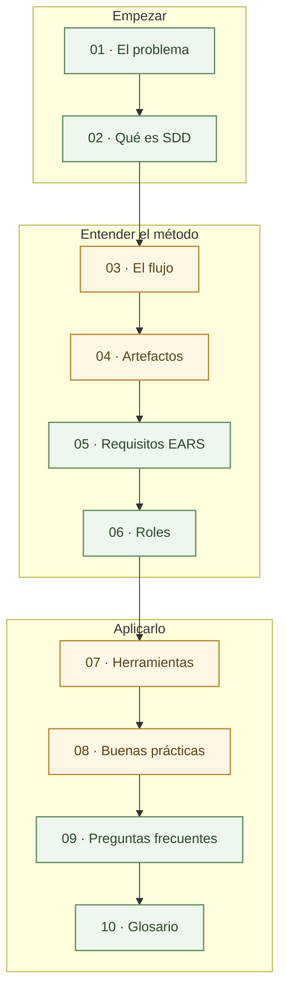

# Documentación

> **Para quién:** toda la empresa, sepa programar o no · **Tiempo de lectura:** ~3 min · **Nivel:** 🟢 básico

Aquí está la parte teórica del curso. Son diez documentos que van desde el problema que intenta resolver SDD hasta el flujo de trabajo, los requisitos, los roles y las herramientas.

Todos usan el mismo ejemplo, ReservaSalas, para no cambiar de contexto cada vez que aparece un concepto nuevo. No hace falta leerlos de principio a fin: puedes seguir el recorrido completo o ir directamente a lo que necesites.

**Qué vas a encontrar**

- [Los diez documentos](#los-diez-documentos)
- [En qué orden leerlos](#en-qué-orden-leerlos)
- [Rutas de lectura por perfil](#rutas-de-lectura-por-perfil)
- [Lo que hay fuera de esta carpeta](#lo-que-hay-fuera-de-esta-carpeta)

## Los diez documentos

| Nº | Documento | De qué va | Para quién | Tiempo · nivel |
|---|---|---|---|---|
| 01 | [El problema del *vibe coding*](01-el-problema-del-vibe-coding.md) | Qué pasa cuando se programa con un asistente de IA sin un texto que diga qué hay que hacer, y por qué acaba costando caro | Todos | ~8 min · 🟢 |
| 02 | [Qué es SDD](02-que-es-sdd.md) | La idea en una frase: primero qué y por qué, en lenguaje natural; después el plan y el código. Qué es y qué no es | Todos | ~10 min · 🟢 |
| 03 | [El flujo paso a paso](03-el-flujo-paso-a-paso.md) | Los siete pasos, de la constitución a implementar: quién participa en cada uno y qué deja escrito | Quien vaya a construir con SDD y cualquier persona curiosa | ~15 min · 🟡 |
| 04 | [Los artefactos](04-los-artefactos.md) | Los cinco documentos de SDD más el registro de aclaraciones: para qué sirve cada uno, qué secciones tiene y dónde vive | Quien vaya a escribir o revisar una especificación | ~15 min · 🟡 |
| 05 | [Escribir requisitos claros (EARS)](05-escribir-requisitos-claros-ears.md) | Cinco plantillas de frase para que un requisito no se pueda malinterpretar | Quien vaya a escribir o revisar requisitos, sepa programar o no | ~12 min · 🟢 |
| 06 | [Roles: quién hace qué](06-roles-quien-hace-que.md) | Qué hacen quien encarga, quien construye y el asistente de IA en cada paso, con la matriz de responsabilidades | Todos | ~10 min · 🟢 |
| 07 | [Herramientas](07-herramientas.md) | Spec Kit, Kiro o sin herramientas: qué hace falta instalar (o nada) y qué hace cada comando | Quien vaya a usar Spec Kit y quien decide qué se instala | ~12 min · 🟡 |
| 08 | [Buenas prácticas y errores comunes](08-buenas-practicas-y-errores-comunes.md) | Lo que funciona, lo que suele salir mal y cómo darte cuenta a tiempo | Todos, sobre todo quien encarga o lidera un proyecto | ~12 min · 🟡 |
| 09 | [Preguntas frecuentes](09-preguntas-frecuentes.md) | 27 preguntas reales agrupadas por tema, con respuesta corta y enlace a donde se amplía | Todos | ~10 min · 🟢 |
| 10 | [Glosario](10-glosario.md) | 62 términos en lenguaje llano, de la A a la V | Todos, para consultar | Consulta · 🟢 |

🟢 básico: no hace falta ningún conocimiento técnico. 🟡 intermedio: ayuda saber qué es un repositorio y haber visto código, pero las partes técnicas están explicadas.

## En qué orden leerlos

Los documentos están numerados en el orden en que se entienden mejor: primero el problema, luego la idea, después cómo se trabaja y, al final, la consulta.

De izquierda a derecha, del 01 al 10. Los recuadros verdes son de nivel básico y los amarillos, de nivel intermedio. Para entender el método basta con los verdes; los amarillos cuentan los detalles de cómo se trabaja.

## Rutas de lectura por perfil

| Si quieres… | Lee, en este orden | Tiempo de lectura |
|---|---|---|
| Entender SDD y decidir si tu equipo lo prueba | [01](01-el-problema-del-vibe-coding.md) → [02](02-que-es-sdd.md) → [06](06-roles-quien-hace-que.md) → [08](08-buenas-practicas-y-errores-comunes.md) → [09](09-preguntas-frecuentes.md) | ~50 min |
| Escribir y revisar lo que pides | [01](01-el-problema-del-vibe-coding.md) → [02](02-que-es-sdd.md) → [05](05-escribir-requisitos-claros-ears.md) → [06](06-roles-quien-hace-que.md), y el [glosario](10-glosario.md) a mano | ~40 min |
| Construir con SDD desde cero | Todos, del [01](01-el-problema-del-vibe-coding.md) al [10](10-glosario.md) | ~2 h |
| Ir al grano si ya trabajas con un asistente de IA | [02](02-que-es-sdd.md) → [03](03-el-flujo-paso-a-paso.md) → [04](04-los-artefactos.md) → [07](07-herramientas.md) → [08](08-buenas-practicas-y-errores-comunes.md) | ~1 h |

Son solo los documentos. Cada ruta completa, con sus diagramas y ejercicios, está dibujada en el [mapa del repositorio](../diagramas/06-mapa-del-repositorio.md#itinerarios-por-perfil).

## Lo que hay fuera de esta carpeta

- [Diagramas](../diagramas/README.md): lo mismo que aquí, contado con dibujos. Útiles para proyectar o para entenderlo de un vistazo.
- [Ejercicios](../ejercicios/README.md): práctica guiada paso a paso, desde una especificación sin ordenador hasta construir ReservaSalas con un asistente de IA.

## Siguiente paso

Empieza por [El problema del *vibe coding*](01-el-problema-del-vibe-coding.md), o salta directamente al primer documento de tu ruta.

---

🏠 [Portada del repositorio](../README.md)
