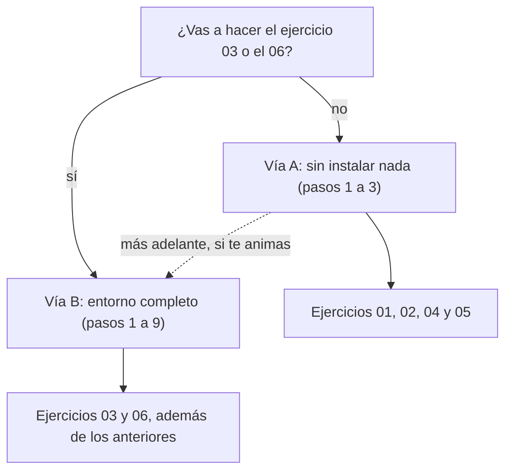

# Ejercicio 00: preparación del entorno

> **Para quién:** cualquier persona (vía A, sin instalar nada) y quien vaya a usar Spec Kit (vía B; hace falta saber usar una terminal) · **Tiempo de lectura:** ~10 min (hacerlo: de 10 a 45 min según la vía) · **Nivel:** 🟡 intermedio

Aquí solo vamos a preparar el terreno. Si quieres practicar sin instalar nada, usa la **vía A**. Si vas a recorrer el flujo completo con Spec Kit en los ejercicios 03 y 06, necesitas la **vía B**.

No compliques el entorno más de la cuenta: si no vas a usar Spec Kit, no lo instales.

**Qué vas a encontrar**

- [Objetivo](#objetivo)
- [Qué necesitas](#qué-necesitas)
- [Elige tu vía](#elige-tu-vía)
- [Pasos de la vía A: sin instalar nada](#pasos-de-la-vía-a-sin-instalar-nada)
- [Pasos de la vía B: entorno completo con Spec Kit](#pasos-de-la-vía-b-entorno-completo-con-spec-kit)
- [Uso responsable de los asistentes de IA](#uso-responsable-de-los-asistentes-de-ia)
- [Errores frecuentes](#errores-frecuentes)
- [Comprueba lo que has aprendido](#comprueba-lo-que-has-aprendido)
- [Solución o ejemplo resuelto](#solución-o-ejemplo-resuelto)
- [En tres frases](#en-tres-frases)
- [Siguiente paso](#siguiente-paso)

## Objetivo

Al terminar sabrás qué vía necesitas según los ejercicios que vayas a hacer y tendrás el material a mano. Si sigues la vía B, además tendrás Spec Kit instalado, un proyecto de prueba creado y habrás comprobado que los comandos `/speckit.*` aparecen en tu asistente de IA.

## Qué necesitas

| | Vía A: sin instalar nada | Vía B: entorno completo |
|---|---|---|
| **Para qué ejercicios** | 01, 02, 04 y 05 | 03 y 06 (y también sirve para los de la vía A) |
| **Tiempo** | 10 min | 30-45 min |
| **Requisitos previos** | Ninguno | Saber abrir una terminal y escribir comandos; permisos para instalar programas en tu equipo (si no los tienes, pide ayuda a IT) |
| **Materiales** | Un editor de texto o un documento compartido; las [plantillas](plantillas/README.md); opcionalmente, un chat de IA autorizado por la empresa | Todo lo de la vía A, más: Git (recomendado), Python 3.11 o superior, `uv`, Spec Kit y un asistente de programación con IA compatible |

Ejemplos de asistentes compatibles con Spec Kit (hay más de cuarenta; el panorama completo está en [Herramientas](../docs/07-herramientas.md)). Usa el que autorice la empresa (pregúntalo antes de instalar ninguno) y, si IT tiene su propia guía de instalación, sigue esa; si no, la guía oficial que enlaza la tabla.

| Asistente | Clave para `--integration` | Guía oficial de instalación | ¿Spec Kit busca su ejecutable? |
|---|---|---|---|
| Claude Code | `claude` | <https://docs.anthropic.com/en/docs/claude-code/setup> | Sí |
| GitHub Copilot | `copilot` | <https://docs.github.com/en/copilot/concepts/agents/copilot-cli/about-copilot-cli> | No |
| Cursor | `cursor-agent` | <https://docs.cursor.com/en/cli/overview> | No (es un editor) |
| Gemini CLI | `gemini` | <https://github.com/google-gemini/gemini-cli> | Sí |
| Codex CLI | `codex` | <https://github.com/openai/codex> | Sí |
| Kiro CLI | `kiro-cli` | <https://kiro.dev/docs/cli/> | Sí |

## Elige tu vía

El diagrama resume la decisión: depende solo de qué ejercicios quieras hacer.



De arriba abajo: si no vas a hacer el 03 ni el 06, sigue la vía A (pasos 1 a 3) y tendrás lo necesario para los ejercicios 01, 02, 04 y 05. Si vas a hacerlos, sigue la vía B completa (pasos 1 a 9). De la vía A siempre se puede pasar a la B más adelante.

## Pasos de la vía A: sin instalar nada

1. **Elige dónde vas a escribir.** Los ejercicios sin código consisten en rellenar plantillas de texto. Vale cualquiera de estas tres opciones: un documento compartido de los que usa tu equipo (la mejor, porque otras personas pueden comentar), un editor de texto sencillo, o papel y bolígrafo (para el ejercicio 04 es incluso lo recomendable). Crea un documento vacío y ponle de título «Ejercicio 01: Solicitud de vacaciones».

   Qué deberías tener: un documento en blanco con ese título, en un sitio que puedas volver a abrir mañana.

   - [ ] Tengo un documento o un cuaderno para escribir las plantillas.

2. **Consigue las plantillas.** Están en la carpeta [plantillas](plantillas/README.md) de este repositorio. Abre [especificacion.md](plantillas/especificacion.md) en GitHub (la vista normal, sin pulsar «Raw»), selecciona desde el primer título hasta el final, copia y pégalo en tu documento (Word, Google Docs…): se pega con formato. Las ayudas de cada sección aparecen en cursiva bajo su título; bórralas cuando termines. Haz lo mismo con [lista-de-verificacion.md](plantillas/lista-de-verificacion.md). Si prefieres tenerlo todo en tu equipo, descarga el repositorio completo (botón «Code» → «Download ZIP») y abre los ficheros con cualquier editor.

   Qué deberías ver: la plantilla en tu documento, con sus secciones como títulos («Resumen», «Historias de usuario y escenarios», «Requisitos»…), los ejemplos de ReservaSalas entre corchetes `[…]` y, bajo cada título, su ayuda en cursiva. Si los corchetes y las ayudas han llegado, lo tienes todo.

   - [ ] Tengo copiadas las plantillas de especificación y de lista de verificación.

3. **(Opcional) Comprueba tu chat de IA autorizado.** Algunos pasos de los ejercicios 01 y 05 ofrecen una variante con asistente de IA. No hace falta un asistente de programación: sirve el chat de IA genérico que tu empresa tenga autorizado. Pregunta a tu responsable o a IT cuál es. Para comprobar que responde como esperas, pégale este *prompt* (la instrucción que le escribes al asistente):

   ```text
   Voy a escribir una especificación de software en lenguaje natural, sin decidir tecnología. Cuando te la pase, quiero que me hagas preguntas de aclaración de una en una y que no propongas soluciones técnicas. Por ahora, confírmame en una sola frase que lo has entendido.
   ```

   Qué deberías ver: una respuesta de una frase confirmando el encargo. Si en vez de eso empieza a proponer bases de datos o lenguajes de programación, no pasa nada: en el ejercicio 01 tienes los *prompts* exactos para reconducirlo.

   - [ ] Sé qué chat de IA puedo usar en la empresa (o he decidido hacer los ejercicios sin él).

Si solo vas a hacer la vía A, has terminado: salta a [Uso responsable de los asistentes de IA](#uso-responsable-de-los-asistentes-de-ia) y después a [Siguiente paso](#siguiente-paso).

## Pasos de la vía B: entorno completo con Spec Kit

Los comandos de esta vía se escriben en una terminal (en Windows, PowerShell). Cada bloque indica qué deberías ver; la salida exacta cambia con la versión, así que fíjate en el sentido, no en la letra.

4. **Instala las herramientas base: Git, Python y uv.** Comprueba primero si ya las tienes:

   ```bash
   git --version
   python3 --version      # en Windows: python --version
   uv --version
   ```

   Si alguna falta: Git se descarga de <https://git-scm.com> (Spec Kit no lo necesita, pero el ejercicio 06 termina con una *pull request*, la propuesta de cambios que se revisa antes de incorporarla, y en el 03 conviene guardar cada paso). Python tiene que ser 3.11 o superior (el ejercicio 03 usa la 3.12 y allí te dice cómo instalarla); si no lo tienes, instálalo desde <https://www.python.org> o pide a IT la versión corporativa. `uv` es el gestor que instala Spec Kit:

   ```bash
   # macOS y Linux
   curl -LsSf https://astral.sh/uv/install.sh | sh
   # Windows (PowerShell)
   powershell -ExecutionPolicy ByPass -c "irm https://astral.sh/uv/install.ps1 | iex"
   uv --version
   ```

   Qué deberías ver: tres líneas de versión, del estilo `git version 2.x`, `Python 3.12.x` y `uv 0.x`. Si `uv` no responde justo después de instalarlo, cierra la terminal y ábrela de nuevo.

   - [ ] `git --version`, `python3 --version` (3.11 o superior) y `uv --version` responden.

5. **Instala un asistente de programación con IA.** Elige uno de la tabla de [Qué necesitas](#qué-necesitas) (el que tu empresa tenga autorizado) e instálalo con la guía de IT, si la hay, o con la guía oficial que enlaza la tabla; cada uno tiene la suya y cambian a menudo, por eso no las copiamos aquí. Al terminar, ábrelo en una carpeta cualquiera y escríbele un saludo.

   Qué deberías ver: el asistente arranca (en la terminal o dentro del editor), normalmente te pide iniciar sesión la primera vez (usa la cuenta corporativa) y responde al saludo. Apunta la **clave** de la tabla (`claude`, `copilot`, `gemini`…): la necesitas en el paso 8.

   - [ ] Mi asistente de IA arranca y responde.

6. **Instala Spec Kit.** Es una herramienta de línea de comandos llamada `specify`. Con `uv`:

   ```bash
   uv tool install specify-cli
   specify version
   ```

   Si en tu empresa se usa `pipx`, vale `pipx install specify-cli`. Si la red corporativa obliga a usar un índice privado de paquetes, pide a IT su dirección y pásala en el comando (vale en cualquier terminal, PowerShell incluida): `uv tool install --default-index https://tu-indice/simple/ specify-cli`. En Linux y macOS también puedes anteponer la variable: `UV_DEFAULT_INDEX=https://tu-indice/simple/ uv tool install specify-cli`. No pongas credenciales en la dirección.

   Qué deberías ver: `specify version` muestra la versión de `specify` (1.x en la fecha de este material), la de Python y la plataforma. Si quieres saber si hay una versión más nueva, `specify self check` lo consulta sin tocar nada, y `specify self upgrade` actualiza.

   - [ ] `specify version` responde con un número de versión.

7. **Comprueba qué asistentes detecta Spec Kit.** Este comando no usa la red: solo mira qué ejecutables tienes instalados.

   ```bash
   specify check
   ```

   Qué deberías ver: una lista con todos los asistentes que Spec Kit conoce. Junto a cada uno aparece si está disponible, si no se ha encontrado o la nota «IDE-based, no CLI check» (los que no necesitan ejecutable, como Cursor o GitHub Copilot, no tienen nada que comprobar). También busca Visual Studio Code. Termina con «Specify CLI is ready to use!». Tu asistente del paso 5 debería figurar como disponible o, si en la tabla de [Qué necesitas](#qué-necesitas) pone que Spec Kit no busca su ejecutable, como «IDE-based». Si aparece como no encontrado, revisa el paso 5 o usa `--ignore-agent-tools` en el paso siguiente.

   - [ ] `specify check` termina con «Specify CLI is ready to use!» y mi asistente aparece disponible (o como «IDE-based»).

8. **Crea un proyecto de prueba.** Sitúate en una carpeta donde guardes tus proyectos y ejecuta (sustituye `claude` por la clave de tu asistente):

   ```bash
   specify init prueba-sdd --integration claude
   cd prueba-sdd
   ```

   Te preguntará el tipo de scripts auxiliares («Choose script type»): pulsa Intro para aceptar el valor por defecto (`sh` en Linux y macOS, `ps` en Windows). Si Spec Kit no encuentra el ejecutable de tu asistente de línea de comandos (por ejemplo, porque aún no lo has instalado en este ordenador), añade `--ignore-agent-tools` al final del comando; a los asistentes que son editores, como Cursor o GitHub Copilot, no les busca ejecutable. Si te equivocas de clave, el error será «Unknown integration»: mira la tabla de [Qué necesitas](#qué-necesitas) (por ejemplo, Kiro es `kiro-cli`, no `kiro`).

   Qué deberías ver: una lista de pasos que se van completando y, al final, un panel «Next Steps» con el orden `constitution → specify → plan → tasks → implement → converge`, seguido de otro panel con los opcionales `clarify`, `analyze` y `checklist`. En la carpeta `prueba-sdd` tendrás, entre otros ficheros, algo así (con Claude Code; con otro asistente cambia la última carpeta):

   ```text
   prueba-sdd/
   ├── .specify/
   │   ├── memory/
   │   │   └── constitution.md      # plantilla de constitución, vacía hasta que ejecutes /speckit.constitution
   │   ├── templates/               # plantillas de especificación, plan, tareas y lista de verificación
   │   ├── scripts/bash/            # scripts auxiliares (powershell/ en Windows)
   │   └── workflows/               # flujo automatizado "speckit" (no hace falta para los ejercicios)
   └── .claude/
       └── skills/                  # una carpeta por comando /speckit-* (.github/skills/ con Copilot, .gemini/commands/ con Gemini CLI…)
   ```

   `specify init` **no** crea un repositorio Git. Si quieres guardar tu trabajo con Git, ejecuta `git init` dentro de la carpeta; es opcional.

   - [ ] Existe la carpeta `prueba-sdd` con `.specify/` dentro y he visto el panel «Next Steps».

9. **Comprueba que los comandos aparecen en el asistente.** Los comandos `/speckit.*` se ejecutan en el chat del asistente, no en la terminal. Abre el asistente **dentro de la carpeta** `prueba-sdd`. Si es de terminal, escribe su comando estando en esa carpeta (tras el paso 8 ya lo estás): `claude` para Claude Code, `gemini` para Gemini CLI, `codex` para Codex CLI o `kiro-cli` para Kiro CLI. Si es un editor, abre la carpeta como proyecto. Escribe `/speckit` y mira las sugerencias. Según el asistente, los comandos se escriben con guion, con punto o con el símbolo de dólar; es la misma orden en todos los casos:

   | Asistente | Cómo se escribe el comando de especificar |
   |---|---|
   | Claude Code, GitHub Copilot, Cursor | `/speckit-specify` |
   | Gemini CLI, Kiro CLI, opencode, Qwen Code | `/speckit.specify` |
   | Codex CLI | `$speckit-specify` |

   No ejecutes ninguno todavía: eso es el [ejercicio 03](03-reserva-salas-paso-a-paso.md). Si no aparece ninguna sugerencia, cierra el asistente (o el editor) y vuelve a abrirlo en la misma carpeta: los comandos se cargan al arrancar.

   Qué deberías ver: al menos estos nueve comandos, con el prefijo que corresponda: `constitution`, `specify`, `clarify`, `plan`, `checklist`, `tasks`, `analyze`, `implement` y `converge`.

   - [ ] Mi asistente me sugiere los comandos `speckit` al escribir `/speckit` (o `$speckit`).

Con esto la vía B está lista. Puedes borrar la carpeta `prueba-sdd` o conservarla para trastear; el ejercicio 03 crea la suya (`reserva-salas`).

## Uso responsable de los asistentes de IA

> [!WARNING]
> Nunca metas datos reales de clientes ni de empleados (nombres, correos, nóminas, contratos, listados) en un asistente de IA que la empresa no haya autorizado expresamente. Todos los ejercicios de este repositorio usan datos ficticios (Ana, Luis, Marta, Jorge, la sala Mediterráneo…) precisamente por eso. Ante la duda, pregunta a IT o a seguridad antes de pegar nada.

Dos hábitos más que conviene adquirir desde el primer día: usa siempre la cuenta corporativa del asistente, no una personal, y trata lo que el asistente genera como un borrador que revisas, no como una verdad.

## Errores frecuentes

| Síntoma | Causa | Cómo arreglarlo |
|---|---|---|
| `specify: command not found` (o «no se reconoce como un comando» en Windows) justo después de instalar | La carpeta donde `uv` deja las herramientas todavía no está en el `PATH` de esta terminal | Cierra la terminal y ábrela de nuevo. Si sigue igual, ejecuta `uv tool update-shell` (añade al `PATH` la carpeta de las herramientas de `uv`), cierra la terminal y ábrela otra vez; si aun así no aparece, pide ayuda a IT |
| `No such option: --integration` | Tienes una versión antigua de Spec Kit (la bandera antigua `--ai` ya no existe) | Reinstala la versión actual con `uv tool install --force specify-cli` (o `pipx install --force specify-cli`) y vuelve a probar. En una versión tan antigua `specify self upgrade` todavía no existe; úsalo a partir de ahora para las siguientes actualizaciones |
| `Unknown integration` al hacer `specify init` | La clave del asistente no es la correcta | Usa la clave exacta de la tabla de [Qué necesitas](#qué-necesitas); por ejemplo `kiro-cli`, `cursor-agent` o `copilot` |
| `specify init` falla diciendo que no encuentra el ejecutable del asistente y muestra una dirección de instalación | El asistente no está instalado o no está en el `PATH` | Instálalo (paso 5) o, si todavía no lo tienes en este ordenador, añade `--ignore-agent-tools` |
| «Permission denied» o «Acceso denegado» al instalar | Intentas instalar en una carpeta del sistema | No uses `sudo` ni la cuenta de administrador: `uv tool install` instala en tu carpeta de usuario. Si tu equipo está bloqueado, habla con IT |
| La instalación se queda colgada, da «timeout» o error de certificado | Proxy o cortafuegos corporativo | Pregunta a IT por el índice privado de paquetes y pásalo con `--default-index` o con la variable `UV_DEFAULT_INDEX` (paso 6). Para equipos sin salida a internet, la documentación oficial de Spec Kit (<https://github.github.io/spec-kit/>) tiene una guía de instalación sin conexión |
| «Template files will be merged with existing content…» | Has ejecutado `specify init` en una carpeta que no está vacía | Responde `n`, crea una carpeta nueva y repite. Solo usa `--force` si sabes qué ficheros va a sobrescribir |
| Los scripts fallan en Windows | Se instalaron scripts Bash en vez de PowerShell | Repite el `init` en una carpeta nueva con `--script ps` (o acepta el valor por defecto, que en Windows ya es `ps`) |
| En PowerShell: «…no se puede cargar porque la ejecución de scripts está deshabilitada en este sistema» | La política de ejecución de PowerShell de tu equipo bloquea los scripts `.ps1`: los de `.specify/scripts/powershell/`, que lanza el asistente, o el que activa un entorno virtual de Python (`Activate.ps1`) | Si IT lo permite, ejecuta `Set-ExecutionPolicy -ExecutionPolicy RemoteSigned -Scope CurrentUser` y abre otra ventana de PowerShell; si no, pide ayuda a IT. Para el entorno virtual de los ejercicios 03 y 06 hay otra salida, sin activarlo: mira los [errores frecuentes del ejercicio 03](03-reserva-salas-paso-a-paso.md#errores-frecuentes) |
| Al escribir `/speckit` el asistente no sugiere nada | El asistente no está abierto en la carpeta del proyecto, o se abrió antes de ejecutar `specify init` | Cierra el asistente, sitúate dentro de `prueba-sdd` y ábrelo de nuevo |

## Comprueba lo que has aprendido

1. ¿Necesitas instalar algo para hacer el ejercicio 01?
2. ¿Qué comando te dice qué asistentes tiene Spec Kit a su alcance, y cuál te dice si existe una versión más nueva de Spec Kit?
3. `/speckit.specify`: ¿se escribe en la terminal o en el chat del asistente? Y si tu asistente lo muestra como `/speckit-specify`, ¿qué haces?
4. ¿`specify init` crea un repositorio Git?
5. Quieres probar el asistente con «datos de verdad» y tienes a mano el listado de empleados. ¿Lo pegas?

<details><summary>Ver respuestas</summary>

1. No. El ejercicio 01 se hace con la vía A: una plantilla copiada en un documento y, como mucho, un chat de IA autorizado.
2. `specify check` mira qué asistentes (ejecutables) tienes instalados, sin usar la red. `specify self check` consulta si hay una versión más nueva de Spec Kit; `specify self upgrade` la instala.
3. En el chat del asistente de IA; en la terminal solo se ejecutan los comandos que empiezan por `specify` (`init`, `check`, `version`…). Y no haces nada: es la misma orden, cada asistente la escribe a su manera (`/speckit-specify`, `/speckit.specify` o `$speckit-specify`).
4. No. Solo crea la carpeta `.specify/` y los ficheros de comandos del asistente. Si quieres Git, ejecutas `git init` tú (o instalas la extensión `git` de Spec Kit, que no hace falta para los ejercicios).
5. No. Ni el listado de empleados ni ningún dato real de personas o clientes en un asistente que la empresa no haya autorizado. Para probar, inventa nombres, como hace todo este repositorio.

</details>

## Solución o ejemplo resuelto

Este ejercicio no tiene fichero de solución: el resultado es tu entorno. Para comprobar que está bien, compara el árbol de carpetas del paso 8 con el tuyo y verifica que en el paso 9 aparecen los nueve comandos. Si quieres ver en qué orden se usan esos comandos en un proyecto real, el apartado «Cómo se generó» de la [solución del ejercicio 03](soluciones/03-reserva-salas/README.md) los enumera uno a uno.

## En tres frases

1. Para los ejercicios sin código (01, 02, 04 y 05) no hace falta instalar nada: un documento, las plantillas y, si acaso, un chat de IA autorizado.
2. Para los ejercicios con código (03 y 06) necesitas Python 3.11 o superior, `uv`, Spec Kit (`uv tool install specify-cli`) y un asistente de programación con IA compatible; `specify check` y `specify init` te confirman que todo encaja.
3. Los comandos `/speckit.*` viven en el chat del asistente y se escriben con guion, punto o dólar según cuál uses; y los datos reales de la empresa no se meten en un asistente que no esté autorizado.

## Siguiente paso

Continúa con [Ejercicio 01: tu primera especificación sin código](01-tu-primera-especificacion-sin-codigo.md). Si vas a usar Spec Kit y tienes prisa por ver el flujo completo, puedes saltar al [Ejercicio 03: ReservaSalas paso a paso](03-reserva-salas-paso-a-paso.md), pero haz antes al menos el [02](02-practicar-requisitos-ears.md): se hace en media hora y te ahorrará errores en el 03.

---

🏠 [Índice de ejercicios](README.md) · ➡️ [Siguiente: Tu primera especificación sin código](01-tu-primera-especificacion-sin-codigo.md)
