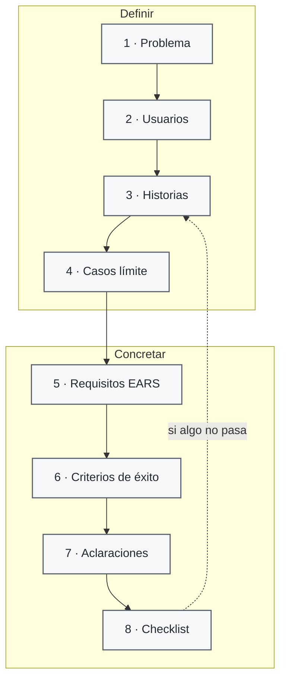

# Ejercicio 01: tu primera especificación sin código

> **Para quién:** quien vaya a escribir o revisar una especificación (y cualquiera que empiece con SDD); no hace falta programar · **Tiempo de lectura:** ~7 min (hacerlo: 30-45 min) · **Nivel:** 🟢 básico

Vas a escribir tu primera especificación sin tocar una línea de código. Usaremos «Solicitud de vacaciones» porque el proceso es familiar y así podemos concentrarnos en lo importante: decidir qué debe ocurrir, qué casos pueden dar problemas y cómo sabremos que el resultado es correcto.

**Qué vas a encontrar**

- [Objetivo](#objetivo)
- [Qué necesitas](#qué-necesitas)
- [El caso: Solicitud de vacaciones](#el-caso-solicitud-de-vacaciones)
- [Pasos](#pasos)
- [Errores frecuentes](#errores-frecuentes)
- [Comprueba lo que has aprendido](#comprueba-lo-que-has-aprendido)
- [Solución o ejemplo resuelto](#solución-o-ejemplo-resuelto)
- [En tres frases](#en-tres-frases)
- [Siguiente paso](#siguiente-paso)

## Objetivo

Al terminar sabrás rellenar las secciones de una especificación (historias de usuario priorizadas, casos límite, requisitos, criterios de éxito y aclaraciones) y distinguir lo que va en ella de lo que no. También sabrás pasarle una lista de verificación y, si quieres, usar un asistente de IA para que te haga preguntas de aclaración sobre tu borrador.

## Qué necesitas

- **Tiempo:** entre 30 y 45 minutos. El objetivo es terminar una primera versión pequeña que otra persona pueda revisar, no describir todo el proceso de vacaciones.
- **Requisitos previos:** ninguno. Ayuda haber leído [Qué es SDD](../docs/02-que-es-sdd.md) y [Escribir requisitos claros (EARS)](../docs/05-escribir-requisitos-claros-ears.md), pero el ejercicio recuerda lo imprescindible.
- **Materiales:** la plantilla [especificacion.md](plantillas/especificacion.md) y la plantilla [lista-de-verificacion.md](plantillas/lista-de-verificacion.md), copiadas en un documento como se explica en la vía A del [ejercicio 00](00-preparacion-del-entorno.md). Si no has hecho el 00: abre cada plantilla en GitHub (la vista normal, sin pulsar «Raw»), selecciona desde el primer título hasta el final, copia y pégalo en tu documento (Word, Google Docs…): se pega con formato. Las ayudas de cada sección aparecen en cursiva bajo su título; bórralas cuando termines. Si prefieres trabajar en papel, imprime el documento.
- **Opcional:** un chat de IA autorizado por tu empresa, para la variante con asistente.

> [!NOTE]
> La plantilla trae ejemplos de ReservaSalas entre corchetes `[…]`: son una guía de cómo suena cada sección. Sustitúyelos por lo tuyo y borra los que no apliquen. Las ayudas en cursiva que hay bajo cada título explican qué va en cada sitio; bórralas cuando el documento esté listo.

## El caso: Solicitud de vacaciones

Hoy, en la empresa, pedir vacaciones funciona así: Luis escribe un correo a su manager, Marta; Marta contesta cuando puede, a veces por el pasillo; Jorge, de RRHH, se entera por una copia del correo (o no se entera) y lleva el saldo de días de cada persona en una hoja de cálculo. Nadie sabe con seguridad cuántos días le quedan, y hay semanas en las que medio equipo está fuera sin que Marta se haya dado cuenta.

Lo que queremos es un proceso con tres pasos claros: una persona pide días; su manager aprueba o rechaza con un motivo; RRHH lo registra y el saldo de días se actualiza solo. Las personas ficticias son las mismas de todo el repositorio: **Luis** (empleado que pide), **Marta** (manager que decide) y **Jorge** (RRHH que registra).

El diagrama muestra el orden de los ocho pasos del ejercicio y a qué sección de la plantilla alimenta cada uno.



De izquierda a derecha: empiezas por el problema y las personas, sigues con las historias, los casos límite, los requisitos y los criterios de éxito, apuntas las dudas y terminas pasando la lista de verificación. Cada «no» de la lista te devuelve a la sección que hay que arreglar, normalmente a las historias o a los requisitos.

## Pasos

Cada paso te dice qué sección de la plantilla rellenar, qué escribir y qué deberías tener al acabar. Trabaja directamente sobre tu copia de la plantilla.

1. **Describe el problema de hoy en tres frases.** Antes, prepara el principio de tu copia de la plantilla:

   - Cambia el título «Plantilla: especificación» por «Especificación: Solicitud de vacaciones».
   - Borra el aviso marcado como «Tip» que hay bajo el título (habla de Spec Kit y aquí no hace falta). La ayuda en cursiva déjala hasta el final, como las demás.
   - Busca la cabecera, la línea que empieza por «Carpeta/rama» (un simple identificador), y cambia `[001-reserva-salas]` por `001-solicitud-vacaciones`.
   - En «Creada», pon la fecha de hoy. Deja «Estado: Borrador» como está.
   - En «Petición original», escribe la frase con la que alguien te encargaría esto: «Queremos dejar de pedir las vacaciones por correo y saber siempre cuántos días nos quedan».

   Después, en la sección «Resumen», escribe tres frases (hasta cinco si lo necesitas), sin tecnología, con esta estructura:

   ```text
   Hoy, para pedir vacaciones, [qué hace cada persona y por dónde].
   Eso provoca [dos o tres problemas concretos].
   Queremos que [qué debe poder hacer cada persona al final del proceso].
   ```

   Qué deberías tener: un resumen que una persona recién llegada a la empresa entiende sin preguntar. Prueba del algodón: si el resumen contiene «aplicación», «base de datos» o «sistema», reescríbelo hablando de personas y de días. (En los requisitos del paso 5, en cambio, el sujeto siempre es «el sistema».)

   - [ ] La cabecera está rellena y el resumen tiene entre tres y cinco frases sin tecnología.

2. **Di quién la va a usar.** La plantilla no tiene una sección de «usuarios»: las personas aparecen en las historias y en «Entidades clave». Antes de escribir las historias, añade debajo del resumen una lista corta con los tres perfiles y qué quiere cada uno; te servirá de guía para todo lo demás:

   ```text
   - Empleado (Luis): quiere [pedir días sin perseguir a nadie y saber cuántos le quedan].
   - Manager (Marta): quiere [decidir rápido, con un motivo si rechaza, y ver quién de su equipo está fuera].
   - RRHH (Jorge): quiere [...].
   ```

   Qué deberías tener: tres líneas, una por perfil, con un verbo de deseo en cada una («quiere ver», «quiere decidir»). Si a un perfil no se te ocurre qué quiere, pregúntate qué hace hoy a mano.

   - [ ] Los tres perfiles tienen escrito qué quieren conseguir.

3. **Escribe la P1 completa y deja P2/P3 como siguientes iteraciones.** Es la sección «Historias de usuario y escenarios». Cada historia lleva el título con su prioridad, un recorrido en lenguaje llano, «Por qué esta prioridad», «Prueba independiente» y, en «Criterios de aceptación», al menos dos criterios en formato Dado / Cuando / Entonces: uno que sale bien y otro que sale mal. «Prueba independiente» es cómo comprobarías esa historia ella sola, sin las otras dos (por ejemplo: «Luis pide tres días y Marta recibe el aviso»). Sustituye los ejemplos de ReservaSalas de cada apartado y mantén el formato de la plantilla, con **Dado**, **cuando** y **entonces** en negrita. Las prioridades ya están decididas:

   - **Historia de usuario 1 - Pedir días de vacaciones (Prioridad: P1).** Luis elige las fechas, ve cuántos días consumen y cuántos le quedan, y envía la solicitud; Marta recibe un aviso.
   - **Historia de usuario 2 - Aprobar o rechazar una solicitud (Prioridad: P2).** Marta ve las solicitudes pendientes de su equipo, aprueba o rechaza, y si rechaza tiene que dar un motivo; Luis recibe la respuesta.
   - **Historia de usuario 3 - Ver el saldo y las solicitudes (Prioridad: P3).** Luis ve su saldo y el estado de sus solicitudes; Jorge ve las solicitudes aprobadas de toda la empresa y el saldo de cada persona.

   Para la historia 1, los criterios podrían empezar así (rellena los corchetes y añade los que falten):

   ```text
   1. Dado que Luis tiene 12 días disponibles, cuando pide del lunes 9 al viernes 13 de noviembre
      (5 días laborables), entonces la solicitud queda en estado «pendiente», Luis ve que le
      quedarían 7 días y Marta recibe un aviso.
   2. Dado que Luis tiene [2] días disponibles, cuando pide [5], entonces el sistema rechaza la
      solicitud e indica [cuántos días le quedan].
   3. Dado [...], cuando [...], entonces [...].
   ```

   Qué deberías tener: una P1 completa. Para P2 y P3 basta con el título y una frase que deje claro que vendrán después. Comprobación clave para la P1: si solo construyéramos «pedir días», ¿ya serviría para algo? Debería (se acaban los correos perdidos); si tu P1 no vale por sí sola, no es una P1.

   - [ ] La P1 tiene recorrido, por qué, prueba independiente y al menos dos criterios de aceptación; P2 y P3 quedan identificadas para después.

4. **Piensa en lo que puede salir mal: casos límite.** Es la subsección «Casos límite», al final de las historias. Escríbelos como preguntas «¿Qué pasa si…?» y responde cada una en la misma línea. Tienes que incluir, como mínimo, estos tres, y añadir al menos dos más:

   ```text
   - ¿Qué pasa si Luis pide más días de los que tiene? → [...]
   - ¿Qué pasa si las fechas se solapan con vacaciones ya aprobadas de otra persona del mismo equipo? → [...]
   - ¿Qué pasa si la fecha de inicio ya ha pasado? → [...]
   - ¿Qué pasa si [...]? → [...]
   - ¿Qué pasa si [...]? → [...]
   ```

   Pistas para los que faltan: fechas que incluyen un festivo o un fin de semana; la manager está de vacaciones y no puede aprobar; una solicitud que cruza el cambio de año; cancelar una solicitud ya aprobada; una persona sin manager asignado.

   Qué deberías tener: cinco o más casos, cada uno con una respuesta. Si para alguno no sabes qué debería pasar, no lo inventes: apúntalo también en el paso 7 como duda.

   - [ ] Hay al menos cinco casos límite y cada uno dice qué debe ocurrir (o está marcado como duda).

5. **Convierte la P1 y sus límites en requisitos EARS (entre cuatro y seis).** Es la sección «Requisitos», subsección «Requisitos funcionales». EARS (*Easy Approach to Requirements Syntax*) es una forma sencilla y estructurada de redactar requisitos: cinco plantillas de frase, siempre con el verbo «deberá» y la palabra clave en mayúsculas. Las tienes resumidas en la ayuda en cursiva de la sección «Requisitos» de la plantilla y, explicadas con calma, en [Escribir requisitos claros (EARS)](../docs/05-escribir-requisitos-claros-ears.md) y en el [diagrama 05](../diagramas/05-anatomia-de-un-requisito-ears.md).

   | Patrón | Plantilla | Para qué |
   |---|---|---|
   | Ubicuo | «El sistema deberá [respuesta].» | Algo que se cumple siempre |
   | Por evento | «CUANDO [disparador], el sistema deberá [respuesta].» | Algo que ocurre en un momento |
   | Por estado | «MIENTRAS [estado], el sistema deberá [respuesta].» | Algo que dura un tiempo |
   | Comportamiento no deseado | «SI [condición], ENTONCES el sistema deberá [respuesta].» | Errores y situaciones a evitar |
   | Opcional | «DONDE [característica o perfil], el sistema deberá [respuesta].» | Solo para algunos perfiles |

   Numera RF-001, RF-002… con el formato de la plantilla (**RF-001**: …). Cada requisito: una frase, una sola cosa comprobable, sin tecnología y sin adjetivos vagos. Intenta usar los cinco patrones al menos una vez. Para empezar:

   ```text
   - RF-001: El sistema deberá mostrar a cada persona su saldo de días de vacaciones del año en curso.
   - RF-002: CUANDO una persona envía una solicitud, el sistema deberá [...].
   - RF-003: SI una persona pide más días de los que tiene disponibles, ENTONCES el sistema deberá
     rechazar la solicitud e indicar cuántos días le quedan.
   - RF-004: SI [la fecha de inicio es anterior a hoy], ENTONCES el sistema deberá [...].
   - RF-005: CUANDO la manager aprueba o rechaza una solicitud, el sistema deberá [...].
   - RF-006: MIENTRAS [una solicitud esté pendiente], el sistema deberá [...].
   - RF-007: DONDE [la persona tenga rol de RRHH], el sistema deberá [...].
   ```

   Rellena también «Entidades clave» con las «cosas» de las que habla el proceso y sus datos, sin decidir cómo se guardan: **Solicitud** (persona, fecha de inicio, fecha de fin, días que consume, estado, motivo de rechazo, quién decidió y cuándo), **Persona** (nombre, correo corporativo, equipo, manager, rol: empleado, manager o RRHH) y **Saldo** (persona, año, días totales, días consumidos, días pendientes de decidir).

   Qué deberías tener: entre cuatro y seis requisitos numerados, cada uno con uno de los cinco patrones, y las tres entidades. Prueba rápida: lee cada requisito y pregúntate «¿cómo demostraría que se cumple?». Si no lo sabes, no es comprobable.

   - [ ] Hay entre cuatro y seis requisitos en EARS, numerados, y solo las entidades necesarias para la P1.

6. **Fija dos criterios de éxito medibles.** Es la sección «Criterios de éxito», subsección «Resultados medibles». Un criterio de éxito dice cómo sabremos, meses después, que el cambio ha merecido la pena. Lleva número (tiempo, porcentaje, cantidad) y no menciona tecnología. Numera CE-001, CE-002, CE-003:

   ```text
   - CE-001: Pedir vacaciones, desde que se abre la solicitud hasta que se envía, lleva menos de [2] minutos.
   - CE-002: El [100] % de las solicitudes aprobadas quedan registradas para RRHH sin que nadie las copie a mano.
   - CE-003: [...]
   ```

   Pistas: cero solicitudes aprobadas con saldo negativo; al cerrar el año, el saldo que ve cada persona coincide con el de RRHH; el porcentaje de solicitudes que reciben respuesta en menos de tres días laborables.

   Qué deberías tener: tres criterios con cifra. «Que sea rápido», «que la gente esté contenta» o «que funcione bien» no valen; «menos de 2 minutos», «el 90 % de las personas» o «cero solicitudes con saldo negativo» sí.

   - [ ] Hay dos criterios de éxito con un número cada uno y sin tecnología.

7. **Apunta las dudas que tendrías que preguntar.** Mientras escribías, seguro que te han surgido preguntas que no puedes responder tú. Van en la sección «Aclaraciones» (en la plantilla está entre «Casos límite» y «Requisitos»), subsección «Dudas pendientes»; borra los ejemplos de ReservaSalas que trae. Como máximo tres de ellas pueden marcarse además en el texto con `[NECESITA ACLARACIÓN: pregunta concreta]` junto al requisito o caso límite afectado. Preguntas típicas de este caso:

   ```text
   - ¿Los días se cuentan en laborables o en naturales? → afecta a [RF-003 y al criterio 1 de la historia 1].
   - ¿Quién aprueba si la manager está de vacaciones? → afecta a [...].
   - ¿Se puede cancelar una solicitud ya aprobada y se devuelven los días? → afecta a [...].
   - ¿Hay una antelación mínima para pedir? → afecta a [...].
   - ¿Los días que no se gastan pasan al año siguiente? → afecta a [...].
   ```

   Ahora haz de Jorge (RRHH) y responde tú a las dudas, con decisiones cortas. Mueve cada pregunta respondida a la subsección «Sesión [AAAA-MM-DD]» (pon la fecha de hoy) con el formato `P: … → R: …` y, lo más importante, cambia la sección afectada: una respuesta que no cambia nada en la especificación no era una duda. Aprovecha para rellenar «Supuestos» (lo que das por hecho: todas las personas tienen manager asignado, RRHH carga el saldo inicial cada año) y «Fuera de alcance» (lo que no vas a hacer: bajas médicas y otros permisos, nómina, festivos distintos por sede).

   Qué deberías tener: al menos cinco preguntas, la mayoría respondidas y reflejadas en el texto, y las secciones «Supuestos» y «Fuera de alcance» con dos o tres líneas cada una.

   - [ ] Hay una lista de dudas; las respondidas han cambiado la sección afectada y las demás están marcadas como pendientes.

8. **Revisa con la lista de verificación.** Abre tu copia de [lista-de-verificacion.md](plantillas/lista-de-verificacion.md) y sigue este orden:

   - En la cabecera, pon el propósito, la funcionalidad (tu especificación) y quién hace la revisión (puedes ser tú).
   - En CHK010, cambia los ejemplos de ReservaSalas que van entre paréntesis por los de vacaciones: más días de los que hay, fechas pasadas, solapamiento con el equipo.
   - En CHK012, cambia los ejemplos entre paréntesis por tus supuestos (por ejemplo, todas las personas tienen manager asignado).
   - Borra la categoría propia (CHK020 a CHK022) o cámbiala por preguntas tuyas sobre vacaciones.
   - Responde cada pregunta de CHK001 a CHK019 mirando tu texto y marca `[x]` solo las que cumplan.

   CHK019 habla de la constitución, que aquí no existe. Úsala para comprobar que tus requisitos no se contradicen entre sí, que solo se guardan los datos imprescindibles de cada persona y que las ausencias ajenas solo las ve quien las necesita (su manager y RRHH). Si dudas, consulta con quien se ocupe de la protección de datos en la empresa.

   Cada «no» te manda a una sección concreta: arréglala y vuelve a comprobar. Si puedes, pídele a otra persona que pase la lista por ti: quien escribe casi nunca ve sus propios huecos.

   Qué deberías tener: la lista con todo marcado o, si queda algo sin marcar, una nota en «Notas» que diga por qué y qué falta.

   - [ ] He pasado la lista de verificación y he corregido cada «no».

### Variante con asistente de IA (opcional, entre los pasos 7 y 8)

Si tienes un chat de IA autorizado por la empresa, puedes usarlo para el paso de aclarar: que sea él quien te haga las preguntas. Es lo que hace el comando `/speckit.clarify` de Spec Kit, pero aquí sin herramientas. Pega este *prompt* (la instrucción que le escribes al asistente) seguido de tu borrador:

```text
Actúa como una persona que revisa una especificación de software escrita en lenguaje natural. Te paso mi borrador de la especificación «Solicitud de vacaciones». No propongas tecnología ni reescribas el documento. Hazme, de una en una, como máximo cinco preguntas de aclaración sobre lo que sea ambiguo, falte o se contradiga, en este orden de importancia: alcance, roles y permisos, datos, casos límite. En cada pregunta ofrece dos o tres opciones de respuesta y di cuál recomiendas. Espera mi respuesta antes de pasar a la siguiente. Al terminar, resume las respuestas en una lista con el formato «P: … → R: …».

[PEGA AQUÍ TU BORRADOR COMPLETO]
```

Qué deberías ver: una primera pregunta con opciones (por ejemplo, «¿Los días se cuentan en laborables o naturales? A) Laborables, recomendado. B) Naturales. C) Depende del tipo de contrato»). Responde con la letra o con tu propia decisión y sigue hasta la quinta. Al final te dará la lista `P: … → R: …`, lista para pegar en «Sesión [AAAA-MM-DD]». Después, como en el paso 7, cambia tú las secciones afectadas o pídeselo con un segundo *prompt*:

```text
Con las respuestas anteriores, dime qué requisitos, historias o casos límite de mi borrador hay que modificar y cómo quedaría cada uno. Mantén el formato EARS en los requisitos («El sistema deberá…», «CUANDO…», «MIENTRAS…», «SI…, ENTONCES…», «DONDE…»). No cambies nada que no esté afectado por una respuesta.
```

Si el asistente se desvía (propone bases de datos, reescribe todo, inventa requisitos), recuérdale con una frase que solo quieres preguntas, y en última instancia ignora esa parte. Cada asistente responde distinto; lo que importa es que las decisiones las tomes tú y queden escritas en la especificación.

- [ ] (Opcional) El asistente me ha hecho hasta cinco preguntas y las respuestas están reflejadas en la especificación.

## Errores frecuentes

| Síntoma | Causa | Cómo arreglarlo |
|---|---|---|
| El resumen o los requisitos hablan de «la base de datos», «la app móvil» o «el formulario web» | Has mezclado el **qué** con el **cómo** | Quita la tecnología; describe lo que la persona consigue. Lo que has quitado puede valer para el plan técnico, no para la especificación |
| Un requisito dice «el sistema deberá ser fácil de usar» | Adjetivo vago sin cifra | Conviértelo en algo comprobable: «CE-001: pedir vacaciones lleva menos de 2 minutos» (criterio de éxito) o quítalo |
| Un requisito dice «avisar a la manager y descontar los días y registrar la fecha» | Tres cosas en una frase | Divídelo en tres requisitos, cada uno con su número |
| La P1 es «ver el saldo» | La historia P1 no resuelve el problema principal | La P1 es lo imprescindible: pedir días. Pregúntate: si solo hiciéramos esto, ¿ya serviría? |
| Las historias describen pantallas y botones («pulsa el botón verde») | Confundir la historia con el diseño | Cuenta el recorrido como se lo contarías a alguien por teléfono: quién, qué hace, qué consigue |
| Los criterios de éxito no tienen números | Son deseos, no criterios | Añade tiempo, porcentaje o cantidad a cada uno, y di cómo se medirá |
| La sección «Casos límite» está vacía o tiene un solo caso | Pensar solo en el camino feliz | Recorre los extremos: cero, demasiado, al mismo tiempo, fuera de plazo, sin permisos, cambio de año |
| Una duda está respondida en «Aclaraciones» pero el requisito sigue igual | La respuesta no se ha trasladado al texto | Cada respuesta cambia una historia, un requisito o un caso límite; si no cambia nada, no era una duda |
| El asistente de IA reescribe toda la especificación o propone tecnología | El *prompt* no ha acotado su papel | Usa el *prompt* de la variante tal cual; si insiste, dile en una frase «solo preguntas, sin tecnología» |

## Comprueba lo que has aprendido

1. ¿Qué dos preguntas responde una especificación y cuál deja para el plan técnico?
2. Luis pide 5 días y solo tiene 2. ¿Con qué patrón EARS escribirías el requisito y cómo quedaría?
3. ¿Por qué «aprobar o rechazar» es P2 y no P1, si sin aprobación no hay vacaciones?
4. «CE-002: que RRHH tenga menos trabajo». ¿Qué le falta a este criterio de éxito?
5. Has respondido en «Aclaraciones» que los días se cuentan en laborables. ¿Qué más tienes que hacer?

<details><summary>Ver respuestas</summary>

1. Responde **qué** queremos y **por qué**. El **cómo** (tecnología, arquitectura, de qué manera se guarda la información) va al plan técnico.
2. Es un comportamiento no deseado, así que patrón «SI…, ENTONCES…»: «SI una persona pide más días de los que tiene disponibles, ENTONCES el sistema deberá rechazar la solicitud e indicar cuántos días le quedan.»
3. Porque la P1 tiene que valer por sí sola y resolver el problema principal: que las peticiones se pierdan por correo. Con solo «pedir días», las solicitudes ya quedan registradas y Marta puede decidir fuera del sistema; la aprobación dentro del sistema es la siguiente mejora, no la primera.
4. Un número y una forma de medirlo. Por ejemplo: «El 100 % de las solicitudes aprobadas quedan registradas para RRHH sin copiarlas a mano», o «RRHH dedica menos de 1 hora al mes a cuadrar el saldo de vacaciones».
5. Trasladar la respuesta a las secciones afectadas: el requisito RF-003 (o el que hable de días disponibles) y los criterios de aceptación de la historia 1 tienen que decir «días laborables». Una aclaración que no cambia la especificación no sirve de nada.

</details>

## Solución o ejemplo resuelto

La especificación completa está en [soluciones/01-solicitud-de-vacaciones/especificacion.md](soluciones/01-solicitud-de-vacaciones/especificacion.md). Es un ejemplo, no la única respuesta correcta: si la tuya toma otras decisiones (por ejemplo, que la manager pueda delegar la aprobación), es igual de válida mientras pase la lista de verificación.

Para que puedas compararla paso a paso, la solución sigue la misma plantilla y el mismo orden que este ejercicio. Fíjate en:

- La cabecera con la carpeta `001-solicitud-vacaciones`, el estado y la petición original; el «Resumen» sin tecnología (paso 1) y la lista de los tres perfiles (paso 2).
- Las tres historias de «Historias de usuario y escenarios»: pedir días (P1), aprobar o rechazar con motivo (P2) y ver el saldo y las solicitudes (P3), cada una con recorrido, por qué, prueba independiente y criterios Dado / Cuando / Entonces, incluido alguno de error (paso 3).
- «Casos límite» con los tres obligatorios (más días de los disponibles, solapamiento con el equipo, fecha pasada) y varios más (paso 4).
- «Requisitos funcionales» numerados RF-001, RF-002… con los cinco patrones EARS representados, y «Entidades clave» con Solicitud, Persona y Saldo (paso 5).
- «Resultados medibles» CE-001 a CE-003, cada uno con cifra y sin tecnología (paso 6).
- «Aclaraciones» con una «Sesión» de preguntas respondidas en formato `P: … → R: …` y sus cambios aplicados en el texto, más «Supuestos» y «Fuera de alcance» (paso 7).
- Pásale también tu lista de verificación: debería cumplir de CHK001 a CHK019 (paso 8).

Si quieres ver una especificación con código detrás, la de ReservaSalas está en [soluciones/03-reserva-salas/spec.md](soluciones/03-reserva-salas/spec.md): mismas secciones, otro problema.

## En tres frases

1. Una especificación dice **qué** queremos y **por qué**, en lenguaje natural y sin tecnología; cualquiera puede escribirla, y en este ejercicio lo has hecho con «Solicitud de vacaciones».
2. Sus piezas son historias priorizadas con criterios Dado / Cuando / Entonces, casos límite, requisitos EARS numerados, criterios de éxito con cifra y aclaraciones que cambian el texto.
3. La lista de verificación (y, si quieres, un asistente de IA que solo haga preguntas) sirve para encontrar los huecos antes de que alguien construya nada.

## Siguiente paso

Continúa con [Ejercicio 02: practicar requisitos EARS](02-practicar-requisitos-ears.md), donde vas a convertir doce frases vagas en requisitos comprobables.

---

⬅️ [Anterior: Preparación del entorno](00-preparacion-del-entorno.md) · 🏠 [Índice de ejercicios](README.md) · ➡️ [Siguiente: Practicar requisitos EARS](02-practicar-requisitos-ears.md)
