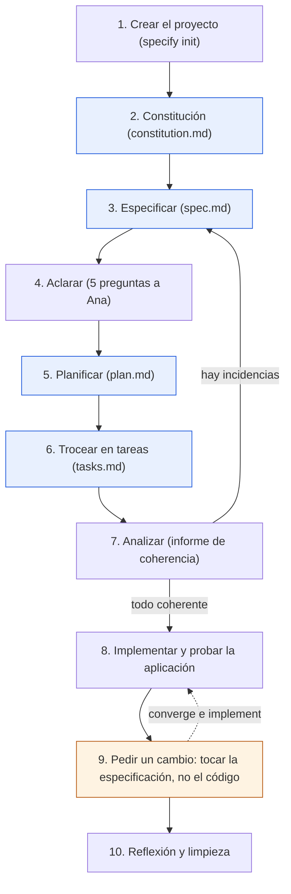

# Ejercicio 03: ReservaSalas paso a paso con Spec Kit

> **Para quién:** programadores junior (y cualquiera que programe y quiera ver el flujo completo) · **Tiempo de lectura:** ~20 min (hacerlo: 90-120 min) · **Nivel:** 🟡 intermedio

Este es el ejercicio central del repositorio. Vas a construir ReservaSalas, la aplicación interna para reservar las 12 salas de reuniones de la empresa, siguiendo de principio a fin el flujo de SDD (*Spec-Driven Development*, desarrollo guiado por especificaciones) con GitHub Spec Kit y un asistente de programación con IA. Tú no escribirás código: escribirás la constitución, la especificación, las respuestas a las aclaraciones y la tecnología del plan. El asistente hará el resto, y tú revisarás cada artefacto antes de pasar al siguiente.

El ejercicio reproduce la sesión que hizo Luis (programador junior) con el encargo de Ana (responsable de Oficina). El resultado de esa sesión, traducido y comentado, está en [la solución canónica](soluciones/03-reserva-salas/README.md); en cada paso te diremos con qué fichero compararte.

**Qué vas a encontrar**

- [Objetivo](#objetivo)
- [Qué necesitas](#qué-necesitas)
- [El recorrido del ejercicio](#el-recorrido-del-ejercicio)
- [Pasos](#pasos)
- [Errores frecuentes](#errores-frecuentes)
- [Comprueba lo que has aprendido](#comprueba-lo-que-has-aprendido)
- [Solución o ejemplo resuelto](#solución-o-ejemplo-resuelto)
- [En tres frases](#en-tres-frases)
- [Siguiente paso](#siguiente-paso)

## Objetivo

Al terminar habrás recorrido los siete pasos del flujo SDD con una herramienta real: crear el proyecto, dictar la constitución (`constitution.md`), escribir la especificación (`spec.md`) sin tecnología, aclarar, redactar el plan técnico (`plan.md`), trocear en una lista de tareas (`tasks.md`), analizar e implementar. Sabrás leer cada artefacto que genera el asistente y qué comprobar en él antes de seguir. Y habrás vivido el momento que resume todo el método: pedir un cambio tocando la especificación, no el código.

## Qué necesitas

- **Tiempo:** entre 90 y 120 minutos seguidos, o dos sesiones (pasos 0-7 y pasos 8-10). El paso 8, implementar, es el más largo: el asistente trabaja solo un buen rato (en nuestra experiencia, entre 15 y 40 minutos según la herramienta).
- **Requisitos previos:** la vía B del [ejercicio 00](00-preparacion-del-entorno.md) terminada (Spec Kit instalado, un asistente de programación con IA compatible y los comandos `/speckit.*` visibles en él). Ayuda haber leído [El flujo paso a paso](../docs/03-el-flujo-paso-a-paso.md) y [Los artefactos](../docs/04-los-artefactos.md).
- **Materiales:** este documento abierto al lado del asistente, y la carpeta [soluciones/03-reserva-salas/](soluciones/03-reserva-salas/README.md) para comparar. Las [plantillas](plantillas/README.md) te sirven de guía para revisar lo que genere el asistente.
- **Asistente:** cualquiera de los compatibles con Spec Kit (Claude Code, GitHub Copilot, Cursor, Gemini CLI, Codex CLI, Kiro CLI, entre otros; la lista está en [Herramientas](../docs/07-herramientas.md)). En este documento escribimos los comandos como `/speckit.specify`; en tu asistente pueden aparecer como `/speckit-specify` o `$speckit-specify`. Es la misma orden.

> [!NOTE]
> **Si no programas**, también puedes seguir este ejercicio sin instalar nada. Los pasos 2, 3 y 4 (constitución, especificación y aclaraciones) se hacen igual con las [plantillas](plantillas/README.md) y un chat de IA genérico autorizado por la empresa: los *prompts* (las instrucciones que le escribes al asistente) de esos pasos funcionan en cualquier chat si le pegas antes la plantilla correspondiente. Los pasos 5 a 9 léelos siguiendo la solución canónica: te enseñan qué recibe negocio y qué tiene que revisar. Si prefieres empezar por algo más corto, el [ejercicio 01](01-tu-primera-especificacion-sin-codigo.md) es la versión sin código.

> [!WARNING]
> Durante el paso 8 el asistente crea ficheros, instala dependencias y ejecuta pruebas en tu equipo. Léete lo que propone antes de aceptar, usa la cuenta corporativa del asistente y no metas ningún dato real: todos los nombres de este ejercicio (Ana, Luis, Marta, Jorge, las salas) son ficticios.

## El recorrido del ejercicio

El diagrama muestra los diez pasos del ejercicio y los dos bucles de vuelta: analizar puede devolverte a la especificación, y el cambio del paso 9 regenera el código sin tocarlo a mano.



De arriba abajo: creas el proyecto y dictas la constitución; especificas, aclaras, planificas y troceas en tareas (los cuatro artefactos en azul); analizas, y si hay incidencias vuelves a la especificación. Cuando todo es coherente, implementas y pruebas la aplicación. En el paso 9 (en naranja) pides un cambio editando la especificación y dejas que el asistente regenere el código; terminas con una reflexión y la limpieza.

## Pasos

Cada paso tiene el comando o el *prompt* exacto, qué deberías ver (cada asistente redacta distinto, así que fíjate en la estructura, no en la letra), qué revisar y una casilla. Si en algún paso el resultado se desvía mucho de lo descrito, no sigas: corrige el artefacto de ese paso antes de continuar.

0. **Comprueba que tienes todo.** En una terminal, ejecuta:

    ```bash
    specify version
    specify check
    ```

    Qué deberías ver: la versión de Spec Kit (1.x en la fecha de este material) y, tras `specify check`, la lista de asistentes con el tuyo como disponible (o «IDE-based» si es un editor), terminando en «Specify CLI is ready to use!». Si algo falla, vuelve a la vía B del [ejercicio 00](00-preparacion-del-entorno.md).

    - [ ] `specify version` y `specify check` responden y mi asistente aparece disponible.

1. **Crea el proyecto.** Sitúate en la carpeta donde guardas tus proyectos y ejecuta (sustituye `claude` por la clave de tu asistente, la misma que usaste en el ejercicio 00):

    ```bash
    specify init reserva-salas --integration claude
    cd reserva-salas
    ```

    Cuando pregunte «Choose script type», pulsa Intro para aceptar el valor por defecto. Si tu asistente es un editor o Spec Kit no encuentra su ejecutable, añade `--ignore-agent-tools` al final del comando. `specify init` no crea un repositorio Git; si quieres guardar cada paso (recomendado: en el paso 9 te permitirá ver exactamente qué ha cambiado), ejecuta `git init` dentro de la carpeta y, al terminar cada paso, `git add -A && git commit -m "Paso N"`.

    Qué deberías ver: el panel «Next Steps» con el orden `constitution → specify → plan → tasks → implement → converge` y otro con los opcionales `clarify`, `analyze` y `checklist`. Dentro de `reserva-salas/`:

    ```text
    reserva-salas/
    ├── .specify/
    │   ├── memory/constitution.md    # plantilla de constitución, todavía sin rellenar
    │   ├── templates/                # plantillas de especificación, plan, tareas y lista de verificación
    │   ├── scripts/bash/             # scripts auxiliares (powershell/ en Windows)
    │   └── workflows/                # flujo automatizado "speckit" (no hace falta para el ejercicio)
    └── .claude/skills/               # los comandos del asistente (la carpeta cambia según cuál uses)
    ```

    Ahora abre el asistente **dentro de esta carpeta** (desde la terminal, su comando desde `reserva-salas/`; en un editor, abre la carpeta como proyecto) y comprueba que al escribir `/speckit` (o `$speckit` en Codex CLI) aparecen los comandos.

    - [ ] Existe `reserva-salas/.specify/` y el asistente, abierto en esa carpeta, me sugiere los comandos `speckit`.

2. **Dicta la constitución.** Son los cinco principios que Ana fijó con Luis. Pega este *prompt* completo detrás del comando, todo en el mismo mensaje. Pégalo de una vez: los asistentes de terminal distinguen un texto pegado de pulsar Intro, así que no se envía a medias; si el tuyo lo enviara al primer salto de línea, junta el texto en un solo párrafo.

    ```text
    /speckit.constitution Crea la constitución del proyecto ReservaSalas, una aplicación interna para reservar las 12 salas de reuniones de la empresa, repartidas en 3 plantas. Redáctala en castellano. Cinco principios, cada uno con su regla y su «por qué»:

    1. Sencillez primero: construimos lo mínimo que resuelve el problema; nada de funciones «por si acaso». Ante dos soluciones que cumplen la especificación, se elige la que menos piezas tiene. Cualquier complejidad extra se justifica por escrito en el plan técnico antes de implementarse.
    2. Accesible y en castellano: cualquier empleado la usa sin formación previa. Todos los textos visibles en castellano claro, sin jerga. Las pantallas funcionan con teclado y con lector de pantalla. Cada error dice qué ha pasado y qué puede hacer la persona.
    3. Pruebas antes de dar algo por hecho: cada historia de usuario tiene pruebas automáticas escritas antes que su implementación. Las reglas de negocio (solapamientos, horario, duración máxima, permisos) tienen pruebas unitarias propias. La batería completa pasa al 100 % antes de cada entrega.
    4. Datos mínimos: solo se guardan nombre, correo corporativo y reservas. Ningún otro dato personal, ningún informe sobre personas concretas.
    5. Transparencia: toda reserva tiene un responsable visible. No hay reservas anónimas y cualquier cambio queda registrado con quién lo hizo.

    Restricciones: uso interno, accesible solo desde la red de la empresa y con el acceso corporativo existente (sin contraseñas propias). Los límites de uso (horario, duración máxima, antelación) se fijan en la especificación, no en el código. Sin integración con el calendario corporativo en la primera versión. Tiene que funcionar en un único servidor modesto.

    Flujo de trabajo: toda funcionalidad empieza por una especificación que aprueba la responsable de Oficina; las dudas se resuelven por escrito antes de planificar; el plan se comprueba contra esta constitución antes de trocearlo en tareas; si el resultado no es el esperado, se corrige la especificación y se regenera, no se parchea el código a mano.

    Versión 1.0.0, ratificada hoy.
    ```

    Qué deberías ver: el asistente reescribe `.specify/memory/constitution.md` y te resume la versión (1.0.0) y el motivo. El fichero empieza por un comentario HTML «Sync Impact Report» (un informe de qué ha cambiado; no hace falta que lo leas), sigue con un título, los cinco principios como subsecciones, las restricciones, el flujo de trabajo y una sección de gobernanza que termina con la línea de versión, fecha de ratificación y última modificación.

    Qué revisar: abre el fichero y compáralo con [constitution.md](soluciones/03-reserva-salas/constitution.md). Cada principio tiene que ser una regla (con «siempre», «nunca», «solo») y llevar su «por qué». No puede quedar ningún hueco entre corchetes en mayúsculas (`[PRINCIPLE_1_NAME]` o similar): si queda alguno, pídele al asistente que lo rellene con lo que ya le has dicho. Si algún principio ha perdido fuerza («intentaremos probar» en vez de «cada historia tiene pruebas»), díselo: «El principio 3 tiene que decir que las pruebas se escriben antes que el código y que son obligatorias».

    - [ ] `.specify/memory/constitution.md` tiene los cinco principios con su «por qué», sin huecos, con versión 1.0.0.

3. **Especifica, sin tecnología.** Este es el texto de Ana, tal cual se lo contó a Luis. Fíjate en que no dice nada de cómo se construye: ni lenguaje, ni base de datos, ni pantallas. Le añadimos una instrucción para que redacte los requisitos en EARS (*Easy Approach to Requirements Syntax*, una forma sencilla y estructurada de redactar requisitos que practicaste en el ejercicio 02). Pégalo todo detrás del comando:

    ```text
    /speckit.specify Quiero una aplicación interna para reservar las 12 salas de reuniones de la empresa, repartidas en 3 plantas. Hoy nos apuntamos en una hoja de cálculo compartida y pasa de todo: dos equipos en la misma sala, salas reservadas que se quedan vacías y reservas de las que nadie sabe quién es el responsable. Cualquier empleado tiene que poder ver qué salas están libres en una franja, reservar una, cancelar o cambiar su reserva, y ver sus reservas y las de hoy en cada sala. El horario de oficina es de 08:00 a 20:00 y no queremos reservas de más de 4 horas. Administración tiene que poder marcar una sala en mantenimiento.

    Redacta la especificación en castellano. Escribe los requisitos funcionales en formato EARS (CUANDO…, MIENTRAS…, SI…, ENTONCES…, DONDE…) con el verbo «deberá». No decidas ninguna tecnología.
    ```

    Qué deberías ver: el asistente crea la carpeta `specs/001-reserva-salas/` (el nombre corto lo elige él a partir de la descripción, así que puede ser `001-reservar-salas` o parecido; no importa) con `spec.md` y `checklists/requirements.md`, y escribe `.specify/feature.json` con esa carpeta como funcionalidad activa. Al final te da un informe con la ruta de la especificación, el resultado de la lista de verificación automática y la recomendación de seguir con aclarar o planificar. Puede que antes te haga hasta tres preguntas en bloque, cada una con una tabla de opciones A, B, C y «Custom», porque le faltaba un dato importante; responde con las decisiones de Ana de la tabla del paso 4, en el formato que te pida (por ejemplo, «Q1: B» o «Q1: Custom - No en la primera versión»).

    Qué revisar en `spec.md`, comparando con [spec.md](soluciones/03-reserva-salas/spec.md) de la solución:

    | Sección | Qué tiene que haber | Si falta o está mal |
    |---|---|---|
    | Historias de usuario | Tres, con prioridad: P1 reservar una sala, P2 cancelar o modificar mi reserva, P3 ver mis reservas y las de hoy. Cada una con «Por qué esta prioridad», «Prueba independiente» y criterios Dado / Cuando / Entonces | Pide que reordene las prioridades o que añada los criterios que falten |
    | Casos límite | Solapamientos, fuera de horario, sala en mantenimiento, más de 4 horas, «para ya mismo» con la sala ocupada | Pide que los añada: «Añade a los casos límite qué pasa si…» |
    | Requisitos funcionales | Entre 8 y 12, en EARS, uno por frase, sin tecnología (en la solución son RF-001 a RF-012; tu asistente puede numerarlos `FR-001`, que es lo mismo) | Si ves «System MUST…» en inglés o requisitos con dos cosas, pide que los reescriba con la tabla de patrones de [EARS](../docs/05-escribir-requisitos-claros-ears.md) |
    | Entidades clave | Sala, Reserva y Persona con sus datos | Si aparece «tabla», «campo» o «clave primaria», eso es plan: pide que lo quite |
    | Criterios de éxito | Medibles y sin tecnología (menos de 1 minuto por reserva, cero solapamientos, 90 % sin ayuda, listado en menos de 2 segundos) | Si dice «rápido» o «intuitivo» sin cifra, pide una cifra |
    | Marcadores `[NEEDS CLARIFICATION: …]` | Como mucho tres; lo normal es que no haya ninguno y que las dudas estén en «Supuestos» | Los resuelves en el paso 4 |

    Abre también `checklists/requirements.md`: es la lista de verificación automática de la calidad de la especificación (tres bloques, 16 comprobaciones). Las casillas sin marcar son lo que el paso 4 tiene que cerrar.

    - [ ] Existe `specs/001-…/spec.md` con tres historias priorizadas, requisitos en EARS y criterios de éxito con cifra, y ninguna mención a tecnología.

4. **Aclara: responde como Ana.** Ejecuta el comando sin nada detrás:

    ```text
    /speckit.clarify
    ```

    Qué deberías ver: el asistente revisa la especificación buscando huecos (alcance, roles, datos, casos límite, avisos) y te hace **una pregunta cada vez**, como mucho cinco. Cada pregunta suele seguir el mismo esqueleto: la pregunta (algo como «Question: …»), una frase de por qué importa, la opción recomendada («Recommended: Option B…») y una tabla de opciones con letras; puedes contestar con la letra, con «yes» para aceptar la recomendación o con una respuesta corta. Después de cada respuesta, actualiza `spec.md` y pasa a la siguiente.

    Responde con las decisiones de Ana (son las de la solución; si tu asistente formula la pregunta de otra manera, busca la que se parezca):

    | Si pregunta sobre… | Responde |
    |---|---|
    | Reservas recurrentes (todos los lunes, cada semana) | No en la primera versión. |
    | Quién puede cancelar o modificar una reserva ajena | Solo administración. |
    | Avisos o notificaciones (correo) | Sí, un correo de confirmación. |
    | Antelación máxima para reservar | 30 días. |
    | Qué pasa si nadie aparece (control de asistencia, liberar la sala) | Fuera de alcance: no se controla la asistencia. |
    | Cualquier tecnología (base de datos, aplicación móvil, servidor) | Eso se decide en el plan técnico; pasa a la siguiente pregunta. |
    | Algo que ya está en la descripción (horario, 4 horas, mantenimiento) | Lo que dice la descripción de Ana. |

    Al terminar, el asistente informa de cuántas preguntas ha hecho, qué secciones ha tocado y cómo ha cambiado la lista de verificación automática (algo como «13/16 → 16/16 items passing»; en la solución canónica esa lista está ampliada a 23 comprobaciones y pasó de 20 a 23), y recomienda pasar a planificar. En `spec.md` aparece una sección nueva, `## Clarifications`, con `### Session` y la fecha, y una línea `- Q: … → A: …` por respuesta. Compárala con [aclaraciones.md](soluciones/03-reserva-salas/aclaraciones.md), que además explica qué cambió en cada requisito.

    Qué revisar: que cada respuesta haya llegado a la sección que le toca, no solo a la lista de aclaraciones: «solo administración» tiene que aparecer como requisito (en la solución, RF-010) y en un criterio de la historia 2; «30 días» en el requisito de límites y en un caso límite; el correo como requisito propio; recurrentes y asistencia en «Fuera de alcance» o en «Supuestos». Si alguna se quedó solo en la lista, díselo: «La respuesta sobre la antelación de 30 días no está reflejada en los requisitos; añádela».

    Si el asistente responde que no detecta ambigüedades críticas (algo como «No critical ambiguities detected»), la especificación ya cubría esos huecos con supuestos. Comprueba que los supuestos coinciden con la tabla; si no, ejecuta `/speckit.clarify alcance, permisos y avisos` para centrarlo en esas áreas.

    - [ ] `spec.md` tiene la sección de aclaraciones con las cinco respuestas de Ana y cada una se refleja en un requisito, un caso límite o «Fuera de alcance».

5. **Planifica: ahora sí, la tecnología.** Es el único paso en el que decides el «cómo». Luis eligió lo más sencillo que cumple la constitución:

    ```text
    /speckit.plan Aplicación web sencilla con Python 3.12 y FastAPI, base de datos SQLite y páginas HTML con plantillas Jinja2. Pruebas con pytest. Sin frontend complejo: nada de frameworks de JavaScript. Redacta el plan en castellano.
    ```

    Qué deberías ver: en `specs/001-…/` aparecen `plan.md`, `research.md` (decisiones y alternativas), `data-model.md` (modelo de datos), la carpeta `contracts/` (qué entra y qué sale en cada operación; el asistente la crea si decide que hay interfaces que documentar, y en la solución las hay) y `quickstart.md` (cómo arrancar y probar). El asistente te lista esos ficheros al terminar. Todavía no existe `tasks.md`: eso es el paso siguiente.

    Qué revisar en `plan.md`, comparando con [plan.md](soluciones/03-reserva-salas/plan.md) (que resume los cinco ficheros en uno):

    - **Comprobación contra la constitución**: una entrada por principio con cómo lo cumple. Si alguna pone que se incumple, tiene que estar justificada en «Registro de complejidad» (en la solución, la API JSON además de las páginas HTML). Si hay una desviación sin justificar, no la aceptes: «El plan incumple el principio 4 porque guarda el departamento de cada persona; quítalo».
    - **Contexto técnico**: lenguaje, dependencias, almacenamiento y pruebas rellenos, sin ningún «NEEDS CLARIFICATION». Si queda alguno, es que al *prompt* le faltaba un dato: repite el comando dándoselo.
    - **Modelo de datos** (`data-model.md`): las tres entidades de la especificación y nada más (nada de teléfonos ni cargos; principio 4). Las reglas de RF-006 (horario, 4 horas, 30 días) tienen que aparecer como restricciones de la reserva.
    - **Contratos**: una operación por historia, como mínimo: listar salas y disponibilidad, crear reserva, cancelar o modificar, mis reservas y reservas de hoy; más marcar mantenimiento para administración.
    - **`quickstart.md`**: los comandos para arrancar la aplicación y un escenario de prueba de la historia 1. Los usarás en el paso 8.

    - [ ] `plan.md` existe, la comprobación contra la constitución está rellena y justificada, y no queda ningún «NEEDS CLARIFICATION».

6. **Trocea en tareas.** Sin argumentos:

    ```text
    /speckit.tasks
    ```

    Qué deberías ver: `specs/001-…/tasks.md` con fases (`Phase 1: Setup`, `Phase 2: Foundational`, una fase por historia de usuario en orden P1, P2, P3, y `Polish & Cross-Cutting Concerns`), y el resumen en el chat: total de tareas, tareas por historia, oportunidades de paralelización y el alcance del MVP (producto mínimo viable: normalmente solo la historia 1). En la solución salieron 47 tareas; en nuestra experiencia, entre 30 y 60 es lo habitual.

    Qué revisar, comparando con [tasks.md](soluciones/03-reserva-salas/tasks.md):

    - Cada tarea sigue el formato `- [ ] T001 [P] [US1] Descripción con ruta de fichero` (en la solución, `[HU1]` en vez de `[US1]`). Sin ruta de fichero, la tarea es vaga: pide que la añada.
    - En cada fase de historia, las **pruebas van antes que la implementación**. En Spec Kit las tareas de pruebas son opcionales: solo las genera si se piden expresamente o si el asistente lo deduce de la constitución (aquí, del principio 3). Si no hay tareas de pruebas, repite: `/speckit.tasks Incluye las pruebas de cada historia antes de su implementación, como exige el principio 3 de la constitución`.
    - `[P]` solo en tareas que tocan ficheros distintos. Dos tareas `[P]` sobre el mismo fichero son un error: señálalo.
    - Cada requisito de la especificación aparece en alguna tarea. Hazlo a ojo con dos o tres (el correo, el mantenimiento, los permisos); el paso 7 lo comprobará del todo.

    - [ ] `tasks.md` tiene fases por historia, pruebas antes que código en cada una, y rutas de fichero en todas las tareas.

7. **Analiza antes de escribir código.** Este comando no modifica nada: solo informa.

    ```text
    /speckit.analyze
    ```

    Qué deberías ver: un informe (algo parecido a un «Specification Analysis Report») con una tabla de incidencias (identificador, categoría, gravedad CRITICAL / HIGH / MEDIUM / LOW, dónde está, resumen y recomendación), una tabla de cobertura (cada requisito y qué tareas lo cubren), las incidencias con la constitución si las hay, unas métricas (requisitos, tareas, porcentaje de cobertura) y un bloque de siguientes acciones. Al final pregunta si quieres que proponga correcciones concretas; nunca las aplica solo.

    Cómo actuar según lo que informe:

    | Resultado | Qué haces |
    |---|---|
    | Cero incidencias críticas y cobertura del 100 % | Sigue al paso 8. Es el resultado de la solución canónica. |
    | Un requisito sin tarea (por ejemplo, el correo de RF-011) | No empieces a implementar. Responde «sí» a la propuesta de correcciones, revísalas, y pide que actualice `tasks.md` (o repite `/speckit.tasks` indicando qué falta). |
    | Una incidencia con la constitución (CRITICAL) | Se corrige el plan o la especificación, nunca la constitución. Vuelve al paso 5 (o al 3) con la corrección y regenera lo que venga después. |
    | Terminología distinta entre ficheros («usuario» en uno, «persona» en otro) | Pide que unifique el término en los tres ficheros. |
    | Solo incidencias LOW o MEDIUM de redacción | Puedes seguir; anótalas para el paso 10. |

    Opcional (10 minutos más): genera una lista de verificación por tema con `/speckit.checklist accesibilidad` (el asistente te hará hasta tres preguntas antes). En el orden oficial de Spec Kit este comando va justo después de planificar, antes de trocear en tareas (solo necesita `plan.md`); aquí lo agrupamos con analizar porque los dos son puertas de calidad, y el resultado es el mismo. Aparece un fichero nuevo en `specs/001-…/checklists/` (por ejemplo `ux.md`; el nombre lo pone el asistente según el tema) con comprobaciones `CHK001…` **sin marcar**: las marcas tú al revisar la especificación, porque el asistente no lo hace. Ten en cuenta que el paso 8 se detiene a preguntar si quedan casillas sin marcar.

    - [ ] El informe de `/speckit.analyze` no tiene incidencias críticas y todos los requisitos tienen al menos una tarea.

8. **Implementa y prueba la aplicación.** Aquí el asistente trabaja solo un buen rato. Lanza:

    ```text
    /speckit.implement
    ```

    Qué deberías ver: primero una tabla con el estado de las listas de verificación (si todas están completas, sigue; si alguna tiene casillas sin marcar, pregunta algo como «Do you want to proceed with implementation anyway?»; responde `yes` si las has revisado). Después va fase por fase: crea `pyproject.toml` y la estructura de carpetas, escribe las pruebas de la historia 1, las ejecuta y ve que fallan, implementa, vuelve a ejecutarlas y pasan, y así con cada historia. Marca cada tarea terminada como `[X]` en `tasks.md`. Si una tarea falla, se para y te explica por qué.

    Cómo seguir el progreso: abre `tasks.md` en el editor y mira cuántas `[X]` hay. Si prefieres ir por partes, puedes pedir un alcance: `/speckit.implement solo las fases 1, 2 y 3` te deja el producto mínimo viable (historia 1) para enseñárselo a Ana; después vuelve a lanzar `/speckit.implement` para el resto.

    Cuando termine, arranca la aplicación. Los comandos exactos están en el `quickstart.md` de **tu** proyecto (y en su `README.md`), porque cada asistente puede elegir otros nombres de módulo o de variable. Los de la solución canónica son estos (ya estás dentro de la carpeta, así que no hace falta clonar nada). Si el asistente ya ha creado `.venv` e instalado las dependencias durante la implementación, sáltate las dos primeras líneas y limítate a activar el entorno. En Linux o macOS:

    ```bash
    uv venv && source .venv/bin/activate
    uv pip install -e ".[dev]"
    export RESERVASALAS_USUARIO_DEV="luis@empresa.example"   # simula el acceso corporativo
    uvicorn reservasalas.app:app --reload
    ```

    En Windows (PowerShell):

    ```powershell
    uv venv; .venv\Scripts\activate
    uv pip install -e ".[dev]"
    $env:RESERVASALAS_USUARIO_DEV = "luis@empresa.example"   # simula el acceso corporativo
    uvicorn reservasalas.app:app --reload
    ```

    Abre <http://localhost:8000> en el navegador. Deberías ver las 12 salas con su planta y su aforo. Ahora haz la prueba de la historia 1, tal como la describe el quickstart del plan:

    1. Indica mañana de 10:00 a 11:00 y pulsa «Ver disponibilidad»: todas las salas aparecen libres salvo las que estén en mantenimiento.
    2. Elige Mediterráneo y confirma: aparece «Reserva confirmada: Mediterráneo, …» con tu nombre como responsable.
    3. Repite la misma franja: Mediterráneo aparece ocupada de 10:00 a 11:00 con tu nombre.
    4. Intenta reservar de 09:00 a 14:00: la aplicación rechaza la reserva e indica que el máximo son 4 horas.

    Por último, en otra terminal, activa el entorno (`source .venv/bin/activate`; en Windows, `.venv\Scripts\activate`) y ejecuta las pruebas automáticas:

    ```bash
    pytest
    ```

    Qué deberías ver: todas las pruebas en verde. Si alguna falla, no la arregles tú: pégale al asistente la salida de `pytest` y dile que la tarea correspondiente no está terminada.

    Opcional pero recomendado: `/speckit.converge` compara el código con la especificación, el plan y las tareas. Si todo está cubierto responde que converge («✅ Converged» o parecido); si falta algo, añade una fase `Convergence` al final de `tasks.md` con las tareas pendientes, y `/speckit.implement` las ejecuta. Lo usarás en el paso siguiente.

    Si usas Git, guarda este estado antes de seguir (comprueba primero que el `.gitignore` que ha creado el asistente excluye `.venv/` y el fichero de la base de datos):

    ```bash
    git add -A && git commit -m "ReservaSalas: primera versión"
    ```

    - [ ] La aplicación arranca, he hecho una reserva de prueba, la franja aparece ocupada y `pytest` pasa.

9. **El momento clave: pide un cambio sin tocar el código.** Dos semanas después, Ana ve que los equipos quieren dejar reservadas con más de un mes de antelación las reuniones de planificación del trimestre, y decide ampliar la antelación máxima de 30 a 60 días. Con *vibe coding* (programar a golpe de instrucciones sueltas, improvisando con el asistente de IA), Luis buscaría el «30» en el código y lo cambiaría a mano. Con SDD, se cambia la especificación y se regenera. Y la constitución lo dice expresamente: los límites de uso (horario, duración máxima, antelación) se fijan en la especificación, no en el código.

    Primero, la especificación. Puedes editar `spec.md` tú mismo o pedírselo al asistente con un *prompt* normal (sin comando `speckit`):

    ```text
    Ana ha decidido que se puede reservar con hasta 60 días de antelación (hasta ahora eran 30). Actualiza únicamente la especificación en specs/001-reserva-salas/spec.md: el requisito de límites (RF-006) y el caso límite «Antelación excesiva», cambiando su ejemplo para que siga siendo un rechazo (una reserva para dentro de 75 días). Anota la decisión en la sección de aclaraciones, en una sesión nueva con la fecha de hoy, sin borrar la respuesta anterior. No toques el código, el plan ni las tareas.
    ```

    Si tu carpeta de funcionalidad se llama distinto de `001-reserva-salas`, cambia la ruta del *prompt*. Qué revisar: `git diff` (si usas Git) tiene que mostrar cambios solo en `spec.md`. En RF-006 y en el caso límite ya pone 60 días; el «30» solo sobrevive en la aclaración antigua, que es el historial de la decisión.

    Segundo, el plan, porque el modelo de datos también recogía el límite:

    ```text
    La especificación ha cambiado: la antelación máxima para reservar pasa de 30 a 60 días. Actualiza plan.md y data-model.md para que reflejen el nuevo límite. No cambies nada más y no toques el código ni tasks.md.
    ```

    Tercero, deja que Spec Kit encuentre la diferencia entre lo que dicen los ficheros y lo que hace el código:

    ```text
    /speckit.converge
    ```

    Qué deberías ver: una tabla de hallazgos (algo como «Convergence Findings») con al menos una incidencia que remite al requisito de límites (tipo `contradicts`: el código sigue rechazando las reservas a más de 30 días) y, al final de `tasks.md`, una fase nueva `## Phase 7: Convergence` (el número depende de cuántas fases tenías) con tareas numeradas a continuación de la última (T048 en adelante si tenías 47): cambiar la validación de antelación en el servicio de reservas y actualizar las pruebas de límites, cada una con su requisito de origen y el tipo de desviación entre paréntesis. El comando no edita código ni las tareas antiguas: solo añade. Las tareas ya hechas que mencionaban los 30 días (en la solución, T014 y T019) se quedan como están, porque son el historial de lo que se hizo.

    Cuarto, ejecuta solo esas tareas:

    ```text
    /speckit.implement solo la fase de convergencia
    ```

    Qué deberías ver: el asistente actualiza las pruebas de límites, las ejecuta (fallan), cambia la validación, las vuelve a ejecutar (pasan) y marca las tareas nuevas como `[X]`. Comprueba tú: `pytest` en verde; en la aplicación (si está arrancada con `--reload`, se recarga sola), una reserva para una fecha dentro de 45 días se acepta y una para dentro de 75 días se rechaza indicando que el máximo son 60 días. Un segundo `/speckit.converge` tiene que responder que todo converge («✅ Converged»).

    Fíjate en lo que acaba de pasar: has cambiado una frase en un documento en castellano, y el código, las pruebas y los mensajes de la aplicación han cambiado en consecuencia. La especificación es la fuente de verdad; el código es su consecuencia. Si comparas ahora tus ficheros con la solución canónica, los tuyos van un cambio por delante (allí el límite sigue siendo 4 horas): es lo esperado.

    - [ ] He cambiado el límite en la especificación, no en el código; `converge` ha añadido las tareas, `implement` las ha hecho y la aplicación rechaza una reserva de 3 horas.

10. **Reflexiona y recoge.** Antes de cerrar, responde por escrito (dos líneas por pregunta bastan) en un fichero `docs/reflexion.md` dentro del proyecto o en tu cuaderno:

    - ¿Cuántas líneas de código has escrito tú? ¿Y cuántas has leído?
    - ¿Qué artefacto te costó más revisar? ¿En cuál detectaste un error antes de que llegara al código?
    - Si mañana Ana pide que administración pueda cancelar cualquier reserva con un motivo obligatorio, ¿qué fichero abres primero?
    - ¿Qué habrías hecho distinto con *vibe coding* y cuánto habrías tardado en descubrir el error del límite de horas tres meses después?

    Limpieza: para el servidor con `Ctrl+C`, desactiva el entorno con `deactivate`, y guarda el estado con `git add -A && git commit -m "ReservaSalas: flujo SDD completo"` si usas Git. No borres la carpeta: te servirá de referencia en el [ejercicio 06](06-reto-final-tu-propio-proyecto.md). Lo único que puedes borrar sin pena es el fichero de la base de datos (`reservasalas.db` en la solución), que se vuelve a crear al arrancar.

    - [ ] He escrito la reflexión y el proyecto queda guardado y parado.

## Errores frecuentes

| Síntoma | Causa | Cómo arreglarlo |
|---|---|---|
| Al ejecutar `/speckit.plan` o `/speckit.tasks`: «ERROR: Feature directory not found» o «Run /speckit.specify first» | No hay funcionalidad activa: no has ejecutado `/speckit.specify`, o el asistente está abierto en otra carpeta y no ve `.specify/feature.json` | Ejecuta `/speckit.specify` (paso 3) o abre el asistente dentro de `reserva-salas/`. Comprueba que `.specify/feature.json` apunta a `specs/001-…` |
| La especificación sale en inglés | El asistente ha seguido el idioma de la plantilla | Pídele: «Traduce spec.md al castellano manteniendo la estructura y los identificadores». En el *prompt* del paso 3 ya va la instrucción; no la recortes |
| La especificación menciona Python, SQLite, API o «tabla» | Se coló tecnología en el *prompt* o el asistente la añadió por su cuenta | Pídele: «Quita de spec.md cualquier mención a tecnología; eso va en el plan». La primera comprobación de `checklists/requirements.md` vigila exactamente esto |
| Los requisitos están como «System MUST…» y no en EARS | El asistente ha usado el formato de la plantilla original | Pásale la tabla de patrones de [EARS](../docs/05-escribir-requisitos-claros-ears.md) y pide que reescriba cada requisito con uno de los cinco patrones y el verbo «deberá» |
| `/speckit.clarify` dice «No critical ambiguities detected» | La especificación cerró los huecos con supuestos | Comprueba «Supuestos» contra la tabla del paso 4; si no coincide, `/speckit.clarify alcance, permisos y avisos` |
| `/speckit.clarify` pregunta por tecnología (base de datos, móvil) | Se ha salido de su papel | Responde: «Eso se decide en el plan técnico; siguiente pregunta» |
| En `plan.md` queda «NEEDS CLARIFICATION» en el contexto técnico, o un principio aparece como incumplido sin justificar | Al *prompt* del paso 5 le faltaba un dato, o el asistente ha tomado una decisión que choca con la constitución | Repite `/speckit.plan` con el dato que falta. Para la desviación: «El plan incumple el principio N; cámbialo o justifícalo en el registro de complejidad» |
| `tasks.md` no tiene tareas de pruebas | En Spec Kit las tareas de pruebas son opcionales: hay que pedirlas, y no todos los asistentes las deducen de la constitución | `/speckit.tasks Incluye las pruebas de cada historia antes de su implementación, como exige el principio 3 de la constitución` |
| `/speckit.implement` se para: «Some checklists have unchecked items. Do you want to proceed…?» | Una lista de `checklists/` (por ejemplo, la de accesibilidad del paso 7) tiene casillas sin marcar | Revisa esa lista y marca tú las casillas que se cumplen, o responde `yes` si asumes el riesgo |
| `/speckit.implement` falla al instalar dependencias (tiempo de espera, certificado) | Proxy o índice privado de paquetes de la empresa | Configura `UV_DEFAULT_INDEX` como en el [ejercicio 00](00-preparacion-del-entorno.md) y vuelve a lanzar el comando; si no, habla con IT |
| `uvicorn: command not found` | El entorno virtual no está activado o faltan las dependencias | `source .venv/bin/activate` (en Windows, `.venv\Scripts\activate`) y `uv pip install -e ".[dev]"` |
| La aplicación rechaza todo o dice que no hay identidad | Falta la variable que simula el acceso corporativo en esa terminal (en la solución, `RESERVASALAS_USUARIO_DEV`; en tu proyecto puede llamarse distinto) | Mira el `README.md` o el `quickstart.md` de tu proyecto, define la variable y arranca de nuevo |
| «Address already in use» al arrancar | Ya hay un servidor escuchando en el puerto 8000 | Páralo con `Ctrl+C` en su terminal, o arranca este en otro puerto: `uvicorn reservasalas.app:app --reload --port 8001` |
| En el paso 9 el asistente ha cambiado el código directamente | Ha tomado el atajo | Deshaz el cambio (`git checkout -- .` si usas Git) y repite el *prompt*, que dice expresamente «no toques el código» |
| Ha aparecido `specs/002-…` | Has vuelto a ejecutar `/speckit.specify`: cada ejecución crea una funcionalidad nueva | Borra `specs/002-…`, deja `.specify/feature.json` apuntando a `specs/001-…` y edita la especificación existente como en el paso 9 |

## Comprueba lo que has aprendido

1. ¿En qué fichero queda la especificación de ReservaSalas, quién decide el nombre de su carpeta y qué fichero le dice a Spec Kit cuál es la funcionalidad activa?
2. Ana cambia de opinión: el máximo de antelación pasa de 30 a 15 días. ¿Qué fichero abres primero y qué comandos vienen después?
3. `/speckit.analyze` informa de que el requisito del correo de confirmación no tiene ninguna tarea. ¿Qué haces y qué no haces?
4. ¿Por qué el *prompt* del paso 3 no menciona Python ni SQLite, y el del paso 5 sí?
5. ¿Qué diferencia hay entre `/speckit.analyze` y `/speckit.converge`?

<details><summary>Ver respuestas</summary>

1. En `specs/001-reserva-salas/spec.md` (el nombre corto lo elige el asistente a partir de la descripción; el número es secuencial). La funcionalidad activa la marca `.specify/feature.json`, no una rama de Git.
2. `spec.md`: cambias el límite en el requisito de límites, en el caso límite y en la aclaración. Después actualizas el plan y el modelo de datos si lo recogían, ejecutas `/speckit.converge` para que añada las tareas de convergencia y `/speckit.implement` para que las haga. Nunca empiezas por el código.
3. Haces: responder «sí» a la propuesta de correcciones, revisarlas y pedir que añada la tarea a `tasks.md` (o repetir `/speckit.tasks` indicando qué falta), y volver a ejecutar `/speckit.analyze`. No haces: empezar a implementar con un requisito sin cubrir, ni quitar el requisito para que el informe salga limpio.
4. Porque la especificación dice QUÉ y POR QUÉ, en lenguaje natural, para que Ana pueda leerla y aprobarla; la tecnología es el CÓMO y se decide en el plan, justificada contra la constitución. Si la tecnología entra en la especificación, negocio deja de poder revisarla y cualquier cambio técnico obliga a reescribirla.
5. `/speckit.analyze` se ejecuta antes de escribir código y comprueba la coherencia entre especificación, plan, tareas y constitución; es solo lectura. `/speckit.converge` se ejecuta después de implementar y compara el código con esos ficheros; solo puede añadir tareas a `tasks.md`, nunca editar código ni los otros ficheros.

</details>

## Solución o ejemplo resuelto

La carpeta [soluciones/03-reserva-salas/](soluciones/03-reserva-salas/README.md) contiene los artefactos de la sesión de Luis, traducidos y comentados: [constitution.md](soluciones/03-reserva-salas/constitution.md), [spec.md](soluciones/03-reserva-salas/spec.md), [aclaraciones.md](soluciones/03-reserva-salas/aclaraciones.md), [checklist.md](soluciones/03-reserva-salas/checklist.md), [plan.md](soluciones/03-reserva-salas/plan.md) y [tasks.md](soluciones/03-reserva-salas/tasks.md). No incluye el código: lo genera tu asistente y cada uno lo escribe distinto. Si tus ficheros no coinciden letra por letra con los de la solución, no pasa nada; lo que tiene que coincidir es la estructura, las prioridades, las cinco respuestas de Ana y que cada requisito esté cubierto por el plan y por alguna tarea. Recuerda que, si has hecho el paso 9, tu especificación va un cambio por delante.

## En tres frases

1. El flujo completo con Spec Kit es `init → constitution → specify → clarify → plan → tasks → analyze → implement → converge`: tú escribes principios, descripción, respuestas y tecnología; el asistente genera los artefactos y el código, y tú revisas cada uno antes de seguir.
2. La especificación no lleva tecnología, el plan sí, y ambos se comprueban contra la constitución; `analyze` evita escribir código con incoherencias y `converge` evita dar por terminado lo que no cumple la especificación.
3. Cuando Ana cambia de opinión, se cambia la especificación y se regenera: la especificación es la fuente de verdad y el código es su consecuencia.

## Siguiente paso

Continúa con [Ejercicio 04: dinámica de equipo de 20 minutos](04-dinamica-de-equipo-20-minutos.md), pensado para hacer en grupo y sin ordenador. Si quieres seguir con las herramientas, el [ejercicio 05](05-arreglar-una-especificacion-mala.md) te da una especificación mala de ReservaSalas para arreglar, y el [ejercicio 06](06-reto-final-tu-propio-proyecto.md) es tu propio proyecto con este mismo flujo.

---

⬅️ [Anterior: Practicar requisitos EARS](02-practicar-requisitos-ears.md) · 🏠 [Índice de ejercicios](README.md) · ➡️ [Siguiente: Dinámica de equipo de 20 minutos](04-dinamica-de-equipo-20-minutos.md)
