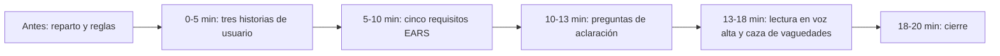

# Ejercicio 04: dinámica de equipo de 20 minutos

> **Para quién:** quien facilita una charla o una reunión de equipo; como participante, cualquier persona, sepa programar o no · **Tiempo de lectura:** ~8 min (hacerlo: 20 min) · **Nivel:** 🟢 básico

Veinte minutos, grupos de tres o cuatro personas, una petición vaga por grupo y ningún ordenador. Cada grupo convierte una frase del tipo «una app para reservar plazas de parking» en tres historias de usuario, cinco requisitos y una lista de preguntas; después lee un requisito en voz alta y el resto de la sala caza sus vaguedades. Es SDD (*Spec-Driven Development*, desarrollo guiado por especificaciones) en miniatura: la parte que no necesita herramientas y que cualquier persona de la empresa puede hacer.

**Qué vas a encontrar**

- [Objetivo](#objetivo)
- [Qué necesitas](#qué-necesitas)
- [Materiales imprimibles](#materiales-imprimibles)
- [Pasos](#pasos)
- [Guion minuto a minuto para quien facilita](#guion-minuto-a-minuto-para-quien-facilita)
- [Variantes](#variantes)
- [Errores frecuentes](#errores-frecuentes)
- [Comprueba lo que has aprendido](#comprueba-lo-que-has-aprendido)
- [Solución o ejemplo resuelto](#solución-o-ejemplo-resuelto)
- [En tres frases](#en-tres-frases)
- [Siguiente paso](#siguiente-paso)

## Objetivo

Al terminar, cada participante habrá vivido en pequeño dos pasos del flujo SDD, especificar (historias y requisitos) y aclarar (las preguntas que haría a quien pide), y la revisión que cierra toda especificación: detectar vaguedades en lo que han escrito otros. Y quien facilita sabrá dirigir la dinámica con un guion cerrado, en una sala o en línea, sin necesidad de saber programar.

## Qué necesitas

- Entre 6 y 24 personas, en 2 a 6 grupos (hay seis tarjetas, y en el paso 5 caben cinco o seis lecturas): de 3 personas hasta 18 participantes y de 4 a partir de ahí; si no salen exactos, algún grupo tendrá una persona más o una menos. Mezcla a la gente: en cada grupo, si puedes, alguien que suela encargar proyectos y alguien que suela construirlos. Con más de 24 personas, monta dos dinámicas en paralelo, cada una con quien la facilite.
- Una persona que facilita. Puedes ser tú: no hace falta saber programar, solo seguir el [guion minuto a minuto](#guion-minuto-a-minuto-para-quien-facilita).
- Una sala con mesas separadas, o una reunión en línea con salas pequeñas (ver [Variantes](#variantes)).
- Impreso, de la sección [Materiales imprimibles](#materiales-imprimibles): una tarjeta de petición por grupo (recortada) y una plantilla de una página por grupo. Bolígrafos. Un cronómetro visible (el móvil vale).
- Opcional: la tabla de patrones EARS (*Easy Approach to Requirements Syntax*, una forma sencilla y estructurada de redactar requisitos) proyectada; está resumida en la propia plantilla.
- Lo que no necesitas: ordenadores, Spec Kit (la herramienta de los ejercicios con código) ni asistentes de IA. Hay una variante opcional con un chat de IA al final, para después de la dinámica.
- Tiempo: 20 minutos de dinámica más 10 de preparación. Lectura previa recomendada para quien facilita: [Escribir requisitos claros con EARS](../docs/05-escribir-requisitos-claros-ears.md). Para quien participa, ninguna.

Este diagrama muestra los cinco bloques de tiempo y su orden.



De izquierda a derecha: antes de arrancar el reloj se reparten tarjetas y se explican las reglas; después vienen cinco minutos de historias de usuario, cinco de requisitos, tres de preguntas de aclaración, cinco de lectura en voz alta con caza de vaguedades y dos de cierre. En total, veinte minutos de reloj.

## Materiales imprimibles

Para imprimir desde GitHub, copia cada bloque de abajo con el botón de copiar que aparece en su esquina superior derecha, pégalo en un documento e imprímelo. Usa una letra de ancho fijo (Courier New o parecida) a 10 puntos, con interlineado 1,5 y sin espacio entre párrafos: con otra letra, los huecos y las flechas se descolocan, y así cada bloque cabe en una cara de A4 con los márgenes normales y deja sitio para escribir a mano. Si tu editor pasa alguno a una segunda página, baja la letra a 9 puntos. Una tarjeta por grupo, recortada por las líneas; una plantilla por grupo.

### Tarjetas de peticiones vagas

Cada tarjeta es todo lo que el grupo sabe del encargo. Las personas y los datos son ficticios.

```text
======================================================================
TARJETA 1 · Plazas de parking
«Una app para que la gente reserve plazas de parking.»
Lo pide: Ana, responsable de Oficina. Hoy hay 30 plazas que se
reparten por correo cada lunes y siempre hay quejas.
Lo usaría: quien viene en coche; Oficina, que gestiona las plazas.
======================================================================
TARJETA 2 · Dudas de nóminas
«Un bot que responda dudas de nóminas.»
Lo pide: Jorge, de RRHH. Hoy RRHH responde por correo las mismas
20 preguntas cada mes.
Lo usaría: cualquier empleado; RRHH, que mantiene las respuestas.
======================================================================
TARJETA 3 · Estado de los proyectos
«Un panel con el estado de los proyectos.»
Lo pide: Marta, manager. Hoy recopila a mano, cada semana, el
estado de 8 proyectos en una presentación.
Lo usaría: dirección y managers; cada responsable de proyecto.
======================================================================
TARJETA 4 · Material de oficina
«Algo para pedir material de oficina sin mandar correos.»
Lo pide: Ana. Hoy se pide por correo a Oficina: se pierde, se
duplica y nadie sabe si ha llegado.
Lo usaría: cualquier empleado; Oficina, que compra y entrega.
======================================================================
TARJETA 5 · Cursos internos
«Una forma de apuntarse a los cursos de formación.»
Lo pide: Jorge, de RRHH. Hoy hay una hoja de cálculo: cursos con
más inscritos que plazas y otros vacíos.
Lo usaría: cualquier empleado; RRHH, que publica cursos y plazas.
======================================================================
TARJETA 6 · Visitas en recepción
«Un registro de visitas para recepción, que ahora es un cuaderno.»
Lo pide: Ana. Hoy nadie avisa a la persona visitada y a veces no
se sabe quién está en el edificio.
Lo usaría: recepción; quien recibe visitas; seguridad.
======================================================================
```

### Plantilla de una página

```text
HOJA DE TRABAJO · Dinámica SDD de 20 minutos  Grupo: ___  Tarjeta: ___
======================================================================
LA PETICIÓN (copia la frase entre comillas de la tarjeta)
«____________________________________________________________________»

1. HISTORIAS (0-5 min) · Como [quién], quiero [qué], para [por qué]
P1 (imprescindible): Como ____________, quiero _______________________
                     ______________________, para ____________________
P2: Como _____________, quiero _______________, para _________________
P3: Como _____________, quiero _______________, para _________________

2. REQUISITOS EARS (5-10 min) · sujeto: el sistema · verbo: «deberá»
   Plantillas: «El sistema deberá…» · «CUANDO…, el sistema deberá…» ·
   «SI…, ENTONCES el sistema deberá…» ·
   «MIENTRAS…, el sistema deberá…» · «DONDE…, el sistema deberá…»
RF-1 _________________________________________________________________
     _________________________________________________________________
RF-2 _________________________________________________________________
     _________________________________________________________________
RF-3 _________________________________________________________________
     _________________________________________________________________
RF-4 _________________________________________________________________
     _________________________________________________________________
RF-5 _________________________________________________________________
     _________________________________________________________________

3. PREGUNTAS DE ACLARACIÓN (10-13 min) · para quien lo pide, antes
   de construir nada · afecta a: historia, requisito o alcance
A1: ________________________________________ → afecta a: _____________
A2: ________________________________________ → afecta a: _____________
A3: ________________________________________ → afecta a: _____________

4. VAGUEDADES CAZADAS (13-18 min) · las vuestras y las de otros grupos
   Tipos: adjetivo sin cifra · dos cosas en una · sin disparador ·
   tecnología · el sujeto es la persona, no el sistema
Grupo ___: «______________________________» → tipo: __________________
Grupo ___: «______________________________» → tipo: __________________

FUERA DE ALCANCE (lo que decidís NO hacer en la primera versión):
______________________________________________________________________
```

## Pasos

1. **Prepara el material y forma los grupos (10 minutos antes).** Imprime y recorta una tarjeta por grupo y una plantilla por grupo; si tienes menos de seis grupos, elige las tarjetas que más se parezcan a los problemas de tu equipo. Forma grupos de 3 o 4 personas, mezclando a quien suele encargar proyectos con quien suele construirlos, sin pasar de seis grupos (con más de 18 participantes, de 4). En cada grupo, pide que elijan quién escribe y quién será portavoz. Reparte a cada grupo una tarjeta boca abajo y una plantilla. Explica las reglas en un minuto, con estas palabras o parecidas:

   ```text
   La tarjeta es todo lo que sabéis del encargo. No podéis preguntarme nada: lo que no sepáis
   lo apuntáis como pregunta en el apartado 3. Escribís sobre qué tiene que hacer el sistema y
   por qué, nunca cómo: nada de pantallas, botones, bases de datos ni tecnología. Cuando suene
   el tiempo, se cambia de apartado aunque no hayáis terminado.
   ```

   Qué deberías ver: cada grupo con una tarjeta sin leer, una plantilla y un bolígrafo, y el cronómetro preparado en 5 minutos.

   - [ ] Los grupos están formados, el material repartido y las reglas dichas.

2. **Minutos 0-5: tres historias de usuario priorizadas.** Los grupos dan la vuelta a la tarjeta y rellenan el apartado 1 de la plantilla: tres historias con la forma «Como [quién], quiero [qué], para [por qué]», ordenadas por prioridad. La regla de la P1: si solo se hiciera esa historia, ¿ya resolvería el problema de la tarjeta? Si no, no es la P1. Lo que decidáis no hacer en la primera versión (abonos, plazas de visitas…) va al pie de la hoja, en «Fuera de alcance»: también es una decisión. Ejemplo a medio rellenar con la tarjeta 1:

   ```text
   P1: Como empleado que viene en coche, quiero ver qué plazas están libres un día y
       reservar una, para no tener que esperar al correo del lunes.
   P2: Como empleado, quiero liberar mi plaza si al final no vengo, para que ________.
   P3: Como responsable de Oficina, quiero ________________, para ________________.
   ```

   Qué deberías ver: tres frases por grupo, con un «quién» distinto en al menos una de ellas (la persona que pide y la que usa no suelen ser la misma) y sin mencionar pantallas. Avisa cuando queden 60 segundos.

   - [ ] Cada grupo tiene una P1 que resolvería el problema por sí sola y, si ha dado tiempo, la P2 y la P3.

3. **Minutos 5-10: cinco requisitos EARS.** Apartado 2. Cada requisito es una sola frase cuyo sujeto es el sistema (nunca «el usuario»), con el verbo «deberá» y una de las cinco plantillas que vienen en la hoja. Reto para el grupo: usar al menos tres plantillas distintas. Si falta una cifra (¿cuántos días? ¿hasta qué hora?), no se inventa: se escribe una provisional entre corchetes ([2 días?]) y se apunta como pregunta en el apartado 3. Ejemplo a medio rellenar con la tarjeta 1:

   ```text
   RF-1 El sistema deberá mostrar las plazas libres de cada día con su número y su planta.
   RF-2 CUANDO una persona confirma una reserva, el sistema deberá ______________________.
   RF-3 SI una plaza ya está reservada ese día, ENTONCES el sistema deberá ______________.
   RF-4 MIENTRAS una plaza esté marcada como ____________, el sistema deberá ___________.
   RF-5 DONDE la persona tenga permisos de ________, el sistema deberá _______________.
   ```

   Qué deberías ver: cinco frases que empiezan por «El sistema deberá», «CUANDO», «MIENTRAS», «SI» o «DONDE». Pasa por las mesas: si ves «el usuario deberá» o «rápido», señálalo sin corregirlo; lo cazarán en el paso 5.

   - [ ] Cada grupo tiene cinco requisitos y al menos tres plantillas distintas.

4. **Minutos 10-13: preguntas de aclaración.** Apartado 3. Cada grupo escribe las tres preguntas que haría a quien pide el sistema antes de construir nada, y a qué parte de la hoja afecta cada respuesta. Son las dudas que han ido apareciendo en los pasos 2 y 3: cifras que han dejado provisionales entre corchetes, perfiles que no estaban claros, cosas que no saben si entran o no. Si una duda se resuelve sola con un «eso no, en la primera versión», no es una pregunta: va a «Fuera de alcance». Ejemplo con la tarjeta 1:

   ```text
   A1: ¿Se puede reservar con más de una semana de antelación?        → afecta a: RF-2, casos límite
   A2: ¿Hay plazas fijas asignadas a alguien, o todas son rotatorias? → afecta a: P1, RF-1
   A3: ______________________________________________________________ → afecta a: ________
   ```

   Qué deberías ver: preguntas concretas, que se responden con un dato o un sí/no, no «¿qué queréis exactamente?». Es el paso que en el flujo real hace el asistente de IA: pregunta antes de inventar.

   - [ ] Cada grupo tiene al menos tres preguntas, cada una con la parte a la que afecta.

5. **Minutos 13-18: lectura en voz alta y caza de vaguedades.** Por turnos, el portavoz de cada grupo lee en voz alta la petición de su tarjeta y **un** requisito (el que más les guste). El resto de la sala tiene 30 segundos para encontrarle una vaguedad: un adjetivo sin cifra, dos cosas en una frase, un requisito sin disparador, una tecnología colada o un sujeto que no es el sistema. Quien la encuentra la dice en voz alta; el grupo que lee la apunta en su apartado 4 (y el que la ha cazado, también). Con cinco grupos sale a un minuto por grupo; con seis, acorta la caza a 20 segundos.

   Qué deberías ver: casi todos los requisitos tienen algo que cazar, y eso es bueno: no es un examen, es la demostración de que un requisito que parece claro a quien lo escribe no lo es para quien lo lee. Si a un requisito nadie le encuentra nada, felicita al grupo y pregunta «¿con qué cifra lo comprobaríais?».

   - [ ] Todos los grupos han leído un requisito y han apuntado al menos una vaguedad.

6. **Minutos 18-20: cierre.** Quien facilita cierra con tres ideas, en este orden:

   ```text
   1. Lo que tenéis en la hoja es una especificación en pequeño: historias, requisitos y
      preguntas. Es exactamente lo que un asistente de IA necesita leer antes de escribir
      código, y lo habéis hecho sin tocar un ordenador.
   2. Las preguntas del apartado 3 son el paso «aclarar». Sin ellas, alguien (una persona o
      un asistente) decide por vosotros y no os enteráis hasta que está hecho.
   3. Las vaguedades que habéis cazado en 30 segundos son las que un asistente de IA suele
      resolver inventando. Cada una es un error que se evita antes de que exista.
   ```

   Recoge las hojas (o fotografíalas): sirven para la variante con asistente de IA y para que quien vaya a usar Spec Kit en el equipo las use como punto de partida.

   Qué deberías obtener: una hoja por grupo con los cuatro apartados rellenos (aunque alguno esté a medias) y al menos una línea en «Fuera de alcance».

   - [ ] Has dicho las tres ideas y has recogido las hojas.

## Guion minuto a minuto para quien facilita

| Minuto | Quien facilita dice o hace | Los grupos | Material |
|---|---|---|---|
| −10 a −1 | Forma los grupos, reparte tarjetas boca abajo y plantillas, explica las reglas (paso 1). | Eligen quién escribe y quién es portavoz. | Tarjetas, plantillas, bolígrafos |
| 0:00 | «Dad la vuelta a la tarjeta. Cinco minutos para tres historias. Empieza el reloj.» | Leen la tarjeta y escriben el apartado 1. | Cronómetro en 5:00 |
| 4:00 | «Un minuto. Si no tenéis P3, dejadla en blanco; la P1 es la que importa.» | Cierran las historias. | |
| 5:00 | «Apartado 2: cinco requisitos. El sujeto es siempre el sistema. Al menos tres plantillas distintas.» | Escriben RF-1 a RF-5. | Cronómetro en 5:00 |
| 7:30 | Pasa por las mesas. Si ves «el usuario deberá» o un adjetivo suelto, dilo sin corregirlo. | Siguen escribiendo. | |
| 9:00 | «Un minuto. Lo que no sepáis, cifra provisional entre corchetes y pregunta al apartado 3.» | Cierran los requisitos. | |
| 10:00 | «Apartado 3: tres preguntas que haríais a quien lo pide. Y a qué afecta cada una. Lo que dejéis fuera, al pie de la hoja.» | Escriben A1 a A3. | Cronómetro en 3:00 |
| 13:00 | «Portavoces: leed la petición y un requisito. El resto, 30 segundos para cazar una vaguedad.» | Grupo 1 lee; los demás buscan. | Lista de tipos de vaguedad a la vista (es la del apartado 4 de la hoja; proyéctala si puedes) |
| 14:00 a 17:00 | Un grupo por minuto. Corta las discusiones: «apuntadlo y seguimos». | Leen y cazan por turnos. | Cronómetro: 30 s por caza (20 s si hay seis grupos) |
| 18:00 | Cierre con las tres ideas del paso 6. | Escuchan. | |
| 19:30 | «Dejad las hojas en la mesa» (o foto). Indica dónde seguir (ver [Siguiente paso](#siguiente-paso)). | Entregan las hojas. | |

Consejos de ritmo: el reloj manda, aunque un grupo esté a mitad de frase; el valor de la dinámica está en que todos lleguen al paso 5. Si la sala es muy grande, dos personas facilitan: una lleva el tiempo y otra pasa por las mesas.

## Variantes

- **Versión de 10 minutos (reunión corta o taller con poco tiempo).** Una sola tarjeta para toda la sala (la 1, parking: todo el mundo entiende el problema sin explicaciones), que quien facilita lee en voz alta o proyecta, y parejas en vez de grupos; cada pareja escribe en los apartados 2 y 3 de la plantilla o en un folio. Las reglas del paso 1 se dicen antes de poner en marcha el reloj. Se salta el apartado 1: 4 minutos para tres requisitos EARS, 2 minutos para dos preguntas, 3 minutos de lectura (quien facilita pide tres requisitos a mano alzada y la sala caza vaguedades) y 1 minuto de cierre.
- **Versión de 4 minutos (la de la charla de 20 minutos).** Sin hojas ni grupos. Quien facilita proyecta la frase de la tarjeta 1 y, debajo, tres frases vagas: «que se vea qué plazas hay», «que no se pueda coger una plaza ocupada» y «que Oficina pueda bloquear plazas». Para cada una pide a la sala, a mano alzada, un requisito EARS, lo escribe tal cual y la sala caza una vaguedad en 20 segundos: un minuto por frase. El cuarto minuto es el cierre, con la idea 3 del paso 6. Es la que usa el [guion de la charla](../charla/guion-20-minutos.md).
- **En línea.** Prepara antes de la reunión un documento compartido por grupo, con su tarjeta pegada arriba y la hoja de trabajo debajo (con letra de ancho fijo, o reconstruida como lista: lo que importa son los apartados). Usa las salas pequeñas de la herramienta de reuniones, una por grupo, y fija su duración en la propia herramienta (casi todas avisan y cierran las salas al acabar el tiempo); los avisos de «un minuto» mándalos como mensaje a todas las salas, porque dentro de ellas nadie ve tu pantalla. Cada cambio de sala cuesta medio minuto: recorta el apartado 3 a dos preguntas o cuenta con 25 minutos en vez de 20. En el paso 5, ya en la sala principal, cada portavoz pega su requisito en el chat general y el resto responde en el chat con el tipo de vaguedad («adjetivo sin cifra») en vez de hablar: así participa todo el mundo y queda registro.
- **Con un asistente de IA (opcional, después de la dinámica).** Si la empresa tiene un chat de IA autorizado, cada grupo puede pegar su hoja con este *prompt* (la instrucción que le escribes al asistente) y comparar lo que el asistente encuentra con lo que cazó la sala:

  ```text
  Actúa como revisor de requisitos. Te paso la hoja de trabajo de un grupo con una petición,
  tres historias de usuario, cinco requisitos en EARS (Easy Approach to Requirements Syntax)
  en castellano y tres preguntas de aclaración. Para cada requisito dime si cumple estas
  reglas: una sola frase, una sola cosa comprobable, el sujeto es el sistema, verbo «deberá»,
  sin tecnología, sin adjetivos sin cifra; y qué plantilla EARS usa. Después dime qué dos
  preguntas de aclaración añadirías tú. No reescribas la hoja ni inventes cifras.

  Hoja:
  [pega aquí el contenido de la hoja]
  ```

  Qué es razonable esperar: una lista con un veredicto por requisito y dos o tres preguntas nuevas; a veces el asistente propondrá tecnología o inventará cifras, y ese es justo el momento de recordar que la última palabra es de las personas. Si alguien del grupo va a usar Spec Kit, la hoja es también la descripción que le daría a la herramienta en el [ejercicio 03](03-reserva-salas-paso-a-paso.md) o en el [reto final](06-reto-final-tu-propio-proyecto.md).

## Errores frecuentes

| Síntoma | Causa | Cómo arreglarlo |
|---|---|---|
| Un grupo dibuja pantallas o discute dónde va el botón. | Han saltado al **cómo**. | «Botones no: ¿qué tiene que poder hacer la persona y por qué?» |
| Los grupos te preguntan «¿y esto cuenta?», «¿cuántas plazas hay?». | Quieren que decidas tú. | «Yo no soy quien lo pide. Apuntadlo en el apartado 3.» |
| Todos los requisitos empiezan por «el usuario». | El sujeto es la persona, no el sistema. | Dar la vuelta a la frase: qué hace el sistema cuando la persona hace algo. |
| Se van los cinco minutos y solo hay una historia. | Perfeccionismo en la P1. | Corta a tiempo: una P1 clara vale más que tres historias a medias. |
| Un grupo mete «base de datos», «API» (una conexión entre programas) o un lenguaje. | Costumbre. | Cuenta como vaguedad de tipo «tecnología» en el paso 5; lo cazará la sala. |
| En el paso 5 nadie encuentra nada. | Vergüenza o requisito de verdad bueno. | Pregunta tú: «¿con qué cifra lo comprobaríais?», «¿qué pasa si falla?». |
| Un grupo se ríe de la tarjeta 2 («un bot de nóminas») y no la toma en serio. | La petición es realista pero suena a broma. | Recuérdales que así llegan las peticiones de verdad: su trabajo es convertirla en algo construible. |

## Comprueba lo que has aprendido

1. ¿Por qué la regla de la dinámica es «no se puede preguntar a quien facilita»?
2. Un grupo escribe «RF-2: El sistema deberá ser fácil de usar para reservar la plaza». ¿Qué tipo de vaguedad es y cómo la arreglarías en la hoja?
3. ¿Qué paso del flujo SDD representa el apartado 3 de la hoja, y qué pasaría en un proyecto real si se saltara?
4. ¿Por qué se mezcla en cada grupo a quien suele encargar proyectos con quien suele construirlos?

<details><summary>Ver respuestas</summary>

1. Porque en un proyecto real quien pide el sistema no está sentado al lado cuando se escribe la especificación, y mucho menos cuando el asistente de IA genera código. La regla obliga a hacer visible lo que no se sabe (las preguntas) en vez de rellenarlo con suposiciones. Es la diferencia entre «aclarar» e «inventar».
2. Adjetivo sin cifra («fácil de usar»). Se arregla de dos formas: convirtiéndolo en un criterio de éxito medible («el 90 % de las personas reservan una plaza sin ayuda la primera vez») o sustituyéndolo por un requisito concreto («CUANDO una persona elige un día, el sistema deberá mostrar las plazas libres de ese día sin pedirle ningún otro dato»). En la hoja se apunta en el apartado 4 como «adjetivo sin cifra».
3. El paso 2, aclarar. Si se salta, las dudas no desaparecen: las resuelve quien construye (o el asistente de IA) sin consultar, y el error se descubre cuando el sistema ya está hecho, que es cuando más cuesta corregirlo.
4. Porque la especificación la escribe quien encarga con ayuda de quien construye, y se lee en los dos sentidos: quien encarga sabe qué cifras y qué perfiles importan; quien construye detecta antes las lagunas y los casos límite. En la dinámica se nota: los grupos mixtos escriben mejores preguntas.

</details>

## Solución o ejemplo resuelto

Esta dinámica no tiene fichero de solución: cada sala produce hojas distintas y todas valen si pasan la caza de vaguedades. Como referencia de lo que es una buena hoja, así podría quedar la tarjeta 1 en un grupo que la ha hecho bien:

```text
P1: Como empleado que viene en coche, quiero ver qué plazas están libres un día y reservar
    una, para no depender del correo del lunes.
P2: Como empleado, quiero liberar mi plaza si no voy a venir, para que otra persona la use.
P3: Como responsable de Oficina, quiero ver quién tiene cada plaza hoy, para resolver quejas.

RF-1 El sistema deberá mostrar las plazas libres de cada día con su número y su planta.
RF-2 CUANDO una persona confirma una reserva, el sistema deberá guardarla y mostrar la
     plaza, el día y el nombre de la persona responsable.
RF-3 SI la plaza elegida ya está reservada ese día, ENTONCES el sistema deberá rechazar la
     reserva e indicar quién la tiene.
RF-4 MIENTRAS una plaza esté marcada como no disponible, el sistema deberá impedir
     reservarla.
RF-5 DONDE la persona tenga permisos de Oficina, el sistema deberá permitir marcar una
     plaza como no disponible.

A1: ¿Con cuánta antelación como máximo se puede reservar?  → afecta a: RF-2, casos límite
A2: ¿Hay plazas fijas asignadas a alguien?                 → afecta a: P1, RF-1
A3: ¿Se puede reservar más de un día seguido?              → afecta a: alcance

Fuera de alcance: plazas de visitas; abonos mensuales; aviso por correo.
```

Fíjate en que se parece mucho a la [especificación canónica de ReservaSalas](soluciones/03-reserva-salas/spec.md): mismos patrones, mismas preguntas de antelación y permisos. Los problemas de reservar cosas se parecen entre sí, y por eso las mismas plantillas sirven para casi cualquier petición. Para ver una especificación completa escrita sin código, tienes la [solución del ejercicio 01](soluciones/01-solicitud-de-vacaciones/especificacion.md).

## En tres frases

1. En veinte minutos y sin ordenador, un grupo convierte una petición vaga en tres historias priorizadas, cinco requisitos EARS y tres preguntas de aclaración: una especificación en pequeño.
2. La regla «no se puede preguntar a quien facilita» hace visible lo que no se sabe, que es exactamente lo que el paso de aclarar evita que se invente.
3. La caza de vaguedades en voz alta demuestra en 30 segundos por qué un requisito que parece claro a quien lo escribe no lo es para quien lo lee, sea una persona o un asistente de IA.

## Siguiente paso

Continúa con [Arreglar una especificación mala](05-arreglar-una-especificacion-mala.md), donde harás la misma caza de vaguedades, pero sobre una especificación completa de ReservaSalas. Si vas a facilitar la charla o un taller, tienes el [guion de 20 minutos](../charla/guion-20-minutos.md) y la [guía del facilitador](../charla/guia-del-facilitador.md).

---

⬅️ [Anterior: ReservaSalas paso a paso](03-reserva-salas-paso-a-paso.md) · 🏠 [Índice de ejercicios](README.md) · ➡️ [Siguiente: Arreglar una especificación mala](05-arreglar-una-especificacion-mala.md)
