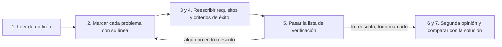

# Ejercicio 05: arreglar una especificación mala

> **Para quién:** programadores junior y cualquier persona de negocio que haya hecho el ejercicio 02 · **Tiempo de lectura:** ~8 min (hacerlo: 30-40 min) · **Nivel:** 🟡 intermedio

Luis tenía prisa. Un viernes a última hora escribió la especificación de ReservaSalas «para salir del paso» y la dejó marcada como lista para implementar. Tu trabajo es el de la persona que la revisa el lunes: encontrar todo lo que falla, decir por qué y dejar los requisitos y los criterios de éxito como deberían estar. Es exactamente lo que harás cada vez que un asistente de IA te genere una especificación.

**Qué vas a encontrar**

- [Objetivo](#objetivo)
- [Qué necesitas](#qué-necesitas)
- [Pasos](#pasos)
- [Errores frecuentes](#errores-frecuentes)
- [Comprueba lo que has aprendido](#comprueba-lo-que-has-aprendido)
- [Solución o ejemplo resuelto](#solución-o-ejemplo-resuelto)
- [En tres frases](#en-tres-frases)
- [Siguiente paso](#siguiente-paso)

## Objetivo

Al terminar sabrás leer una especificación con ojo crítico: detectar tecnología donde no toca, requisitos vagos o dobles, contradicciones, historias sin prioridad, criterios de éxito que no se pueden medir y choques con la constitución. Y sabrás reescribir la parte que más importa, los requisitos en EARS (*Easy Approach to Requirements Syntax*, una forma sencilla y estructurada de redactar requisitos) y los criterios de éxito, hasta que pasen la lista de verificación. En SDD (*Spec-Driven Development*, desarrollo guiado por especificaciones) esta revisión ocurre antes de que nada pase al plan técnico, y es el momento más barato para encontrar un error: corregir una línea aquí cuesta minutos; corregirla cuando ya hay código suele costar días.

## Qué necesitas

- Haber leído [Los artefactos](../docs/04-los-artefactos.md) y [Escribir requisitos claros con EARS](../docs/05-escribir-requisitos-claros-ears.md). Muy recomendable haber hecho el [ejercicio 02](02-practicar-requisitos-ears.md).
- La [constitución de ReservaSalas](soluciones/03-reserva-salas/constitution.md) abierta al lado: varios problemas solo se ven comparándola con ella.
- Las plantillas de [especificación](plantillas/especificacion.md) (para consultar qué secciones debería tener una buena) y de [lista de verificación](plantillas/lista-de-verificacion.md) (la pasarás en el paso 5).
- Tiempo: entre 30 y 40 minutos (unos 5 para leer, 10 para marcar problemas, 10 para reescribir, 5 para la lista de verificación y 5-10 para comparar). La segunda revisión con un asistente de IA, si la haces, va aparte.
- Dónde trabajar. Elige una vía:
  - **Vía A, sin instalar nada:** imprime o copia la especificación del paso 1 a un documento compartido y trabaja sobre ella con bolígrafo o con comentarios. Vale para todos los perfiles.
  - **Vía B, con un asistente de IA:** además de lo anterior, un chat de IA genérico autorizado por la empresa para pedir una segunda revisión en el paso 6. No hace falta Spec Kit (la herramienta de línea de comandos que se usa en el ejercicio 03): aquí se entrena tu ojo, no la herramienta.

> [!IMPORTANT]
> No abras todavía [soluciones/03-reserva-salas/spec.md](soluciones/03-reserva-salas/spec.md): es la versión buena de esta misma especificación y te chafaría el ejercicio. Úsala solo en el paso 7. La constitución sí puedes (y debes) tenerla abierta.

## Pasos

El ejercicio sigue el mismo bucle que una revisión real. Este diagrama lo resume:



De izquierda a derecha: primero se lee entera sin tocar nada; después se marcan los problemas línea a línea; con esa lista se reescriben los requisitos y los criterios de éxito; se pasa la lista de verificación y, si en lo que has reescrito queda algún «no», se vuelve a marcar y corregir. Cuando lo reescrito está todo marcado (lo que no has reescrito, como las historias, se deja anotado como pendiente), se pide una segunda opinión y se compara con la solución.

1. **Lee la especificación mala de un tirón.** Léela entera una vez, sin bolígrafo, como la leería Ana el lunes por la mañana. No apuntes nada todavía: el objetivo es que te quede la sensación de «aquí hay algo que no cuadra» en varios sitios. Los números de la izquierda no forman parte de la especificación: están para que puedas citar líneas en el paso 2.

   ```text
   01  # Especificación: ReservaSalas
   02
   03  **Carpeta/rama:** 001-reserva-salas · **Creada:** el viernes · **Estado:** lista para implementar
   04  **Petición original:** «Una app para reservar salas, que vaya rápido y sin líos.»
   05
   06  ## Resumen
   07
   08  Vamos a hacer una app web para reservar las 12 salas de reuniones de las tres plantas
   09  (Mediterráneo, Cantábrico, Atlántico y las demás). Se hará con React en la parte visual,
   10  una API REST en Node.js y PostgreSQL, todo en la nube. Así sustituimos la hoja de cálculo,
   11  que da muchos problemas. Más adelante servirá también para reservar parking y catering.
   12
   13  ## Historias de usuario y escenarios
   14
   15  ### Historia de usuario: Ver estadísticas de uso
   16
   17  Como responsable de Oficina quiero ver gráficas de ocupación de cada sala por semana, mes
   18  y año, con exportación a Excel, para tomar decisiones.
   19
   20  **Criterios de aceptación:** se comprueba abriendo la pantalla de estadísticas y viendo
   21  que funciona bien.
   22
   23  ### Historia de usuario: Reservar una sala
   24
   25  Como empleado quiero reservar una sala, y de paso reservar también el proyector y pedir
   26  café para la reunión, para no tener que hacerlo en tres sitios distintos.
   27
   28  **Criterios de aceptación:** el usuario pulsa el botón verde grande de arriba a la derecha
   29  que pone «Reservar» y la reserva se guarda correctamente.
   30
   31  ### Historia de usuario: Cancelar
   32
   33  Como usuario quiero cancelar.
   34
   35  ### Casos límite
   36
   37  Ninguno destacable. Si aparece alguno, ya lo veremos al programar.
   38
   39  ## Requisitos
   40
   41  ### Requisitos funcionales
   42
   43  - RF-1: El sistema deberá ser rápido, intuitivo y fácil de usar.
   44  - RF-2: El sistema deberá permitir reservar salas y gestionar los usuarios (alta, baja y
   45    cambio de contraseña).
   46  - RF-2: Avisar si hay choque de reservas.
   47  - RF-4: CUANDO una persona confirma una reserva, el sistema deberá guardarla en la tabla
   48    `reservas` de PostgreSQL y enviar el correo por la API de un proveedor externo.
   49  - RF-5: El usuario deberá hacer las reservas dentro del horario de oficina, de 08:00 a
   50    20:00 (o hasta las 22:00 si es un evento).
   51  - RF-6: El sistema podría enviar un correo de confirmación, si da tiempo a hacerlo.
   52  - RF-7: Las reservas pueden ser anónimas para ir más rápido; no hace falta indicar quién
   53    reserva.
   54  - RF-8: Las reservas no pueden durar más de 4 horas, salvo las reuniones de todo el día,
   55    que se reservan sin problema.
   56  - RF-9: El sistema deberá mostrar la disponibilidad de todos los espacios y las rooms de
   57    cada planta.
   58  - RF-10: CUANDO se confirma una reserva, el sistema deberá guardar la reserva (ver
   59    también RF-4).
   60  - RF-11: El sistema deberá impedir reservar una sala que esté en mantenimiento
   61    [NECESITA ACLARACIÓN: ¿quién marca una sala en mantenimiento? ¿Y quién puede cancelar
   62    una reserva de otra persona?].
   63
   64  ### Entidades clave
   65
   66  - **Sala**: nombre, planta, aforo.
   67  - **Reserva**: sala, inicio, fin.
   68  - **Usuario**: nombre, correo, teléfono móvil, foto, DNI, departamento, cargo y fecha de
   69    nacimiento (por si hace falta más adelante).
   70
   71  ## Criterios de éxito
   72
   73  ### Resultados medibles
   74
   75  - CE-1: La gente estará más contenta con las salas.
   76  - CE-2: Habrá menos choques que ahora.
   77  - CE-3: La consulta a la base de datos tardará menos de 50 milisegundos.
   78  - CE-4: La app será un éxito y todo el mundo la usará.
   79
   80  ## Supuestos
   81
   82  - Todo el mundo usará Chrome en un portátil de la empresa.
   83  - Las reservas que ya están en la hoja de cálculo las pasará alguien a mano la primera semana.
   84
   85  ## Fuera de alcance
   86
   87  - De momento nada: lo haremos todo en la primera versión.
   88
   89  ## Notas de Luis
   90
   91  - La tecnología ya está decidida, así que el plan técnico se puede saltar.
   92  - Se probará a mano al final; no hay tiempo para pruebas automáticas.
   93  - Si Ana tiene dudas, que las pregunte cuando la app esté hecha.
   ```

   Qué deberías tener: la sensación de que al menos cinco o seis cosas «no cuadran», aunque todavía no sepas nombrarlas.

   - [ ] La he leído entera una vez sin apuntar nada.

2. **Marca los problemas, línea a línea.** Segunda lectura, ahora con bolígrafo. Por cada problema apunta una fila en esta tabla: en qué línea o líneas está, qué falla, de qué tipo es y cómo lo arreglarías en una frase. Encuentra **al menos 10**; hay más de veinte, y varios se repiten en distintos sitios (la tecnología, por ejemplo, aparece en el resumen, en los requisitos, en los criterios de éxito y en los supuestos). La primera fila va de ejemplo.

   Tipos que puedes usar (y qué quiere decir cada uno):

   - tecnología: nombra lenguajes, bases de datos, productos o «dónde se guarda» algo;
   - vago: no se puede comprobar con un sí o un no («rápido», «correctamente», «funciona bien»);
   - dos cosas en una: la mitad podría cumplirse y la otra mitad no;
   - sin disparador o sin sujeto: no dice cuándo actúa el sistema, o el sujeto no es el sistema;
   - verbo blando: «podría», «pueden», «si da tiempo» en lugar de «deberá»;
   - contradicción: choca con otra línea del documento;
   - laguna: falta algo que debería estar;
   - prioridad: no dice qué es imprescindible y qué puede esperar;
   - no medible: criterio de éxito sin cifra;
   - contra la constitución: choca con uno de sus principios o con sus restricciones;
   - alcance: mete cosas que nadie ha pedido o no acota qué queda fuera;
   - terminología: llama de formas distintas a la misma cosa;
   - interfaz: describe botones, colores o pantallas en vez de lo que hace el sistema;
   - duplicado: repite algo ya dicho, con el mismo número o con otro.

   | Línea(s) | Qué falla | Tipo | Cómo lo arreglarías |
   |---|---|---|---|
   | 09-10 | Se decide la tecnología (React, Node.js, PostgreSQL, nube) en la especificación. | Tecnología | Quitarlo de aquí. Si hay preferencias, van al plan técnico, justificadas contra la constitución. |
   | … | … | … | … |
   | … | … | … | … |
   | … | … | … | … |
   | … | … | … | … |
   | … | … | … | … |
   | … | … | … | … |
   | … | … | … | … |
   | … | … | … | … |
   | … | … | … | … |
   | … | … | … | … |

   Pistas:

   - Para cada requisito, pregúntate «¿cómo demostraría que se cumple?»; si no lo sabes, es vago o no es comprobable.
   - Si una palabra solo la entendería quien programa (React, Node.js, API REST, PostgreSQL, «tabla»), es tecnología y sobra: no hace falta saber qué es cada cosa para marcarla.
   - Para cada afirmación, pregúntate si choca con otra línea (horarios, duraciones, lo que queda fuera de alcance) o con la constitución: sus cinco principios (sencillez, accesible y en castellano, pruebas, datos mínimos, transparencia) y sus «Restricciones adicionales» (acceso corporativo existente, un único servidor, sin sistemas externos).
   - Mira lo que falta, no solo lo que sobra: prioridades P1/P2/P3, criterios de aceptación (los ejemplos Dado/Cuando/Entonces de cada historia), casos límite, responsable de cada reserva, la pregunta pendiente de la línea 61.
   - No te saltes la cabecera (línea 03) ni las notas del final (líneas 89-93): también cuentan.

   Qué deberías ver: una tabla con al menos diez filas y al menos seis tipos distintos. Si todas tus filas son «tecnología» y «vago», relee las entidades, los criterios de éxito y las notas finales.

   - [ ] Tengo al menos diez problemas apuntados, de al menos seis tipos.

3. **Reescribe los requisitos funcionales.** Deja la especificación mala a un lado y escribe la sección «Requisitos funcionales» como debería ser: entre 10 y 12 requisitos en EARS, numerados RF-001, RF-002… sin huecos ni repetidos, cada uno con un solo patrón, sin tecnología y sin adjetivos sin cifra. Tienen que cubrir, como mínimo, estos diez puntos: listar las salas, ver disponibilidad, confirmar una reserva, rechazar solapamientos, rechazar franjas fuera de horario o demasiado largas, salas en mantenimiento, cancelar o modificar, permisos (quién marca una sala en mantenimiento y quién cancela reservas ajenas), aviso por correo y responsable visible.

   Para que la aclaración pendiente de la línea 61 y las contradicciones de las líneas 49-50 y 54-55 no te bloqueen, estas son las respuestas que dio Ana cuando por fin se le preguntó:

   - una sala la marca en mantenimiento solo administración;
   - una reserva ajena solo la puede cancelar o modificar administración;
   - el horario de reservas es de 08:00 a 20:00 y el máximo son 4 horas, sin excepciones (ni «eventos» hasta las 22:00 ni reuniones de todo el día);
   - el correo de confirmación es obligatorio;
   - se puede reservar con 30 días de antelación como máximo;
   - no hay reservas recurrentes ni control de asistencia en la primera versión;
   - y, aunque no hizo falta preguntarlo porque lo dice la constitución, toda reserva lleva el nombre de quien la hace.

   Plantilla a medio rellenar (la numeración es tuya; no tiene por qué coincidir con la del ejemplo canónico):

   ```markdown
   ### Requisitos funcionales

   - **RF-001**: El sistema deberá mostrar la lista de salas con su planta y aforo.
   - **RF-002**: CUANDO una persona indica una fecha y una franja horaria, el sistema deberá […].
   - **RF-003**: CUANDO una persona confirma una reserva, el sistema deberá […].
   - **RF-004**: SI […], ENTONCES el sistema deberá rechazar la reserva e indicar qué franja está ocupada.
   - **RF-005**: SI la franja solicitada […], ENTONCES el sistema deberá […].
   - **RF-006**: MIENTRAS […], el sistema deberá […].
   - **RF-007**: DONDE […], el sistema deberá […].
   - **RF-008**: …
   ```

   Qué hacer con lo que no era un requisito: RF-1 (rápido, intuitivo) se convierte en criterios de éxito en el paso 4; la gestión de contraseñas de RF-2 desaparece (la constitución dice que se usa el acceso corporativo existente); RF-7 (anónimas) se convierte en su contrario, porque la constitución exige un responsable visible; RF-5 y RF-8 dicen lo que debe hacer la persona: dales la vuelta y di qué hace el sistema si la franja queda fuera del horario o dura más de 4 horas (compara después con RF-006 del ejemplo); RF-4, RF-6 y RF-10 se convierten en dos requisitos sin tecnología, uno para guardar la reserva y confirmarla en pantalla y otro para el correo, porque pueden fallar por separado (compara después con RF-003 y RF-011 del ejemplo).

   Qué deberías ver: una lista limpia en la que cada requisito empieza por «El sistema deberá», «CUANDO», «MIENTRAS», «SI» o «DONDE», y en la que ya no aparecen PostgreSQL, «API», «rápido», «podría» ni «el usuario deberá».

   - [ ] Tengo entre 10 y 12 requisitos en EARS, numerados sin huecos y sin tecnología.

4. **Reescribe los criterios de éxito.** Sustituye CE-1 a CE-4 por al menos tres criterios con un número (tiempo, porcentaje o cantidad), que hablen de lo que ve o consigue una persona y no de cómo está construido el sistema. Un buen truco: coge cada criterio malo y pregúntate «¿cómo sabría dentro de tres meses si esto se ha cumplido?». Las cifras las fija quien encarga el sistema, no quien revisa: como aquí no puedes preguntar a Ana, pon las que te parezcan razonables y anótalas como supuesto («cifra provisional, confirmar con Ana»); en el paso 7 verás las que fijó ella.

   ```markdown
   ### Resultados medibles

   - **CE-001**: Reservar una sala, desde que se abre la aplicación hasta que aparece la confirmación, lleva menos de […].
   - **CE-002**: Cero […] en la misma sala.
   - **CE-003**: El […] % de las personas completan una reserva sin ayuda la primera vez.
   - **CE-004**: […] se muestra en menos de […] segundos.
   ```

   Qué deberías ver: ningún criterio con «contenta», «éxito» o «menos que ahora» sin cifra, y ninguno que mencione la base de datos. Fíjate en que CE-3 no era del todo inútil: tenía una cifra, pero medía algo que la persona no ve (una consulta interna). Se mantiene la idea de medir un tiempo, pero cambia lo que se mide (el listado que aparece en pantalla) y, con ello, la cifra: segundos de espera de una persona, no milisegundos de una consulta.

   - [ ] Tengo al menos tres criterios de éxito con cifra y sin tecnología.

5. **Pasa la lista de verificación.** Imprime o copia la plantilla [lista-de-verificacion.md](plantillas/lista-de-verificacion.md) y responde las preguntas CHK001 a CHK019 sobre tu versión, es decir, sobre los requisitos y los criterios de éxito nuevos (las CHK020 a CHK022 de la plantilla son ejemplos de una categoría propia; déjalas en blanco). Marca `[x]` solo lo que cumpla de verdad. Las preguntas que hablan de secciones que no has reescrito (historias, casos límite, alcance y supuestos: CHK010 a CHK016 y CHK018) déjalas sin marcar y escribe en «Notas» qué habría que arreglar; tu tabla del paso 2 ya lo dice. Cada «no» sobre un requisito o un criterio de éxito te manda de vuelta al paso 3 o al 4 (y al 2, si descubres un problema que no habías apuntado).

   Qué deberías ver: marcadas, como mínimo, CHK001 (sin tecnología), CHK005 (sin marcadores de aclaración pendientes), CHK006 a CHK009 (requisitos en EARS, una sola cosa, sin adjetivos sin cifra, numerados), CHK017 (criterios de éxito con número y sin tecnología) y CHK019 (compatibles con la constitución). Es normal que CHK013 a CHK015 (historias con prioridad, «por qué» y criterios Dado/Cuando/Entonces) queden sin marcar si no has reescrito las historias: con la nota de qué falta, el paso está hecho.

   - [ ] He pasado la lista y cada casilla sin marcar tiene una nota que dice qué falta.

6. **Vía B: pide una segunda revisión a un asistente de IA.** Solo después de tener tu tabla, pega en el chat de IA autorizado este *prompt* (la instrucción que le escribes al asistente), con la constitución y la especificación mala en los huecos indicados:

   ```text
   Actúa como revisor de especificaciones en un proceso de desarrollo guiado por especificaciones. Te paso (1) la constitución de un proyecto, con sus principios innegociables, y (2) una especificación escrita con prisas. Revisa la especificación y devuélveme una tabla con una fila por problema: número de línea, qué falla, tipo de problema (tecnología, vago, dos cosas en una, sin disparador o sin sujeto, contradicción, laguna, prioridad, no medible, contra la constitución, alcance, terminología, interfaz, duplicado) y cómo lo arreglarías en una frase.

   Reglas: la especificación solo puede decir QUÉ hace el sistema y POR QUÉ, nunca con qué tecnología. Cada requisito funcional debe ser una sola frase en formato EARS en castellano («El sistema deberá…», «CUANDO…, el sistema deberá…», «MIENTRAS…, el sistema deberá…», «SI…, ENTONCES el sistema deberá…», «DONDE…, el sistema deberá…»), con una sola cosa comprobable y sin adjetivos sin cifra. Los criterios de éxito deben tener un número (tiempo, porcentaje o cantidad) y no mencionar tecnología. Las historias de usuario deben tener prioridad P1/P2/P3 y criterios de aceptación Dado/Cuando/Entonces. No reescribas la especificación entera y no inventes cifras: si falta un dato, dilo como [NECESITA ACLARACIÓN: …].

   (1) Constitución:
   [pega aquí el contenido de soluciones/03-reserva-salas/constitution.md]

   (2) Especificación:
   [pega aquí las líneas 01 a 93 del paso 1]
   ```

   Qué deberías ver: una tabla de entre 10 y 25 filas. Es habitual que el asistente detecte a la primera la tecnología y los adjetivos vagos, y que se le escapen las contradicciones con la constitución si no se la has pegado; también puede «arreglar» cosas inventando cifras. Compara su tabla con la tuya: lo que el asistente ha visto y tú no, apúntalo; lo que tú has visto y el asistente no, también, porque es la prueba de que la revisión humana sigue haciendo falta. Cada asistente responde distinto; si el tuyo se pone a proponer tecnología o a reescribirlo todo, recuérdale las reglas del *prompt*.

   - [ ] He comparado la tabla del asistente con la mía y he añadido lo que me faltaba.

7. **Compara con la solución y con el ejemplo canónico.** Abre [soluciones/05-especificacion-arreglada.md](soluciones/05-especificacion-arreglada.md) (lista numerada de problemas con explicación y versión corregida) y, ahora sí, [la especificación canónica](soluciones/03-reserva-salas/spec.md). Comprueba tres cosas: cuántos problemas de la lista habías encontrado y cuáles se te escaparon; si tus requisitos cubren lo mismo que RF-001 a RF-012 del ejemplo (aunque los hayas numerado o agrupado distinto); y si tus criterios de éxito se parecen a CE-001 a CE-004.

   Qué deberías ver: tu lista con, probablemente, entre 10 y 15 de los problemas de la solución (nadie los encuentra todos a la primera), y requisitos que dicen lo mismo que el ejemplo con otras palabras. Si tienes Spec Kit instalado, el cierre natural es el paso 3 del [ejercicio 03](03-reserva-salas-paso-a-paso.md): lo normal es que `/speckit.specify`, a partir de la petición de Ana, genere una especificación mucho más cercana a tu versión corregida que a la de Luis (cada asistente responde distinto, pero la diferencia se nota).

   - [ ] He comparado con la solución y he apuntado los problemas que se me escaparon.

## Errores frecuentes

| Síntoma | Causa | Cómo arreglarlo |
|---|---|---|
| Solo encuentras cinco o seis problemas. | Has leído buscando erratas, no sentido. | Recorre la lista de tipos del paso 2 uno a uno y pregúntate, por cada línea, «¿cómo lo comprobaría?» y «¿choca con la constitución?». |
| Al corregir has añadido más tecnología («mejor SQLite que PostgreSQL»). | Confundes arreglar la especificación con tomar decisiones técnicas. | Toda tecnología sale de la especificación y va al plan técnico; en la especificación solo queda qué hace el sistema. |
| Has reescrito el documento entero y has tardado dos horas. | El ejercicio pide reescribir solo requisitos y criterios de éxito. | Las historias y los casos límite se anotan en la tabla como «cómo lo arreglaría»; reescribirlos es opcional. |
| Tus requisitos corregidos no coinciden con la solución. | Es lo normal: hay varias formas buenas de decir lo mismo. | Compara patrón, disparador y respuesta, y pasa la lista de verificación; si la pasa, está bien. |
| No sabes si «exportar a Excel» o «botón verde» son tecnología. | Mezclan qué quiere la persona con cómo se le da. | Quédate con el qué («descargar el listado», «confirmar la reserva») y deja el cómo para el plan y el diseño. |
| El chat de IA te dice que la especificación «está bastante bien». | El *prompt* no llevaba reglas ni constitución. | Usa el *prompt* del paso 6 completo, con la constitución pegada, y pídele una tabla, no una opinión. |

## Comprueba lo que has aprendido

1. ¿Por qué «React y PostgreSQL» no pueden estar en la especificación aunque sean la tecnología que se acabe usando?
2. ¿Qué diferencia hay entre un requisito vago (RF-1) y un criterio de éxito no medible (CE-1)? ¿Cómo se arregla cada uno?
3. La línea 54 dice «máximo 4 horas, salvo las reuniones de todo el día». ¿Quién resuelve la contradicción y dónde queda registrada la respuesta?
4. ¿Por qué la constitución te ayudó a encontrar problemas que no se ven leyendo solo la especificación? Da dos ejemplos.
5. La historia «Ver estadísticas de uso» (líneas 15-21): ¿se borra o se baja de prioridad? ¿Y «reservar el proyector y pedir café»?

<details><summary>Ver respuestas</summary>

1. Porque la especificación es el contrato de qué hace el sistema y por qué, y tiene que seguir siendo válida aunque cambie la tecnología. Las decisiones técnicas van al plan técnico, donde se justifican contra la constitución y se pueden cambiar sin tocar los requisitos. Lo que está mal no es la elección, es el sitio.
2. Un requisito vago describe un comportamiento sin que se pueda comprobar («rápido»); se arregla poniéndole cifra o moviéndolo a criterios de éxito. Un criterio de éxito no medible describe un resultado sin número («la gente estará más contenta»); se arregla fijando qué se mide y cuánto («el 90 % completa una reserva sin ayuda la primera vez»). Los dos fallan por lo mismo, la falta de medida, pero viven en sitios distintos.
3. La resuelve quien encarga el sistema (Ana), no quien programa ni el asistente de IA. La respuesta se registra en la sección «Aclaraciones» de la especificación (con Spec Kit, `/speckit.clarify` la añade como «P: … → R: …»; en el original en inglés, «Q: … → A: …») y se corrige el requisito afectado. En el ejemplo canónico no hizo falta preguntarlo: Ana ya había fijado en su petición el máximo de 4 horas, sin excepciones, y así lo recoge RF-006.
4. Porque la constitución fija reglas que la especificación no repite pero debe respetar. Ejemplos: las reservas anónimas (línea 52) chocan con el principio 5, transparencia; los datos de la entidad Usuario (líneas 68-69) chocan con el principio 4, datos mínimos; «se probará a mano al final» (línea 92) choca con el principio 3; «todo el mundo usará Chrome en un portátil» (línea 82) choca con el principio 2, porque exige un navegador y un dispositivo concretos para poder usar la aplicación, y además es una decisión técnica que no va en la especificación.
5. «Ver estadísticas» no resuelve el problema (choques, salas vacías, reservas fantasma): se baja de prioridad o se deja fuera de la primera versión; en el ejemplo canónico ni siquiera aparece, porque Ana no la pidió. «Proyector y café» es otra funcionalidad mezclada en la historia P1: se saca de la historia y va a «Fuera de alcance» (el ejemplo canónico lo deja ahí como «reserva de equipamiento»); si algún día se quiere, será su propia especificación.

</details>

## Solución o ejemplo resuelto

La lista completa de problemas, numerada y explicada, y la especificación corregida están en [soluciones/05-especificacion-arreglada.md](soluciones/05-especificacion-arreglada.md). La versión «como debería ser» de todo el documento, incluidas historias, casos límite y aclaraciones, es la [especificación canónica de ReservaSalas](soluciones/03-reserva-salas/spec.md). Para la lista de errores típicos en general, con su remedio, tienes [Buenas prácticas y errores comunes](../docs/08-buenas-practicas-y-errores-comunes.md).

## En tres frases

1. Una especificación mala no suele tener un gran error, sino muchos pequeños: tecnología donde no toca, requisitos vagos o dobles, contradicciones, cosas que faltan y choques con la constitución.
2. Revisar es preguntar, línea a línea, «¿cómo lo comprobaría?» y «¿respeta los principios?»; lo que no pasa esas dos preguntas se reescribe o se manda a aclaraciones.
3. Los requisitos y los criterios de éxito se arreglan con EARS y con cifras; el asistente de IA ayuda a encontrar fallos, pero la última palabra sobre qué quiere el sistema la tiene la persona que lo encarga.

## Siguiente paso

Continúa con el [reto final: tu propio proyecto](06-reto-final-tu-propio-proyecto.md), donde escribirás una especificación desde cero y la revisarás tú con esta misma lista. Si no programas, el [ejercicio 04](04-dinamica-de-equipo-20-minutos.md) te sirve para practicar en grupo la caza de vaguedades en requisitos escritos por otras personas.

---

⬅️ [Anterior: Dinámica de equipo de 20 minutos](04-dinamica-de-equipo-20-minutos.md) · 🏠 [Índice de ejercicios](README.md) · ➡️ [Siguiente: Reto final: tu propio proyecto](06-reto-final-tu-propio-proyecto.md)
