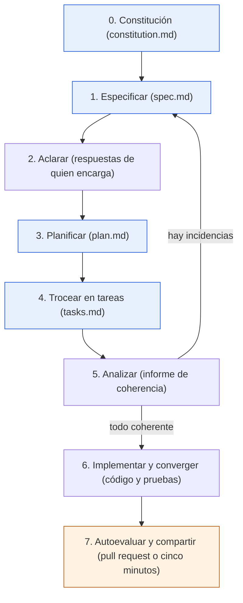

# Ejercicio 06: reto final, tu propio proyecto

> **Para quién:** quien programa (junior o con experiencia) y ha terminado el ejercicio 03; si te han pedido hacer de «Ana», lee el aviso para managers de [Qué necesitas](#qué-necesitas) · **Tiempo de lectura:** ~15 min (hacerlo: 3-4 h, en dos o tres sesiones) · **Nivel:** 🔴 avanzado

Hasta ahora has seguido un guion: ReservaSalas, con los principios de Ana, sus respuestas y la tecnología de Luis. En este reto el problema lo eliges tú, las respuestas las da alguien de tu entorno y el resultado lo entregas a tu equipo. Es la prueba de que sabes aplicar SDD (*Spec-Driven Development*, desarrollo guiado por especificaciones) sin red: elegir un problema pequeño y real, recorrer el flujo completo con GitHub Spec Kit y un asistente de programación con IA, puntuarte con una rúbrica y compartir el resultado para que otras personas lo revisen.

No hay solución: cada proyecto es distinto. Hay, en cambio, una lista de verificación de entrega, una rúbrica y dos ejemplos de cómo se ve un buen resultado.

**Qué vas a encontrar**

- [Objetivo](#objetivo)
- [Qué necesitas](#qué-necesitas)
- [Ocho ideas de proyecto](#ocho-ideas-de-proyecto)
- [El recorrido con Spec Kit](#el-recorrido-con-spec-kit)
- [Pasos](#pasos)
- [Lista de verificación de entrega](#lista-de-verificación-de-entrega)
- [Rúbrica de autoevaluación](#rúbrica-de-autoevaluación)
- [Cómo compartirlo con el equipo](#cómo-compartirlo-con-el-equipo)
- [Errores frecuentes](#errores-frecuentes)
- [Comprueba lo que has aprendido](#comprueba-lo-que-has-aprendido)
- [Solución o ejemplo resuelto](#solución-o-ejemplo-resuelto)
- [En tres frases](#en-tres-frases)
- [Siguiente paso](#siguiente-paso)

## Objetivo

Al terminar habrás llevado un problema real de tu día a día desde una petición en lenguaje natural hasta una aplicación pequeña que funciona, pasando por la constitución (`constitution.md`), la especificación (`spec.md`), las aclaraciones, el plan técnico (`plan.md`) y la lista de tareas (`tasks.md`), sin que nadie te dicte los pasos. Sabrás decidir qué cabe en una primera versión y qué no, hacer de puente entre quien pide y el asistente de IA, puntuar tu propio trabajo con una rúbrica y presentarlo de forma que alguien de negocio pueda revisarlo sin abrir el código.

## Qué necesitas

- **Tiempo:** entre 3 y 4 horas, mejor en dos o tres sesiones: elegir y especificar (pasos 1-5, algo más de una hora), planificar e implementar (pasos 6-9, entre una hora y hora y media) y cambiar y entregar (pasos 10-11, unos 50 minutos). Cada paso lleva su estimación.
- **Requisitos previos:** la vía B del [ejercicio 00](00-preparacion-del-entorno.md) (Spec Kit y un asistente compatible) y el [ejercicio 03](03-reserva-salas-paso-a-paso.md) terminado: aquí no repetimos qué deberías ver tras cada comando, lo enlazamos. Git instalado, porque la entrega recomendada es una *pull request* (la propuesta de cambios que se revisa antes de incorporarla al repositorio).
- **Una persona que haga de «Ana»:** alguien que conozca el problema y pueda responder a las aclaraciones por escrito (un compañero, tu responsable, la persona de Oficina o de RRHH que sufre el problema). Si no encuentras a nadie, harás los dos papeles con la regla del paso 1.
- **Materiales:** las [plantillas](plantillas/README.md) para revisar lo que genere el asistente, [Buenas prácticas y errores comunes](../docs/08-buenas-practicas-y-errores-comunes.md) como lista de repaso y la [solución canónica de ReservaSalas](soluciones/03-reserva-salas/README.md) como referencia de cómo se ve cada artefacto bien hecho.
- **Asistente:** el mismo del ejercicio 03. Escribimos los comandos como `/speckit.specify`; en tu asistente pueden aparecer como `/speckit-specify` o `$speckit-specify`. Es la misma orden: si es tu caso, cambia solo la primera palabra de cada bloque. Con Kiro CLI, el texto que va detrás del comando no le llega: si te pide la descripción, pégasela en el mensaje siguiente.

> [!NOTE]
> **Si no programas**, hay un reto reducido sin instalar nada: haz los pasos 1, 3, 4 y 5 con las [plantillas](plantillas/README.md) y un chat de IA autorizado por la empresa. Los *prompts* (las instrucciones que le escribes al asistente) de los pasos 3 y 4 funcionan en cualquier chat si le pegas antes la plantilla correspondiente y quitas la primera palabra del bloque (el comando `/speckit.…`). Para aclarar sin Spec Kit, usa el *prompt* de la [variante con asistente del ejercicio 01](01-tu-primera-especificacion-sin-codigo.md#variante-con-asistente-de-ia-opcional-entre-los-pasos-7-y-8) cambiando «Solicitud de vacaciones» por el nombre de tu proyecto: hace el papel de `/speckit.clarify`. Después pasa la [lista de verificación](plantillas/lista-de-verificacion.md) y presenta la especificación con los puntos 1 a 3 del [guion de cinco puntos](#cómo-compartirlo-con-el-equipo). De la [rúbrica](#rúbrica-de-autoevaluación) te aplican los criterios 1 y 2 (donde dice `checklists/requirements.md`, lee la lista de verificación de las plantillas) y, del 5, solo la parte que no depende del plan: que cada principio prohíba algo concreto.

> [!WARNING]
> El problema es real; los datos, no. Inventa nombres, correos y cifras como hace todo este repositorio, y no pegues listados, nóminas ni contratos en el asistente. Y si el proyecto gusta y alguien quiere usarlo de verdad, antes de ponerlo en marcha habla con IT y con seguridad: este reto es formación, no una puesta en producción.

> [!TIP]
> **Si eres manager o de negocio y alguien de tu equipo te pide hacer de «Ana»**, esto es lo que te va a pedir, en ratos cortos a lo largo de dos o tres sesiones: leer y corregir su petición (10 min); escuchar sus principios y decirle si los entiendes (5 min); responder a sus preguntas de aclaración, como mucho ocho y casi siempre con opciones para elegir (20 min); ver funcionar la primera historia y pedirle un cambio (15 min) y, al final, leer la especificación y contestar «¿es esto lo que pedí?» (20 min). En total, algo más de una hora. Lo que decidas tiene que quedar por escrito, porque es lo que el asistente de IA va a construir; en ningún momento hace falta abrir el código.

## Ocho ideas de proyecto

Elige un problema que sufras tú o alguien cercano, que se pueda explicar en cinco frases y cuya historia P1 (la de prioridad 1, la que por sí sola ya resuelve algo) quepa en uno o dos días de trabajo con sus pruebas (la primera de las [buenas prácticas](../docs/08-buenas-practicas-y-errores-comunes.md#doce-buenas-prácticas)). El nivel indica cuántas reglas, roles y estados tendrás que especificar, no cuánto código saldrá.

| # | Idea | Nivel | Por qué encaja |
|---|---|---|---|
| 1 | **Préstamo de portátiles y proyectores.** Oficina presta equipos; hoy se apuntan en un cuaderno y nunca se sabe quién tiene qué | 🟢 básico | Es ReservaSalas con otro objeto: reutilizas lo que ya sabes y te concentras en hacerlo sin guion |
| 2 | **Buzón de sugerencias con votos.** Cualquiera propone una mejora para la oficina, los demás votan y Oficina responde | 🟢 básico | Dos entidades (la sugerencia y el voto), dos roles y ningún horario: ideal para una primera vez en solitario |
| 3 | **Días en la oficina.** Cada persona marca qué días viene, su equipo lo ve y hay un aforo máximo por planta | 🟢 básico | Una regla clara (el aforo) que da pie a buenos requisitos SI/ENTONCES y a casos límite reales |
| 4 | **Solicitud de vacaciones.** Pedir días, que el manager apruebe o rechace con motivo y que RRHH lo registre | 🟡 intermedio | Si hiciste el [ejercicio 01](01-tu-primera-especificacion-sin-codigo.md) ya tienes la especificación: el reto es llevarla hasta el código |
| 5 | **Incidencias de oficina.** «La impresora de la 2.ª no va»: se reporta, Oficina la asigna y la cierra, y quien la abrió se entera | 🟡 intermedio | Estados, responsables y un aviso: obliga a decidir quién puede hacer qué en cada momento |
| 6 | **Inscripción a cursos internos.** RRHH publica cursos con plazas, la gente se apunta y hay lista de espera | 🟡 intermedio | Plazas limitadas y lista de espera: buen terreno para criterios de éxito con cifra y aclaraciones de verdad |
| 7 | **Turnos de guardia del equipo de soporte.** Rotación mensual, intercambios entre compañeros con aprobación, nadie dos semanas seguidas | 🔴 avanzado | Reglas que se cruzan y una P1 difícil de acotar: el reto está en decidir qué queda fuera de la primera versión |
| 8 | **Horas por proyecto con cierre mensual.** Cada persona imputa horas, el manager las valida y el mes se cierra | 🔴 avanzado | Varios roles, un cierre con fecha y la tentación de guardar datos de más: la constitución tendrá que decidir |

Las seis tarjetas del [ejercicio 04](04-dinamica-de-equipo-20-minutos.md#tarjetas-de-peticiones-vagas) también valen, sobre todo si tu equipo ya las trabajó en grupo. Y si tienes un problema propio que cumpla las tres condiciones de arriba, es la mejor opción de todas.

## El recorrido con Spec Kit

El diagrama muestra los siete pasos del flujo tal como los vas a recorrer, con el bucle de analizar y el paso final de entrega.



De arriba abajo: dictas la constitución y especificas; aclaras con quien encarga; planificas y troceas en tareas (los cuatro artefactos en azul); analizas y, si hay incidencias, vuelves atrás a corregir la especificación, el plan o las tareas (la flecha que sube). Cuando todo es coherente, implementas y converges hasta que el código cubre lo escrito. El último paso (en naranja) es nuevo respecto al ejercicio 03: autoevaluarte y compartirlo.

## Pasos

Cada paso dice qué hacer, qué deberías ver y qué revisar antes de seguir, con una casilla al final. Los once pasos cubren todo el diagrama: el 1 y el 2 preparan el terreno (el problema y el proyecto), del 3 al 9 van del paso 0 al 6 del flujo, el 10 es el cambio desde la especificación y el 11 es la entrega (el paso 7 del diagrama). Para el detalle de cada comando (qué pregunta, qué ficheros crea, qué hacer si se desvía), el [paso correspondiente del ejercicio 03](03-reserva-salas-paso-a-paso.md#pasos) sigue siendo tu referencia; aquí nos centramos en lo que cambia cuando el proyecto es tuyo.

1. **Elige el problema y a tu «Ana» (15 min).** Escoge una idea de la tabla (o la tuya) y escribe la petición en un fichero de texto, `peticion.md`, como la que Ana le hizo a Luis: entre cinco y diez frases en lenguaje natural que digan cuál es el problema hoy y qué cuesta, quién lo usa, qué tiene que poder hacer cada perfil, los límites que ya conoces (plazos, cantidades, quién aprueba) y qué queda fuera de la primera versión. Ni una palabra de tecnología. Plantilla a medio rellenar, con la idea 1:

    ```markdown
    # Petición: préstamo de portátiles y proyectores

    Lo pide: Ana, responsable de Oficina.

    Hoy Oficina presta portátiles y proyectores y lo apunta en un cuaderno: nunca sabemos quién tiene cada equipo ni cuándo lo devolverá, y [qué cuesta hoy: equipos que no aparecen, reuniones sin proyector…]. Lo usarían cualquier empleado que necesite un equipo y Oficina, que los entrega y los recoge. Cualquier empleado tiene que poder [ver qué hay libre, pedir un equipo para unas fechas…]. Oficina tiene que poder [entregar, recoger…]. Límites que ya conocemos: [días máximos de préstamo, cuántos equipos a la vez…]. En la primera versión no entra [comprar equipos nuevos…].
    ```

    Después pídele a tu Ana que la lea y la corrija: es su petición, no la tuya.

    Si haces los dos papeles, la regla es esta: cada decisión de negocio la escribes en `peticion.md` o en la sección de aclaraciones antes de usarla, y nunca la tomas sobre la marcha en el chat del asistente. Lo que no está escrito no existe.

    Qué deberías tener: una petición de media página que otra persona entiende sin preguntarte nada, con el visto bueno de quien encarga.

    - [ ] Tengo la petición escrita, sin tecnología, y quien hace de Ana la ha leído.

2. **Crea el proyecto y guarda el punto de partida (5 min).** Un nombre corto en minúsculas y con guiones, y la clave de tu asistente (aquí `claude`; sustitúyela por la que usaste en el ejercicio 00):

    ```bash
    specify init prestamo-portatiles --integration claude
    cd prestamo-portatiles
    git init
    git add -A
    git commit -m "Proyecto vacío creado con specify init"
    git checkout -b reto-sdd
    ```

    Cuando `specify init` pregunte «Choose script type», pulsa Intro para aceptar el valor por defecto. Añade `--ignore-agent-tools` al final de ese comando si Spec Kit no encuentra el ejecutable de tu asistente (a los que son editores no los comprueba de todos modos). Copia `peticion.md` dentro de la carpeta. La rama `reto-sdd` es la que convertirás en *pull request* en el paso 11; a partir de ahora haz *commit* (guarda una versión) al terminar cada paso, con `git add -A` y después, por ejemplo, `git commit -m "Paso 3: constitución"` (dos comandos, válidos en cualquier terminal), para poder comparar cada artefacto con su versión anterior.

    **Si tu proyecto ya existe**, no crees otra carpeta: haz *commit* de lo que tengas, crea la rama (`git checkout -b reto-sdd`) y, dentro de la carpeta del proyecto, ejecuta `specify init --here --integration claude`. Cuando avise de que va a mezclar sus plantillas con tus ficheros («Template files will be merged with existing content…»), responde `y`, y revisa después con `git status` y `git diff` qué ha añadido o cambiado. En el resto del reto, tres ajustes:

    - En el paso 3, la constitución recoge también las reglas que el proyecto ya cumple (tecnología, estructura, cómo se prueba).
    - En el paso 4, especifica solo el cambio nuevo, no la aplicación entera.
    - En el paso 6, empieza el *prompt* con «Usa la tecnología y la estructura que ya tiene el proyecto; no añadas dependencias nuevas sin justificarlas en el registro de complejidad».

    Más en [Preguntas frecuentes](../docs/09-preguntas-frecuentes.md#qué-pasa-con-proyectos-que-ya-existen).

    Qué deberías ver: el panel «Next Steps» de `specify init` y, al abrir el asistente dentro de la carpeta, los comandos `speckit`, como en el paso 1 del ejercicio 03.

    - [ ] El proyecto existe, está en la rama `reto-sdd` y el asistente ve los comandos.

3. **Dicta tu constitución (15 min).** No copies la de ReservaSalas tal cual: escribe entre tres y cinco principios que decidan algo en tu proyecto. Prueba rápida: si un principio no prohíbe nada concreto, no es un principio (error 8 de [Buenas prácticas](../docs/08-buenas-practicas-y-errores-comunes.md#doce-errores-comunes)). Si tu proyecto toca datos de personas o dinero, un principio sobre qué se guarda y qué no es obligatorio. Plantilla a medio rellenar:

    ```text
    /speckit.constitution Crea la constitución del proyecto [NOMBRE], [una frase: qué es y para quién]. Redáctala en castellano. [Tres a cinco] principios, cada uno con su regla y su «por qué»:

    1. Sencillez primero: construimos lo mínimo que resuelve [el problema]; nada de funciones «por si acaso». [Qué queda expresamente fuera de la primera versión.]
    2. Datos mínimos: solo se guardan [nombre, correo corporativo y …]. Ningún otro dato personal.
    3. Pruebas antes de dar algo por hecho: cada historia de usuario tiene pruebas automáticas escritas antes que su implementación, y las reglas de negocio ([límites, permisos, plazos]) tienen pruebas propias.
    4. [Un principio propio del problema, que prohíba algo: «nadie hace dos guardias seguidas; el sistema lo impide, no lo avisa», «toda incidencia tiene una persona responsable visible».]

    Restricciones: uso interno con el acceso corporativo existente; sin integraciones con otros sistemas en la primera versión; [tiene que funcionar en un único servidor modesto].

    Flujo de trabajo: toda funcionalidad empieza por una especificación que aprueba [quien encarga]; las dudas se resuelven por escrito antes de planificar; el plan se comprueba contra esta constitución antes de trocearlo en tareas; si el resultado no es el esperado, se corrige la especificación y se regenera.

    Versión 1.0.0, ratificada hoy.
    ```

    Qué revisar en `.specify/memory/constitution.md`: ningún hueco entre corchetes, cada principio con regla y «por qué», versión 1.0.0 con fecha. Léesela a tu Ana en dos minutos: si no entiende alguno, reescríbelo.

    - [ ] Mi constitución tiene entre tres y cinco principios que prohíben algo concreto, y quien encarga los ha entendido.

4. **Especifica, sin tecnología (20 min).** Pega tu petición detrás del comando, con la misma instrucción final del ejercicio 03 para que los requisitos salgan en EARS (*Easy Approach to Requirements Syntax*, una forma sencilla y estructurada de redactar requisitos):

    ```text
    /speckit.specify [Pega aquí el contenido de peticion.md.]

    Redacta la especificación en castellano. Escribe los requisitos funcionales en formato EARS (CUANDO…, MIENTRAS…, SI…, ENTONCES…, DONDE…) con el verbo «deberá». No decidas ninguna tecnología.
    ```

    Qué deberías ver: `specs/001-[nombre]/spec.md` (el nombre corto lo elige el asistente) y, en la misma carpeta, `checklists/requirements.md`, y quizá hasta tres preguntas con opciones si a la petición le faltaba algo importante; respóndelas con tu Ana al lado, no por tu cuenta.

    Qué revisar, con la tabla del paso 3 del ejercicio 03 delante: que la P1 valga sola (si solo existiera eso, ¿se resolvería el problema de hoy?); entre dos y cuatro historias, no seis; entre 6 y 12 requisitos, uno por frase; al menos cuatro casos límite; criterios de éxito con cifra; «Fuera de alcance» con contenido (la plantilla de Spec Kit no trae esa sección: si el asistente no la ha escrito, pídesela: «Añade una sección Fuera de alcance con lo que la petición deja para más adelante»). Lo que sobre, fuera: una especificación corta y completa vale más que una larga. Y haz lo que hiciste en el [ejercicio 05](05-arreglar-una-especificacion-mala.md): léela con ojo de revisor y apunta lo que no cuadre antes de aclarar.

    - [ ] `spec.md` tiene una P1 que vale sola, requisitos en EARS, criterios con cifra y ninguna tecnología.

5. **Aclara con quien encarga (15 min).** Ejecuta `/speckit.clarify` y pásale cada pregunta a tu Ana tal cual, con sus opciones; responde con lo que ella decida, aunque no sea lo que tú harías. Si el asistente no encuentra ambigüedades, fuérzalo sobre lo que más dudas te dé: `/speckit.clarify permisos, plazos y avisos`.

    Qué revisar: que cada respuesta haya cambiado algo (un requisito, un caso límite, «Fuera de alcance»), no solo la sección de aclaraciones; y que `checklists/requirements.md` esté completa. Si tu Ana cambia de opinión sobre algo de `peticion.md`, se cambia la especificación y se anota.

    - [ ] Las aclaraciones las ha respondido quien encarga, por escrito, y cada una se refleja en la especificación.

6. **Planifica con la tecnología más sencilla que domines (15 min).** Es la única decisión técnica del reto. Elige lo que ya conoces, no lo que te apetece aprender: el reto es el método. Si no tienes preferencia, usa la del ejercicio 03:

    ```text
    /speckit.plan Aplicación web sencilla con Python 3.12 y FastAPI, base de datos SQLite y páginas HTML con plantillas Jinja2. Pruebas con pytest. Sin frontend complejo: nada de frameworks de JavaScript. [Añade lo que exija tu constitución; por ejemplo: «sin servicios externos: los avisos se guardan en una bandeja interna en vez de enviarse por correo».] Redacta el plan en castellano.
    ```

    Qué revisar en `plan.md` (y en `data-model.md`, `contracts/` y `quickstart.md`): la comprobación contra la constitución explica cómo se cumple cada principio, no dice solo «cumple»; cada desviación está en el registro de complejidad con su justificación; el modelo de datos solo tiene las entidades de la especificación; ningún «NEEDS CLARIFICATION». Compara con el [plan canónico](soluciones/03-reserva-salas/plan.md) si dudas de cómo se ve una sección bien hecha.

    - [ ] `plan.md` cumple la constitución principio a principio y el modelo de datos no guarda nada que la especificación no pida.

7. **Trocea en tareas (10 min).** Pide las pruebas desde el principio para no tener que repetir:

    ```text
    /speckit.tasks Incluye las pruebas de cada historia antes de su implementación, como exige la constitución.
    ```

    Qué revisar en `tasks.md`: una fase por historia en orden P1, P2, P3; pruebas antes que implementación en cada una; ruta de fichero en todas las tareas; `[P]` solo en tareas que tocan ficheros distintos; y, a ojo, que tres o cuatro requisitos elegidos al azar aparezcan en alguna tarea. En nuestra experiencia, un proyecto de este tamaño sale en 20 a 50 tareas (ReservaSalas, algo mayor, tuvo 47); si pasan de 60, la especificación era demasiado grande: vuelve al paso 4 y recorta.

    - [ ] `tasks.md` tiene fases por historia, pruebas primero y ruta de fichero en cada tarea.

8. **Analiza antes de escribir código (10 min).** Ejecuta `/speckit.analyze`. Opcional: `/speckit.checklist` con el tema que más te preocupe (permisos, accesibilidad, datos). En el orden oficial de Spec Kit ese comando va justo después de `/speckit.plan` y antes de las tareas (solo necesita `plan.md`); aquí lo agrupamos con analizar, como en el ejercicio 03, porque los dos son puertas de calidad. Las casillas de esa lista las marcas tú al revisar la especificación; si quedan sin marcar, `/speckit.implement` se parará a preguntarte si sigues.

    Qué deberías ver: el informe en el chat, con la tabla de incidencias (cada una con su gravedad: CRITICAL, HIGH, MEDIUM o LOW), la tabla de cobertura (cada requisito y las tareas que lo cubren) y las métricas. Tiene que salir sin incidencias CRITICAL ni HIGH y con cobertura del 100 % (cada requisito, al menos una tarea); las MEDIUM y LOW de redacción puedes anotarlas y seguir. Si no, corrige donde toque (especificación, plan o tareas; nunca la constitución) y repite hasta que salga limpio: la tabla del paso 7 del ejercicio 03 dice qué hacer con cada tipo de incidencia.

    - [ ] El informe de `analyze` no tiene incidencias críticas ni altas, y todos los requisitos tienen tarea.

9. **Implementa en dos rondas, prueba y converge (30-60 min).** Primero el producto mínimo:

    ```text
    /speckit.implement solo las fases 1, 2 y 3
    ```

    Qué deberías ver: el asistente recorre las fases, escribe primero las pruebas de la historia 1, las ve fallar, implementa y las ve pasar, y marca esas tareas `[X]` en `tasks.md` (las que solo puede hacer una persona las deja sin marcar, como en el paso 8 del ejercicio 03). Cuando termine, arranca la aplicación con los comandos del `quickstart.md` de tu proyecto, haz tú el recorrido de la historia 1 y pasa las pruebas (`pytest` o el equivalente de tu tecnología). Si usas la tecnología del ejercicio 03 en Windows y PowerShell no te deja activar el entorno virtual («la ejecución de scripts está deshabilitada en este sistema»), no hace falta activarlo: ejecuta `.venv\Scripts\python -m uvicorn …` y `.venv\Scripts\python -m pytest`, como explican los [errores frecuentes del ejercicio 03](03-reserva-salas-paso-a-paso.md#errores-frecuentes). Enséñaselo a tu Ana antes de seguir: cinco minutos bastan y es el momento en que más se aprende.

    Después, `/speckit.implement` sin alcance para el resto, y `/speckit.converge`: si añade una fase de convergencia a `tasks.md`, ejecútala con `/speckit.implement solo la fase de convergencia` y vuelve a lanzar `/speckit.converge`, hasta que responda «✅ Converged». Si una prueba falla, no la arregles tú: pégale la salida al asistente y dile que esa tarea no está terminada.

    - [ ] La P1 funciona y la ha visto quien encarga; todas las pruebas pasan; `converge` está en verde.

10. **Pide un cambio desde la especificación (20 min).** Tu Ana, después de ver la aplicación, querrá cambiar algo: un plazo, un límite, quién aprueba. Si no se le ocurre nada, pídele que elija un cambio pequeño: el reto necesita uno. Hazlo como en el paso 9 del ejercicio 03: tu Ana decide y pide el cambio; tú lo escribes primero en `spec.md` (y en el plan, si recogía el dato), anotando la decisión en las aclaraciones, y ella relee el texto nuevo y lo aprueba; luego `/speckit.converge` y `/speckit.implement solo la fase de convergencia`. Haz *commit* del cambio de la especificación antes de regenerar, para que en el historial se vea que el cambio empezó por ella.

    Qué deberías ver: antes de ese *commit*, `git diff` solo muestra cambios en `spec.md` (y en el plan); `converge` añade una fase de convergencia a `tasks.md`; tras implementarla, la aplicación hace lo nuevo, `pytest` sigue en verde y un segundo `/speckit.converge` responde «✅ Converged».

    - [ ] El último cambio de comportamiento de mi aplicación empezó por un cambio en `spec.md`, y está en el historial.

11. **Autoevalúa y entrega (30 min).** Repasa la [lista de verificación de entrega](#lista-de-verificación-de-entrega) (si el proyecto aún no tiene `README.md`, escríbelo ahora: tres párrafos bastan), puntúate con la [rúbrica](#rúbrica-de-autoevaluación) y escribe `docs/autoevaluacion.md` dentro del proyecto:

    ```markdown
    # Autoevaluación: [NOMBRE DEL PROYECTO]

    | Criterio | Nivel (1-4) | Por qué |
    |---|---|---|
    | Claridad de la especificación | [1-4] | [p. ej. «Ana la leyó entera y corrigió dos criterios de aceptación»] |
    | Calidad de los requisitos EARS | [1-4] | […] |
    | Coherencia especificación-plan-tareas | [1-4] | […] |
    | Pruebas y verificación | [1-4] | […] |
    | Fidelidad a la constitución | [1-4] | […] |

    **Total:** [suma de los cinco, de 5 a 20]

    **Tres cosas que haría distinto:** 1. […] 2. […] 3. […]
    ```

    Después, comparte el resultado como se explica en [Cómo compartirlo con el equipo](#cómo-compartirlo-con-el-equipo): una *pull request* en un repositorio interno o una presentación de cinco minutos.

    - [ ] La lista de entrega está completa, la rúbrica puntuada con justificación y el proyecto compartido.

## Lista de verificación de entrega

Antes de compartir, comprueba que existen estos ficheros y que cada uno cumple lo que se le pide. `[nombre]` es el nombre corto que el asistente dio a tu funcionalidad.

- [ ] **`peticion.md`**: la petición original, en lenguaje natural y sin tecnología, con el visto bueno de quien encarga.
- [ ] **`.specify/memory/constitution.md`**: entre tres y cinco principios con regla y «por qué», restricciones, flujo de trabajo y gobernanza con versión 1.0.0 y fechas; ningún hueco `[…]`.
- [ ] **`specs/001-[nombre]/spec.md`**: entre dos y cuatro historias con prioridad y criterios Dado/Cuando/Entonces; al menos cuatro casos límite; entre 6 y 12 requisitos EARS numerados sin huecos; entidades; criterios de éxito con cifra; supuestos; «Fuera de alcance»; sección de aclaraciones con las respuestas de quien encarga. Ni una tecnología.
- [ ] **`specs/001-[nombre]/checklists/requirements.md`**: todas las casillas marcadas tras aclarar. Si generaste listas por tema con `/speckit.checklist`, marcadas por ti, con una nota en cada «no».
- [ ] **`specs/001-[nombre]/plan.md`** (con `research.md`, `data-model.md`, `quickstart.md` y, si el asistente la creó, `contracts/`): contexto técnico sin «NEEDS CLARIFICATION»; comprobación contra la constitución explicada principio a principio; registro de complejidad con cada desviación; `quickstart.md` con los comandos para arrancar y probar la P1.
- [ ] **`specs/001-[nombre]/tasks.md`**: fases por historia; pruebas antes que implementación; ruta de fichero en cada tarea; todas las tareas de las fases implementadas marcadas `[X]`, incluida la fase de convergencia si la hubo; las manuales (las que solo puede hacer una persona), marcadas por ti cuando las hayas hecho o anotadas como pendientes.
- [ ] **Código y pruebas** (`src/`, `tests/` o la estructura que fije tu plan): las pruebas pasan todas; la P1 se puede probar siguiendo el quickstart sin ayuda.
- [ ] **`README.md` del proyecto**: qué es, cómo arrancarlo y dónde está la especificación. Tres párrafos bastan.
- [ ] **`docs/autoevaluacion.md`**: la rúbrica puntuada con una línea de justificación por criterio y tres cosas que harías distinto.
- [ ] **`.gitignore`**: excluye el entorno virtual, la base de datos local y cualquier fichero con claves. Ningún dato real en ningún fichero.

## Rúbrica de autoevaluación

Puntúa cada criterio del 1 al 4 leyendo la fila entera: el nivel es el más alto cuyo texto se cumple del todo. La suma va de 5 a 20. Con todos los criterios en 3 o más, el proyecto está listo para compartir; un 2 te dice qué arreglar antes; un 1, a qué paso volver.

| Criterio | 1 · Inicial | 2 · En marcha | 3 · Sólido | 4 · Ejemplar |
|---|---|---|---|---|
| **Claridad de la especificación** | Mezcla qué y cómo; historias sin prioridad; alguien de negocio no la entiende | Historias con prioridad, pero la P1 no vale sola; quedan frases vagas o algún marcador de aclaración sin resolver | Sin tecnología; P1 que vale sola; criterios Dado/Cuando/Entonces; casos límite y «Fuera de alcance» escritos; `checklists/requirements.md` completa | Además, quien encarga la ha leído entera y ha corregido algo en ella, y una persona ajena al proyecto la entiende sin preguntarte (ninguna jerga sin explicar) |
| **Calidad de los requisitos EARS** | La mayoría sin patrón, con dos cosas en una frase o con adjetivos sin cifra | La mayoría sigue EARS, pero alguno mezcla dos cosas, lleva un adjetivo sin cifra o tecnología, o hay repetidos o huecos en la numeración | Todos siguen uno de los cinco patrones, numerados sin huecos, con una sola cosa comprobable cada uno | Además, cada requisito se comprueba en al menos un criterio de aceptación y una tabla relaciona cada historia con sus requisitos, como en la [especificación canónica](soluciones/03-reserva-salas/spec.md) |
| **Coherencia especificación-plan-tareas** | No se ejecutó `analyze`, o se implementó con incidencias críticas pendientes | `analyze` se ejecutó, pero se implementó con incidencias altas pendientes o con algún requisito sin tarea | El último `analyze` antes de implementar salió sin incidencias críticas ni altas y con cobertura del 100 %, y las correcciones se hicieron en la especificación, el plan o las tareas | Además, el modelo de datos solo tiene las entidades de la especificación y `converge` respondió «Converged» tras el cambio pedido desde la especificación |
| **Pruebas y verificación** | No hay pruebas automáticas, o no pasan | Hay pruebas, pero se escribieron después del código o no cubren las reglas de negocio | Pruebas antes que implementación en cada historia; todas pasan; las reglas de negocio (límites, permisos) tienen pruebas propias | Además, otra persona ha arrancado y probado la P1 siguiendo `quickstart.md` sin tu ayuda |
| **Fidelidad a la constitución** | Constitución genérica (no prohíbe nada) o sin usar | Principios concretos, pero la comprobación del plan dice «cumple» sin explicar cómo | Cada principio decide algo; la comprobación explica cómo; las desviaciones están en el registro de complejidad | Además, la constitución frenó al menos una decisión (está anotado dónde) y nada del código la contradice |

## Cómo compartirlo con el equipo

Un proyecto SDD que nadie revisa es medio proyecto. Hay dos formas de entregarlo y las dos siguen el mismo guion de cinco puntos: es lo que escribirás en la descripción de la *pull request* o lo que contarás en cinco minutos.

**El guion de cinco puntos**

1. **El problema y quién lo pidió** (1 min): qué pasa hoy y qué cuesta; enseña `peticion.md`.
2. **La especificación** (1 min): la P1 y por qué vale sola; lee en voz alta dos requisitos EARS y un criterio de éxito con cifra.
3. **Una aclaración que cambió algo** (30 s): la pregunta, la respuesta de quien encarga y qué requisito nació o cambió.
4. **El plan contra la constitución y la demostración** (1 min 30 s): un principio y cómo lo cumple el plan (o la desviación justificada); después, el recorrido de la P1 en la aplicación.
5. **El cambio desde la especificación y lo aprendido** (1 min): el cambio del paso 10, visto en el historial, y las tres cosas que harías distinto.

### Opción A: pull request en un repositorio interno

Pide a tu equipo o a IT la dirección de un repositorio vacío en el servidor Git de la empresa (GitHub u otro). Antes de subir nada, comprueba que `.gitignore` excluye el entorno virtual (`.venv/`), la base de datos local (`*.db`) y cualquier fichero con claves, y que en ningún fichero hay datos reales. Después:

```bash
git add -A
git commit -m "Reto SDD: flujo completo con autoevaluación"
git remote add origin [dirección del repositorio interno]
git push -u origin main      # o master, según se llame tu rama inicial
git push -u origin reto-sdd
```

En la web del repositorio, abre una *pull request* de `reto-sdd` hacia `main` (o `master`), con el guion de cinco puntos como descripción y enlaces directos a `spec.md`, `plan.md`, `tasks.md` y `docs/autoevaluacion.md`.

Pide dos revisiones: a quien hizo de Ana, que lea solo la especificación y conteste «¿es esto lo que pedí?»; y a alguien con experiencia técnica, que mire la comprobación contra la constitución, las pruebas y el historial (¿el último cambio empezó por la especificación?). Los comentarios de la revisión son la primera lista de aclaraciones de la versión 2.

### Opción B: presentación de cinco minutos

En la reunión de equipo, con el guion de arriba y tres cosas abiertas: `spec.md`, la aplicación arrancada y `git log --oneline`. Nada de diapositivas: los artefactos son la presentación. Reserva dos minutos más para preguntas y apunta cada una: las que no sepas responder son aclaraciones pendientes, y se anotan en la especificación, no en la memoria.

## Errores frecuentes

| Síntoma | Causa | Cómo arreglarlo |
|---|---|---|
| El primer `git commit` responde «Please tell me who you are» | Es la primera vez que usas Git en ese equipo y no sabe tu nombre ni tu correo | `git config --global user.name "[tu nombre]"` y `git config --global user.email "[tu correo corporativo]"`; después repite el *commit* |
| Llevas una hora y la especificación no termina: seis historias y veinte requisitos | El problema es demasiado grande | Quédate con la P1 y una P2; el resto va a «Fuera de alcance» con una frase. La versión 2 será otra especificación |
| Las aclaraciones las has respondido tú en diez segundos «porque era obvio» | Has hecho de Ana sin escribirlo | Anótalas en la sección de aclaraciones antes de seguir y, si tienes a alguien, pregúntale: lo obvio para ti suele ser lo que cambia |
| La especificación tiene nombres de tecnología porque «ya sé cómo lo voy a hacer» | Has mezclado el qué con el cómo | Quítalos de `spec.md` y ponlos en el *prompt* de `/speckit.plan`; es el [error 1 de Buenas prácticas](../docs/08-buenas-practicas-y-errores-comunes.md#doce-errores-comunes) |
| `/speckit.plan` propone una tecnología que no conoces | El *prompt* no la fijaba | Repite el comando indicando lenguaje, almacenamiento y pruebas: el plan parte de lo que escribes |
| `/speckit.implement` falla al instalar dependencias | Proxy o índice privado de paquetes de la empresa | `UV_DEFAULT_INDEX` como en el [ejercicio 00](00-preparacion-del-entorno.md); si no, habla con IT |
| `implement` lleva más de una hora o se para a cada rato | Demasiadas tareas, o tareas gigantes | Ejecuta por fases (`solo las fases 1, 2 y 3`) y, si una tarea no cabe en una línea con su fichero, regenera `tasks.md` pidiendo tareas más pequeñas |
| `/speckit.converge` añade tareas una y otra vez | La especificación y el plan se contradicen en algo (un límite distinto en cada uno) | Unifica el dato en `spec.md` y `plan.md`, haz *commit* y vuelve a converger |
| Has arreglado un fallo editando el código a mano «para ir más rápido» | El atajo de siempre | Deshazlo (`git checkout -- src tests`, o las carpetas de código de tu proyecto; nunca `git checkout -- .`, que borraría también lo que hayas cambiado en la especificación y aún no tenga *commit*), decide si el error está en la especificación, el plan o la implementación ([qué se corrige](../docs/08-buenas-practicas-y-errores-comunes.md#cuando-algo-falla-qué-se-corrige)) y arréglalo ahí |
| Ha aparecido `specs/002-…` | Has vuelto a ejecutar `/speckit.specify` | Borra la carpeta nueva, deja `.specify/feature.json` apuntando a `specs/001-…` y edita la especificación existente |
| La *pull request* tiene cientos de ficheros y nadie la revisa | Has subido `.venv/`, la base de datos o ficheros generados | Añádelos a `.gitignore`, sácalos del control de versiones (`git rm -r --cached .venv`), haz *commit* y vuelve a subir |

## Comprueba lo que has aprendido

1. ¿Por qué el reto te pide un problema cuya P1 quepa en uno o dos días, y no la aplicación que siempre quisiste hacer?
2. Haces los dos papeles. ¿Qué regla evita que aclarar sea una conversación contigo mismo en la cabeza?
3. `/speckit.analyze` sale limpio y las pruebas están en verde, pero al probar la P1 la aplicación hace algo que tu Ana no quería. ¿Dónde está el error, probablemente, y qué tocas?
4. ¿Qué diferencia un 3 de un 4 en «fidelidad a la constitución»?
5. ¿Qué tiene que contener la descripción de la *pull request* para que alguien de negocio pueda revisarla sin abrir el código?

<details><summary>Ver respuestas</summary>

1. Porque el objetivo es aprender el método con algo que termina: con una P1 pequeña recorres los siete pasos, ves funcionar la aplicación y te queda tiempo para el cambio desde la especificación y para la entrega. Un proyecto grande se queda en una especificación a medias. La aplicación grande se trocea: su primera funcionalidad es este reto; las demás, especificaciones nuevas.
2. Cada decisión de negocio se escribe (en `peticion.md` o en la sección de aclaraciones) antes de usarla, y nunca se toma sobre la marcha en el chat. Lo que no está escrito no existe. Y si hay alguien a quien preguntar, se pregunta.
3. Si la coherencia y las pruebas están bien, lo más probable es que la especificación no diga lo que tu Ana quería: las pruebas comprueban lo escrito, no lo deseado. Tocas `spec.md` (y el plan si recogía el dato), anotas la decisión en aclaraciones y regeneras con `converge` e `implement`. No tocas el código.
4. Un 3 es una constitución concreta que el plan cumple y explica. Un 4 añade pruebas de que la constitución sirvió para decidir: frenó una propuesta (está anotado dónde: por ejemplo, en `research.md` como alternativa descartada, o en las aclaraciones) y nada del código la contradice. En el 4 la constitución se usó; en el 3 se describió.
5. El guion de cinco puntos (problema y quién lo pidió; la P1 con dos requisitos y un criterio con cifra; una aclaración que cambió algo; el plan contra la constitución con la demostración; el cambio desde la especificación y lo aprendido) y enlaces directos a `spec.md`, `plan.md`, `tasks.md` y `docs/autoevaluacion.md`. Quien revisa desde negocio lee la especificación y contesta «¿es esto lo que pedí?».

</details>

## Solución o ejemplo resuelto

Este reto no tiene solución: cada proyecto es distinto y el tuyo lo juzgan la lista de entrega, la rúbrica y tu equipo. Lo que sí podemos enseñarte es cómo se ve un buen resultado. Dos ejemplos, uno de cada extremo de la tabla de ideas; los dos tienen fallos y los dos los dicen. Son ficticios, como todo en este repositorio: sirven para ver qué aspecto tiene un buen resultado, no como medida de lo que tienes que tardar.

### Ejemplo 1: préstamo de portátiles (🟢), por Luis, en dos tardes

- **Petición:** seis frases que Luis escribió a partir de lo que le contó Ana: Oficina presta portátiles y proyectores, se apuntan en un cuaderno y nadie sabe quién tiene qué ni cuándo vuelve. Ana tardó diez minutos en leerla y cambió dos frases.
- **Constitución:** cuatro principios. El cuarto, propio del problema: «todo equipo prestado tiene una persona responsable visible y una fecha de devolución; no existen préstamos abiertos».
- **Especificación:** P1 «pedir un equipo para unas fechas y recogerlo» (vale sola: con eso el cuaderno desaparece); P2 «devolver o prorrogar»; P3 «ver qué hay disponible hoy». Nueve requisitos EARS, seis casos límite y cuatro criterios de éxito con cifra. Cuatro aclaraciones respondidas por Ana: máximo diez días laborables, una sola prórroga, no se guarda el motivo, aviso el día antes de la devolución.
- **Plan y tareas:** la tecnología del ejercicio 03. La comprobación contra la constitución explica cada principio; una desviación en el registro de complejidad (el aviso del día antes necesita una tarea programada; la alternativa, que cada persona lo mire por su cuenta, se descartó porque Ana lo pidió expresamente). 31 tareas, pruebas primero.
- **Análisis e implementación:** `analyze` encontró una incidencia HIGH (el requisito del aviso no tenía tarea) y se corrigió `tasks.md` antes de implementar. Producto mínimo enseñado a Ana ese mismo día; `converge` en verde a la segunda. Cambio desde la especificación: Ana bajó el máximo a cinco días; el *commit* de `spec.md` va antes que el del código.
- **Autoevaluación:** 17 de 20. Claridad 4 (Ana la corrigió y una compañera de RRHH la entendió sin preguntar), EARS 3 (todos con patrón y una sola cosa, pero dos no tienen criterio de aceptación que los compruebe), coherencia 3 (tras implementar el cambio de Ana no repitió `converge` para confirmar que todo convergía), pruebas 3 (nadie más había seguido el quickstart todavía), constitución 4 (frenó una propuesta de guardar el departamento de cada persona). *Pull request* de 38 ficheros: Ana revisó la especificación en 20 minutos y pidió un cambio de texto; un compañero con experiencia revisó el plan y las pruebas.

### Ejemplo 2: turnos de guardia (🔴), por una persona con experiencia del equipo de soporte, en tres sesiones

- **Lo primero fue recortar:** la petición inicial pedía rotación, intercambios, festivos, vacaciones y avisos. Tras aclarar con el responsable del equipo, la P1 quedó en «publicar el calendario de guardias del mes a partir de una rotación fija» (vale sola: hoy se hace a mano en una hoja de cálculo cada mes), la P2 en «intercambiar una guardia con aprobación», y los festivos y las vacaciones en «Fuera de alcance», con una frase que dice por qué.
- **La constitución decidió algo:** «nadie hace dos guardias seguidas; el sistema lo impide, no lo avisa». El plan propuso «permitir excepciones con un aviso»; se rechazó, y en `research.md` quedó anotada como alternativa descartada, con el principio que la impide.
- **El análisis sirvió:** el primer `analyze` encontró una incidencia HIGH (un requisito sin tarea) y una MEDIUM («guardia» y «turno» usados como sinónimos en ficheros distintos); se corrigieron las dos y el segundo salió limpio. Tras implementar, `converge` añadió tres tareas (una regla de la especificación no estaba en el código) y la segunda pasada respondió «✅ Converged».
- **El cambio llegó solo:** al ver la aplicación, el responsable pidió que los intercambios entre personas del mismo nivel no necesiten aprobación. Se cambió `spec.md`, luego `plan.md`, después `converge` e `implement`; `git log` muestra ese orden.
- **Autoevaluación:** 16 de 20. El 3 en claridad es honesto: la jerga «nivel 1 / nivel 2» no está explicada y alguien de fuera del equipo no la entiende; va en «Tres cosas que haría distinto». Presentación de cinco minutos con el guion; dos preguntas del público quedaron apuntadas como aclaraciones para la versión 2.

Qué tienen en común: una P1 que vale sola, una persona distinta de quien programa que decide, cada decisión escrita en un fichero, el análisis usado para corregir antes de implementar, un cambio que empezó por la especificación y una autoevaluación que dice lo que falta. Eso es un buen resultado; que el código sea bonito es secundario.

## En tres frases

1. El reto es el flujo completo sin guion: un problema pequeño y real, una persona que decide, la constitución, la especificación sin tecnología, las aclaraciones por escrito, el plan contra la constitución, las tareas con pruebas primero, el análisis, la implementación y un cambio pedido desde la especificación.
2. Un buen resultado no es un proyecto perfecto: es uno en el que cada fichero de la lista de entrega existe y cumple lo suyo, la rúbrica está puntuada con honestidad y cualquiera puede seguir la pista de cada decisión.
3. Compartirlo, con una *pull request* o con cinco minutos y el guion, convierte el ejercicio en práctica de equipo: la revisión de negocio y la técnica son las primeras aclaraciones de la versión 2.

## Siguiente paso

Has terminado el itinerario de ejercicios. Vuelve al [índice de ejercicios](README.md) para repasar los que te falten y a la [portada del repositorio](../README.md) para las rutas de lectura por perfil. Si el reto te ha dejado ideas para mejorar este material, [CONTRIBUIR.md](../CONTRIBUIR.md) explica cómo proponerlas.

---

⬅️ [Anterior: Arreglar una especificación mala](05-arreglar-una-especificacion-mala.md) · 🏠 [Índice de ejercicios](README.md)
