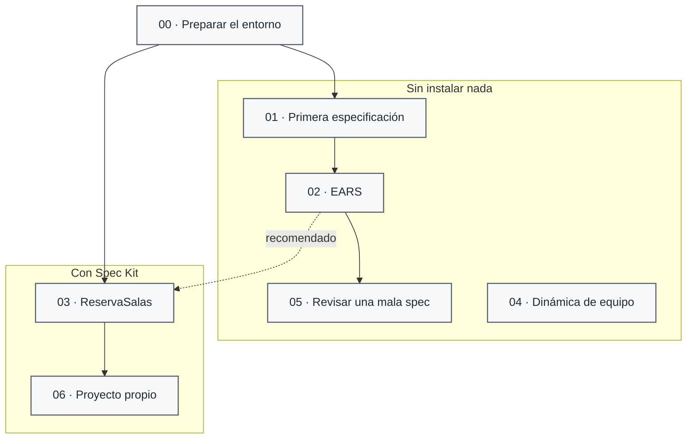

# Ejercicios

> **Para quién:** toda la empresa, sepa programar o no · **Tiempo de lectura:** ~4 min · **Nivel:** 🟢 básico

Aquí es donde se deja de leer y se empieza a practicar. Hay siete ejercicios, desde redactar una primera especificación sin instalar nada hasta recorrer el flujo completo con Spec Kit y construir una aplicación pequeña.

No hace falta hacerlos todos ni seguirlos como un examen. La idea es equivocarse aquí, comparar con los ejemplos y entender por qué una frase aparentemente inocente puede cambiar bastante lo que termina construyendo el asistente.

**Qué vas a encontrar**

- [Los siete ejercicios](#los-siete-ejercicios)
- [Las dos vías: con o sin herramientas](#las-dos-vías-con-o-sin-herramientas)
- [Qué ejercicios hacer según tu perfil](#qué-ejercicios-hacer-según-tu-perfil)
- [Cómo usarlos](#cómo-usarlos)
- [Plantillas y soluciones](#plantillas-y-soluciones)

## Los siete ejercicios

| Nº | Ejercicio | Qué vas a hacer | Nivel | Tiempo (hacerlo) | ¿Hay que instalar algo? | Solución |
|---|---|---|---|---|---|---|
| 00 | [Preparación del entorno](00-preparacion-del-entorno.md) | Dejar listo lo que necesitas: la vía A no instala nada; la vía B instala Spec Kit y comprueba que funciona | 🟡 | 10-45 min | Solo en la vía B | [Entorno resuelto](soluciones/00-preparacion-del-entorno-resuelta.md) |
| 01 | [Tu primera especificación sin código](01-tu-primera-especificacion-sin-codigo.md) | Escribir con una plantilla la especificación de «Solicitud de vacaciones»: historias, casos límite, requisitos y criterios de éxito | 🟢 | 30-45 min | No | [Especificación resuelta](soluciones/01-solicitud-de-vacaciones/especificacion.md) |
| 02 | [Practicar requisitos EARS](02-practicar-requisitos-ears.md) | Convertir doce frases vagas en requisitos que solo se pueden leer de una manera, reconocer patrones y cazar errores | 🟢 | 30 min | No | [Requisitos resueltos](soluciones/02-requisitos-ears-resueltos.md) |
| 03 | [ReservaSalas paso a paso con Spec Kit](03-reserva-salas-paso-a-paso.md) | Construir ReservaSalas recorriendo los siete pasos del flujo con Spec Kit y un asistente de IA, y cambiarla tocando solo la especificación | 🟡 | 90-120 min | Sí (vía B) | [Ejemplo completo](soluciones/03-reserva-salas/README.md) y [pasos 7 a 10](soluciones/03-reserva-salas-pasos-7-a-10.md) |
| 04 | [Dinámica de equipo de 20 minutos](04-dinamica-de-equipo-20-minutos.md) | Dinámica en grupo, sin ordenador: de una petición vaga a historias, requisitos y preguntas de aclaración | 🟢 | 20 min | No | [Las seis tarjetas resueltas](soluciones/04-dinamica-de-equipo-resuelta.md) |
| 05 | [Arreglar una especificación mala](05-arreglar-una-especificacion-mala.md) | Encontrar los problemas de una especificación escrita con prisa y reescribir sus requisitos y criterios de éxito | 🟡 | 30-40 min | No | [Especificación arreglada](soluciones/05-especificacion-arreglada.md) |
| 06 | [Reto final: tu propio proyecto](06-reto-final-tu-propio-proyecto.md) | Llevar un problema real de tu día a día por todo el flujo, hasta una aplicación pequeña que funciona | 🔴 | 60-90 min | Sí (vía B) | [Ejemplo completo y punto de partida de cada idea](soluciones/06-reto-final/README.md) |

🟢 básico: no hace falta ningún conocimiento técnico. 🟡 intermedio: ayuda saber qué es un repositorio y haber visto código. 🔴 avanzado: hace falta soltura con la terminal y con el código.

## Las dos vías: con o sin herramientas

La mayoría de los ejercicios se hacen sin instalar nada. Solo el 03 y el 06 necesitan herramientas, y el [ejercicio 00](00-preparacion-del-entorno.md) te explica cómo prepararlas.

De izquierda a derecha: el ejercicio 00 te dice qué vía necesitas. Por la vía A, sin instalar nada, vas de la primera especificación (01) a practicar requisitos (02) y a arreglar una especificación mala (05); la dinámica de equipo (04) se hace en grupo cuando quieras. Por la vía B, con Spec Kit y un asistente de IA, construyes ReservaSalas (03) y después tu propio proyecto (06). Conviene haber hecho el 02 antes del 03, porque en el 03 vas a revisar requisitos escritos así.

> [!WARNING]
> Usa solo el asistente de IA que haya autorizado la empresa, y nunca metas en él datos reales de clientes o de personas de la plantilla. Los ejercicios usan siempre ejemplos ficticios.

## Qué ejercicios hacer según tu perfil

| Si quieres… | Haz | Por qué |
|---|---|---|
| Entender SDD y decidir si tu equipo lo prueba | [01](01-tu-primera-especificacion-sin-codigo.md), y el [04](04-dinamica-de-equipo-20-minutos.md) con tu equipo | Para saber qué pedir y cómo revisar lo que te entreguen |
| Escribir y revisar lo que pides | [01](01-tu-primera-especificacion-sin-codigo.md) → [02](02-practicar-requisitos-ears.md), y el [05](05-arreglar-una-especificacion-mala.md) si quieres ir más allá | Para escribir peticiones que no se puedan malinterpretar |
| Construir con SDD desde cero | [00](00-preparacion-del-entorno.md) (vía B) → [02](02-practicar-requisitos-ears.md) → [03](03-reserva-salas-paso-a-paso.md) → [05](05-arreglar-una-especificacion-mala.md) → [06](06-reto-final-tu-propio-proyecto.md) | El recorrido completo, de la práctica guiada a un proyecto propio |
| Ir al grano si ya trabajas con un asistente de IA | [00](00-preparacion-del-entorno.md) (vía B, si aún no tienes Spec Kit) → [03](03-reserva-salas-paso-a-paso.md) → [06](06-reto-final-tu-propio-proyecto.md) | Ver el flujo con una herramienta real y aplicarlo a algo tuyo |

El itinerario completo de cada ruta, con documentos y diagramas, está en el [mapa del repositorio](../diagramas/06-mapa-del-repositorio.md#itinerarios-por-perfil).

## Cómo usarlos

- **Por tu cuenta.** Cada paso termina con una casilla: márcala cuando veas lo que el ejercicio dice que deberías ver. Si te atascas, mira la tabla de errores frecuentes del final antes de abrir la solución.
- **En pareja.** Funciona muy bien una persona que encarga proyectos con una que los construye: una escribe la especificación y la otra la revisa, y luego al revés. Es lo que pasa en un proyecto real.
- **En grupo.** El [ejercicio 04](04-dinamica-de-equipo-20-minutos.md) está pensado para hacerlo en una reunión de equipo, sin ordenador.

Haz primero el ejercicio y compara después con la solución. Las soluciones son ejemplos: si tu respuesta es distinta pero cumple lo que pide el ejercicio, también vale.

## Plantillas y soluciones

- [Plantillas](plantillas/README.md): la constitución, la especificación, la lista de aclaraciones, el plan técnico, la lista de tareas y la lista de verificación, en castellano y listas para copiar. Los ejercicios 01, 05 y 06 las usan.
- [Soluciones](soluciones/README.md): las respuestas de todos los ejercicios (también la del entorno, las seis tarjetas de la dinámica y un ejemplo completo del reto final), y el ejemplo de ReservaSalas del ejercicio 03, con los seis ficheros que produce el flujo, un README que explica cómo se generaron y los pasos 7 a 10 por dentro.

## Siguiente paso

Si vas a hacerlo sin instalar nada, empieza por el [ejercicio 01](01-tu-primera-especificacion-sin-codigo.md). Si vas a usar Spec Kit, empieza por el [ejercicio 00](00-preparacion-del-entorno.md) para preparar el entorno.

---

🏠 [Portada del repositorio](../README.md)
