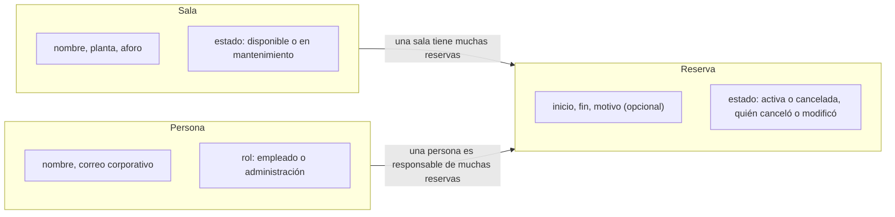

# Plan técnico: ReservaSalas

> [!NOTE]
> Este fichero es el **plan técnico** (`plan.md`): cómo vamos a construir lo que pide la especificación. Es el paso 3 del flujo SDD (*Spec-Driven Development*, desarrollo guiado por especificaciones) y se genera con `/speckit.plan` indicando la tecnología elegida. En un proyecto real Spec Kit reparte el resultado en `plan.md`, `research.md`, `data-model.md`, `contracts/` y `quickstart.md`; aquí los resumimos todos en un único fichero.

**Carpeta/rama:** `specs/001-reserva-salas/` · **Fecha:** 2026-10-08 · **Especificación:** [spec.md](spec.md) · **Constitución:** [constitution.md](constitution.md)

**Entrada (instrucción de Luis):** «Aplicación web sencilla con Python 3.12 y FastAPI, base de datos SQLite y páginas HTML con plantillas Jinja2. Pruebas con pytest. Sin frontend complejo: nada de frameworks de JavaScript».

**Qué vas a encontrar**

- [Resumen](#resumen-summary)
- [Contexto técnico](#contexto-técnico-technical-context)
- [Comprobación contra la constitución](#comprobación-contra-la-constitución-constitution-check)
- [Decisiones y alternativas](#decisiones-y-alternativas-researchmd)
- [Modelo de datos](#modelo-de-datos-data-modelmd)
- [Contratos](#contratos-contracts)
- [Estructura del proyecto](#estructura-del-proyecto-project-structure)
- [Riesgos](#riesgos)
- [Arranque rápido](#arranque-rápido-quickstartmd)
- [Registro de complejidad](#registro-de-complejidad-complexity-tracking)

## Resumen (Summary)

ReservaSalas será una aplicación web de una sola pieza: un servicio en Python (FastAPI) que sirve páginas HTML generadas en el servidor con Jinja2 y guarda los datos en un fichero SQLite. Toda la lógica de negocio (disponibilidad, solapamientos, límites de horario y antelación, permisos) vive en un módulo de servicios con pruebas unitarias propias; las rutas solo reciben la petición, llaman al servicio y devuelven la respuesta. Los avisos se envían por el servidor de correo corporativo. Sin JavaScript: los formularios HTML funcionan solos.

El recorrido de una petición es siempre el mismo: el navegador la envía, el acceso corporativo le añade la identidad de la persona, la ruta la pasa al servicio correspondiente, el servicio aplica las reglas y lee o escribe en SQLite a través del repositorio y, cuando toca, envía el correo de aviso.

## Contexto técnico (Technical Context)

| Aspecto | Decisión |
|---|---|
| **Lenguaje y versión** | Python 3.12 |
| **Dependencias principales** | FastAPI, Uvicorn (servidor), Jinja2 (plantillas HTML), `python-multipart` (lectura de los formularios que envían las páginas), `sqlite3` de la biblioteca estándar |
| **Almacenamiento** | SQLite, un único fichero `reservasalas.db` |
| **Pruebas** | pytest + `httpx` (cliente de pruebas de FastAPI) |
| **Plataforma** | Servidor Linux interno; acceso desde el navegador de la empresa (escritorio y móvil) |
| **Tipo de proyecto** | Aplicación web de un solo proyecto (sin frontend separado) |
| **Objetivos de rendimiento** | Listado de disponibilidad en menos de 2 s (CE-004); el resto de pantallas por debajo de 1 s |
| **Restricciones** | Sin integración con el calendario corporativo. Solo dos sistemas que ya existen en la empresa: el acceso corporativo, que pone la identidad de la persona en cada petición, y el servidor de correo, para los avisos. Sin servicios ni JavaScript de terceros; textos en castellano. La aplicación solo escucha en la red interna, detrás del acceso corporativo (ver «Decisiones y alternativas») |
| **Escala** | 12 salas, unas 200 personas, decenas de reservas al día, un año de histórico (unas 10 000 filas) |

## Comprobación contra la constitución (Constitution Check)

Puerta de entrada: se comprueba antes de investigar y se vuelve a comprobar al terminar el diseño.

| Principio | Cómo lo cumple este plan | Estado |
|---|---|---|
| 1. Sencillez primero | Un solo proceso, una sola base de datos en fichero, sin frontend separado ni cola de mensajes. Cuatro páginas y seis rutas de API; la API es la única pieza que no pide la especificación y se justifica en el «Registro de complejidad». | Cumple (con una desviación justificada) |
| 2. Accesible y en castellano | HTML generado en el servidor con formularios estándar (funcionan sin JavaScript y con lector de pantalla). Todos los textos y mensajes de error en castellano, definidos en un único módulo; cada error dice qué ha pasado y qué puede hacer la persona. | Cumple |
| 3. Pruebas antes de dar algo por hecho | Cada historia tiene pruebas de contrato e integración escritas antes que el código; las reglas de negocio tienen pruebas unitarias. `pytest` en cada entrega. | Cumple |
| 4. Datos mínimos | La tabla `persona` tiene solo nombre, correo y rol. No hay registro de actividad por persona ni campos «por si acaso». | Cumple |
| 5. Transparencia | `reserva.persona_id` es obligatorio; el nombre del responsable se muestra en todas las vistas; las cancelaciones y las modificaciones guardan quién las hizo (`cancelada_por`, `modificada_por`). | Cumple |

## Decisiones y alternativas (research.md)

| Decisión | Justificación | Alternativas consideradas |
|---|---|---|
| Páginas HTML generadas en el servidor (Jinja2) | Es lo más sencillo que cumple la especificación; funciona sin JavaScript y es fácil de hacer accesible. | Una aplicación de página única en JavaScript: más piezas, más dependencias, y no aporta nada a una aplicación de formularios. |
| SQLite en un fichero | Volumen pequeño (decenas de reservas al día). Sin servidor de base de datos que instalar ni mantener. Copia de seguridad = copiar un fichero. | PostgreSQL: más robusto para cargas grandes, pero añade un servicio que mantener. Se podrá migrar si crece el uso. |
| Identificación por correo corporativo | El acceso único de la empresa añade a cada petición la cabecera `X-Usuario` con el correo de la persona; la aplicación lo lee y busca (o crea) la persona. La aplicación solo escucha en la interfaz interna, detrás del acceso corporativo, que elimina cualquier `X-Usuario` que envíe el navegador y la sustituye por la identidad autenticada; en producción `RESERVASALAS_USUARIO_DEV` está vacía y se rechazan las peticiones sin identidad. En desarrollo esa variable simula el acceso. Quién tiene permisos de administración se fija en la variable `RESERVASALAS_ADMINISTRACION` (lista de correos); al resolver la persona se le asigna el rol que le toca. | Gestionar usuarios y contraseñas propias: choca con el principio 4 y con la restricción de no gestionar contraseñas. Guardar el rol a mano en la base de datos: nadie sabría cómo dar de alta a la segunda persona administradora. |
| Solapamiento comprobado en una sola transacción | La comprobación «¿hay otra reserva activa de esta sala con inicio anterior a mi fin y fin posterior a mi inicio?» y la inserción se ejecutan dentro de una transacción abierta con `BEGIN IMMEDIATE` (el servicio controla las transacciones: conexión con `isolation_level=None` y `BEGIN IMMEDIATE` explícito antes de la consulta). Así la transacción toma el bloqueo de escritura antes de comprobar: si dos personas confirman a la vez, la segunda espera, después ve la reserva ya guardada y recibe el rechazo por solapamiento. Garantiza CE-002 incluso con dos personas a la vez. | Transacción normal (`BEGIN DEFERRED`, la que abre `sqlite3` por defecto): las dos peticiones leerían «libre» a la vez y la segunda fallaría con un error de bloqueo en vez de con el rechazo limpio que pide RF-005. Bloqueo optimista con reintentos: más complejo e innecesario con este volumen. |
| Correo por el servidor corporativo (`smtplib`) | Cumple RF-011 con un sistema que ya existe en la empresa y que la constitución permite usar, sin servicios de terceros. En pruebas se sustituye por un envío simulado que guarda los correos en memoria. | Servicio de correo en la nube: dependencia externa y datos personales fuera de la empresa. |
| Fechas y horas en hora local, guardadas como texto ISO 8601 | Una sola sede y una sola zona horaria (supuesto de la especificación). Comparar textos ISO es suficiente para detectar solapamientos. | Guardar en UTC: correcto en general, pero añade conversiones que aquí no aportan nada. |

## Modelo de datos (data-model.md)

El diagrama muestra las tres entidades de la especificación y cómo se relacionan.



De izquierda a derecha: una sala tiene muchas reservas y una persona es responsable de muchas reservas. Cada reserva pertenece exactamente a una sala y a una persona; es la pieza central y la única que cambia a menudo.

### Tablas

**`sala`** (12 filas fijas, cargadas al arrancar)

| Campo | Tipo | Reglas |
|---|---|---|
| `id` | entero | clave primaria |
| `nombre` | texto | único; Mediterráneo, Cantábrico, Atlántico, Báltico, Egeo, Adriático, Jónico, Tirreno, Caribe, Índico, Ártico, Mar del Norte |
| `planta` | entero | 1, 2 o 3 |
| `aforo` | entero | mayor que 0 |
| `estado` | texto | `disponible` o `mantenimiento` (RF-007, RF-009) |

**`persona`**

| Campo | Tipo | Reglas |
|---|---|---|
| `id` | entero | clave primaria |
| `nombre` | texto | obligatorio |
| `correo` | texto | único; identifica a la persona (principio 4: nada más) |
| `rol` | texto | `empleado` (por defecto) o `administracion` (RF-009, RF-010) |

**`reserva`**

| Campo | Tipo | Reglas |
|---|---|---|
| `id` | entero | clave primaria |
| `sala_id` | entero | obligatorio; referencia a `sala` |
| `persona_id` | entero | obligatorio; referencia a `persona` (principio 5) |
| `inicio`, `fin` | texto ISO 8601 (`2026-10-22T10:00`) | `fin` posterior a `inicio`; dentro de 08:00-20:00; duración máxima 4 h; `fin` en el futuro; `inicio` como máximo 30 días después de hoy (RF-006) |
| `motivo` | texto | opcional, máximo 120 caracteres |
| `estado` | texto | `activa` o `cancelada` |
| `cancelada_por` | entero | opcional; referencia a `persona`; se rellena al cancelar (principio 5) |
| `modificada_por` | entero | opcional; referencia a `persona`; se rellena al modificar, con quien hizo el último cambio (principio 5) |

Regla de integridad principal (CE-002): no pueden existir dos reservas con `estado = activa`, la misma `sala_id` y franjas que se crucen (`inicio_a < fin_b` y `fin_a > inicio_b`). Se comprueba en el servicio dentro de la misma transacción que la escritura, abierta con `BEGIN IMMEDIATE` para que dos peticiones simultáneas no lean «libre» a la vez (RF-005). Índice en `(sala_id, inicio)` para que el listado cumpla CE-004.

### Estados

- **Reserva:** `activa` → `cancelada` (RF-008, RF-010). No se borran filas: así «Mis reservas» y el histórico siguen siendo coherentes. Modificar una reserva cambia `inicio` y `fin` sin cambiar de estado y guarda en `modificada_por` quién hizo el cambio.
- **Sala:** `disponible` ↔ `mantenimiento` (RF-009). Al pasar a mantenimiento no se tocan las reservas existentes.

## Contratos (contracts/)

La aplicación expone una pequeña API JSON bajo `/api/` que usan las pruebas de contrato, y páginas HTML que usan las personas. Ambas llaman a los mismos servicios (la API es una pieza de más respecto a la especificación; se justifica en el «Registro de complejidad»). La persona se identifica por la cabecera `X-Usuario` (correo corporativo), que solo puede poner el acceso corporativo: la aplicación no es accesible sin pasar por él.

| Ruta | Método | Historia | Requisitos |
|---|---|---|---|
| `/api/salas` | GET | HU1 | RF-001, RF-002, RF-004, RF-007 |
| `/api/reservas` | POST | HU1 | RF-003, RF-004, RF-005, RF-006, RF-007, RF-011 |
| `/api/reservas/{id}` | PUT, DELETE | HU2 | RF-008, RF-010, RF-011 |
| `/api/mis-reservas` | GET | HU3 | RF-012 |
| `/api/hoy` | GET | HU3 | RF-004, RF-012 |
| `/api/salas/{id}/mantenimiento` | PUT | Administración | RF-009 |

Páginas HTML: `/` (disponibilidad y formulario de reserva), `/reservas/{id}` (detalle, cancelar y modificar), `/mis-reservas` y `/hoy` (reservas de hoy por sala).

### 1. Listar salas y disponibilidad: `GET /api/salas`

Petición: `GET /api/salas?fecha=2026-10-22&inicio=10:00&fin=11:00`. Sin parámetros devuelve la lista de salas sin disponibilidad (RF-001).

Respuesta `200`:

```json
{
  "franja": {"fecha": "2026-10-22", "inicio": "10:00", "fin": "11:00"},
  "salas": [
    {"id": 1, "nombre": "Mediterráneo", "planta": 1, "aforo": 8, "estado": "disponible", "libre": true},
    {"id": 5, "nombre": "Báltico", "planta": 2, "aforo": 12, "estado": "disponible", "libre": false,
     "ocupadas": [{"inicio": "10:30", "fin": "11:30", "responsable": "Marta"}]},
    {"id": 11, "nombre": "Ártico", "planta": 3, "aforo": 4, "estado": "mantenimiento", "libre": false}
  ]
}
```

### 2. Crear una reserva: `POST /api/reservas`

Petición (con cabecera `X-Usuario: marta@empresa.example`):

```json
{"sala_id": 1, "inicio": "2026-10-22T10:00", "fin": "2026-10-22T11:00", "motivo": "Reunión semanal"}
```

Respuesta `201` (RF-003, RF-004):

```json
{
  "id": 57, "sala": "Mediterráneo", "fecha": "2026-10-22", "inicio": "10:00", "fin": "11:00",
  "responsable": {"nombre": "Marta", "correo": "marta@empresa.example"},
  "mensaje": "Reserva confirmada: Mediterráneo, jueves 22 de octubre, de 10:00 a 11:00"
}
```

Errores (cada mensaje dice qué ha pasado y qué puede hacer la persona, como pide el principio 2): `409` si se solapa (RF-005), con `{"error": "solapamiento", "mensaje": "Mediterráneo ya está reservada de 10:30 a 11:30. Prueba otra franja o elige otra sala.", "ocupadas": [{"inicio": "10:30", "fin": "11:30"}]}`; `400` si incumple un límite de RF-006, con `{"error": "limite", "mensaje": "La duración máxima es de 4 horas. Elige una franja más corta."}` (se reserva el `422` para lo que FastAPI rechaza por su cuenta: cuerpos mal formados, con otra estructura de error); `409` si la sala está en mantenimiento (RF-007), con `{"error": "mantenimiento", "mensaje": "Ártico está en mantenimiento y no admite reservas. Elige otra sala."}`.

### 3. Cancelar una reserva: `DELETE /api/reservas/{id}`

Petición: `DELETE /api/reservas/57` con cabecera `X-Usuario`.

Respuesta `200` (RF-008): `{"id": 57, "estado": "cancelada", "mensaje": "Reserva cancelada: Mediterráneo, jueves 22 de octubre, de 10:00 a 11:00"}`. Si quien cancela es administración, la respuesta incluye `"cancelada_por": "Ana (administración)"`.

Error `403` si la persona no es la responsable ni administración (RF-010): `{"error": "sin_permiso", "mensaje": "Solo Marta o administración pueden cancelar esta reserva. Si la necesitas, habla con Marta."}`.

Modificar usa `PUT /api/reservas/{id}` con el cuerpo `{"inicio": "…", "fin": "…", "motivo": "…"}` (no se cambia de sala: para eso se cancela y se reserva otra) y las mismas respuestas que crear (`200`, `409`, `400`, `403`); si falla, la reserva original no cambia. Al modificar se guarda en `modificada_por` quién hizo el cambio (principio 5); si es administración, la respuesta incluye `"modificada_por": "Ana (administración)"`.

### 4. Mis reservas: `GET /api/mis-reservas`

Respuesta `200` (RF-012): solo las reservas activas y futuras de la persona identificada, ordenadas por fecha.

```json
{
  "mis_reservas": [{"id": 57, "sala": "Mediterráneo", "fecha": "2026-10-22", "inicio": "10:00", "fin": "11:00"}]
}
```

### 5. Reservas de hoy por sala: `GET /api/hoy`

Respuesta `200` (RF-004, RF-012): las 12 salas, cada una con sus reservas activas del día y el nombre de la persona responsable.

```json
{
  "fecha": "2026-10-22",
  "salas": [
    {"sala": "Atlántico", "reservas": [{"inicio": "09:00", "fin": "10:00", "responsable": "Jorge"}]},
    {"sala": "Báltico", "reservas": []}
  ]
}
```

En todos los casos, el correo del RF-011 se envía después de confirmar la escritura; si el envío falla, la reserva se mantiene y el fallo queda en el registro de la aplicación.

## Estructura del proyecto (Project Structure)

Documentación de esta funcionalidad: todo cuelga de `specs/001-reserva-salas/` (`spec.md`, `plan.md`, `research.md`, `data-model.md`, `quickstart.md`, `contracts/`, `checklists/requirements.md` y, tras `/speckit.tasks`, `tasks.md`). La constitución está en `.specify/memory/constitution.md`.

Código fuente:

```text
reserva-salas/
├── pyproject.toml                  # dependencias: fastapi, uvicorn, jinja2, python-multipart; dev: pytest, httpx
├── README.md                       # guía rápida de arranque y configuración del despliegue
├── datos/salas.sql                 # las 12 salas con planta y aforo
├── docs/                           # resultados de la fase de remate: prueba-con-usuarios.md, revision-constitucion.md
├── src/reservasalas/
│   ├── app.py                      # crea la aplicación FastAPI y registra las rutas
│   ├── config.py                   # ruta de la base de datos, correo, usuario de desarrollo, lista de administración
│   ├── db.py                       # conexión SQLite, creación de tablas, carga de salas
│   ├── modelos.py                  # Sala, Reserva, Persona (dataclasses)
│   ├── repositorio.py              # consultas SQL
│   ├── identidad.py                # lee X-Usuario y resuelve la Persona
│   ├── textos.py                   # todos los mensajes en castellano
│   ├── servicios/                  # disponibilidad.py, reservas.py (límites, permisos), correo.py
│   ├── rutas/                      # api.py (/api/...) y paginas.py (páginas HTML)
│   ├── plantillas/                 # base.html, disponibilidad.html, reserva.html, mis_reservas.html, hoy.html
│   └── estatico/estilo.css
└── tests/
    ├── conftest.py                 # base de datos temporal, cliente de pruebas, correo simulado
    ├── unitarias/                  # test_solapamiento.py, test_limites.py, test_permisos.py
    ├── contrato/                   # test_api_salas.py, test_api_reservas.py, test_api_mis_reservas.py, test_api_hoy.py
    └── integracion/                # test_hu1_reservar.py, test_hu2_cancelar_modificar.py, test_hu3_ver.py
```

**Decisión de estructura:** un solo proyecto Python, con la lógica de negocio en `servicios/` separada de las rutas para que las pruebas unitarias no necesiten arrancar el servidor web. Las plantillas y los textos están en módulos propios para cumplir el principio 2 sin repartir cadenas por todo el código.

## Riesgos

- **El servidor de correo falla:** la reserva se guarda igual y el fallo queda en el registro de la aplicación (RF-011 no bloquea RF-003). Durante las primeras semanas se revisa ese registro a diario.
- **Crece el volumen:** si SQLite se queda corto (muchas más de 200 personas o varias sedes), se migra a PostgreSQL. El SQL está concentrado en `repositorio.py` para que el cambio no toque los servicios.
- **Identidad suplantada:** si la aplicación quedara accesible sin pasar por el acceso corporativo, cualquiera podría enviar la cabecera `X-Usuario` a mano. Por eso solo escucha en la red interna y, sin identidad, rechaza la petición (ver «Decisiones y alternativas»).

## Arranque rápido (quickstart.md)

Requisitos: Python 3.12 (si tienes otra versión, instala esta con `uv python install 3.12`) y `uv` (o `pip`).

En Linux o macOS:

```bash
git clone <url-del-repositorio-interno> reserva-salas
cd reserva-salas
uv venv && source .venv/bin/activate
uv pip install -e ".[dev]"
export RESERVASALAS_USUARIO_DEV="luis@empresa.example"   # simula el acceso corporativo
uvicorn reservasalas.app:app --reload
```

En Windows (PowerShell):

```powershell
git clone <url-del-repositorio-interno> reserva-salas
cd reserva-salas
uv venv; .venv\Scripts\activate
uv pip install -e ".[dev]"
$env:RESERVASALAS_USUARIO_DEV = "luis@empresa.example"   # simula el acceso corporativo
uvicorn reservasalas.app:app --reload
```

Si PowerShell no te deja activar el entorno («la ejecución de scripts está deshabilitada en este sistema»), no hace falta activarlo: sáltate `.venv\Scripts\activate` (`uv pip install` encuentra la carpeta `.venv` por su cuenta) y llama al Python del entorno directamente:

```powershell
.venv\Scripts\python -m uvicorn reservasalas.app:app --reload
.venv\Scripts\python -m pytest
```

Abre <http://localhost:8000>. Deberías ver las 12 salas con su planta y su aforo.

Escenario de validación de extremo a extremo (historia 1):

1. Indica mañana de 10:00 a 11:00 y pulsa «Ver disponibilidad»: todas las salas aparecen libres salvo las que estén en mantenimiento.
2. Elige Mediterráneo y confirma: aparece «Reserva confirmada: Mediterráneo, …» con tu nombre como responsable.
3. Repite la misma franja: Mediterráneo aparece ocupada de 10:00 a 11:00 con tu nombre.
4. Intenta reservar de 09:00 a 14:00: la aplicación rechaza la reserva e indica que el máximo son 4 horas.

Pruebas automáticas:

```bash
pytest                    # toda la batería; tiene que pasar al 100 % (principio 3)
pytest tests/unitarias -q # solo las reglas de negocio, en pocos segundos
```

## Registro de complejidad (Complexity Tracking)

La comprobación contra la constitución, repetida tras diseñar el modelo de datos y los contratos, ha detectado una sola desviación del principio 1, que se justifica en la tabla. El acceso corporativo y el servidor de correo no son desviaciones: son los dos sistemas de la empresa que la constitución permite usar.

| Desviación | Por qué es necesaria | Alternativa más simple descartada porque |
|---|---|---|
| API JSON bajo `/api/` además de las páginas HTML (la especificación solo pide pantallas) | Las pruebas de contrato necesitan respuestas estructuradas para comprobar códigos y mensajes de rechazo (RF-005, RF-006, RF-010) sin depender del HTML. Páginas y API comparten los servicios: no duplican reglas de negocio, solo la capa de entrada. | Probar las páginas HTML directamente: las pruebas se vuelven frágiles (cualquier cambio de maquetación las rompe) y cuesta más saber qué regla ha fallado. |

Otro punto que vigilar durante la implementación es el principio 2: las plantillas HTML tienen que usar etiquetas `<label>` en todos los campos, y los mensajes de error tienen que salir de `textos.py`, no escribirse sueltos en las rutas.

---

⬅️ [Anterior: Lista de verificación](checklist.md) · 🏠 [Índice de la solución](README.md) · ➡️ [Siguiente: Tareas](tasks.md)
