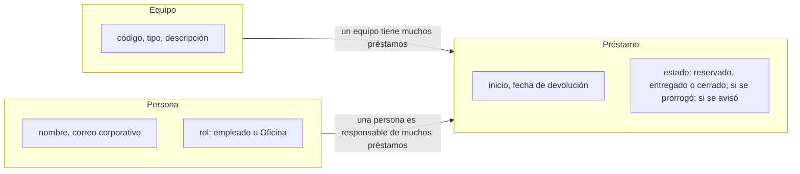

# Plan técnico: PrestamoPortatiles

> [!NOTE]
> Este fichero es el **plan técnico** (`plan.md`): cómo vamos a construir lo que pide la especificación. Es el paso 3 del flujo SDD (*Spec-Driven Development*, desarrollo guiado por especificaciones) y se genera con `/speckit.plan` indicando la tecnología elegida. En un proyecto real Spec Kit reparte el resultado en `plan.md`, `research.md`, `data-model.md` y `quickstart.md`; aquí los resumimos todos en un único fichero. No hay `contracts/` porque la aplicación no ofrece ninguna interfaz a otros sistemas: solo pantallas.

**Carpeta/rama:** `specs/001-prestamo-portatiles/` · **Fecha:** 2026-11-05 · **Especificación:** [spec.md](spec.md) · **Constitución:** [constitution.md](constitution.md)

**Entrada (instrucción de Luis):** «Aplicación web sencilla con Python 3.12 y FastAPI, base de datos SQLite y páginas HTML con plantillas Jinja2. Pruebas con pytest. Sin frontend complejo: nada de frameworks de JavaScript. Sin servicios externos: los avisos salen por el servidor de correo de la empresa».

**Qué vas a encontrar**

- [Resumen](#resumen-summary)
- [Contexto técnico](#contexto-técnico-technical-context)
- [Comprobación contra la constitución](#comprobación-contra-la-constitución-constitution-check)
- [Decisiones y alternativas](#decisiones-y-alternativas-researchmd)
- [Modelo de datos](#modelo-de-datos-data-modelmd)
- [Páginas y acciones](#páginas-y-acciones)
- [Estructura del proyecto](#estructura-del-proyecto-project-structure)
- [Riesgos](#riesgos)
- [Arranque rápido](#arranque-rápido-quickstartmd)
- [Registro de complejidad](#registro-de-complejidad-complexity-tracking)

## Resumen (Summary)

PrestamoPortatiles será una aplicación web de una sola pieza: un servicio en Python (FastAPI) que sirve páginas HTML generadas en el servidor con Jinja2 y guarda los datos en un fichero SQLite. Toda la lógica de negocio (días laborables, solapamientos, límites, prórrogas y avisos) vive en un módulo de servicios con pruebas unitarias propias; las rutas solo reciben la petición, llaman al servicio y devuelven la página. No hay API JSON: la aplicación solo tiene pantallas.

Hay una sola pieza más: un programa pequeño, `python -m prestamo.avisos`, que el programador de tareas del servidor ejecuta cada mañana laborable para enviar los avisos de devolución. Es la única desviación de la sencillez y se justifica en el «Registro de complejidad».

El recorrido de una petición es siempre el mismo: el navegador la envía, el acceso corporativo le añade la identidad de la persona, la ruta la pasa al servicio correspondiente, el servicio aplica las reglas y lee o escribe en SQLite a través del repositorio.

## Contexto técnico (Technical Context)

| Aspecto | Decisión |
|---|---|
| **Lenguaje y versión** | Python 3.12 |
| **Dependencias principales** | FastAPI, Uvicorn (servidor), Jinja2 (plantillas HTML), `python-multipart` (lectura de los formularios que envían las páginas), `sqlite3` de la biblioteca estándar |
| **Almacenamiento** | SQLite, un único fichero `prestamo.db` |
| **Pruebas** | pytest + `httpx` (cliente de pruebas de FastAPI), con un reloj simulado que fija «hoy» para que las reglas de fechas no dependan del día en que se ejecutan |
| **Plataforma** | Servidor Linux interno; acceso desde el navegador de la empresa (escritorio y móvil) |
| **Tipo de proyecto** | Aplicación web de un solo proyecto (sin frontend separado) y un programa de avisos que comparte sus servicios |
| **Objetivos de rendimiento** | Todas las pantallas por debajo de 1 s con los 14 equipos y un año de préstamos; los avisos salen a las 08:00 (CE-004) |
| **Restricciones** | Solo dos sistemas que ya existen en la empresa: el acceso corporativo, que pone la identidad de la persona en cada petición, y el servidor de correo, para los avisos. Sin servicios ni JavaScript de terceros; textos en castellano. La aplicación solo escucha en la red interna, detrás del acceso corporativo |
| **Escala** | 14 equipos, unas 200 personas, decenas de préstamos al mes, un año de histórico (unas 600 filas) |

## Comprobación contra la constitución (Constitution Check)

Puerta de entrada: se comprueba antes de investigar y se vuelve a comprobar al terminar el diseño.

| Principio | Cómo lo cumple este plan | Estado |
|---|---|---|
| 1. Sencillez primero | Un solo proceso web, una sola base de datos en fichero, sin frontend separado, sin API JSON y sin cola de mensajes. Tres pantallas y cuatro acciones. La única pieza que no pide la especificación como pantalla es el programa diario de avisos, que se justifica en el «Registro de complejidad». | Cumple (con una desviación justificada) |
| 2. Datos mínimos | La tabla `persona` tiene solo nombre, correo y rol, y `prestamo` no guarda el motivo. No hay registro de actividad por persona ni campos «por si acaso». La primera versión de este plan proponía guardar el departamento de cada persona y se descartó (ver «Decisiones y alternativas»). | Cumple |
| 3. Pruebas antes de dar algo por hecho | Cada historia tiene su prueba de integración escrita antes que el código, y las reglas de negocio (calendario, solapamiento, límites, prórroga y avisos) tienen pruebas unitarias. `pytest` en cada entrega. | Cumple |
| 4. Responsable visible y fecha de devolución | `prestamo.persona_id`, `prestamo.inicio` y `prestamo.devolucion` son obligatorios: sin una persona y una fecha no se guarda el préstamo. Un préstamo vencido no desaparece: sigue en «Hoy» con su responsable hasta que Oficina registra la devolución. La entrega y la devolución guardan quién las hizo (`entregado_por`, `cerrado_por`). | Cumple |

## Decisiones y alternativas (research.md)

| Decisión | Justificación | Alternativas consideradas |
|---|---|---|
| Páginas HTML generadas en el servidor (Jinja2), sin API JSON | Es lo más sencillo que cumple la especificación; funciona sin JavaScript y es fácil de hacer accesible. Las pruebas de integración usan el cliente de pruebas de FastAPI contra esas mismas páginas y comprueban el estado HTTP y el texto de la respuesta. | Una API JSON con pruebas de contrato aparte, como en otros proyectos: una capa más que nadie ha pedido. Una aplicación de página única en JavaScript: más piezas y más dependencias para una aplicación de formularios. |
| SQLite en un fichero | Volumen pequeño (decenas de préstamos al mes). Sin servidor de base de datos que instalar ni mantener. Copia de seguridad = copiar un fichero. | PostgreSQL: más robusto para cargas grandes, pero añade un servicio que mantener. Se podrá migrar si crece el uso. |
| Identificación por correo corporativo | El acceso único de la empresa añade a cada petición la cabecera `X-Usuario` con el correo de la persona; la aplicación lo lee y busca (o crea) la persona. En producción `PRESTAMO_USUARIO_DEV` está vacía y se rechazan las peticiones sin identidad; en desarrollo esa variable simula el acceso. Quién tiene rol de Oficina se fija en la variable `PRESTAMO_OFICINA` (lista de correos). | Gestionar usuarios y contraseñas propias: choca con la restricción de no gestionar contraseñas. Guardar el rol a mano en la base de datos: nadie sabría cómo dar de alta a la segunda persona de Oficina. |
| Solapamiento comprobado en una sola transacción | La comprobación «¿hay otro préstamo abierto de este equipo con inicio anterior o igual a mi devolución y devolución posterior o igual a mi inicio?» y la inserción se ejecutan dentro de una transacción abierta con `BEGIN IMMEDIATE` (el servicio controla las transacciones: conexión con `isolation_level=None` y `BEGIN IMMEDIATE` explícito antes de la consulta). Si dos personas confirman a la vez, la segunda espera, después ve el préstamo ya guardado y recibe el rechazo por solapamiento. Garantiza CE-002. | Transacción normal (`BEGIN DEFERRED`): las dos peticiones leerían «libre» a la vez y la segunda fallaría con un error de bloqueo en vez de con el rechazo limpio que pide RF-004. |
| Fechas como día (texto ISO 8601, `2026-11-18`) y días laborables calculados en el código | Los préstamos van de día a día, sin horas. Un día laborable es de lunes a viernes, como dice la especificación; el cálculo vive en un solo módulo (`calendario.py`) y es lo primero que se prueba. | Una tabla de festivos: está fuera de alcance de la primera versión y añadiría un dato que alguien tendría que mantener. |
| Aviso con un programa diario que ejecuta el programador de tareas del servidor | RF-009 pide enviar un correo sin que nadie lo pida, y una aplicación web solo actúa cuando alguien hace una petición. El programa usa el mismo repositorio y el mismo envío de correo que la web, así que no duplica reglas. | Un planificador dentro de la propia aplicación (por ejemplo, una biblioteca de tareas programadas): una dependencia y un hilo más que mantener. Que cada persona mire su fecha en la aplicación: no cumple RF-009 (ver «Registro de complejidad»). |
| No guardar el departamento de cada persona | El principio 2 lo prohíbe y ninguna historia ni requisito lo necesita. | Guardar el departamento para contar préstamos por departamento: lo propuso el asistente en la primera versión de este plan y la comprobación contra la constitución lo frenó, porque es un dato personal que nadie ha pedido y permite informes sobre personas concretas. |

## Modelo de datos (data-model.md)

El diagrama muestra las tres entidades de la especificación y cómo se relacionan.



De izquierda a derecha: un equipo tiene muchos préstamos y una persona es responsable de muchos préstamos. Cada préstamo pertenece exactamente a un equipo y a una persona; es la pieza central y la única que cambia a menudo.

### Tablas

**`equipo`** (14 filas fijas, cargadas al arrancar)

| Campo | Tipo | Reglas |
|---|---|---|
| `id` | entero | clave primaria |
| `codigo` | texto | único; PORT-01 a PORT-10 y PROY-01 a PROY-04 |
| `tipo` | texto | `portatil` o `proyector` |
| `descripcion` | texto | obligatorio; por ejemplo, «Portátil de 14 pulgadas con cargador» |

**`persona`**

| Campo | Tipo | Reglas |
|---|---|---|
| `id` | entero | clave primaria |
| `nombre` | texto | obligatorio |
| `correo` | texto | único; identifica a la persona (principio 2: nada más) |
| `rol` | texto | `empleado` (por defecto) u `oficina` (RF-006, RF-007) |

**`prestamo`**

| Campo | Tipo | Reglas |
|---|---|---|
| `id` | entero | clave primaria |
| `equipo_id` | entero | obligatorio; referencia a `equipo` |
| `persona_id` | entero | obligatorio; referencia a `persona` (principio 4) |
| `inicio` | texto ISO 8601 (`2026-11-18`) | obligatorio; día laborable; no anterior a hoy al crearlo (RF-005) |
| `devolucion` | texto ISO 8601 (`2026-11-19`) | obligatorio (principio 4, CE-003); día laborable; no anterior a `inicio`; como máximo diez días laborables desde `inicio`, contando los dos días y la prórroga (RF-005) |
| `estado` | texto | `reservado`, `entregado` o `cerrado` |
| `prorrogado` | 0 o 1 | 1 cuando ya se ha usado la única prórroga (RF-005, RF-008) |
| `aviso_enviado` | 0 o 1 | 1 cuando ya se ha enviado el aviso de la fecha de devolución actual; vuelve a 0 al prorrogar (RF-009) |
| `entregado_por` | entero | opcional; referencia a `persona`; quién marcó la entrega (principio 4) |
| `cerrado_por` | entero | opcional; referencia a `persona`; quién registró la devolución (principio 4) |

Regla de integridad principal (CE-002): no pueden existir dos préstamos con `estado` distinto de `cerrado`, el mismo `equipo_id` y fechas que se crucen (`inicio_a <= devolucion_b` y `devolucion_a >= inicio_b`). Se comprueba en el servicio dentro de la misma transacción que la escritura, abierta con `BEGIN IMMEDIATE`, para que dos peticiones simultáneas no lean «libre» a la vez (RF-004). Índice en `(equipo_id, inicio)`.

### Estados

- **Préstamo:** `reservado` → `entregado` → `cerrado` (RF-006, RF-007). Si nadie recoge el equipo, `reservado` → `cerrado` con la misma acción de devolución. No se borran filas: así «Hoy» y el histórico siguen siendo coherentes y el principio 4 se cumple siempre.
- **Vencido:** no se guarda. Es un préstamo que no está `cerrado` y cuya fecha de devolución es anterior a hoy; sigue ocupando solo sus fechas, así que no bloquea a quien pida el equipo para días posteriores.
- **Prórroga:** alarga `devolucion`, pone `prorrogado` a 1 y `aviso_enviado` a 0 (RF-008, RF-009).
- **Equipo:** no tiene estado propio: libre, prestado o vencido se deduce de sus préstamos y de la fecha de hoy.

## Páginas y acciones

La aplicación solo tiene pantallas. Las acciones son envíos de formularios HTML: si el sistema rechaza una, vuelve a mostrar la página con el mensaje junto al formulario y el estado HTTP que corresponde. Cada mensaje dice qué ha pasado y qué puede hacer la persona.

| Ruta | Método | Historia | Requisitos |
|---|---|---|---|
| `/` | GET | HU1 | RF-002 |
| `/prestamos` | POST | HU1 | RF-003, RF-004, RF-005 |
| `/prestamos/{id}` | GET | HU1, HU2 | RF-006, RF-007, RF-008 |
| `/prestamos/{id}/entrega` | POST | HU1 | RF-006 |
| `/prestamos/{id}/devolucion` | POST | HU2 | RF-007 |
| `/prestamos/{id}/prorroga` | POST | HU2 | RF-004, RF-005, RF-008 |
| `/hoy` | GET | HU3 | RF-001 |

El correo de RF-009 no sale de una ruta, sino del programa `python -m prestamo.avisos` (sección 5).

### 1. Pedir un equipo: `GET /` y `POST /prestamos`

`GET /` muestra el formulario con el tipo de equipo y las fechas. Con `GET /?tipo=portatil&inicio=2026-11-16&devolucion=2026-11-18` lista los equipos libres de ese tipo en ese periodo, cada uno con su código y su descripción (RF-002).

`POST /prestamos` recibe `equipo_id`, `inicio` y `devolucion`, con la identidad de la persona en la cabecera `X-Usuario`. Si todo va bien, guarda el préstamo como `reservado` y redirige a `/prestamos/{id}` con «Préstamo confirmado: PROY-02, del miércoles 18 al jueves 19 de noviembre. Devuélvelo como máximo el jueves 19» (RF-003).

Rechazos: `409` si el equipo no está libre (RF-004), con «PORT-03 no está libre en esas fechas: lo tiene Luis hasta el miércoles 18 y queda libre desde el jueves 19. Prueba otras fechas o elige otro portátil»; `400` si incumple un límite (RF-005), con «Un préstamo puede durar como máximo diez días laborables. Elige unas fechas más cortas» o «Los préstamos empiezan y terminan en día laborable, de lunes a viernes. Elige otras fechas». Se reserva el `422` para lo que FastAPI rechaza por su cuenta: formularios mal formados.

### 2. Entregar: `POST /prestamos/{id}/entrega`

Solo con rol de Oficina (RF-006). Pasa el préstamo de `reservado` a `entregado` y guarda en `entregado_por` quién lo hizo. Una persona sin ese rol no ve el botón en `/prestamos/{id}` y, si envía la petición a mano, recibe `403` con «Solo Oficina puede marcar un préstamo como entregado».

### 3. Devolver y prorrogar: `POST /prestamos/{id}/devolucion` y `POST /prestamos/{id}/prorroga`

La devolución la registra solo Oficina (RF-007): cierra el préstamo, guarda `cerrado_por` y deja el equipo libre. Vale también para un préstamo que nadie recogió.

La prórroga la pide solo la persona responsable, con la nueva fecha en `devolucion` (RF-008). Si se acepta, la fecha cambia y la página muestra la nueva. Rechazos (RF-004 y RF-005): `409` si otro préstamo ocupa el equipo, con «PORT-06 solo está libre hasta el viernes 20: Marta lo tiene desde el lunes 23. Pide una prórroga más corta»; `400` para la segunda prórroga («Un préstamo solo se puede prorrogar una vez»), para pasar del máximo y para un préstamo vencido («Este préstamo ya ha vencido: devuelve el equipo a Oficina»).

### 4. Ver qué hay hoy: `GET /hoy`

Una fila por equipo (RF-001): código, tipo, estado de hoy (libre, prestado o vencido) y, si no está libre, la persona responsable y la fecha de devolución. En los préstamos de quien mira aparece el enlace para prorrogar.

### 5. Avisos: `python -m prestamo.avisos`

Se ejecuta de lunes a viernes a las 08:00 (RF-009). Busca los préstamos `entregado` con `aviso_enviado` a 0 cuya fecha de devolución es el siguiente día laborable (si cae en lunes, se avisa el viernes) o, si un envío anterior falló, hoy mismo; envía un correo a la persona responsable y pone `aviso_enviado` a 1. El correo dice el equipo y la fecha, por ejemplo: «Hola, Marta: el jueves 19 de noviembre tienes que devolver PROY-02 en Oficina. Si necesitas más días, pídelos antes en la aplicación». Si el envío falla, el préstamo no se toca y el aviso se reintenta en la siguiente ejecución mientras no haya pasado la fecha de devolución.

## Estructura del proyecto (Project Structure)

Documentación de esta funcionalidad: todo cuelga de `specs/001-prestamo-portatiles/` (`spec.md`, `plan.md`, `research.md`, `data-model.md`, `quickstart.md`, `checklists/requirements.md` y, tras `/speckit.tasks`, `tasks.md`). La constitución está en `.specify/memory/constitution.md`.

Código fuente:

```text
prestamo-portatiles/
├── pyproject.toml                  # dependencias: fastapi, uvicorn, jinja2, python-multipart; dev: pytest, httpx
├── README.md                       # arranque, configuración del despliegue y programación de los avisos
├── datos/equipos.sql               # los 14 equipos con su código, tipo y descripción
├── docs/                           # autoevaluacion.md, prueba-con-usuarios.md, revision-constitucion.md
├── src/prestamo/
│   ├── app.py                      # crea la aplicación FastAPI y registra las rutas
│   ├── config.py                   # ruta de la base de datos, correo, usuario de desarrollo, lista de Oficina
│   ├── db.py                       # conexión SQLite, creación de tablas, carga de equipos
│   ├── modelos.py                  # Equipo, Persona, Prestamo (dataclasses)
│   ├── repositorio.py              # consultas SQL
│   ├── identidad.py                # lee X-Usuario y resuelve la Persona
│   ├── textos.py                   # todos los mensajes en castellano
│   ├── avisos.py                   # programa diario: python -m prestamo.avisos
│   ├── servicios/                  # calendario.py, disponibilidad.py, prestamos.py (límites, permisos), correo.py
│   ├── rutas/                      # paginas.py (páginas HTML y acciones de los formularios)
│   ├── plantillas/                 # base.html, disponibilidad.html, prestamo.html, hoy.html
│   └── estatico/estilo.css
└── tests/
    ├── conftest.py                 # base de datos temporal, reloj simulado, cliente de pruebas, correo simulado
    ├── unitarias/                  # test_calendario.py, test_reglas_prestamo.py, test_prorroga.py, test_avisos.py
    └── integracion/                # test_hu1_pedir_y_recoger.py, test_hu2_devolver_prorrogar.py, test_hu3_hoy.py
```

**Decisión de estructura:** un solo proyecto Python, con la lógica de negocio en `servicios/` separada de las rutas para que las pruebas unitarias no necesiten arrancar el servidor web, y con el programa de avisos al lado de la aplicación para que los dos usen los mismos servicios. Las plantillas y los textos están en módulos propios para no repartir cadenas por todo el código.

## Riesgos

- **El servidor de correo falla:** el préstamo se guarda igual y el aviso se reintenta en la siguiente ejecución; el fallo queda en el registro del programa (RF-009 no bloquea RF-003). Durante las primeras semanas se revisa ese registro a diario.
- **La tarea programada no se ejecuta** (servidor apagado a las 08:00): el aviso de ese día no sale a tiempo y CE-004 no se cumple. Al ejecutarse de nuevo, el programa envía los avisos pendientes; la comprobación semanal de CE-004 lo detecta.
- **Festivos:** la primera versión no los conoce, así que una fecha de devolución puede caer en un festivo. Oficina lo resuelve a mano al entregar el equipo.
- **Crece el volumen:** si SQLite se queda corto (muchas más de 200 personas o varias sedes), se migra a PostgreSQL. El SQL está concentrado en `repositorio.py` para que el cambio no toque los servicios.
- **Identidad suplantada:** si la aplicación quedara accesible sin pasar por el acceso corporativo, cualquiera podría enviar la cabecera `X-Usuario` a mano. Por eso solo escucha en la red interna y, sin identidad, rechaza la petición.

## Arranque rápido (quickstart.md)

Requisitos: Python 3.12 (si tu equipo tiene otra versión, instálala con `uv python install 3.12`) y `uv` (o `pip`).

En Linux o macOS:

```bash
git clone [url-del-repositorio-interno] prestamo-portatiles
cd prestamo-portatiles
uv venv && source .venv/bin/activate
uv pip install -e ".[dev]"
export PRESTAMO_USUARIO_DEV="luis@empresa.example"   # simula el acceso corporativo
export PRESTAMO_OFICINA="ana@empresa.example"        # quién tiene rol de Oficina
uvicorn prestamo.app:app --reload
```

En Windows (PowerShell):

```powershell
git clone [url-del-repositorio-interno] prestamo-portatiles
cd prestamo-portatiles
uv venv; .venv\Scripts\activate
uv pip install -e ".[dev]"
$env:PRESTAMO_USUARIO_DEV = "luis@empresa.example"   # simula el acceso corporativo
$env:PRESTAMO_OFICINA = "ana@empresa.example"        # quién tiene rol de Oficina
uvicorn prestamo.app:app --reload
```

Si PowerShell no te deja activar el entorno («la ejecución de scripts está deshabilitada en este sistema»), no hace falta activarlo: sáltate `.venv\Scripts\activate` y llama al Python del entorno directamente con `.venv\Scripts\python -m uvicorn prestamo.app:app --reload` y `.venv\Scripts\python -m pytest`.

Abre <http://localhost:8000>. Deberías ver el formulario para pedir un equipo.

Escenario de validación de extremo a extremo (historia 1):

1. Elige «Proyector», indica de mañana a pasado mañana (si es viernes, de lunes a martes) y pulsa «Ver equipos libres»: aparecen los cuatro proyectores.
2. Elige PROY-02 y confirma: aparece «Préstamo confirmado: PROY-02, …» con la fecha máxima de devolución.
3. Repite la misma consulta: PROY-02 ya no aparece entre los equipos libres; los otros tres proyectores, sí.
4. Pide un portátil desde hoy hasta dentro de tres semanas: la aplicación rechaza la petición e indica el máximo de días laborables.

Pruebas automáticas:

```bash
pytest                    # toda la batería; tiene que pasar al 100 % (principio 3)
pytest tests/unitarias -q # solo las reglas de negocio, en pocos segundos
```

Los avisos se comprueban con `pytest tests/unitarias/test_avisos.py`; en el servidor, el `README.md` explica cómo programarlos.

## Registro de complejidad (Complexity Tracking)

La comprobación contra la constitución, repetida tras diseñar el modelo de datos y las páginas, ha detectado una sola desviación del principio 1, que se justifica en la tabla. El acceso corporativo y el servidor de correo no son desviaciones: son los dos sistemas de la empresa que la constitución permite usar.

| Desviación | Por qué es necesaria | Alternativa más simple descartada porque |
|---|---|---|
| Un programa diario de avisos (`python -m prestamo.avisos`) fuera del proceso web, además de la aplicación | RF-009 pide enviar un correo sin que nadie lo pida, y la aplicación web solo actúa cuando alguien hace una petición, así que hace falta algo que se ejecute cada mañana laborable. Usa el programador de tareas que ya tiene el servidor y los mismos servicios que la web: no duplica reglas, solo la capa de entrada. | Que cada persona mire en la aplicación su fecha de devolución: no cumple RF-009 y Ana pidió el aviso expresamente (aclaración 4). |

Otro punto que vigilar durante la implementación es la restricción de accesibilidad: las plantillas HTML tienen que usar etiquetas `<label>` en todos los campos, y los mensajes de error tienen que salir de `textos.py`, no escribirse sueltos en las rutas.

---

⬅️ [Anterior: Especificación](spec.md) · 🏠 [Índice del ejemplo](README.md) · ➡️ [Siguiente: Tareas](tasks.md)
